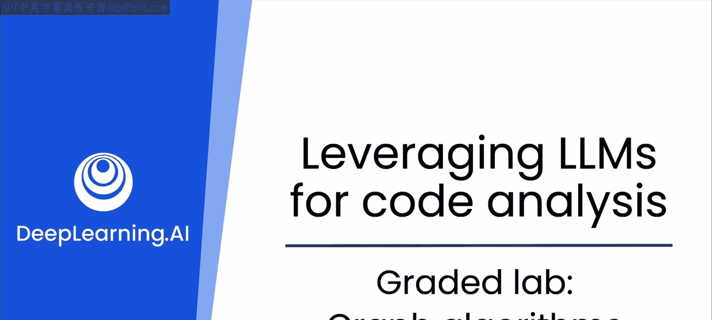
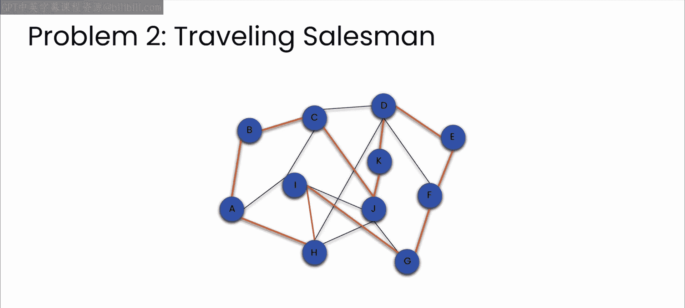

# 吴恩达《软件开发的生成式AI技能（简介、结对编程、数据库设计-3课全）Generative AI for Software Development Skill》 - P22：21_图算法分级实验.zh_en - GPT中英字幕课程资源 - BV1ucxLeUEHD

In all the videos for this module so far， you've seen how you can work with an LLM to implement some fundamental data structures。

 not just the basics from CS101， but also how you would take these structures into the real world with considerations for scalability。

 security and having them well documented and tested。 Now。

 I'd like you to get hands on in the graded lab for this course。

 Your task will be to implement some important algorithms for working with graphs。😊。

Ive provided a graph implementation Gra 3。 pi， which you can use as your starting point。

Now you're going to have two problems to solve and for each， you're going to solve it for two cases。

 First will be with a small graph with about 10 nodes and then for a large graph with thousands of nodes。

The first problem is this， given two vertices of a graph。

 I'd like you to implement an algorithm to calculate the shortest route between them。

 One common solution to this is called Dytra's algorithm。

 and you'll probably learn about others as you chat with the LLM。😊，The second problem is this。

 given a starting vertex， calculate the shortest route to take where you're going to visit all of the vertices in the graph。

😊，A little hint， this is commonly called the travelling salesman problem。

 and this often shows up in job interviews。

Take some time to work on these and test the code created by chat GT thoroughly as you go along Also think through how you're going to make sure that the code is of professional quality and ready for production with attributes like security。

 scalability， manageability and so on。The lab will grade your work by running your code on some test cases。

 there will also be some hints that you can consult in case you get stuck and hopefully the LLM will be a more useful tool as you go through the activity。

When you've completed the lab， I'll see you in the next video to discuss the final data structure of this module。

 the hash table。