# 吴恩达《软件开发的生成式AI技能（简介、结对编程、数据库设计-3课全）Generative AI for Software Development Skill》 - P23：22_哈希表和映射.zh_en - GPT中英字幕课程资源 - BV1ucxLeUEHD

Throughout this module， you've been revisiting and exploring different data types that are used to solve complex problems in programming。

In this lesson， you're going to take a deep dive implementing my favorite data structure。

The hash table or the hash map。It's often quite confusing why there are two different names for effectively the same thing。

If you were to ask five different programmers about this naming convention。

 you'd probably get 10 different answers。 So I'm going to give you mine。

 And that is that the language Java had two different data types and they now mostly obsolete that did roughly the same thing。

 but had different names。 And I believe that led to this current confusion。

So you might hear the terms hash table and hashmap being used interchangeably， and if you do。

 just realize that ultimately there are two terms for roughly the same thing。😊。

And that is a data structure that looks and feels like an array。

 but where the index can be any value， not just a number。So if an array looks like this。

Then an equivalent hash table would look like this。

 And now while it's nice to be a bit more readable。

 this probably isn't the best solution for tracking home runs of players。

 So let's consider another approach。 And this one is a common job interview question。 Actually。

 when I was interviewed at Google， I was asked this one。😊。

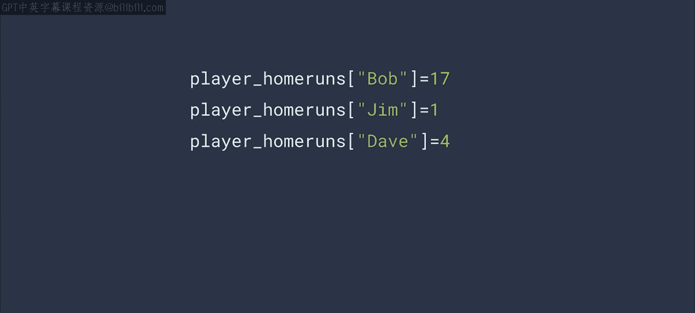

Imagine you have all of the works of Shakespeare in a data sent。

 Your task is to count the instance of each word。 How many times the， how many times ex ya。

 how many ans and all of that。Now， you could see how the algorithm would begin to take shape。

 Sa you begin with the Scottish play。 You know， the one that the actors won't say the name of because of superstition。

 yet， that's the one。It begins like this。The first word is thunder。

 so you could use a hash table like this to track the occurrences。The next word is and。

 so you could do this。😊，And this suggests a pretty simple algorithm。 Go through all the words。

 And if it exists in the hash table， add one to its value。 And if it doesn't。

 then just create it and set it to one。If you do that for every word。

 you'll then have account of each individual word in the corpus。 Easy， right。

The algorithm was easy because the data structure makes it so。Under the hood。

 the Python dictionary object uses a hashing function to turn words like thunderh or and into numeric values。

If you were to implement your own hash table， it's important to understand how hashing functions like that work so that you don't get a conflict。

 For example， if you're counting every individual word in Shakespeare and your hashing function gives the same numeric value for thunder as it does for and。

 then the counts of those words would be mush together。

Creating a hashing function is beyond the scope of this course。

 but it is something that you want to watch out for as you make your code production worthy。

 So let's explore these types of data structures and how you can build bigger and better implementations of them with L L Ms as your coding partner。

 Let's start working with Python and a hash map to solve a problem like the word counting example from earlier。

😊，I'll start with a prompt。 I'm asking the model to write Python code where given a URL。

 the script should download the text at that URL and count every instance of every word。

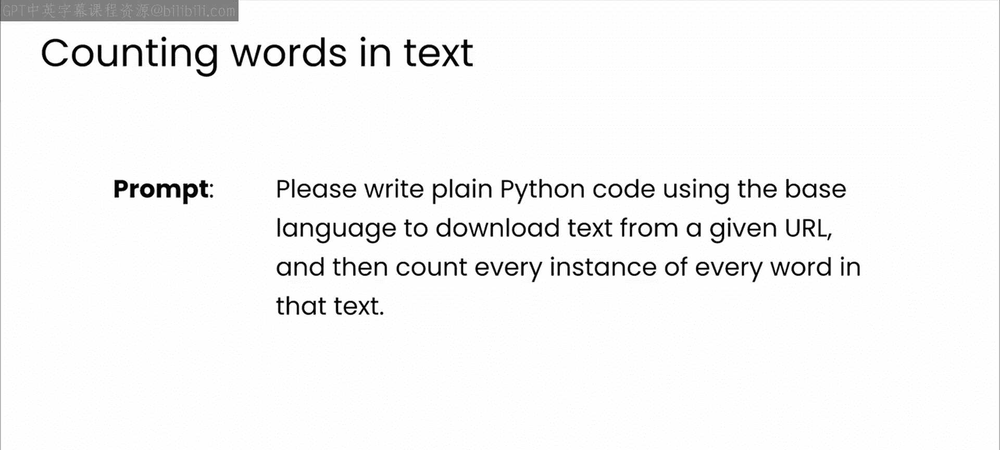

And the model will return something like the Python code that you can see here in count wordss pi。

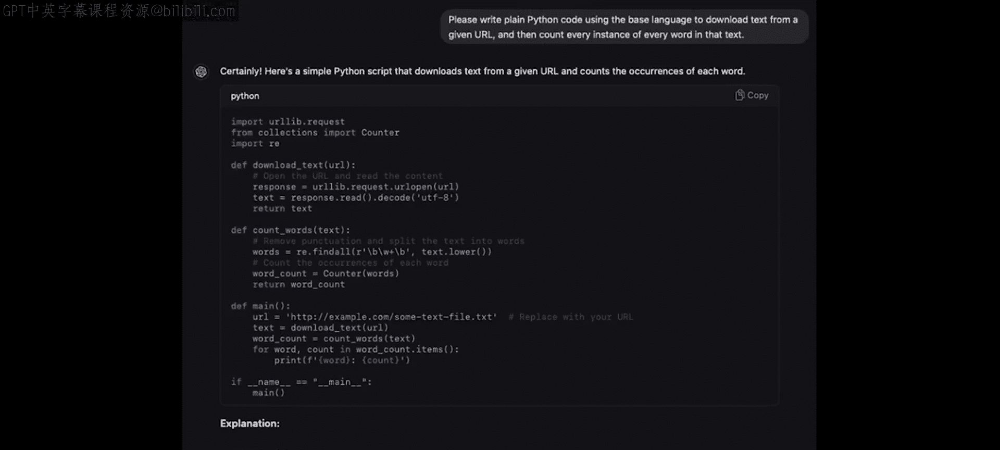

What's interesting is that the LLM imports a type called counter from the library collectionions。

 Now， that's something I probably would not have known unless I was a deep expert in the Python ecosystem。

 and I would likely have just dived in and started hand rolling my own code with an iterator like I did earlier。

😊。

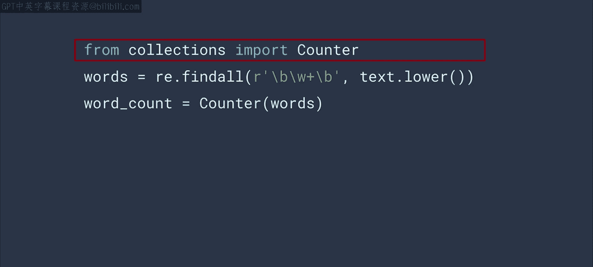

By the way， this is a good moment to remind you that if the LLM suggests code that you're not familiar with。

 you can always ask it to explain the code。

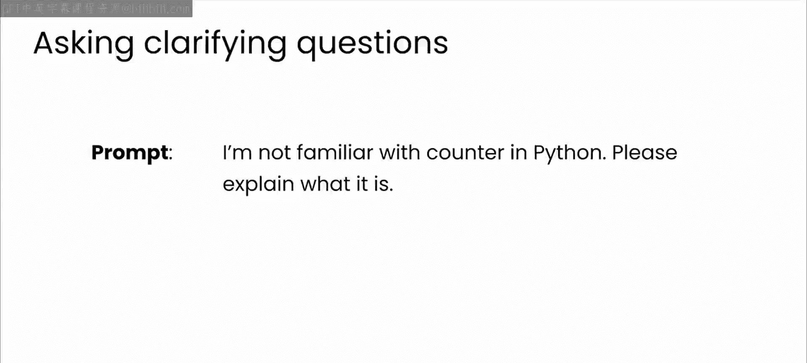

The other thing the model did was use a regular expression to find the occurrence of every word。 Now。

 this is much neater and quicker than iterating through the text the way that I did earlier。

The resulting set of words is then passed to the counter。 and we get the correct results。

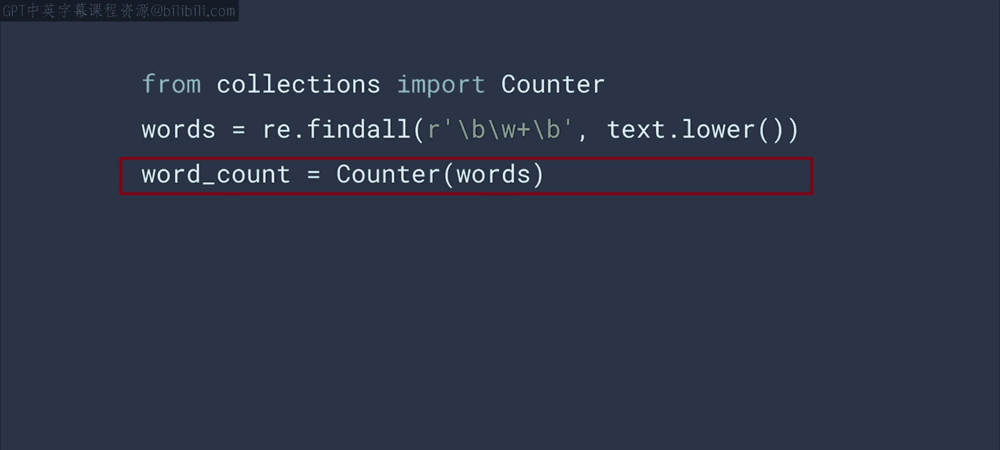

This is great。 The code written by the LLM works， but can you trust it。

 I a counter really the best data structure to use。

 and does the regular expression really work faster or better than what I had envisaged。😊。

I'll be honest。 I don't know。 And I'm guessing you may not either。

So let's work with the LLM to check if this is the best possible solution。 Start with the counter。

 You can simply ask the model why it used it。😊。

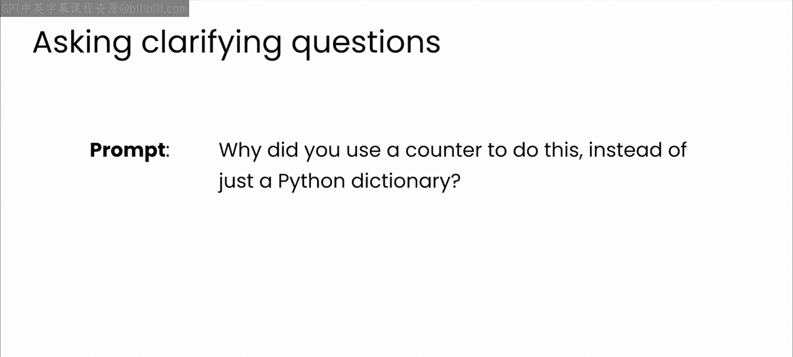

And the answer it responds with is really cool and insightful。 Readability and conciseness。

 having built in methods and default value handling is already there。 So you don't need all of that。

 F else code。 That's pretty cool。😊。

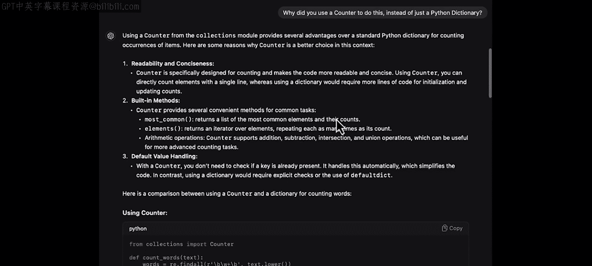

But I'm sure you've realized by now that there's always a follow up question。

 and in this case it's once again about scale。Say you're using a counter in code that counts the words in a single book。

But what about if you want to count the words in millions of books。

 Another option could be a dictionary， but does a count or scale better than a dictionary。Well。

 let's ask the motto what it thinks。

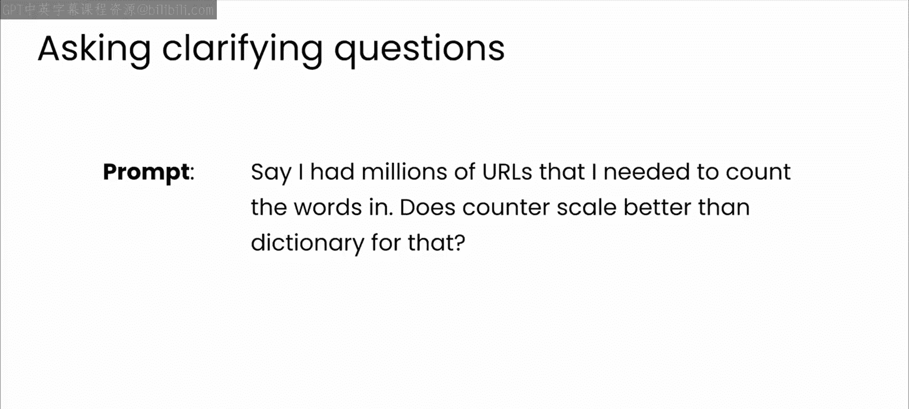

And the answer is that counter is a subclass of dictionary。 So the overhead is pretty much the same。

It also supports a merge function allowing you to merge counters。 So， for example。

 if youre counting multiple books， you could have a counter for each。 And then when you're done。

 you could merge them altogether quite easily。 Well， limited by memory and space， of course。

 but that's a different problem。😊。

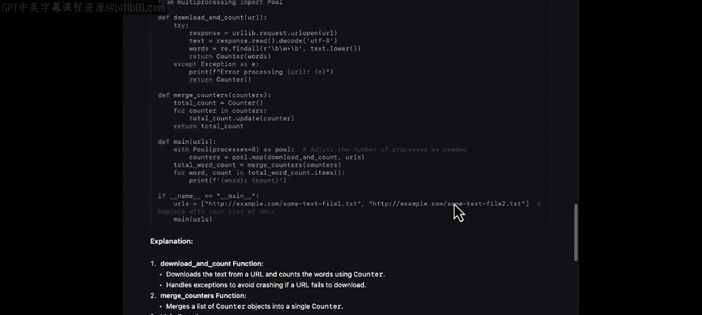

Okay， so now thanks to the YaLM， you can be more confident about using a counter。

But the other question was about regular expressions。

 is that really the most efficient and scalable way to find all the words？

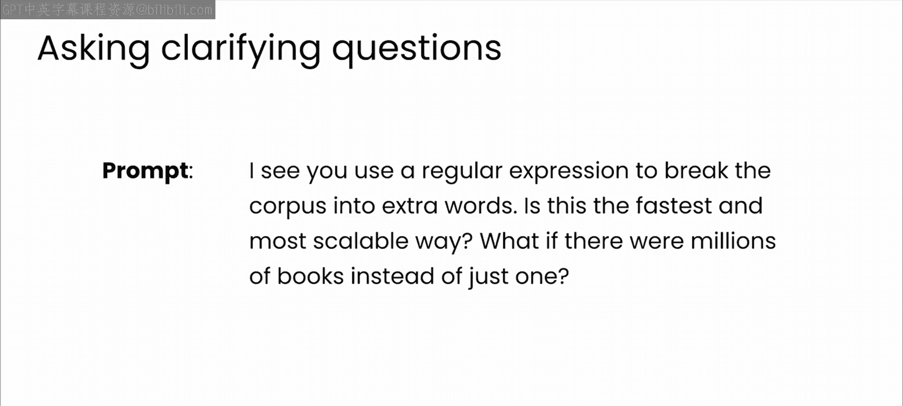

Let's ask。And from the response， you'll learn that using the base string methods might be better for this task。

 but the text has to be relatively clean and follow a consistent structure。So for example。

 splitting it when there's a lot of punctuation characters might be very difficult。

And I think that this would pretty much come down to an it depends situation where the rex might be better for you。

 depending on your data。Remember， no size fits all and bringing your expertise about your system to understand the problem is vital。

 Work with an LLM like this can throw up some great ideas。

 but they're not necessarily always the right ideas for your specific system。

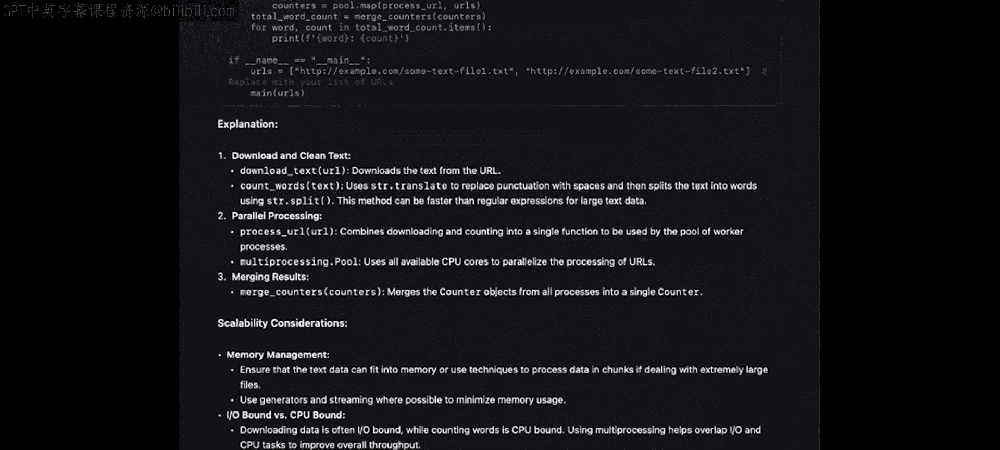

Okay， so now you've started a basic algorithm to count the words in a body of work。

 You started using some basic libraries in Python， such as counter and regular expressions in order to help。

 You've even begun to address the typical follow up question about scaling to larger problems In this case。

 counting word occurrence in all of the works of the English language。

And you ended up with code like that in count T 2t pi， which is in the repo for this course。

 Take a look at the code and think about its vulnerabilities。

Other areas there that might be problematic。Pause the video for a moment and explore the code。

 What do you think？I tried it with G Omni， and it found six potential issues when Heitho thought of three。

The first is unverified URL inputs。 there's no validation or sanitization。

 so how can you trust that list of URLs。For real solution。

 you'll have a list that's likely generated by a web crawler。

 and that could result in a whole new set of problems。

 not least the fact that works could be repeated。The complete works of Shakespeare are online in many different places。

 So how do you avoid multi counting。 Also， how do you avoid stuff getting onto the list that you don't want to index or count。

The second and a little easier issue is error handling。 The code has a catch all for every error。

 but that won't help you fix bugs。 I do think the code could be much better there。 The third， for me。

 was the rex。 It's pretty simple， but it's also quite obscure。

 You do need deep expertise in rex syntax to ensure that it works right。

 And one place that was problematic here is in robustness。

 It might not be able to handle all types of punctuation。GPT also identified concurrency issues。

 resource management and a lack of logging， I'd missed those ones。So how do you fix that？ Well。

 simply ask the model。 You could do something similar with your code。 Always check， test， iterate。

 ask， explore and prompt for more。😊，And one obvious gotcha that I missed。

 even as a very experienced developer， there was no time out on the request to the server。

 so threads could hang for a long time if the distant server didn't respond。

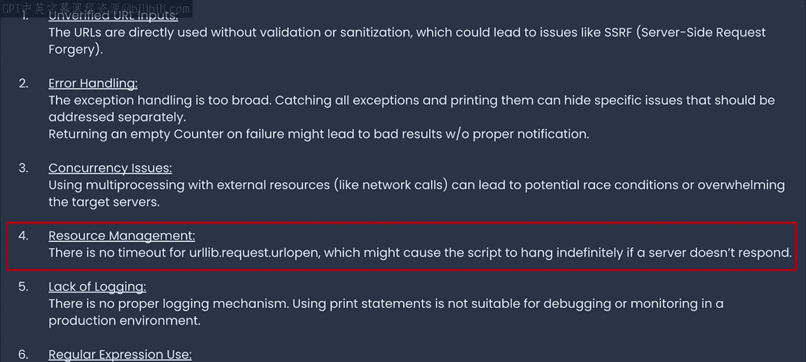

After addressing all of these issues， you should have something like count text 3 dot pi。

 which you can find in the course materials to download。

 I'd love to hear your experience in pair coding with the LLM like this。

 Maybe there's other gotchas in there that we haven't covered。

 Or maybe you can find issues in that file。 despite my repeated prompting for improvement。😊。

Be sure to share them in the course community pages， if you do。By this point。

 you've developed a fairly robust solution to a common computer science problem。

But if you've been following along， you'll probably know what I'm going to suggest next。

That you look at a piece of code like counttex 3。 pi and think about what you would do next。

 how do you make it even better？I'm going to leave that part up to you。

But consider these things that you could do in partnership with your favorite LLM。

 You could write test cases for the code， maybe trying lots of different URLls。

You could see how it would behave for non English languages， would the rex still work。

You could document the code thoroughly。You could refactor the code to work in a different language。

 that could be a programming language or a language that has a different character word set than English。

 such as Japanese。

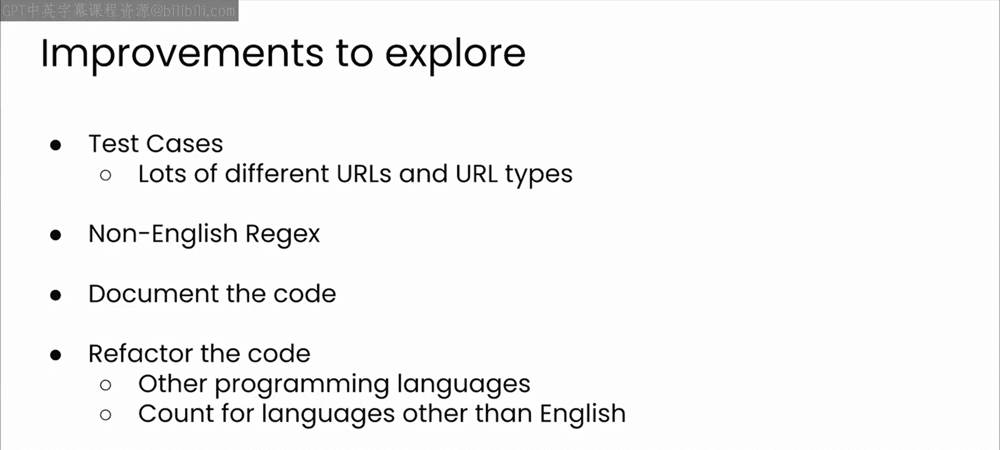

There are so many possibilities。I hope this has inspired you to think about all the ways that you can have longrun conversations with your LLM of choice。

 bringing your expertise together with the models to help you build better code。

 And as I've emphasized throughout this module， LLMs are a great way to think through the kind of problems you'll have to solve in codingd interviews。

 so please use them as you study。😊。