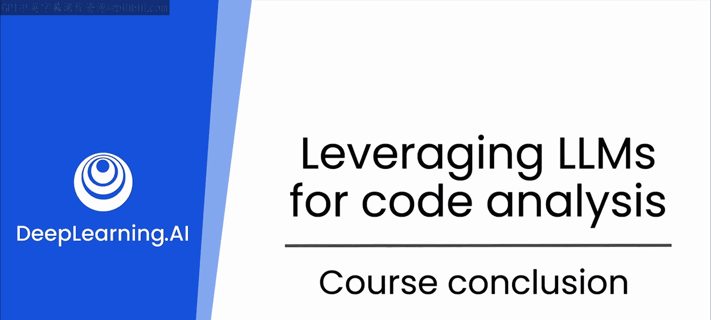
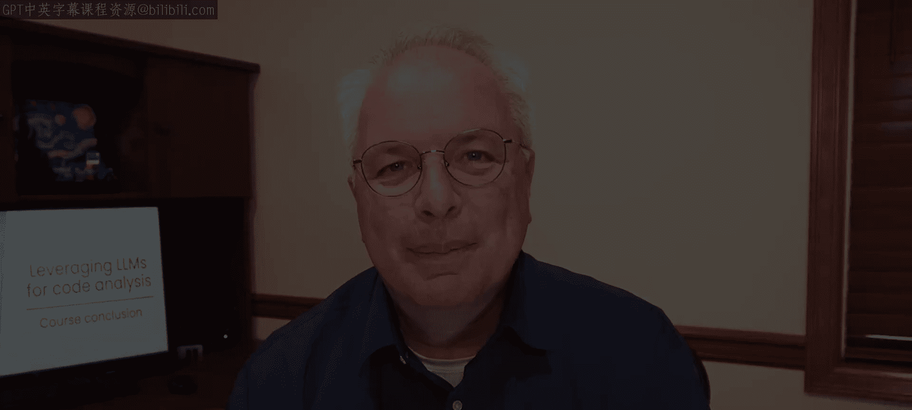

# 吴恩达《软件开发的生成式AI技能（简介、结对编程、数据库设计-3课全）Generative AI for Software Development Skill》 - P24：23_课程总结.zh_en - GPT中英字幕课程资源 - BV1ucxLeUEHD

I hope you've enjoyed this course， and you've come a long way。

 Youve started by looking at what AI is and how machine learning enables you to build artificially intelligent applications。

😊，From there， you looked at how machine learning lets you do this。

 exploring the different types of ML。 This LED to an understanding of transformers。

 the technology that underpins generative AI， such as large language models。

One part of generative AI is its ability to generate and analyze source code。

 and you explored how to leverage that with many software engineering tasks beyond just coding。

 from documentation to debugging and whole lot more。

You then dug into prompting and how with a little work on your prompts。

 you can get the best out of the model。 things like being specific or having the LLM adopt a role or bringing your own expertise to the table to guide it。

 providing feedback to help it do better。😊，You then use data structures as a great example of putting these skills into practice。

 taking very basic and fundamental computer science concepts。

 but stretching them into production scenarios， understanding how to scale， assess vulnerabilities。

 limitations in their implementation， security issues and a whole lot more this stuff is also really useful for software engineering interviews。

😊，And you're really only getting started in this specialization。

 will'll do a lot more digging into using an LLM as your assistant to be a much better developer。

 including using and scaling data， understanding testing and test cases， and a whole lot more。😊。

I'm so excited to share this journey with you。 Thank you。😊。

