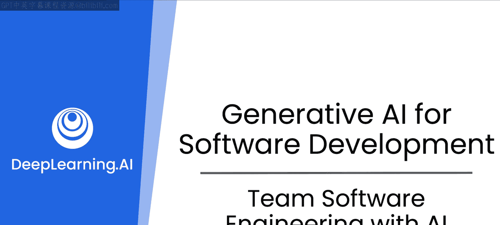

# 吴恩达《软件开发的生成式AI技能（简介、结对编程、数据库设计-3课全）Generative AI for Software Development Skill》 - P25：0_Laurence Moroney与Andrew Ng的对话.zh_en - GPT中英字幕课程资源 - BV1ucxLeUEHD

Welcome to this second course on Genative AI for software Development。

I'm here again with Lawrence Boroi， your instructor for these courses。In the previous course。

 you took a look at how Gen AI works， learn some principles are prompting to help you carry out software dev tasks with the hub of AI and use an LM to help you analyze some foundational data structures and improve the performance as skill In this course you see how ElMS can grease the wheels of collaboration and make you better and all the things that can become pain points as code is passed back and forth between you and others That's right Andrew and in this course one of the things we really wanted to lean into was that theme of working with others and pass andcode back and forth with them and it's going to follow three things the first one will be testing and debugging so helping you write test cases and helping you pass test cases off to your testing team and then documentation allowing you to put the proper comments and the proper formatting of comments so that things such as auto documentation tools can turn that into documentation for you and then of course dependency management everybody's best friend so that you can work not just with thirdparty dependencies。

from outside of your company， but also how you can understand how to integrate dependencies from inside your company and from the people that you work with The dream has always been to have well tested well documented code and the reality is we're all kind of busy and can't always meet that high standard that we aspire to and we encourage others to aspire to as well and genderI is hoping a lot absolutely and it's like I mean I'd like to share one example is that talking about sharing code is that we've done many courses together and by definition when we do courses we share code with the learners and in one of the courses that we worked on we were doing a Tensorflow for mobile applications and in specifically for iOS mobile applications in Swt and if you think about doing image classification for example you have your image as an NS image I believe was the data structure on iOS that you have to convert into Tensors that you then pass to the Tensorflow light that you then get an interpretation back that in tensors that you then have to cast back into native data。

sAnd I wrote the code to do this for simple image classifier and you know in the three weeks between writing the code and then teaching the course。

 I forgot what it did。 I forgot like all how these things worked and it took me a long time to kind of sit down and like work through that and understand it again this was before LLMs so then recently as like working through building this course now where we have LLMs as our parapror I actually took that code and I tried it out and I was able to document it I was able to get an LLM to explain it back to me now it's like three years later that helped me to understand it better and it even found and fix some issues in the code。

 so it's like you know and those are the kind of things that when you share with others or when you inherit from others it's amazing to have that LLM by your side to work it through it with you I think someone said that if you haven't looked at your own code for long enough is as if a stranger had written it and in this case that stranger of your younger self your own code you understand is great I had to look back and tell him off that he didn't。

Great job。And yeah I find that machine learning people are notorious not proud of this but having complex code I think part because machine learning is so iterative。

 we try something works or doesn't work， change it and by the time we finally get to work in prototype you know the codes been iterated on many。

 many times much more than traditional software engineering and so I found that sometimes that documentation you know get a few lines of code from some cloud provider documentation and then a week later I have no idea what I just did and getting some help to understand that code my someone else's code would be very welcome I'm really glad to hear you say that I thought it was just me so with that let's jump in to see how I can help you with testing debugging documentation and dependency management which would make you a better developer I think and also a better teammate to everyone you might work with let's go on to the next video。

😊。

