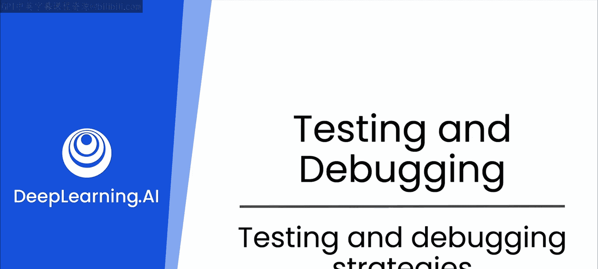
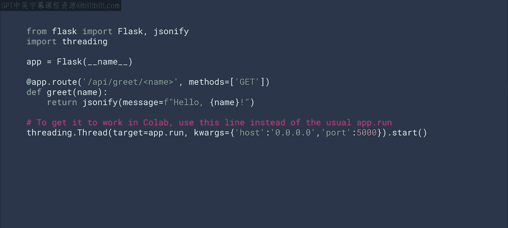
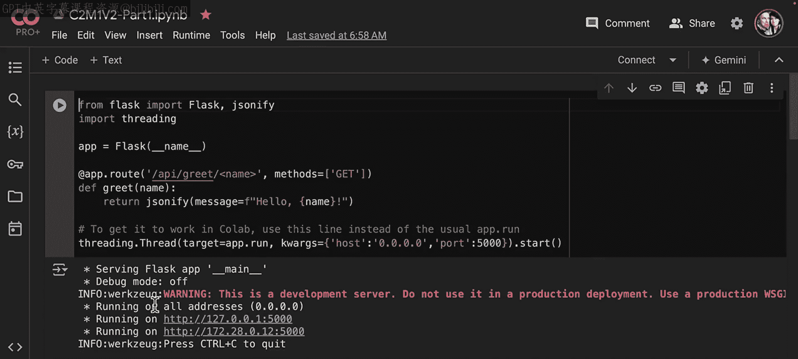
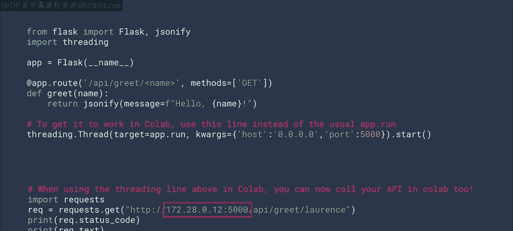
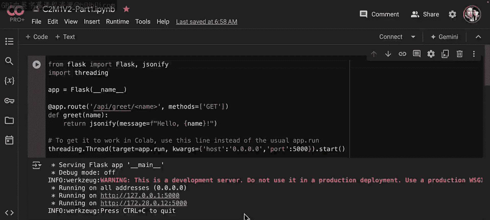
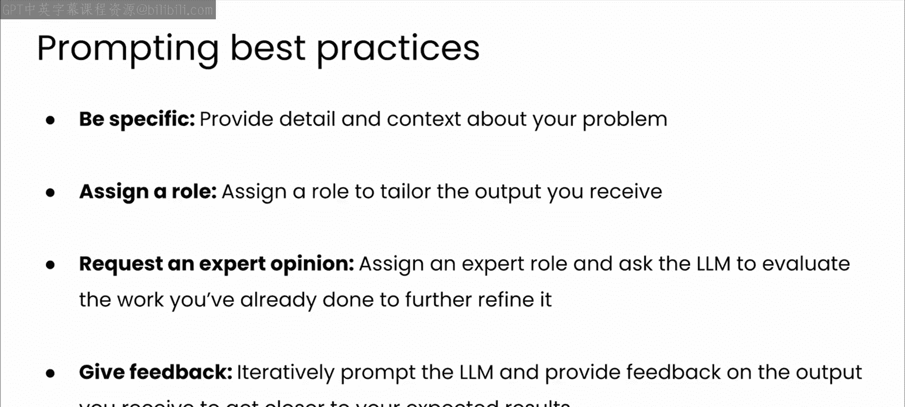
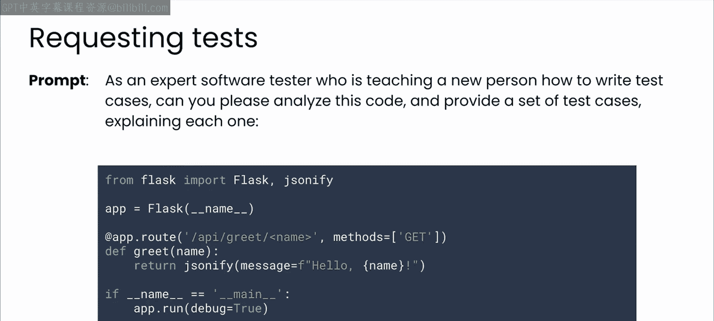
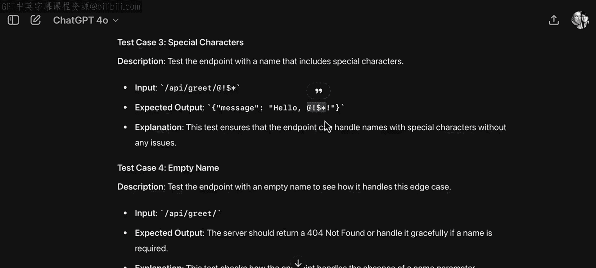
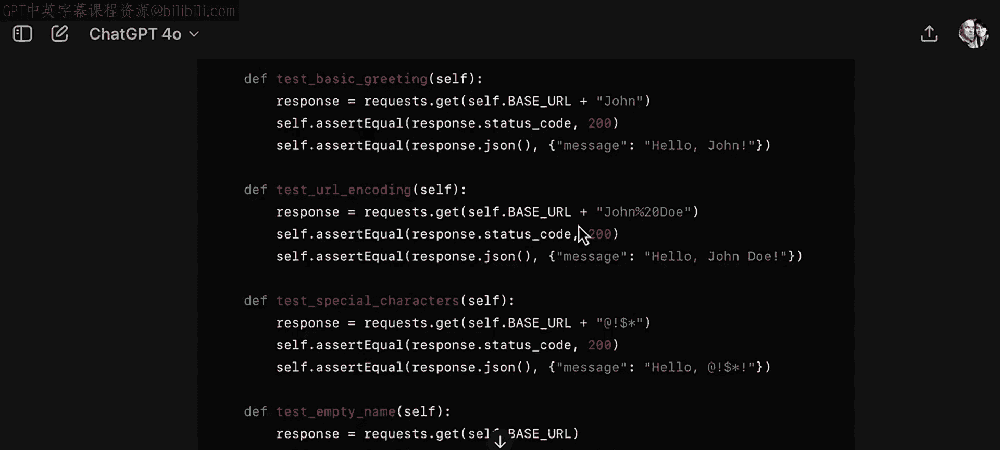
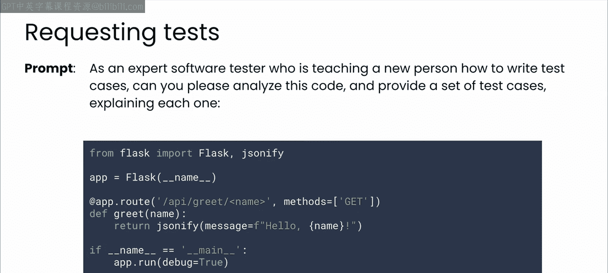

# 吴恩达《软件开发的生成式AI技能（简介、结对编程、数据库设计-3课全）Generative AI for Software Development Skill》 - P27：2_测试和调试策略.zh_en - GPT中英字幕课程资源 - BV1ucxLeUEHD

To begin developing a high level sense of how an LLM can help you think through testing strategies。

 let's begin with a basic Python example。 It's a flask app with a web API Flask。

 if you're notfam with it， is a lightweight web framework for Python and it's perfect for our demonstration。

Let's walk through the code and we'll take a close look at how it works。

 This app has a single endpoint， slash API slash greet slash name。

 and this will take a name as a parameter and return a greeting message。

 If you're running it in a shared environment like coab。

 you have to change it a little to use threading Notes like Jupiter or coab will always finish the code in the current cell before they move on to the next one。

 So if you want to launch a server with an API that you're going to call like we're got to be doing here。

 It does need to run in a separate thread， and that will let you get on with the rest of your notebook。

 You probably would not want to do this in a production environment。

 but for learning purposes with a notebook。 It's perfectly okay。😊。

Once you have a running API， if it's on your server， you can call it with curl。

 or if you want to use Python， you can use requests like this。

And this will be the IP address of your server。

If you're running it in coabab with the threading code。

 CoLab will report back to you the address of the server。

 make sure you use the one that's reported back to you instead of the address that's in the slides。

So now that you have your example up and running， pause the video and think about what test cases you might want to use for your API。

What data might you pass in to check if it's behaving properly and how would you break it。Okay。

 hopefully you came up with a few ideas Now I'd like you to try using GPT or another LLM as your testing partner and see what it comes up with。

😊，In the last course， you practice using a set of prompting best practices to guide the LLM to the output that you wanted。

 Here's a quick recap。You should always be specific in your prompts and provide details and context about your problem。

Assigning a role can help the model tailor the output that you receive。

And taking that a step further by asking the model to behave as an expert and critique your work can help you get really specific well formatted outputs。

😊，And then last， bringing your own expertise into the mix and having that back and forth with the model can help you steer the LLM to write the exact code that you want and need。

 So with these best practices in mind， here's an example prompt that can help you think through testing strategies for that simple web app。

😊。

As an expert software tester who's teaching a new person how to write test cases。

 can you please analyze this code and provide a set of test cases explaining each one？

So here's what I got when I use this prompt with GPT。

 remember LLMs are probabilistic in nature so the exact output that you'll get will depend on a number of factors such as changing random seeds or indeed the model version that you're using。

So it takes a look at my code it analysess my code and understands it it defines what it's doing。

 but more importantly it gives me the test cases。So the first of course， is the basic greeting。

 the basic greeting is/ API/ greetre something， and the expected output will be JON messages。

 hellello， something。The second test case then would be URL encoding handling。

 so if I passed in a string that has a space in it， for example， John Doe。

 it would be percent 20 is the URL encoding of that space。

 but I expect my output not to have the URL encoding and it would just say hello John Doe。

The model goes on to suggest several other test cases like special characters， empty names。

 numeric input and so on All of these are important corner cases to consider and test for scrolling to the bottom of the response you can see the model also included implementations of each of these test cases。

Now， the pro you used to write tests here was pretty generic。

 You didn't specify any particular testing strategy。 For example。

 The tests the LLM suggested here mainly looked at functionality。

 and a pretty representative of the type of manual exploratory testing that you might do during early stage development。

 Let's now move on to the next video to take a more detailed look at exploratory testing。

 And in particular， how you can use an LLM to help you and your colleagues in that process。😊。

