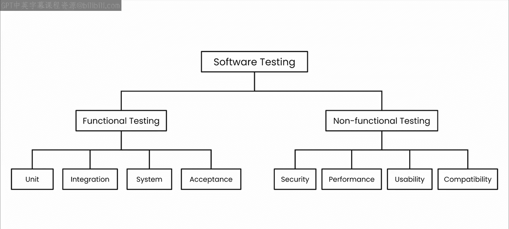
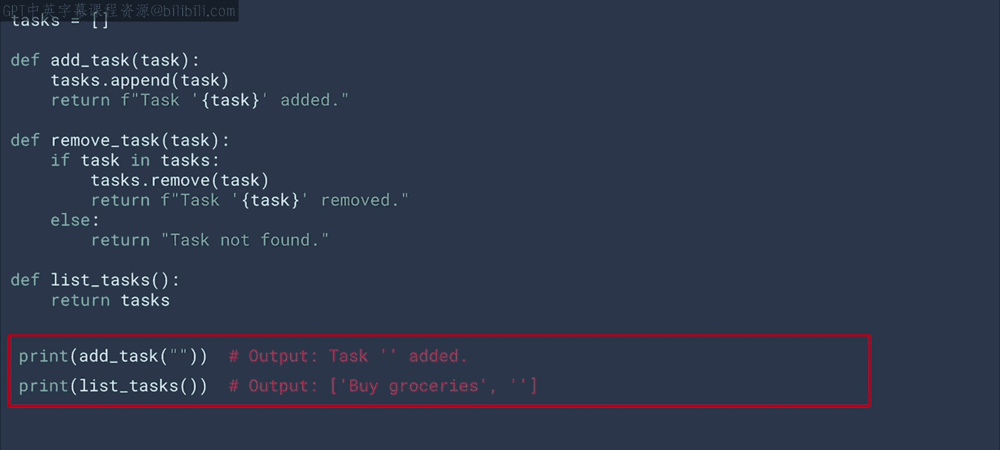
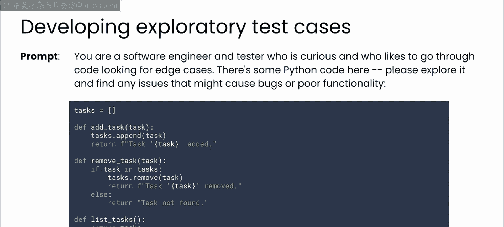
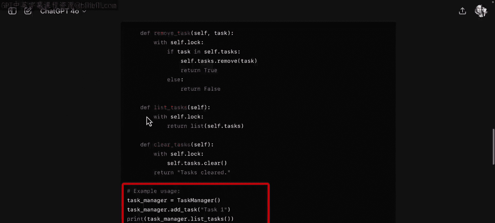

# 吴恩达《软件开发的生成式AI技能（简介、结对编程、数据库设计-3课全）Generative AI for Software Development Skill》 - P28：3_探索性测试.zh_en - GPT中英字幕课程资源 - BV1ucxLeUEHD

As you saw in the previous video， there are lots of issues to think through and address in testing。

 even with very simple apps like the flask Endpoint example。😊。

At early stages of development you'll likely focus on manual testing where you or a tester。

 work with the code and can test without automated tools So testers break down manual testing into many subtypes as specificity can help create more effective efficient testing processes。

By working with an LLM to think through different types of testing activities。

 you can make life much easier for anyone testing your code。

In this video you're going to dive into one of the most important types of manual testing。

 Exploratory testing， and you'll work with an LLM to implement this strategy in Python。

 Exploratory testing is a relatively informal mode of testing where you explore the application you're developing without predefined test cases。

 The goal is to discover bugs by using the application and the way your user would and if that sounds random well。

 it really is but it's good to put yourself in your user' shoes and work in the same ways that they might to think through how exploratory testing might play out you're going to use a very simple to do list application built in Python。

Here's the code。If you were to consume an API like this。

 well what kind of things would you do to test to see if it works？

Its functions include things like adding tasks， removing tasks and listing tasks。

 so it would make sense for you to try each one of these。

Here's example usage code first you'd like to add some tasks like bike groceries or read a book。

Then you'd use the list task method to see if they're listed correctly。

 and then maybe you'd try removing a task and then check the task list again to verify that your task was removed properly。

 and these are fairly straightforward tests that the methods will work as you expect them to。😊。

Next you might move on to testing some edge cases for instance。

 what happens when you try to remove the task that doesn't exist well you can see that the Re task method should tell us that the task isn't found。

 so let's just test that and make sure。😊，Now， think about some of the use cases that you might try。

 pause the video and try coding them for yourself， and the code is available for you in the download for these courses。

 it's called taskask Stop Pi， or you could generate one that's similar with an LLM if you don't want to code it yourself。

😊，So how did that go Hopefully you came up with some ideas and there's one issue that you may have found and it's not immediately obvious。

 and that is you can add an empty task。😊，Then when you list out the tasks。

 you're going to get that empty spot in the list， and that's probably something you would want to fix。

😊。

And that's some of the essence of exploratory testing。

 experienced software testers are really good at this type of free form testing。😊。

But you won't always have a dedicated tester with you at the early stages of your project。

 So what happens if you try to replicate what you just saw here using an LLM to help you。

In this prompt， I assigned the LLM two roles， a software engineer and a tester。

 and I ask you to explore the possible edge cases of the code that could cause problems。

 and then if I include the code for it to analyze， we'll see how the model responded。

Let's take a look at what ChatyPt came back with。So found a number of issues and suggested some potential improvements。

 for example， one of them global variable usage， I have a global list tasks。

 which could cause issues if the module is used multiple times or in a multithreaded environment so we'll get back to multithreaded in a moment。

The function return types could also return a string saying task not found if the task is not found。

 but return to task list if it is found， this is inconsistent return types。

There's various other things such as task duplication。

 it does not check for duplicate tasks when we do add tasks。

 it doesn't handle an empty task or when none is done。

The more interesting one to me is this thread safety and I thought about this but the current implementation is not threadsSafe so in a multi-user environment if a lot of people are using this modifications to the task list could of course lead to race conditions so the suggestion is to use thread locking to ensure thread safety and then of course testing for edge cases I didn't put any tests in despite this course being all about testing so the suggestion of course is to add unit tests。

😊，So it ends up giving me a revised version of the code that addresses the above issues。

 so things such as threading to be able to handle that， things such as checking for tasks to be done。

 all of that good stuff and then here at the bottom the model has included some sample usage code which looks a lot like the human written exploratory testing code you saw earlier it's creating a task list。

 adding tasks， listing them， removing them and then printing the results。

So as you can see the LLM is great at coming up with the example usage code that's the typical outcome of exploratory testing working like this can help you identify edge cases and unusual behavior early in the process and by developing with testing in mind you'll make life easier for your colleagues when you pass the code on them The next step in manual testing is to formalize the outcome of exploratory testing as a set of functional tests Jo me in the next video to see how an LLM can help you with just that。

😊。

