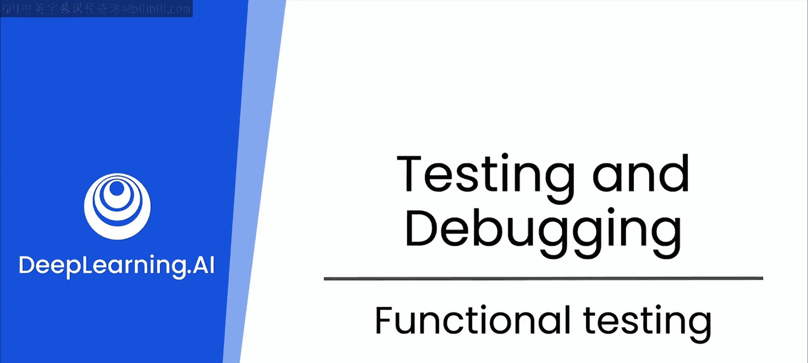
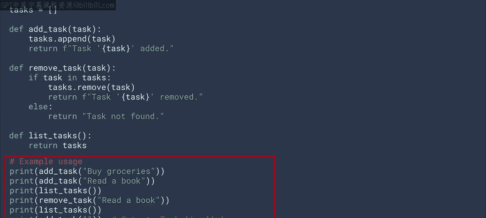
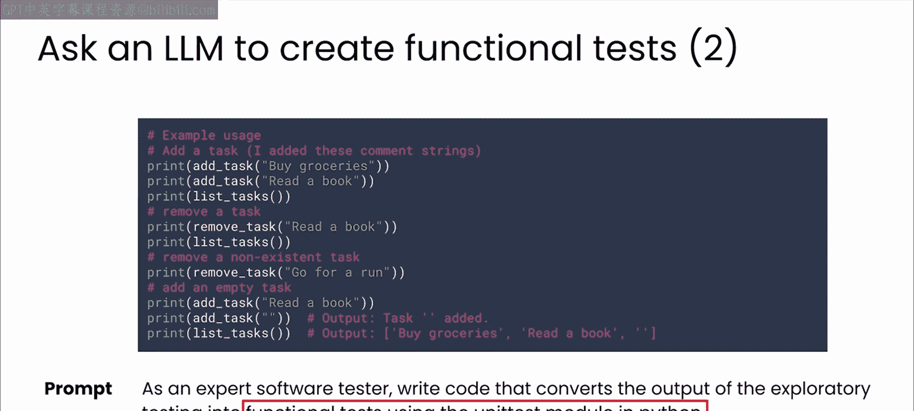
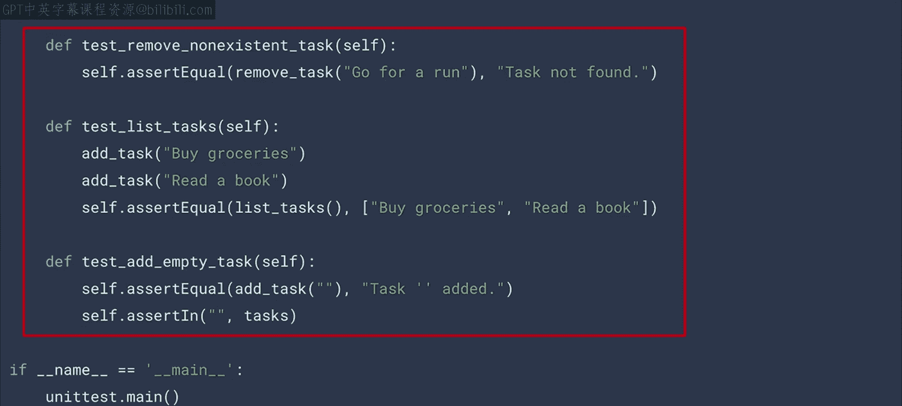
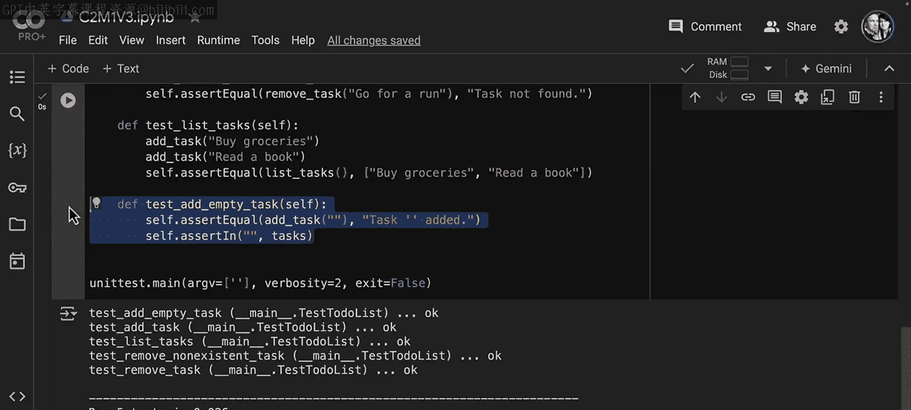
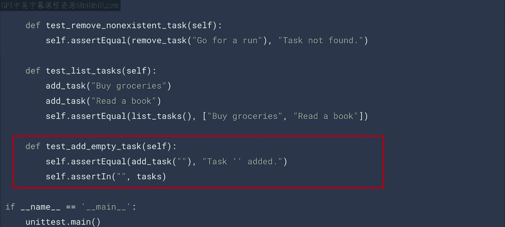
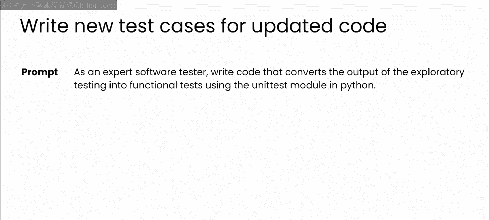

# 吴恩达《软件开发的生成式AI技能（简介、结对编程、数据库设计-3课全）Generative AI for Software Development Skill》 - P29：4_功能测试.zh_en - GPT中英字幕课程资源 - BV1ucxLeUEHD

Now that you've seen manual exploratory testing and the logical next step is functional testing。

 which takes the parts of the exploratory testing that check the code worked as expected and gives them a structure that will be useful later when testing is automated you might come out of your manual testing phase with some simple testing code and here's the example you saw in the previous video for the to do list app。

😊，The example usage code here tests all of the various functions of the to do list app code and does explore some edge cases。

Code like this could have been written by you as you developed or by a human tester。

 or be suggested by an LLM working with you as a pair programmer。

The goal of functional testing is to check the application's functionality against predefined requirements。

 it's a crucial step for verifying that the application performs correctly and according to specifications。

😊，For this kind of testing you'll write test cases to ensure each function of your code does work as expected and LLMs are really good at this with a prompt like this one。

 you can give an LLM your code and the test that came out of your exploratory testing and you can ask it to apply a structure that makes it useful for more formal testing and this is where your own expertise can help you quickly get the code you need for instance。

 by specifying that you wanted to write tests using the unit test package。😊。

And of course， if you aren't sure of a good package that you could use。

 you can always chat with the LLM and have it recommend options to you。😊。

And here is the unit test code that the LLM wrote。 You can see several test cases to check the different functionalities of your application。

In fact， the model has designed a test for each of the example use cases that you gave it in the prompt。

😊，The model also created a setup method that ensures you start with a clean slate before each test Now this is important so you can avoid side effects between different tests。

😊，In the Test Add task method， you check if a task is added successfully and then you verify that it appears in the task list for test。

 remove task， you add the task first and then remove it to check if it's removed from the list。😊。

The test Removeve nonexistent task method verifies that trying to remove a nonexistent task will return the correct message。

The Test the List tasksask method checks if the list of tasks is returned correctly and Test Add emptyTask checks if the application handles adding an empty task。

Remember， if you have any questions about how the unit test module works， be sure to ask the LLM。

 follow up questions so that you can understand the code and know how to use it properly。

The next step is to try out the code that the LLM wrote， so just like before。

 we have our simple task list and three functions to add， remove and list tasks。😊。

Over here we have a new class designed to unit test that code。

 There are multiple test cases here like adding a task， removing a task。

 removing an nonexistent task， and so on。😊，I run this。And I look at my tests。

 will see that all of my tests have passed。Now that might look like it's a good thing。

But let's think about this for a second and let's think about what has actually happened here。

So we can see that I'm testing that I'm adding an empty task and I'm checking to see if adding an empty task returns task blank added。

 and that passes。Or requirements wise， if we're building a task list。

 do we really want to be able to add an empty task， I think the answer to that should be no。

 The functionality is not what we want。 and this is why manual testing， exploring。

 testing yourself by going through the code and thinking of task cases ends up being really。

 really useful because ultimately we probably want to put a check in here to see if the task is empty。

 And if the task is empty， we should reject the adding of the task and then return an error message of some type。

 and then our testing should test for that error message。

Again， this is a great example where simply trusting an LLM can get you into trouble。

 and that's why I would always encourage you not to get lazy and not to rely on them too much。

 even as they get more and more advanced and capable。😊，At this point， to test yourself。

 try pausing the video and updating the to do list code to disallow adding an empty task。

And once you've done that， go on and update the test case to only pass if it sees the correct error coming back。

 when you try adding that empty task？

One more thing， it's important to maintain and update your test cases as the application evolves。

 When new features are added or existing ones are modified。

 you should write new tests or update existing ones to cover these changes。

 This helps ensure that your application remains reliable over time。

 and this maintenance work is a great place where the LLM yet again， can be your friend。😊。

You can give it the updated code and the current test cases and have it help you figure out how to update your test cases。

 adding， editing or removing as necessary。

Functional testing ensures that your application behaves as expected under predefined conditions。

 and it's important to get these tests right because many of your colleagues。

 especially those responsible for maintaining your application in production。

 rely on them to work well so they can do their jobs effectively。And as you've seen。

 an LLM is really useful for writing good manual tests， but these alone will never be enough。😊。

For large code bases in the real world， automated testing is critical Celester on to the next video to look at how an LLM can make automated testing easier for you and for your entire team。

😊。