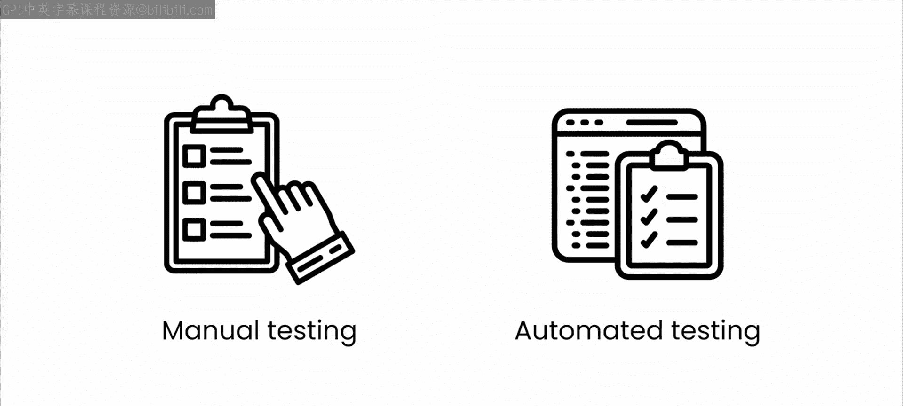
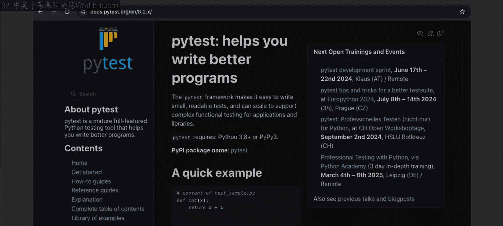
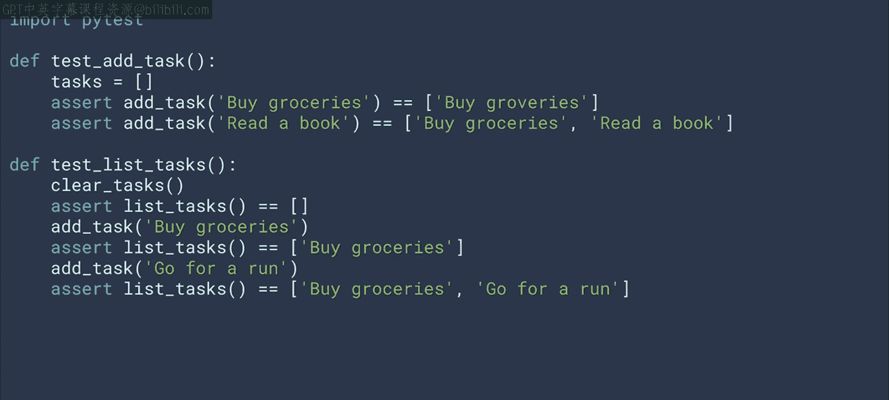
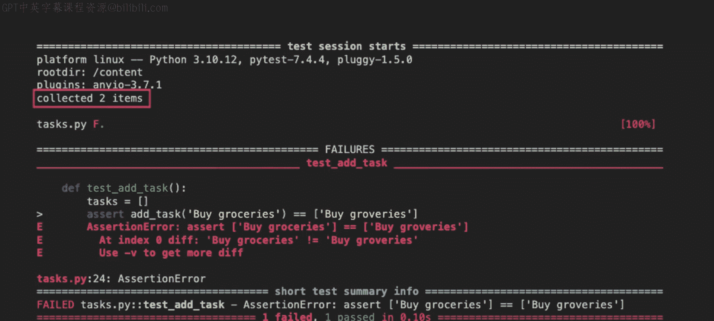
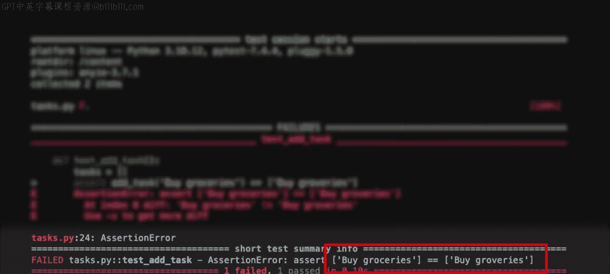
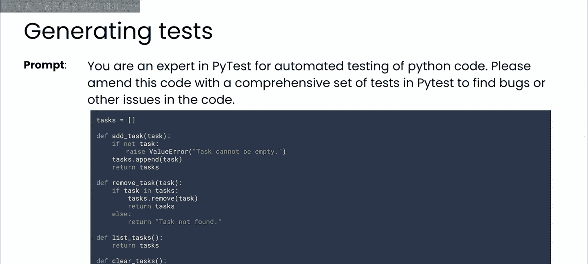
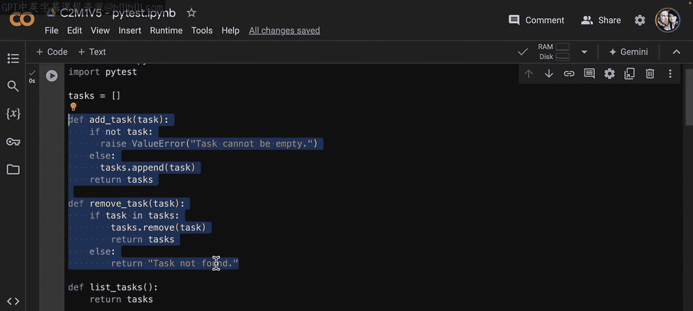
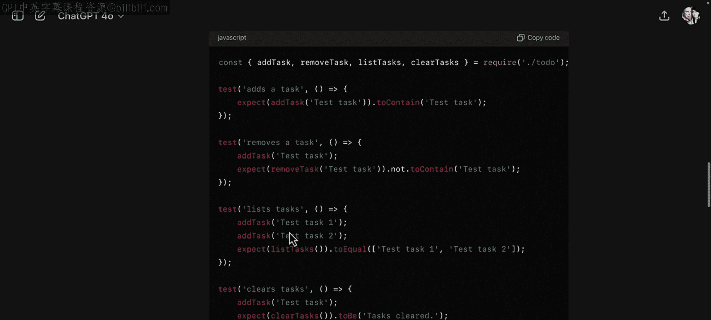

# 吴恩达《软件开发的生成式AI技能（简介、结对编程、数据库设计-3课全）Generative AI for Software Development Skill》 - P30：5_自动化测试.zh_en - GPT中英字幕课程资源 - BV1ucxLeUEHD

Automated testing is a natural extension of the functional testing that you explored in the last video。

😊，Manual functional testing ensures that individual functions of your code will work as expected。

 but it can be time consuming and prone to human error。

Automated testing uses software tools to carry out these repetitive tasks automatically。

 saving you time and ensuring consistency。😊。

Automated tests can be run frequently， providing quick feedback and the ability to catch issues early。

 This is especially important as your code base grows and you make changes to existing functionality。

😊，Automated testing helps maintain the quality and reliability of your software over time。

Since Python is the working language in this course。

 you're going to be using PT for automated testing。

PyT is a powerful and flexible testing framework for Python。

It makes it easy to write simple and scalable task cases。

 it also comes with a lot of useful features right out of the box。

 such as fixtures and parameterized testing。😊。

Similar frameworks do exist in other languages and I'll say a little bit more about that later on。

 Here's a quick refresher on that simple to do list scenario you're going to be using a simple list as your data structure to store all of these to do tasks The app will include methods that allow you to add or remove tasks from your to do list。

😊，You can then also print out your tasks or you can just clear the whole to do list。😊。

Previously you tested this function using unit Test and here's the code that you saw in the last video for the functional tests of adding and removing tasks。

 including the edge case of removing a nonexistent task。😊。

Now let's take a look at how you could build the same tests using PT。

You'll need to install P test for this next section。

 You can do this by running H install P test in your terminal if you're running locally。

 if you're using the Coursera coding environment or Google Collab， it's already installed for you。

 P test can automatically discover and run your tests， providing a clean and readable output。😊。

The tests can be included directly in your Python code scripts or in separate files in your subdirecty prefixed with the name tests。

 One way that Pytest automatically discovers tests is by looking for functions within your code that are prefixed with the word test。

 So for simplicity， we're going to follow that convention here。And here's some code。

 R I've added a couple of P test test functions for the to do list first to test whether you're adding a task correctly。

 and then to see if you're listing all of the tasks correctly。😊。

I've deliberately included a bug here。 Can you see it？Palluse the video for a second if you need to。

Now， if you run this with Pi test， you'll get output like this。 notice that there are only two tests。

 but only one of those passed。

For the one that failed， we're going to get some details as to why。

And you can see that I misspelled groceries in my test case Now don't worry if you didn't catch that one when you inspected the code。

 this is why automated testing is so helpful。😊。

Okay， so now that you have a sense of how PT works。

 let's bring the LLM back into the process Now with a prompt that assigns a role。

 you can get GPT to help you build your test suite here you're asking the model to bring expert level P test knowledge to the table to write a comprehensive set of tests for the to do list code。

😊。

Run this。😮，And GPT should return some nice test code for you。

Let's take a look at what it created for me。Okay， so let's take a look at the notebook and we can look at some of the new things that we've added to the notebook for handling things。

 for example， adding an empty task。And one of the interesting things about this one is good Python coding here。

 we can see is that if we try to add an empty task。

 what we want to do is raise an error when that happens。

 so now when we're doing our testing instead of just checking for values。

 we also want to be checking for errors。And then similarly for the remove tasks。

 we want to just say when there's a task there， we're going to go through the tasks and remove that。

 but in this case if there's no task there we're just going to return a string。

 so there's two different cases here， one where we raise an error。

 one where we just return a string and we want to take a look at the test cases for these things here we could have just used a string and not appended the task。

 or here we could have just return an error but I just wanted to cover both examples。

So now when we go down and we start looking at the task cases。Let's take adding a task as an example。

 first thing we'll do is clear the tasks， and then we're going to assert if you add task one。

 you expect the less just to have to squ。Once you add task two。

 you expect the list to have taskask one and task two， once you add task three。

 you expect it to have task one， ask 2， task  three， etc。

But what we wanted to do is then if we're trying to add an empty task at any point instead of doing this assert and expecting what the list would look like。

 we expect an error to come back regardless of what the list looks like。

 so we don't need to clear the list beforehand or anything like that and then we just say if we're testing to add an empty task we want to see if ptech raises that error。

 a value error as we've done here where we see if there's not a task we're raising the value error task cannot be empty and if it raises that when we try to add an empty task as you're seeing here。

And then similarly as we've seen before， for removing a task， for example。

 we're going to clear the tasks we'll add three tasks if we have one two and three and we try to remove two。

 we expect it to be one and three， if we try to remove one we expect it to be three if we try to remove four then we're expecting the string task not fan because of how we've architected it here in a real life application I would recommend you raise errors in this case instead of just returning a string but I just wanted to show from testing what it would look like in both scenarios。

So now once you've done that and then of course you know you'd expect this to be returned。

 but at this point you've added one， two and3， you've removed one and two。

 so you would expect to remove three to give you back an empty list。

 There's a few other tests in here list tasks， clear tasks。

 all of those kind of things it's worth taking a look at。

Now the other thing just to note of course is at the top I've said this percent percent file task pi this is a coab specific thing and this coab specific thing is to save this out as a file task pi so when I run this what's going to happen is the code isn't actually executing the code is being saved by collab as task pi and when I come down to this cell then I'm going to run Pt with task pi and we can run that and we can see that the test all past。

So， you know， there's no false positives here， and it looks like it's a working the way that we would like it to work。

 But the thing that would be good homework for you to do is kind of decide what would you prefer to do here。

 if you want to raise an error when something like this happens and then test for that。

 or do you just want to want to return status and do nothing and test for that。

 But it would be good to be consistent throughout。

One of the advantages of using an LLM to help write automated tests is that it will write them in a consistent style。

 This can be really helpful for you and your teammates。

 especially as your code base grows and new functionalities and their associated test are added later。

 Now Pyt， it's just a single automated testing framework and really good one at that。 But of course。

 if you want to try different framework or if you're working in a different programming language。

 please go ahead and experiment with them。 For example。

 if I ask the LLM to convert my Python to do list code into jascript， it'll happily do so。😊。

And then you could ask for suggestions on automated testing libraries for JavaScript and have it write some tests for you with those。

😊，When I tried this， it went ahead and suggested the Jest framework， and it then wrote this code。

The important thing here， regardless of the language that you're working in。

 is that with a good understanding of what your code does。

 you can guide an LLM to do the exhaustive part of the work for you。

It can help you generate test cases， it can write the scripts or an automated testing framework like PT or Jest。

 and so much more。

Now， so far， you've just been testing that your code functions。But does it function well。

 meaning quickly with good user experience and under conditions of high traffic or other stresses？

And that will bring us to the next phase of testing， performance testing。

 Let's go on to the next video to take a look。