# 吴恩达《软件开发的生成式AI技能（简介、结对编程、数据库设计-3课全）Generative AI for Software Development Skill》 - P31：6_软件性能测试.zh_en - GPT中英字幕课程资源 - BV1ucxLeUEHD

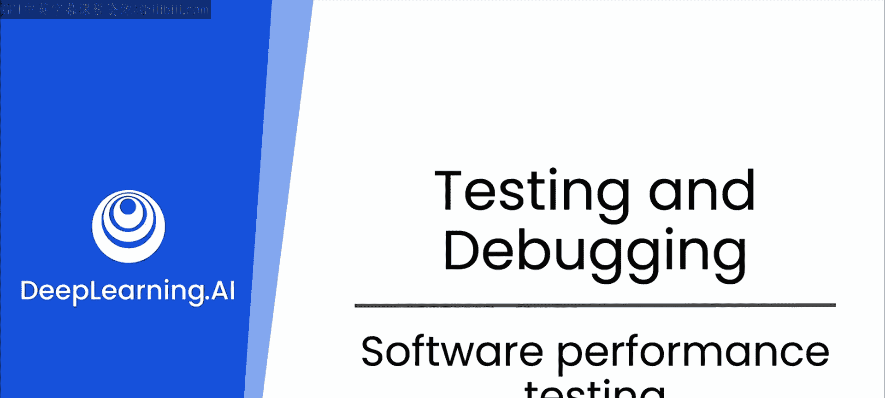

Performance testing is essential to ensure that your applications run efficiently in production and can handle the expected user load In this video you're going to focus on two primary aspects of performance testing。

 measuring execution time and identifying performance bottlenecks。😊，Again。

 you're going to be using some Python specific libraries to do this here。

 but similar principles will apply to software that you're writing in any other language and an LLM can help you write the necessary code。

😊，I'm going to start with a gratuitous demo that's computationally intensive。

 This code will find the prime numbers in a range and calculate the sum of all of them。😊。

So for example， if I now specify my list of numbers to be between  one and 100。

000 and called a sum of Prime's naive， I'm going to get a result of around 454 million。

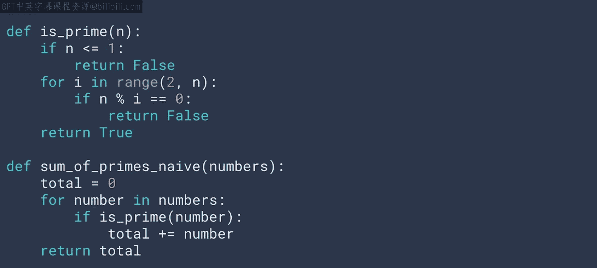

The goal here is to add code to measure the execution time， and if you're comfortable in Python。

 you'll probably know that you can use Python's timeit function。

 but if you aren't already familiar with how to do this in Python。

 you can use an LLM to help you write the necessary code。😊，With a plot like this one。

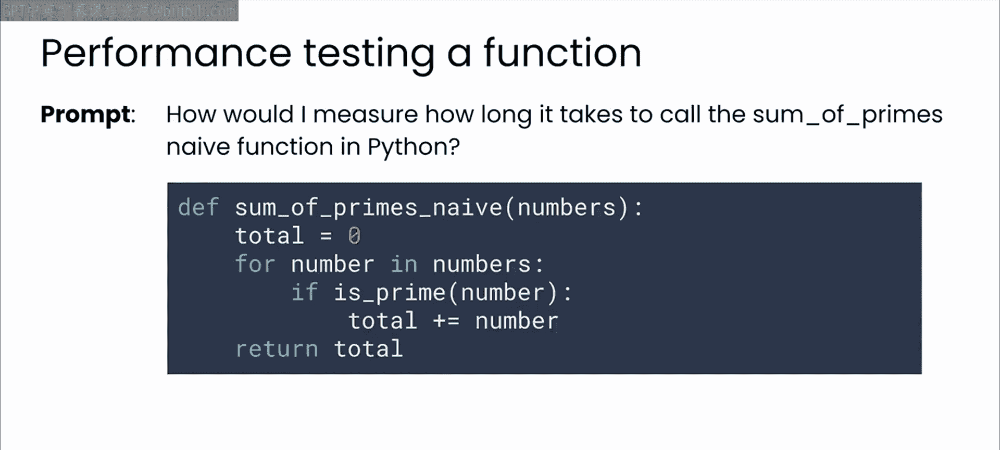

And here's the model's response。It did teach me about several different ways to do this。

 including using the time module， the timeit module and the C profilefile library。

 this kind of insight is really great if you're not already an expert in the ecosystem and LLM can really broaden your experience。

😊。

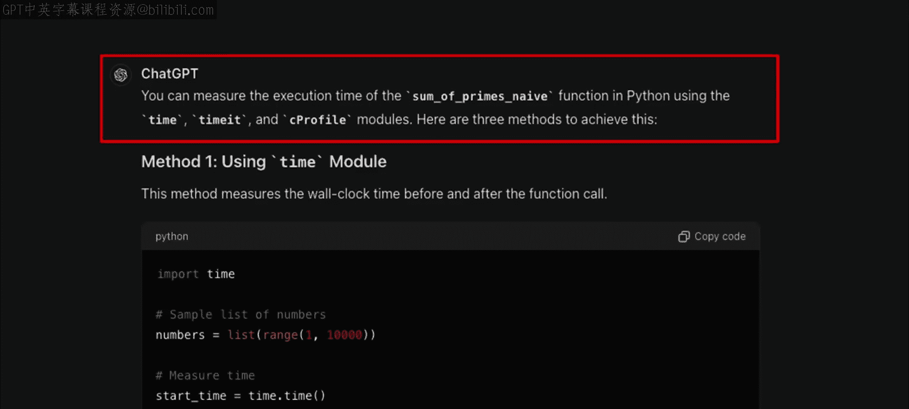

And from there I got this code， and you can use this to test the performance of the primes function。

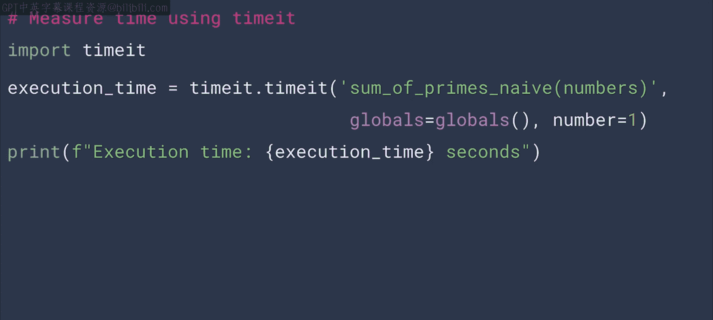

When you run it， you can now see that the execution time took a little bit over 40 seconds。

 and by the way， if you ever generate code to do this。

 make sure that you use the number parameter of time it do timeit。

 this is the number of times the function will be called and a default to1 million。

 So if you are to run this code without it could take a very long time。😊。

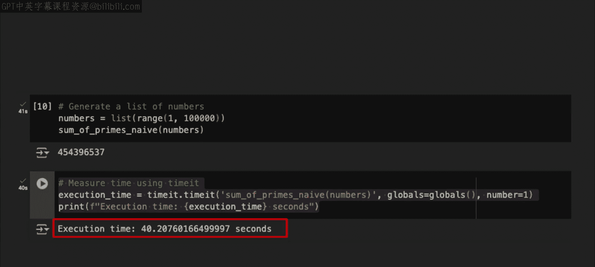

Okay， so this code is really slow， and while you could probably prompt an LLM to improve this simple code。

 it might struggle with longer， more complex code from real world applications。

You can help an LLM improve your code in these circumstances by giving a deeper context around the current performance issues。

 the C profilefi library and Python， which the LLM also suggested is a really useful tool to help you understand specifically where bottlenecks are occurring in your code by measuring the time spent in individual functions。

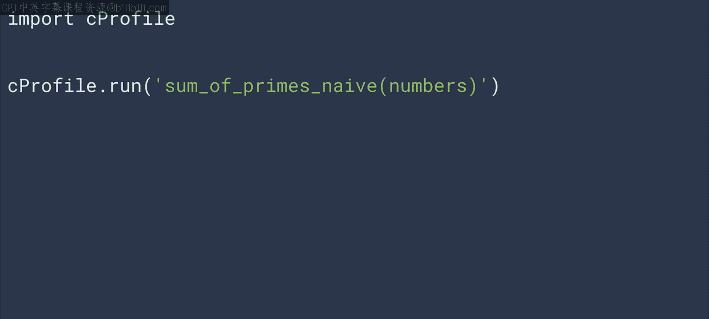

So if you run it， you'll get output like this。 Now this run took a little longer about 52 seconds。

 but the important thing is to see where most of the time was spent and it's in the is prime function。

 Only 0。046 seconds of the 52 seconds were not in that function so it's clearly a bottleneck。😊。

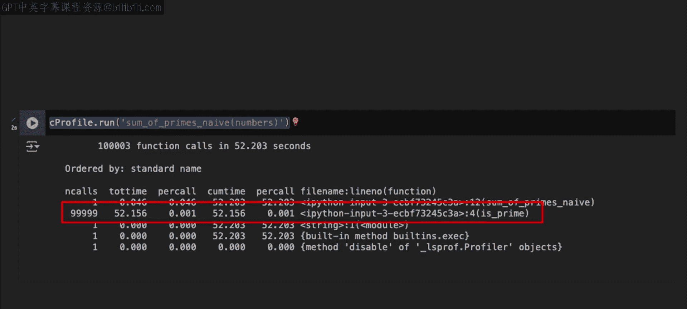

And this is exactly the kind of detailed additional context that you can pass to an LLM to help it write the best possible code for you。

😊，So now， instead of just asking the model to look for places to speed up your code。

 you can include the results from using C profilefile in your prompt and ask the LLM to optimize the I Prime function specifically。

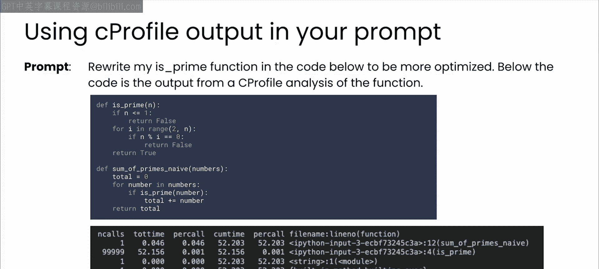

And you might get cold a bit like this。

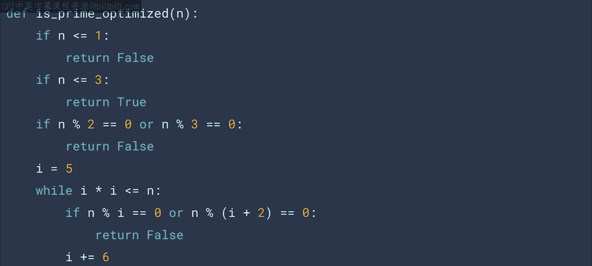

By the way， if you're curious about where this algorithm comes from。

 go ahead and ask the LLM and it will give you a great walkthrough of how primes can be calculated。😊。

So if you run this new code， the optimization suggested by the ALM reduces the execution time to a fraction of a second instead of the 40 to 50 seconds that we had earlier。

And when you profile it with C profile， you can see that formerly the I prime optimized function is still the bottleneck。

 but 0。16 seconds for 100000 calls is pretty good， and it's much less of a bottleneck than it was before。

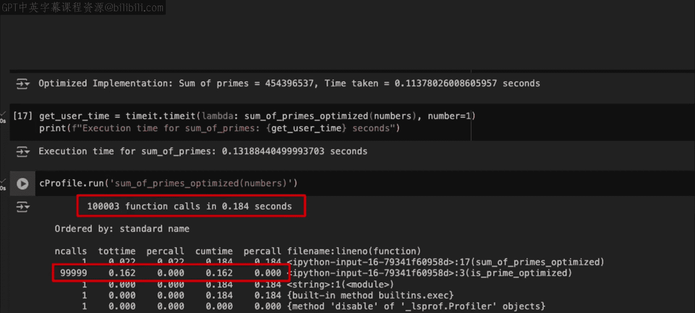

I've provided you with a notebook and this code so you can try it out for yourself。

 Try out the function with much bigger values than 100000。

 and you'll see how well this new code is optimized。

 Post the video and spend a bit of time with the notebook now。😊。

The important lesson in following prompting best practices here is twofold。First。

 you can ask the LLM to give you an expert opinion。

 and the LLM will give you great advice on how to improve performance and even introduce you to libraries that you may not have been familiar with。

😊，Performance testing is specialized work， and you can help your engineering colleagues do this more efficiently by thinking about it yourself as you develop your code。

Second， and perhaps more important， providing detailed context in your prompts will always lead to more useful responses from the LLN。

😊。

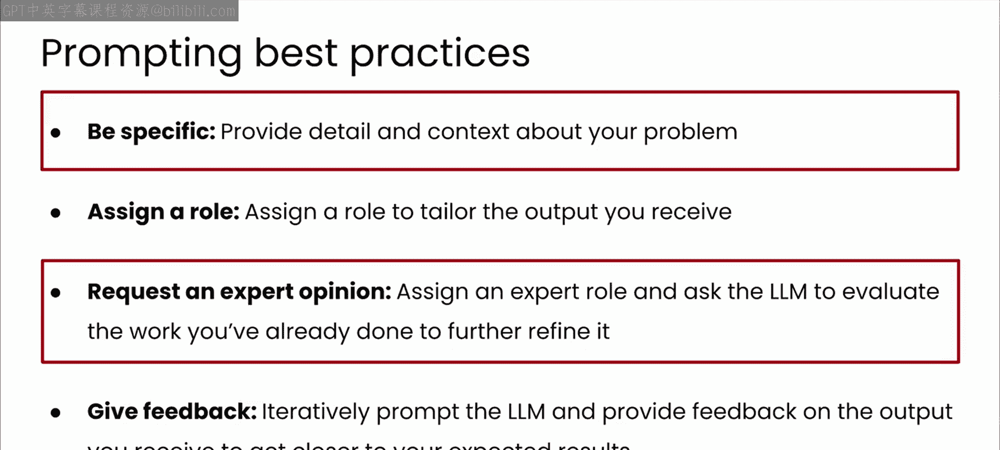

And that's what you did in this video when you gave the model the C profile results。

 they helped the LLM identify how to fix the performance bottleneck caused by that specific slow primes function。

 Now， of course， this is just one example。 But I do think that the skills of doing this will serve you well in general。

 And this example is representative of the types of things that you need to do to be a better coder。

 Now， there's one last type of testing to consider。

 And it's one that's really important to get right because the implications of getting it wrong are pretty bad。

 So please join me in the next video to explore security testing。😊。

