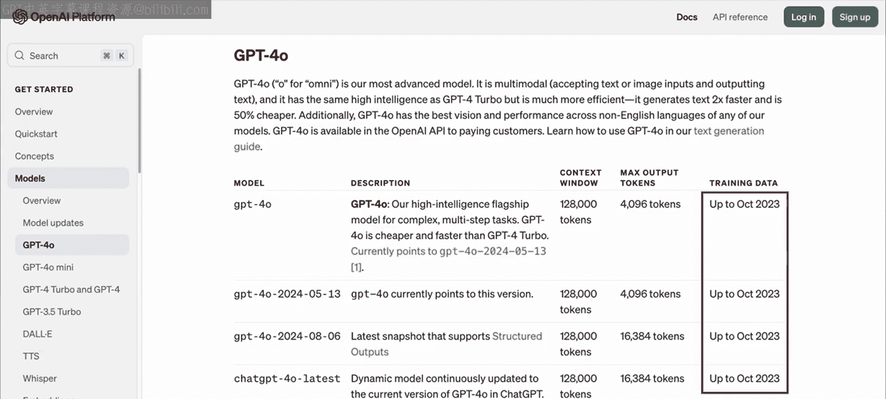
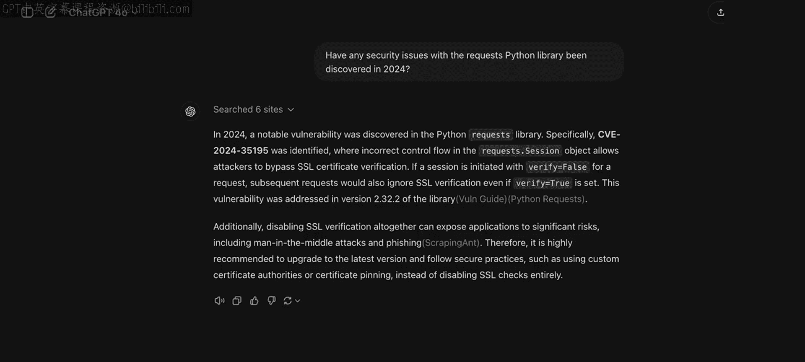
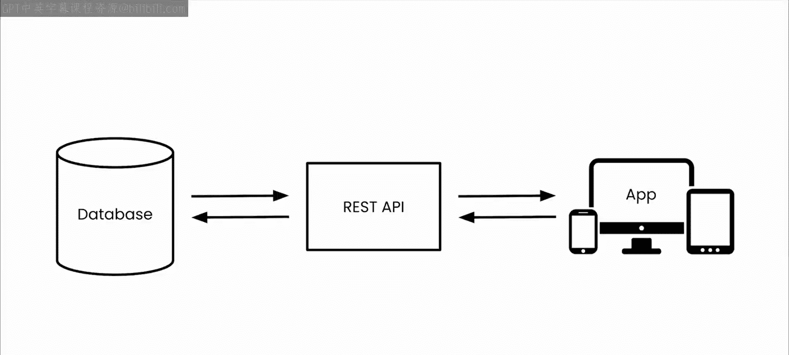
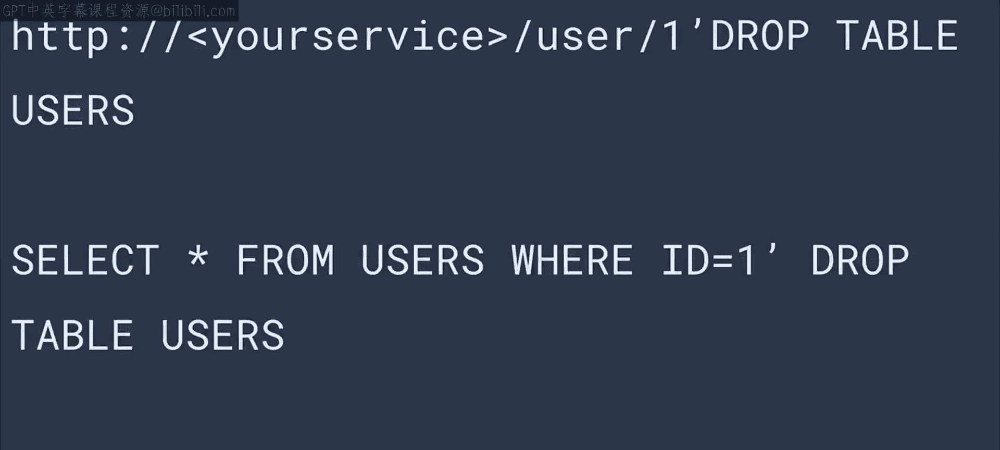

# 吴恩达《软件开发的生成式AI技能（简介、结对编程、数据库设计-3课全）Generative AI for Software Development Skill》 - P32：7_安全测试.zh_en - GPT中英字幕课程资源 - BV1ucxLeUEHD

The last type of testing you're going to explore in this module is security testing。 Now。

 this testing case is a really interesting one because it's simultaneously one where you can get a lot of help from an L lamb。

😊，And also the case where I would trust an LLM the least Well why？ Well， there's a few reasons。

 The first is that the potential security vulnerabilities that can arise in any application。

 particularly any that publicly expose your assets or compute via APIs over the Internet。

 are constantly under attack。And it's a game of Wackaole between you。

 the creators of the application frameworks， operating systems， and cloud infrastructure on one side。

 against attackers and hackers on the other。There are constantly new attacks and exploits being discovered and new patches and methodologies to avoid them。

But large language models are only trained infrequently， GT40 which I've been using in this course。

 has a knowledge cutoff date of October 2023， meaning that has no knowledge of the world encoded in its weights after that date。

 and while the paid version of Chat EPT can browse the web and reason across things that it finds there。

 you might know that this isn't always reliable either。

So when it comes to security， this knowledge cutoff is an important LLM limitation that you do have to consider guidanceid on general security issues。

 including broadly adopted best practices to secure your apps。

 are things that LLMs will be able to tell you about。

 but for all other parts of your application don't outsource your security to an LLM。

It can help you， but you really need to understand it deeply with the aid of a real security expert。

 Now， this is another place where an LLM can help your team function and communicate really well。

By having the model play the role of a security expert。

 it can kickstart those conversations with your human colleagues。

Now let's take a look at a small representative example of how one would think about security for an application with the assistance of an LLM like GPT40。

You'll start with a simple application that's somewhat representative。

 it will provide a web based RE API to a backend database。

You're going to use it for user management and with this API， somebody could add， edit。

 remove or update users in a system， and the user will be stored in the database。

 So for example a user in the database might look like this， they'll have an ID。

 a username and a password。

Then with flask， you can easily create APIs that allow you to do stuff with this database。

 So for example， if you want to see the details for a particular user。

 you can do it with a URL of slash user slash I。😊，And the code to return the details for the user if they exist。

 would look a bit like this。It queries the database for the user ID that's passed in。

 and then it gets the results and packages them into JSON to return to the caller。By the way。

 there is a notebook in the course downloads that contains the entire code for this application。

 if you want to open it and follow along。 I'm sure you've already thought of at least one security vulnerability。

 and that's whenever you have a database on the back end and you're accepting a parameter on the front end。

 there's a possibility of something called SQL injection。 Let's take a little look at how that works。

See your code offers an API endpoint like this one with the endpoint being user and it gets a parameter of one。

Then your back end would take the one and use it to look for a user with that ID and your app would work as intended。

But in some SQL databases， a special character like the apostrophe can be used to say stop the previous query and run this one instead。

So a bad actor could do something like this。An insecure code could then do this。

 which would delete the entire user's table or worse。

 they might be able to access information about all of your users with a well crafted query。

So SQL injection is always something to worry about。 Now， is our application here vulnerable to that。

 Well， after this is an optional exercise to try it out for yourself。

 try using the provided notebook and see if he can finds some。😊。

