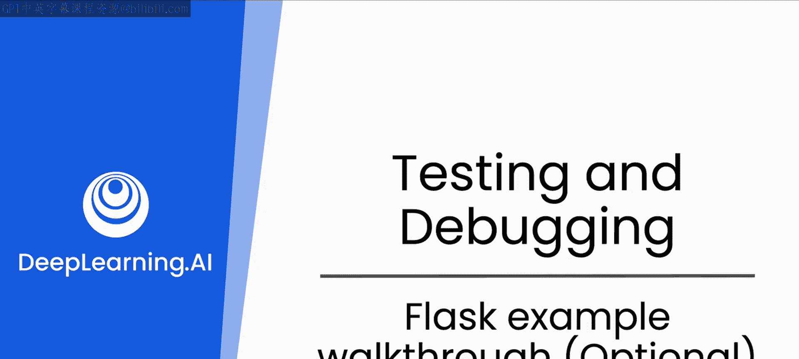
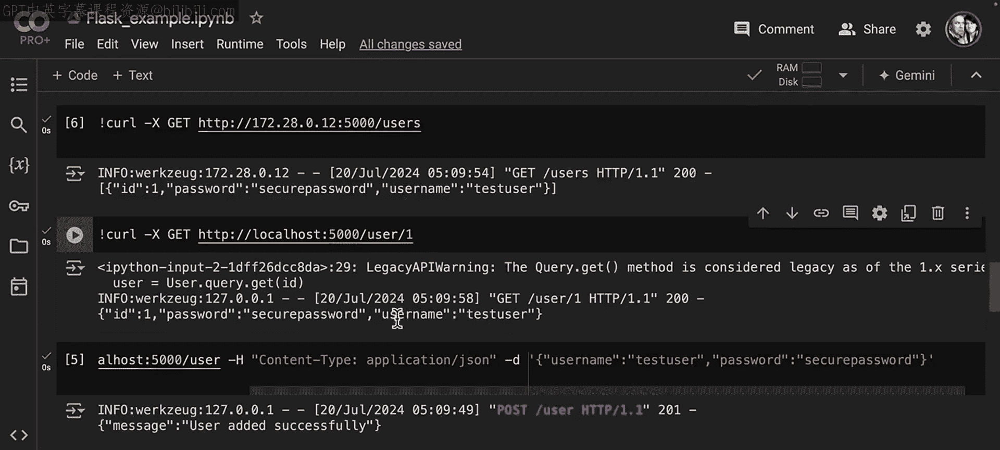
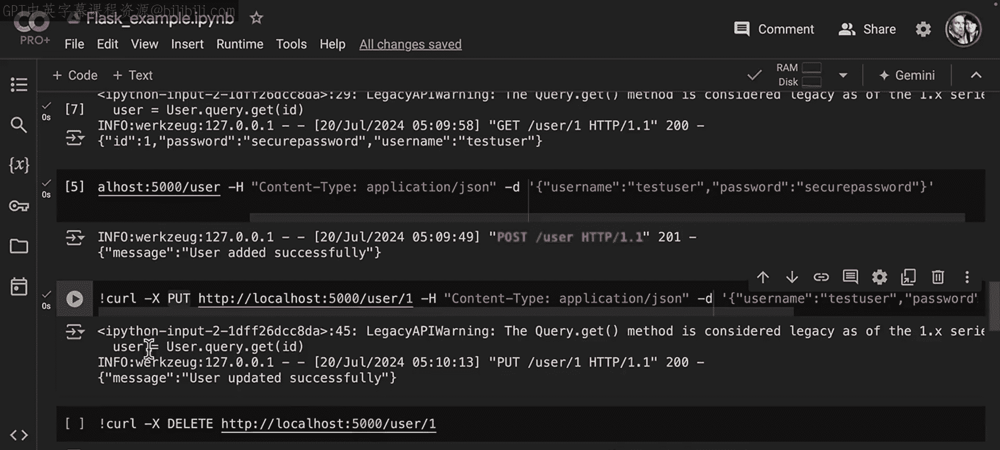
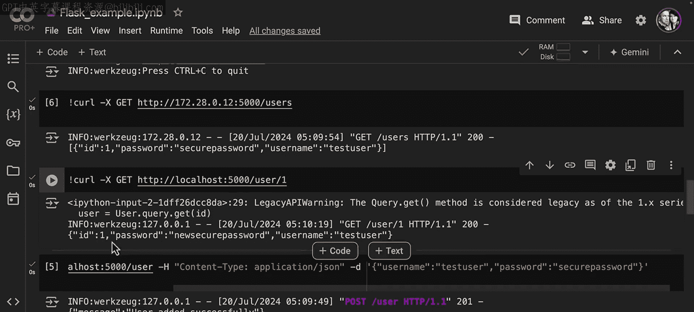
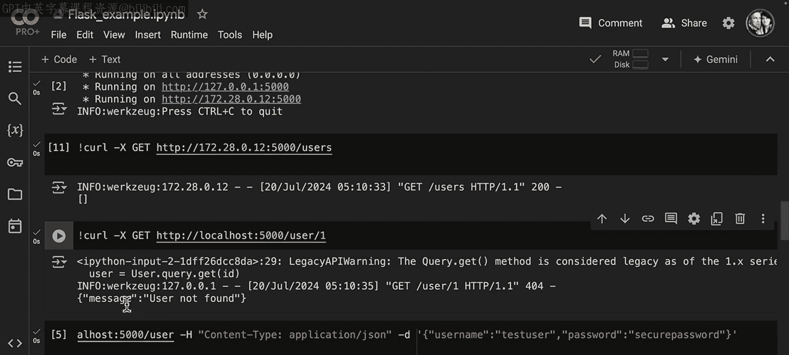
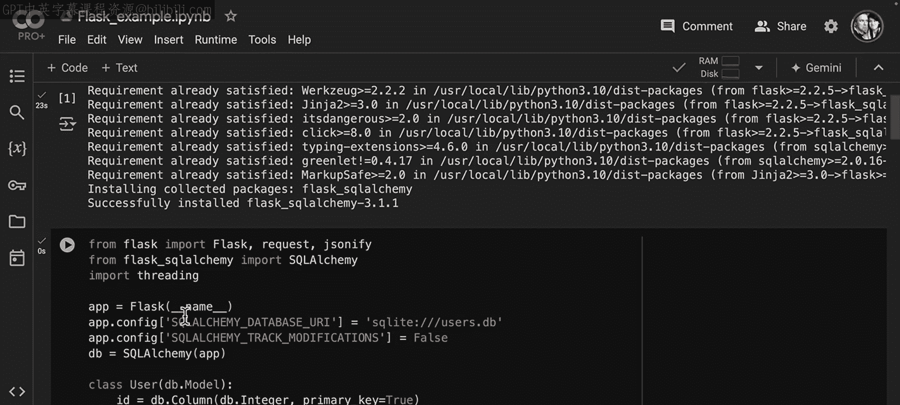

# 吴恩达《软件开发的生成式AI技能（简介、结对编程、数据库设计-3课全）Generative AI for Software Development Skill》 - P33：8_Flask示例演练（可选）.zh_en - GPT中英字幕课程资源 - BV1ucxLeUEHD

This video is a quick walkthrough of the flask application you'll be analyzing for security issues。

 especially if you are unfamiliar with Flask， this should help you get situated and lead to a more fruitful conversation with your LLM。

😊，If you are already comfortable with flask， feel free to skip this walk through。 Okay， for this one。

 the first thing we need to do is install SQL alchemy。

 So that's going to take a couple of minutes to do。 So while that's working。

 I'm just going to look at some of the code。😊，So in our code。

 what we're doing is we're creating a new Flask application and this Flask application is going to have a database。

And I'm specifying the database UI is going to be SQLite//users。

db and once we have this setup now and we have it database set up using SQL alchemy。

 it's really as easy as that。So the next thing I want to do is with this database it's going to be having a bunch of users。

 I'm going to create a class user and that class user is going to be using the Db model and the user's just gonna have an ID a username and a password So when I run this。

 it's going to create an out context create my database and now that database I'll be able to add users to that and it's just going to give me some of the usual stuff like welcome to security testing demo map to the routes of basically the homeage the route of it but then for using users and for manipulating users just take a quick look at what's going on here So first of all consider the HttP methods that I'll be using so I'm going to be routing to the users endpoint with a get method and in this case I've defined it that if I want to get users by definition that's going to return all users so it's going to be user query all as you imagine it's going to query the database for all users and then it's going to return them Jsonified with the user' username and user password now of course。

In a real application， you wouldn't do this because it would be a bit of a security leak。

 but you'd have some kind of an admin。The endpoint or an admin interface that would allow the admin to be able to look at all the users and that would run code like this。

Secondly， also on a get， so get/lashus/lash a number that's again then going to query the database to find that user and if they exist。

 then return that user's username and password， highly inecure I know。

 but again just for demo purposes， and if it doesn't exist it can return a user not found with a 404。

😊，Now when you want to add a user， you're generally not going to be getting that you're going to be posting。

 so of course the route will also support slash user but this time with the post method and of course the post method is just going to add a new user it's going to accept two parameters。

 the username and password and that it's going to add though the user with that username and password to the database。

And if it works， you'll get their return message in JO the user was added successfully。

Now another method in HTTP is put and this is perfect for editing an existing user so if you put slashuser/ ID and then you specify username and password。

 you will change the existing username and password notice that the signature is exactly the same right it's going to be slash user s an identifier and exactly the same as you have like forgetting the particular user but when you do the put method you're indicating that you're putting some data up to the server and as a result that data is going to change the actual user and then similarly for delete as you could imagine it's just going to be a case of you're going to pass up an ID it will delete that user and then return the appropriate messages。

So this has been run up。 It's already good to go。 So I'm going to run this code next。

 So now the code is run。 the server's up and running。 It should be good to go。

 And we can see this threading not thread allows me you to use it in Colab。

 and we have the server actually running here 172280。 12。😊，So now if I curl to this server。

 I can simulate what it would be like calling that server。

 so if I werecur to it I get to list all users well we've got no users yet， so this would be empty。

So if I are now to curl a get for slash user/1， I would be expecting to look for user 1 and of course my message comes back that there is no user  one that hasn't been found。

So now let's think about posting to create a new user。

 So I'm going to post to the slash user endpoint， and I'm going to pass up some Json with username test user password secure password because it is very secure。

 And when I run it， we'll see the user has been added successfully I could come over here and I could try to list all users now。

 and we could see that user I 1 is there。 or I could specifically try to find user 1。

 and we see that user I 1 is there kind of cool。 So now if I want to put， what does that do。

 remember that edits it。 So what I'm going to do is I'm going to change the user password from secure password to new secure password So if I run that again。

 it puts the new data， it shows that it was done successfully。 And for example， if I list user 1。

 we can see user1 is I1 password is new secure password。 So it actually worked。😊。

And then finally， if I want to delete the user， I can just click this one and now the user has been deleted successfully。

 and of course， if I try to get all users， there's nobody there and if I try to get user one。

 they don't exist。 So we can see that this code is running for me。

 the test cases have been set up and you know， this is just a really interesting little starter for you to be able to work on to try and think about how youll build applications like this。

😊。

Okay， that's the end of this walkthrough。 You'll find the code for this app in the following ungraded lab。

 I recommend that youll open that lab and then move on to the next video for suggestions on specific strategies for analyzing the code。

😊。

