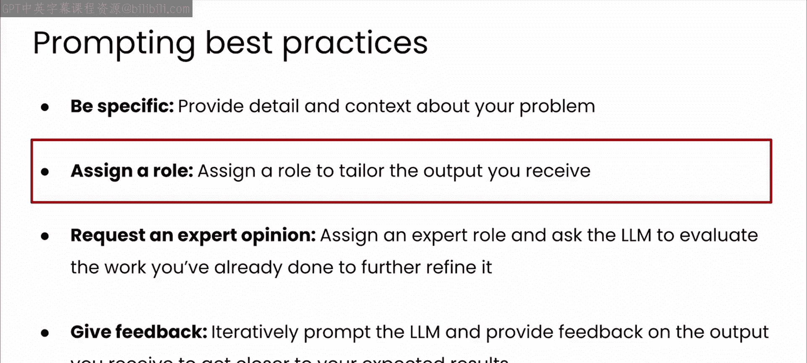
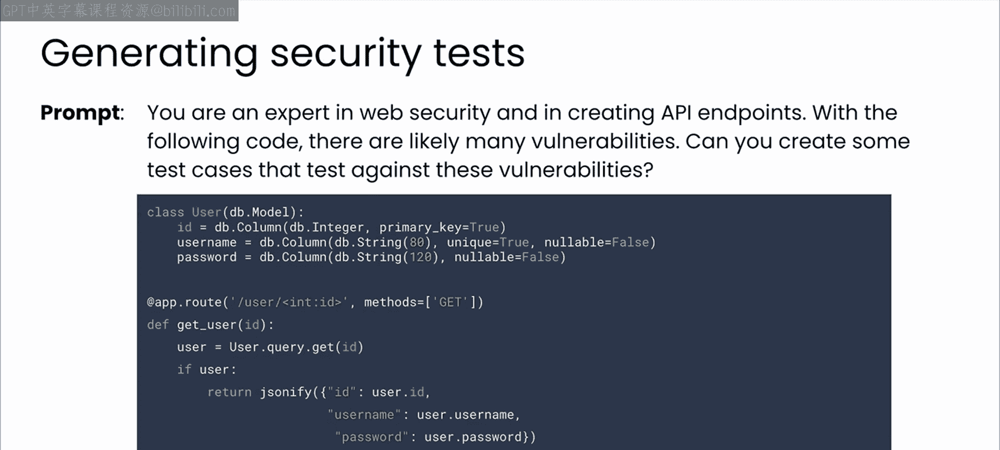
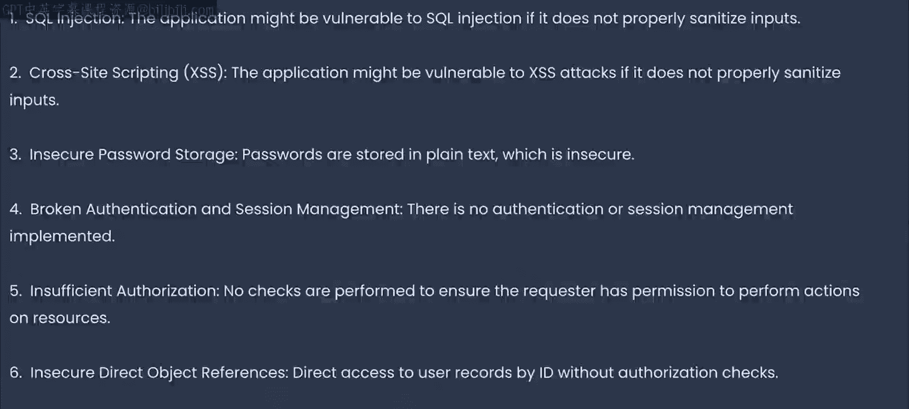
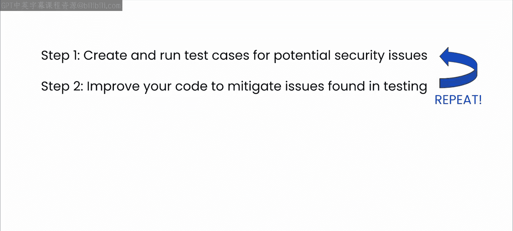
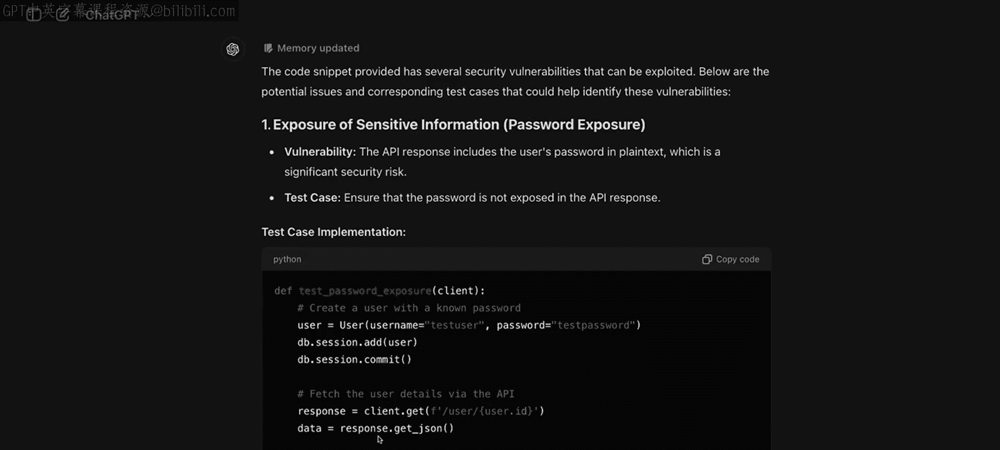

# 吴恩达《软件开发的生成式AI技能（简介、结对编程、数据库设计-3课全）Generative AI for Software Development Skill》 - P34：9_分析代码安全漏洞.zh_en - GPT中英字幕课程资源 - BV1ucxLeUEHD

Okay， so now you have that code it's time to test for security vulnerabilities。

 you should use all of the prompting principles that you've been learning throughout this course。

 but giving GPT40 a role here will be particularly effective。

 perhaps a security expert at a company that has had many hack attackss。

That kind of thing pass it the code from the notebook and see what it suggests。 If you want。

 take a few minutes to try and identify the issues that the model will bring up and then see how many of those that you had actually guessed。

The rest of this lesson will not work well in a notebook。

 so if you're going to follow along with the code， I would recommend that you set up your own Python environments。

Otherwise， it's okay just to follow on the video so you can get the idea。

The general principles of what we're going to cover will apply across all software testing for security。

My recommendation， the first thing you should do is to have your LLM Co programmer identify potential vulnerabilities and then generate testing code for those for the flask application we're using in here。

 I used the prompt like this and provided the code。

I'm simply assigning a role and asking it to provide test cases for the vulnerabilities that it might see。

And it did give me a list of potential vulnerabilities。

 everything from the aforementioned SQL injection to crossite scripting attacks。

 and this is where a bad actor could get the API to potentially return code in a query。

 and then that code could execute in somebody else's browser and do bad things。

It also spotted insecure password storage because my passwords are stored in plain text。

And there's a whole lot more stuff， the direct access to user records that we saw earlier。

 anybody can list details， including the passwords for any user。😊。

And this leads to the fact that data is exposed， and in this case， passwords。

 and that's an obvious gold mine for hackers。

I've provided the test cases that I generated in the notebook， but as mentioned。

 here's where we're hitting the walls of running a server within a notebook。

The first test case doing SQL injectionject will actually crash the running flask server。

 and it's hard for you to debug why。And this is why running code locally it really is the best way to go forward and for resources on building and running your own local Python with flask。

 you can visit the URL that you see here， which is also provided in the notes for this video。

Of course， every application and application type is different。

 and the security vulnerabilities of each one will also differ。 So unfortunately。

 there is no one size fits all approach to securing your applications。

 but the general design pattern of working with an LLM to do two things still holds The first。

 have a generate test cases for you after profiling your code。

 I've often found that this step is really useful for sparking inspiration in me around things that I might have missed。

 And the LL M may not even have context to reason about them。😊。

So take some time to get those right and run through them to spot errors。The second。

 work with the LLM once errors have been spotted by the test cases to come up with improvements to your code that mitigate those issues。

 it can be really tempting to just have the LLM rewrite the code for you wholesale。

 by passing everything in and asking it to find and fix the bugs。

 particularly with the ever increasing context window sizes。😊。

But I think this is a recipe for trouble。 I would recommend that you follow the procedural approach that we're doing here。

 Profi the code， generate test cases， test against those cases， find issues。

 drill down into specific issues and have the LLM work with you to fix those and then repeat this on an ongoing basis。

 At that point， you could profile your entire code base， and then go back to step 1。

 continuously repeat this until you're satisfied that your code is as secure as it can be。

You'll also want to bring your security expert colleagues into the mix at this point。

 making sure that your proposed fixes are in compliance with any security protocols and requirements specific to your company or your industry sector Con repeat this cycle until you and your colleagues are satisfied that your code is as secure as it can be and remember code is never finished because code will always be under attack This is not something that you can just ship and sign off at once and then be happy that it will be secure forever wouldnn't that be nice。

😊。

It's a difficult job requiring a lot of effort， but I do hope that by having an LLM as your code partner。

 some of that effort can be reduced。

And that brings us to the end of this module on testing you've seen how you can use an LLM to profile your code。

 help you to identify and implement test cases and also how to assess and test the performance and security issues in your codebase by building these testing considerations into your coding practice from the very beginning you're setting yourself up for more productive and communicative relationships with your colleagues in testing and security roles。

😊，The idea here isn't that the LLM replaces any of these roles。

 instead it helps you anticipate their needs and write better code that makes your job and their jobs easier。

One thing that really helps code move between team members with as little friction as possible is great documentation。

 and you probably know what I'm going to say next。 and LLM can help you with that， too。

 and you're going to start exploring the power of LLMs to generate great documentation in the next module。

' see you there。😊。