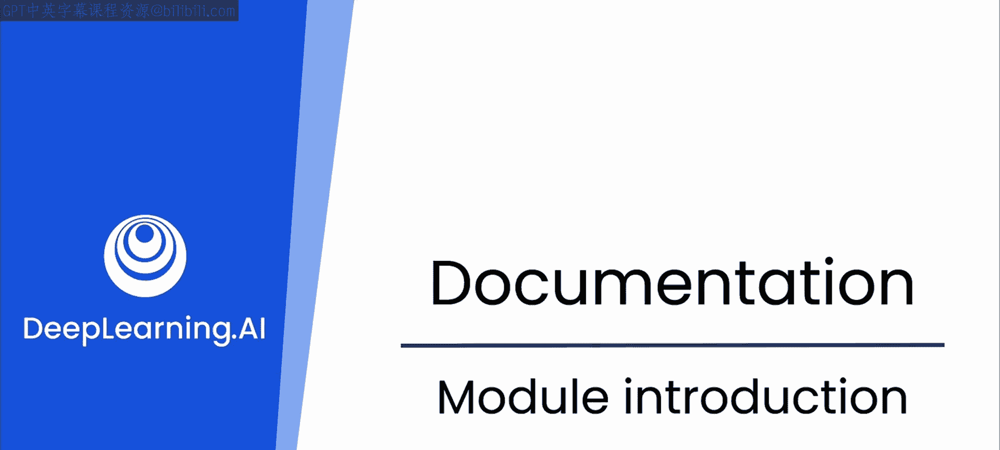
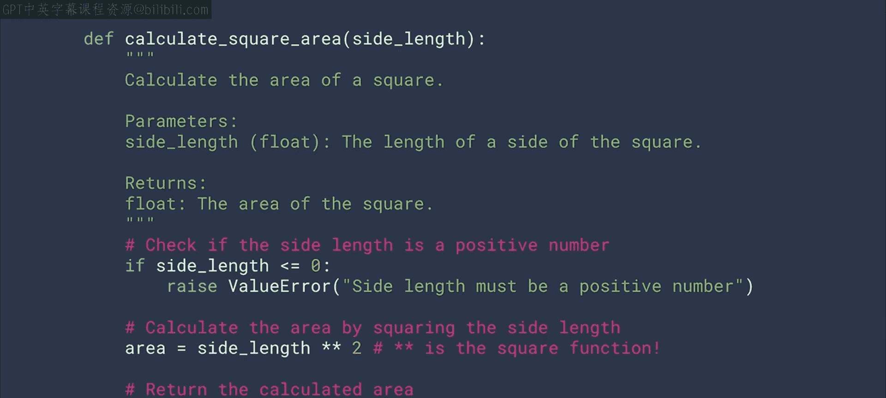
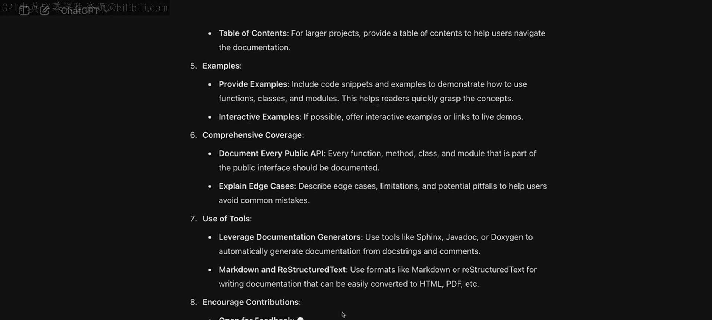

# 吴恩达《软件开发的生成式AI技能（简介、结对编程、数据库设计-3课全）Generative AI for Software Development Skill》 - P35：10_模块介绍.zh_en - GPT中英字幕课程资源 - BV1ucxLeUEHD

In this module， you'll explore the importance of documentation and software development。

 both as a means to making your code better and easier to use and as a tool to facilitate communication with your team members and other stakeholders。

 Now， you'll probably thinking documentation is easy。

 You just write text that explains what the code does。

 Remember the right syntax for the comment streams and move on。

 You've been doing this since your early days of coding。 So we include it here in this course。 Well。

 as much as we all spend our time writing documentation and think we're good at it。

 You'll probably encounter code all of the time in your work where you think who wrote this。

 It's such a mess， I have no idea what's going on。 That's because writing good documentation is actually an art。

 There are many schools of thought about what makes good code documentation from those who think it should be as minimal as possible because beautiful code just speaks to itself。

 or those who just like to add comments to every other line just to make sure there's no ambiguity in the intent of the code。

😊。

これ。If you ask an LLM what it knows about writing good code documentation。

 it will probably respond by writing a many bulletet point essay， a little bit like this。

 offering up ideas about the principles of good documentation， good writing。

 the structure of documentation， writing to a specific audience， and so on。

So clearly there's a lot to consider。For the next few videos。

 we'll try to go back to basics and think through both best practices for writing good documentation yourself and how an LLM can best support you in that effort。

After all， code documentation is an important means of communication with others。

 be your developer colleagues， code testers， security experts or engineering partners who need to figure out how to deploy your code。

 the better your documentation， the easier everybody's job will be。

So let's start by heading to the next video and thinking through what really makes good documentation。

 good documentation。😊。

