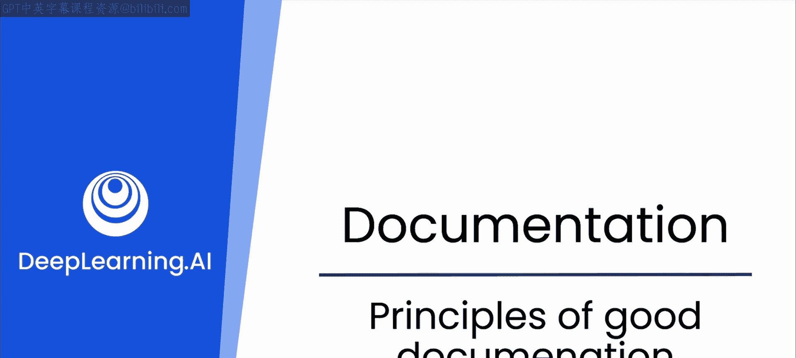
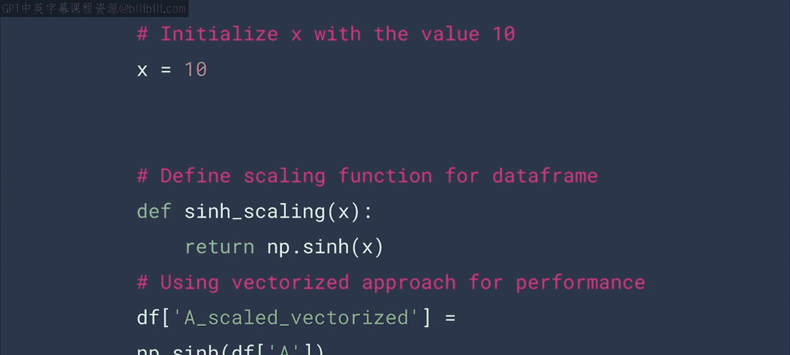
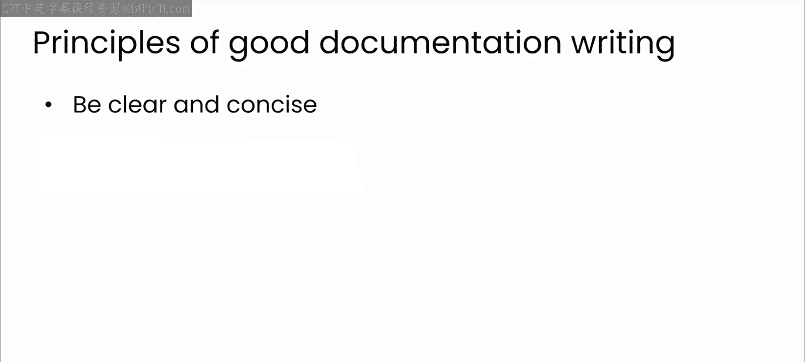
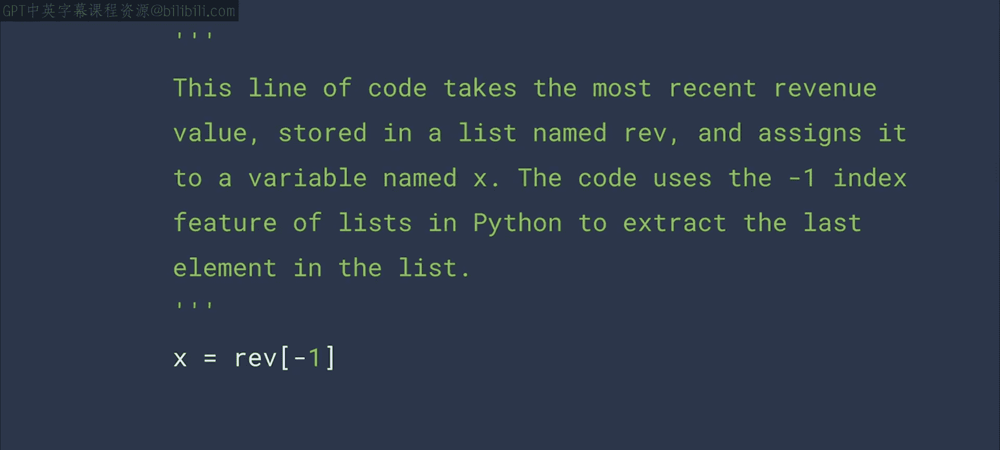
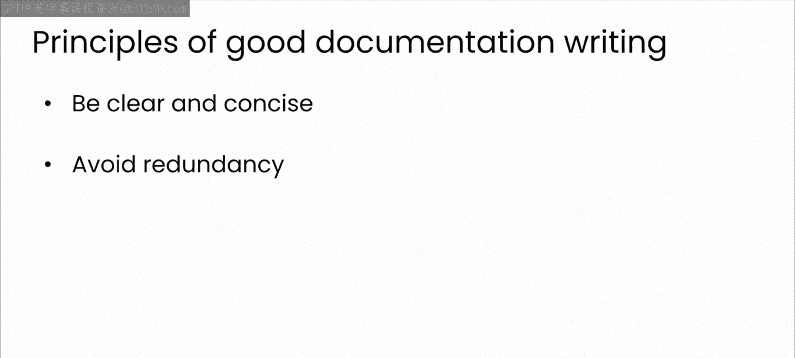
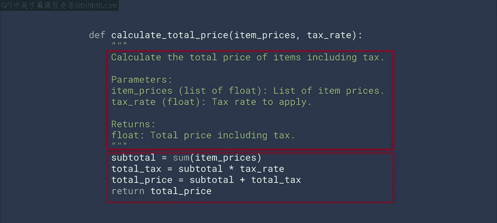
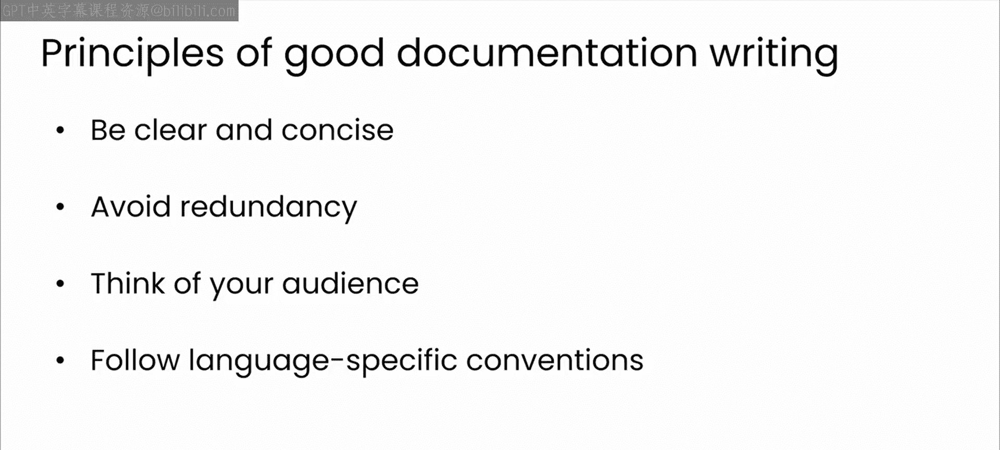
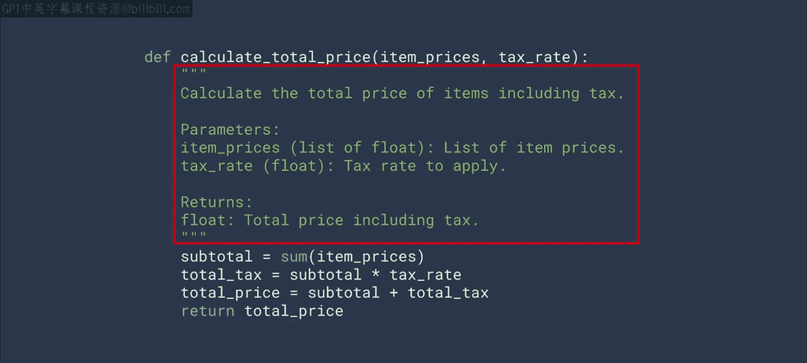
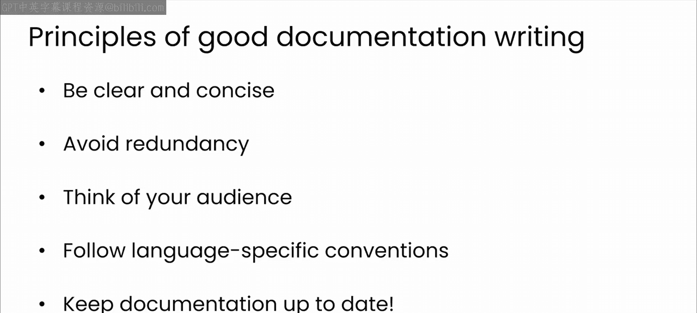
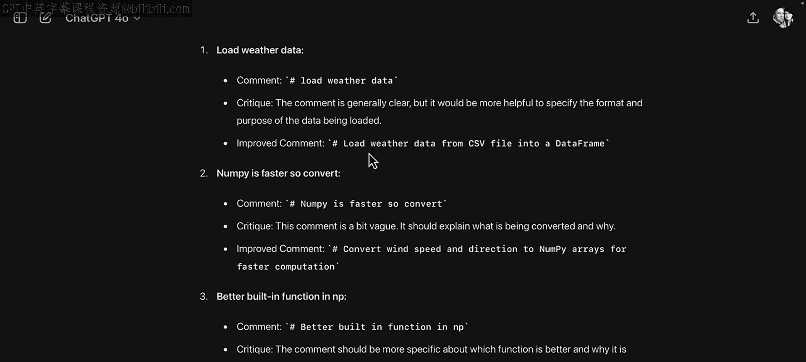

# 吴恩达《软件开发的生成式AI技能（简介、结对编程、数据库设计-3课全）Generative AI for Software Development Skill》 - P36：11_良好文档的原则.zh_en - GPT中英字幕课程资源 - BV1ucxLeUEHD

Good documentation can take many forms。 It can be as simple as inline comments that explain the purpose of a particular block of code。

😊，Why you chose a particular repro？

Or it might be a more complex set of instructions or explanations like you'd find in a software development kit。

 SDK， or an application programmer's interface API。

Good documentation first and foremost improves code readability。

 but the benefits extend well beyond this。Well documented code is easier for others to understand。

 and this is crucial in a team setting where multiple developers may be working on the same code base。

 If your code is well explained and easy to follow。

 the team can quickly grasp what you were doing when they pick up the code and try to move forward with their own tasks。

 Good documentation also helps prevent technical debt。

 and this accrues when you take shortcuts today day in order to get something to production。

 But then other people have the burden， not least the cognitive load of understanding what you have done in the future。

 I think this is a really important point， well written documentation aids and maintenance。

 when you or someone else revisits the code months or even years afterward was written。

 good documentation helps to quickly understand the code's purpose and its logic。

 making it much easier to update， maintain and debug。😊。

Documentation is the primary tool for others to learn what your code is and how to use it。

 so it is really important that it be fit for this purpose。

Think of maybe when you are onboarding new team members。 If your code was well documented。

 it helped get new developers up to speed faster， reducing their learning curve and increasing productivity。

 Finally， and perhaps most importantly， good documentation improves overall code quality。

 writing documentation often forces you to think about your code more deeply。

 which can lead to better design decisions and fewer bugs。

 So given all of these benefits of writing good documentation。

 let's take some time to get really specific about what we mean by good。

 I'd like to share some principles of good documentation that I find really useful in my work。😊。

The first is that your documentation should be clear and concise。

 This applies whether you're writing an inline comment or the full documentation for an SDK。

For example， here's an inline comment that really doesn't say anything， I mean。

 what does update mean here？A clearer comment would be something like this。

 where in just a few words， you now have an idea of what the code is doing。But， of course。

 you should use as few words as possible。 Too much documentation can make your code very hard to read。

 This multi line comment is probably overkill， and it doesn't really need to explain the basic functions of Python。

Another principle that will keep your code manageable and easy to read is to avoid redundancy。😊。

For example， in this Python script， the variables are named in a very descriptive way。

 and it's pretty clear what the code is doing。The documentation comment at the top is useful because it defines the input types。

 but you wouldn't want to add in line comments to this section since the function of the code is already quite clear。

😊。

And if you are working on more complex documentation， for example， a full SDK。

 avoiding redundancy is really important to make the documents easy to navigate。

 having the same information in multiple places can lead to inconsistencies， user errors。

 and it can make docs more difficult to maintain。It also blos your documentation unnecessarily。

Documentation is intended to be read， so having a specific audience in mind can help you make the tone and level of detail of your docs most useful for your intended users。

😊，For example， you might reference internal requirements and specifications when working on a private internal project。

But you wouldn't want to do that in public facing docs since those resources are inaccessible to external users。

 Another important issue to keep in mind is that documentation conventions can differ by language。

 Some like Java and Python have well established guidelines for writing documentation that are maintained by the community。

For example， Python uses documentation comments known as Doc strings as a standard way of documenting code。

Here's the calculate total price function you saw a few moments ago to demonstrate the dock string is this string literal that appears right after the definition of the function。

 And you'd place this in your definition of a method， class or module，2。

The style of these doc strings is outlined in a document called PEEP257。

 Python has many of these Python enhancement proposals， PEP。

 which can then help developers standardize their code and it's best practice to follow these guidelines。

Lastly， and this one's really important， keep your documentation up to date。😊。

Code is like a living thing。 It's constantly evolving as things change around it and bugs are found。

 Keep your code up to date will help you to avoid technical debt and make your code easier to maintain in the long run。

 And， of course， I think you know what I'm going to say next。

 an LL M can help you maintain these principles as you work on documentation。😊。

Besides just helping you to write comments， it can also help you work across languages。

 advise on tone for your intended audience， and analyze docs to suggest improvements。

So let's get hands on and look at how LLMs can help you with different types of documentation。

 we'll start with a seemingly easy one inline comments， I'll see you there in the next video。😊。

