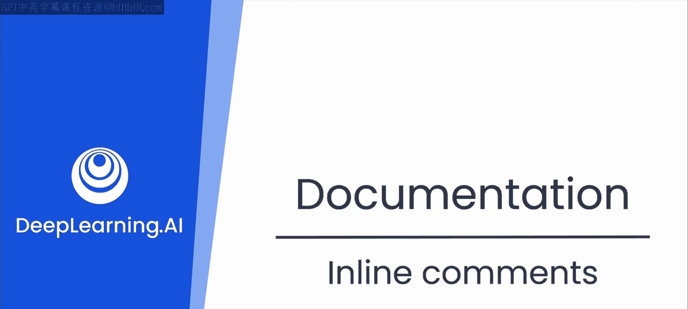
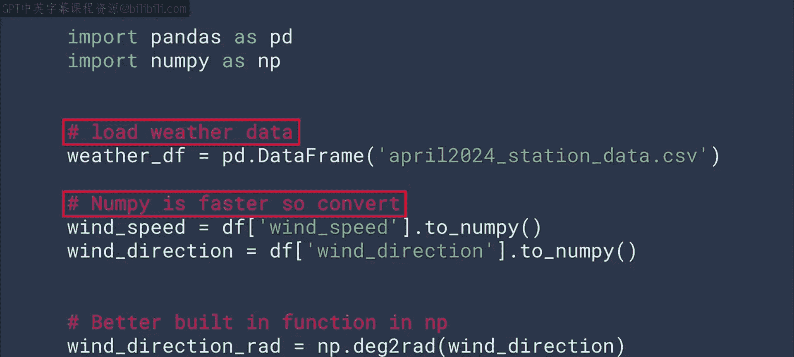
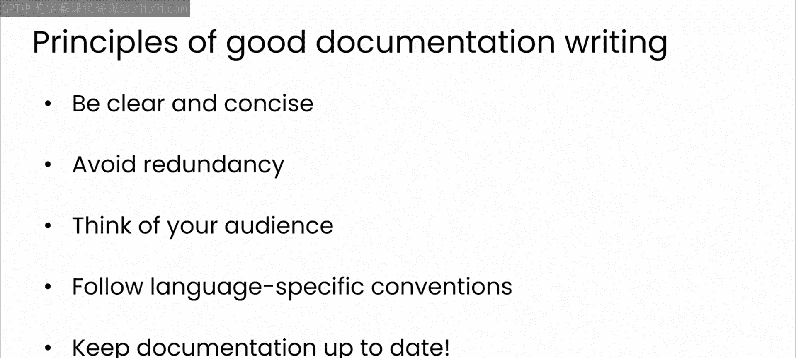
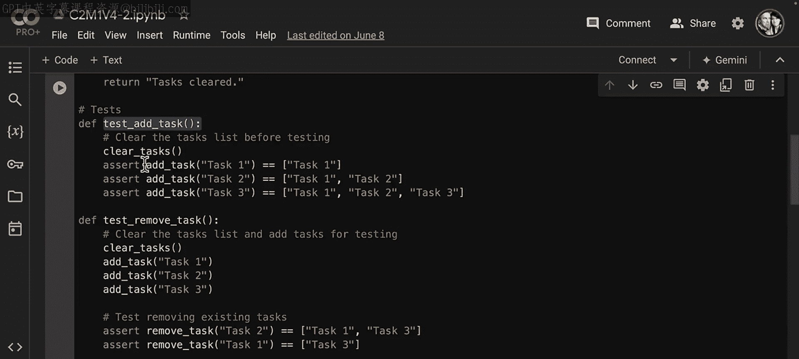
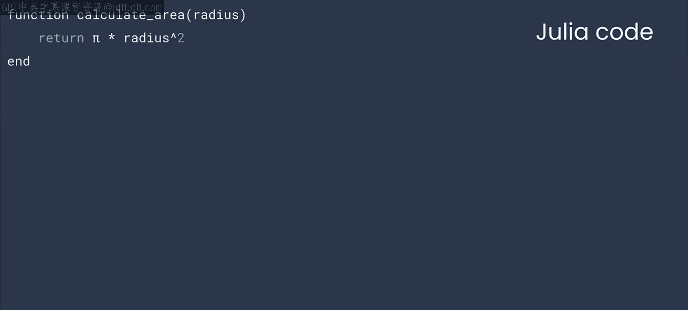
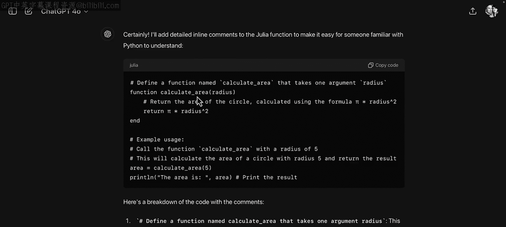
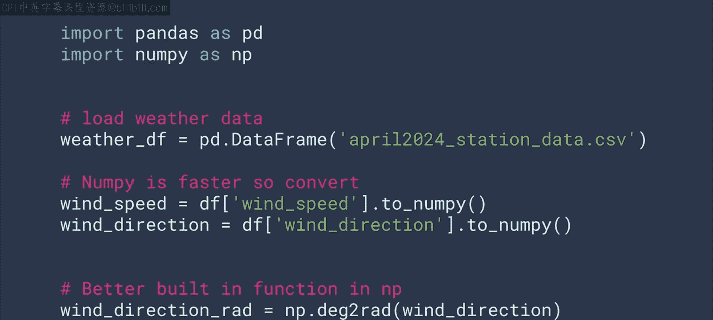
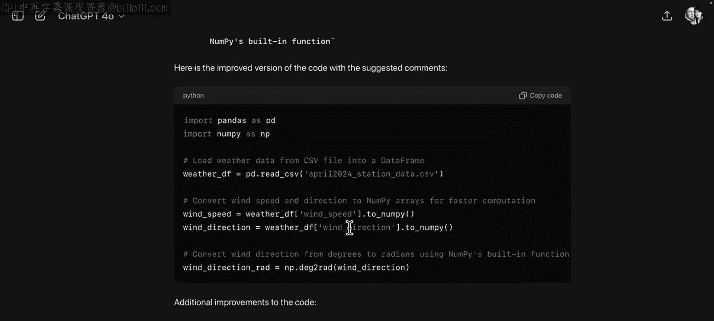

# 吴恩达《软件开发的生成式AI技能（简介、结对编程、数据库设计-3课全）Generative AI for Software Development Skill》 - P37：12_内联注释.zh_en - GPT中英字幕课程资源 - BV1ucxLeUEHD

In line comments are perhaps the most basic form of code documentation。

 Theyre short notes that explain a single line or maybe even a whole block of code。Now。

 I know you've been probably writing comments like this since your early days of coding。

 but have you ever spent that much time thinking about how you write and use them？For example。

 you might use in line comments while coding to write notes to yourself so that you can remember what you were doing or why you chose a particular library or module。

 but this kind of comment can be hard for others to interpret。

 So try to apply the principles of good documentation from the last video to ensure that your in line comments are useful both for you today and for any teammates or others who have to work with your code tomorrow。

So let's walk through a few different examples focusing on how an LLM can help you write your inline comments well。

😊，First， you' have probably noticed while working with an LLM as a pair coding partner that the model will often write useful in line comments as it suggests code to you。

 This is really helpful。 But， of course， you can guide the LLM to write the comments in a way that is most useful for your project by giving it more context in your prompt。

😊。

Take a second to think through the types of instructions that you could give。

 Then play with the model， asking it to modify how it writes in line comments。

 maybe for different use cases or for different audiences。 For example。

 here's what I got when I asked the model to write a function to count the unique letters in a string specifying that the intended user was an experienced Python developer。

 The commenting is fairly minimal。😊，And here's what I got when I asked the model to update the code to make it easier to follow for a novice developer。

 You can see that the code is longer because the comment strings are more developed。

 There's more explanation in the dock string and then more inline comments to help that novice follow along。

 Now， while these may be overkill for production， Theyre definitely helpful for somebody who's learning Python。

😊，So commenting is one of those things that you can guide the model to write to your specifications by giving relevant context in the prompt。

A place where L L Ms really exc is in writing comments for existing code that has poor documentation。

 The artificial understanding that the model has developed during training lets it read the code。

 understand its intent， and then add comments to help you understand what the code is doing。

Here's an example。 So this is a simple function to calculate the area of a circle without any comments。

If you ask an LLM like chat GT to add comments to the code。

 it will analyze the code and provide comments a bit like this。 And as you can see。

 the model added clear and concise comments explaining the purpose of each line of code。

Or suppose you handed some code in a language that you' are not familiar with。

 Here's a function to calculate the area of a circle in Julia。 If you don't know how this works。

 you can ask an LL M to comment the code to help you understand what's going on。

 and is really helpful if you give some context about your own expertise。

In this example， I'm telling the model that I'm experienced in Python， but not in Julia。

And you can see it rewrites the code with these comments that explain how it all works in detail。

Now it's your turn， I'll provide some code and then you can use chat ET to generate inline comments。

 Here's the first example， a Python function to carry out a bubble sort。

Pose the video and try using ChatTT to add comments to this function。Okay， how did that go。

 What did you think of the models suggestions？Well。

 here's what I found from the name of the function， you can see it's a bubble sort。

 And while Cha Ept's in line code commenting didn't identify that it was a bubble sort。

 it just commented line by line。 but it still realized that it was code for sorting。

 It's pretty cool。 Given that it understood this， I have more confidence now in the generated comments。

 Maybe your experience was the same Or maybe in your case。

 it even identified that it was a bubble sort。😊，Keep an eye out for such things as you work through this course。

 It's always fun to see the L L M parsing things intelligently。😊，And to wrap up。

 here's one more way I think LLMs can help you with your inline comments by critiquing any that you write and offering suggestions for improvement。

Let's go back to one of the examples from earlier in this video。 the code to calculate wind speed。

 Here's the code， which includes some in line comments that are a bit vague。

Pause the video here and ask an LLM to give you feedback on the comments in this code。

Try some variations of the prompt and maybe you could mention the good documentation principles you've learned in this module。

 and you can see what the LLM offers up to you。😊，Here's what I found。

The model had some good suggestions here。 It adds formality and clarity to the comments that will make them more useful for other people or for you when you revisit this code after six months。

😊，It also gave some general comments for improvement， which were very helpful。 And， of course。

 it returned the new code with the suggestions had been implemented and ready to use。😊。

So even though inline comments are a basic element of coding， they're easy to take for granted。

 but as you've seen， they can make a big difference to the quality of your code。

You've already seen a few different ways to work with an LLM to improve these comments。

 and it's quick and easy。 So moving forward， you can always make sure that your inline comments will enhance your code In our next video。

 you'll going to explore a more complex and formalized form of in called commentary documentation comments。

😊，I'll see you there。