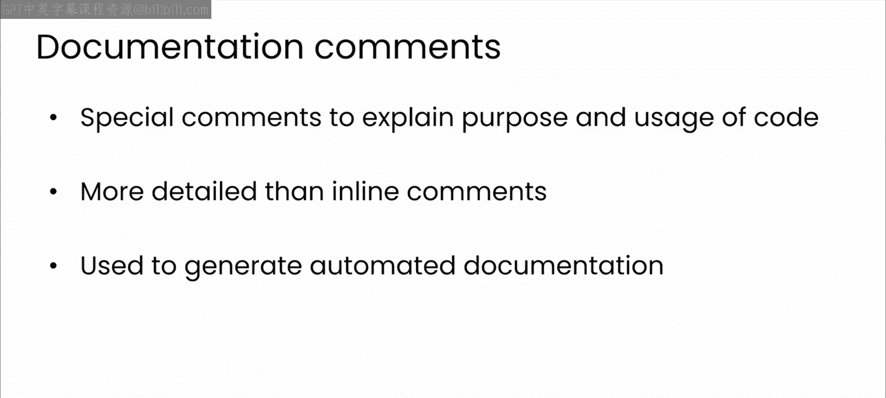
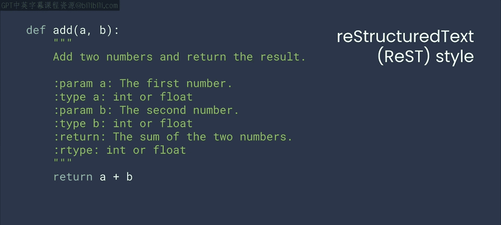
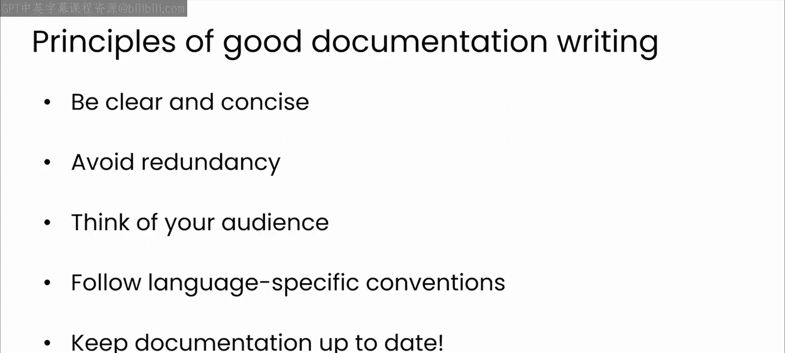
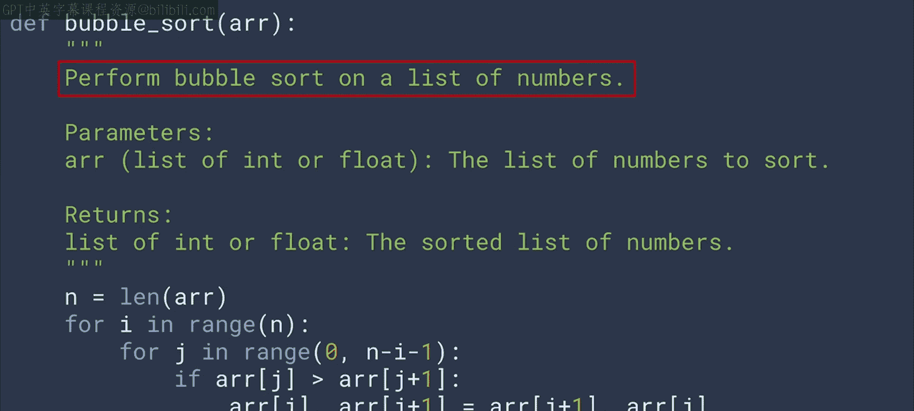
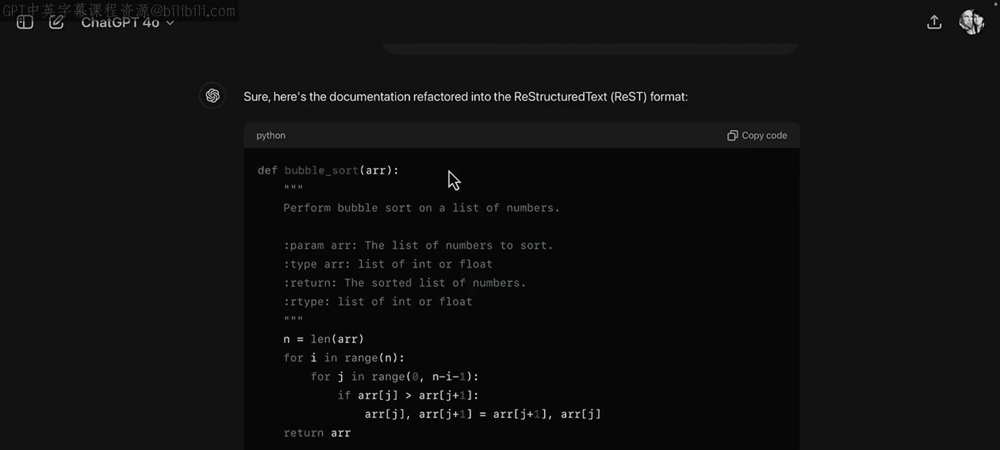

# 吴恩达《软件开发的生成式AI技能（简介、结对编程、数据库设计-3课全）Generative AI for Software Development Skill》 - P38：13_文档注释.zh_en - GPT中英字幕课程资源 - BV1ucxLeUEHD

Whereas inline comments are useful for providing clarity and making your code easier to follow。

 they're not intended for comprehensive documentation needs。

 and this is where documentation comments come in。😊。

Documentation comments also called doc comments or doc strings are special comments used to explain the purpose。

 parameters， and return values of a code block that they document。

They're much more detailed and structured than regular inline comments。

 and they play a special role in automatically generating documentation。

 we'll learn more on that later。😊。

Documentation comments are a critical tool for others to make sense of your code。 When written well。

 they will help your colleagues work with your code without having to ask you a ton of questions and partnering with an LLM on this aspect of documentation can really save you time and ensure that you create the best possible doc comments。

😊，Most modern programming languages have either built in support or agreed upon community standards for some type of variation of documentation comments The here are some examples in JavaScript The dot comment is the section before the function starts。

 and in Ruby here's the comment in the pink text。In this video you're going to focus on the implementation in Python which are known as Dock strings。

 and here's a simple example， the dock string appears immediately after the definition of the function in contrast to the examples that you just saw in JavaScript and Ruby。

😊，The dock string is a multiline string that explains the purpose of the function。

 the input parameters that it accepts， and the value that it returns。

There are a few different style conventions that dock strings and Python can follow。

 let's take a look at some examples of each。First is Google style。

 It's designed to be straightforward and easy to read。 Indeed， is why you just saw a moment ago。

The nuumpy or sip pi style shown here is similar to Google style。

 but some slight differences in how the parameters and return sections are formatted。And lastly。

 there's restructured text or rest style， which is often used with documentation tools like Sphinx。

 here's an example， and as you can see it looks quite a bit different from the previous styles because the items aren't broken out into different sections。

😊。

So let's take a look now at how you can work with an LLM to generate great dockstrs in Python。😊。

Keeping the principles of good documentation in mind is even more important with documentation comments。

 since they're longer， they involve more components and they're often used to generate documentation that will appear in public facing settings。

😊。

Let's start by automatically generating a dock string for function。

Using an LLM to do this can save you time and can ensure consistency across your codeb。As before。

 you'll provide chat GPT with a piece of code， and then you'll prompt it to generate a do string for you。

Here's a Python implementation of the calculate area function you saw earlier。

 but with no do straight。😊，Pause the video and work with GPT to try and get a dock string generated for this code。

Here's an example result that I got。 The model has generated a doc string describing what the function does and then describes its parameters and returns。

 It looks like this time the model chose to use the Google style。

 but if I wanted it in a different format， I could ask the model to change that。😊，Okay。

 here's another piece of code to try， pause the video and give it a go。

What kind of dock string did you get， Are you happy with it。

 Is there anything else you would try or maybe see if you can use a roll to get it to produce a different style of dockstr。

 I found that it generally defaults to the Google format。 Can you override that。😊，Okay。

 here's the bubble sort code from earlier， pause the video again and try to generate a dock string for this。

Think about writing this one for a specific audience。

 maybe a novice developer or someone who usually codes in C plus+ or Java。

 See how that changes the output。For fun， here's what I got。 Do you notice anything interesting。Yep。

 you guessed it， it actually identified it as a bubble sort。

Lastly， try using an LLM to refactor a dock string。

 have it changed the one that had just row for the bubble sort to the rest style？

And here's how the model responded for me。You can see that it refactored the information into the structure required for the rest style。

 This refactoring ability is so useful as you think about preparing your code for automated documentation generation tools。

 The LLM can really save time here， and it will help you avoid errors that might impact the quality of your docs and the time to generate them。

😊。

Now you know how to use an LLM to get Python dock strings in the right format for autodog tools like Sphinx。

 let's move on to the next video to see how you can create beautiful doc pages using these tools with the help of an LLM as always。

😊。