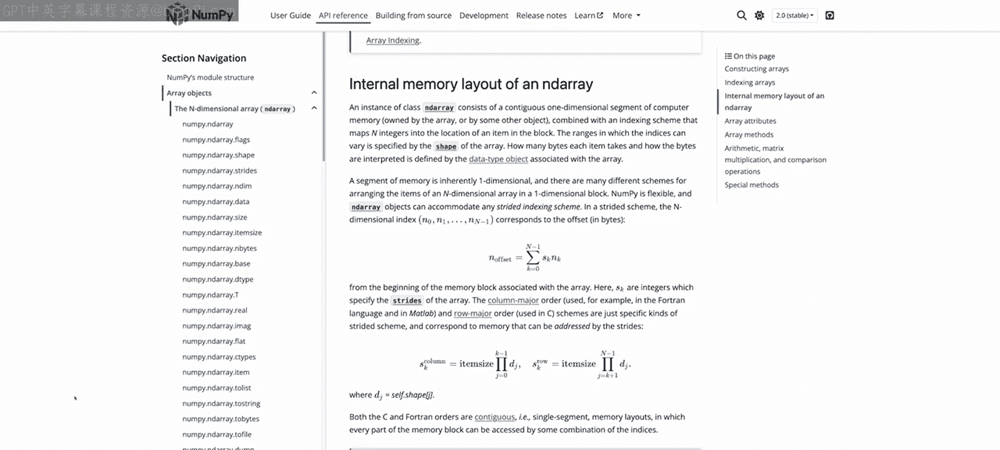
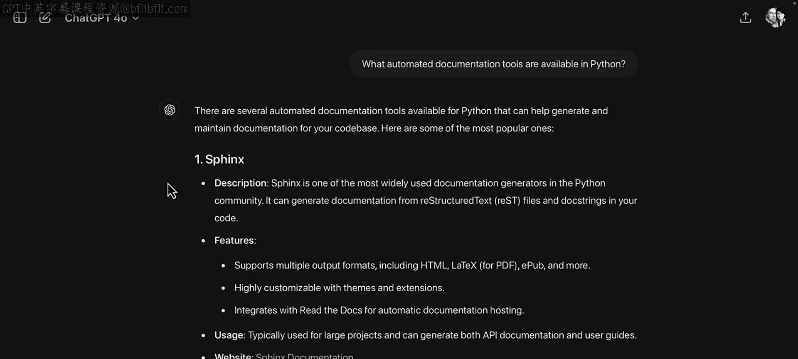
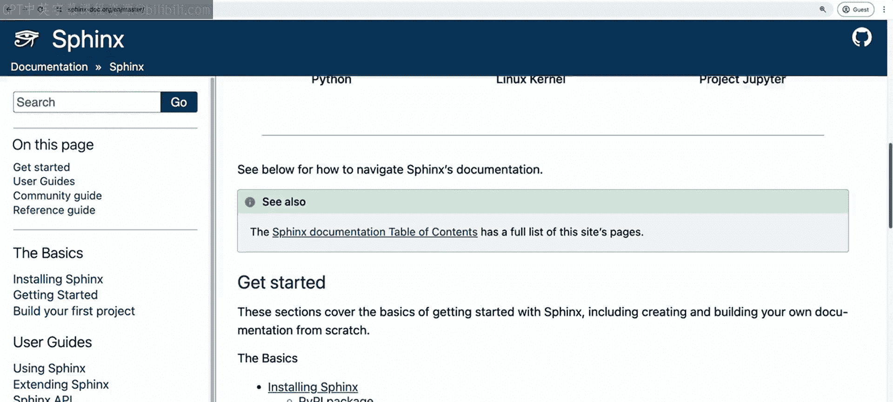
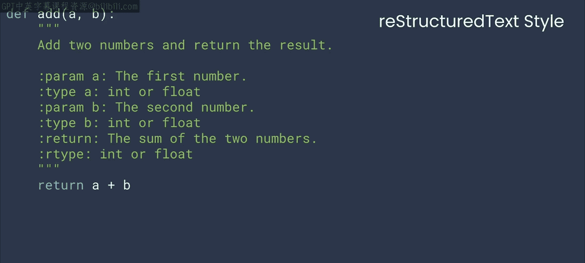
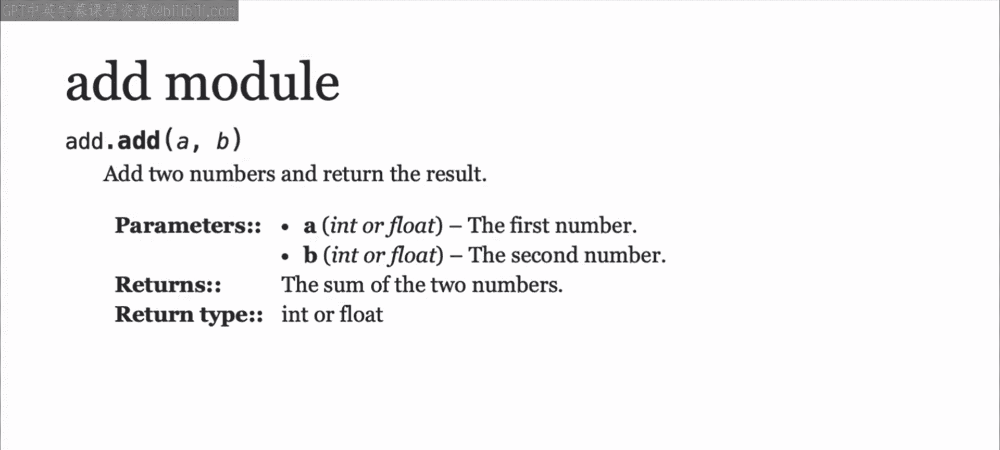
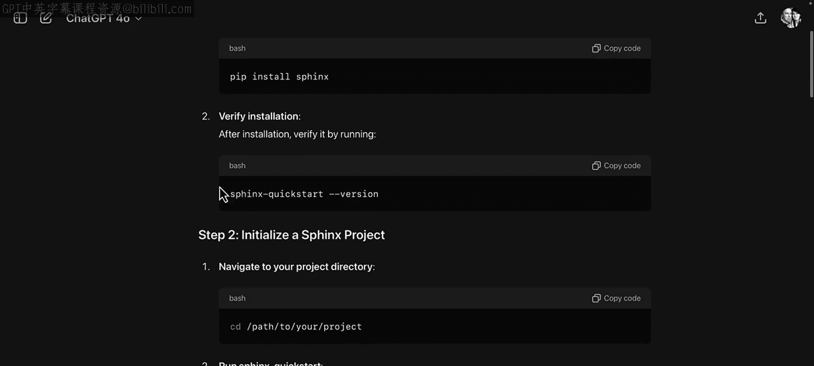
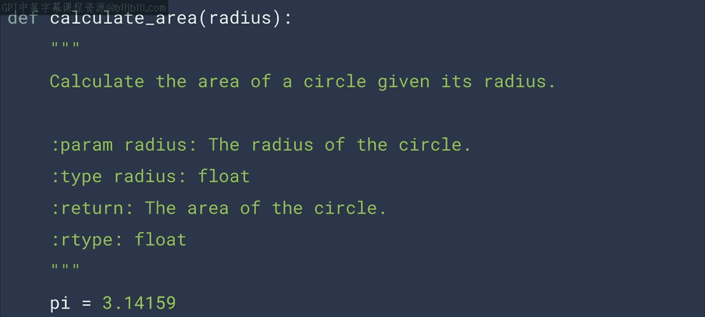
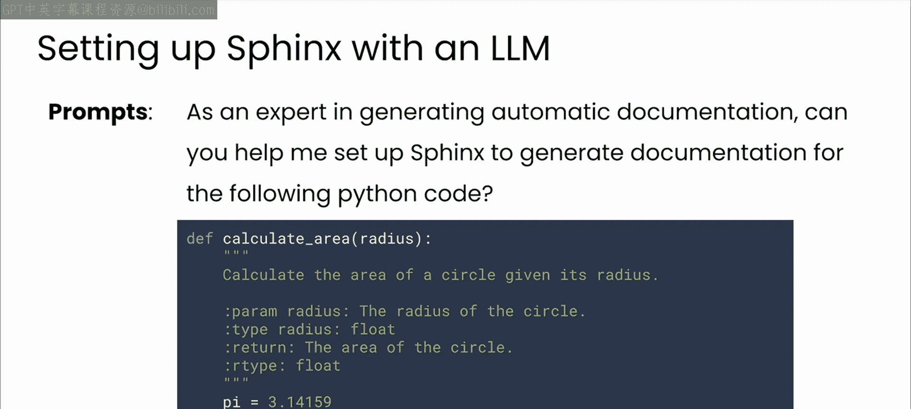
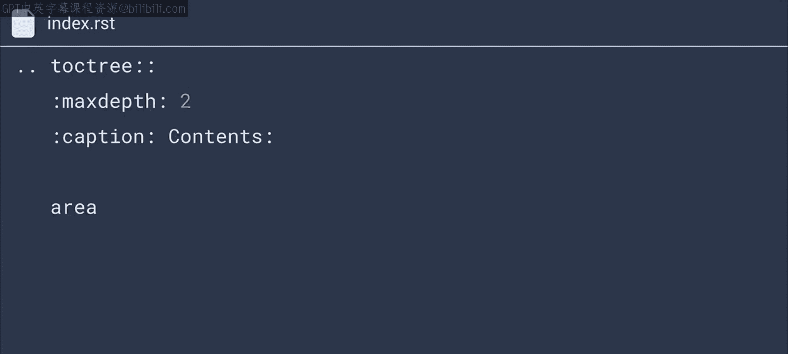
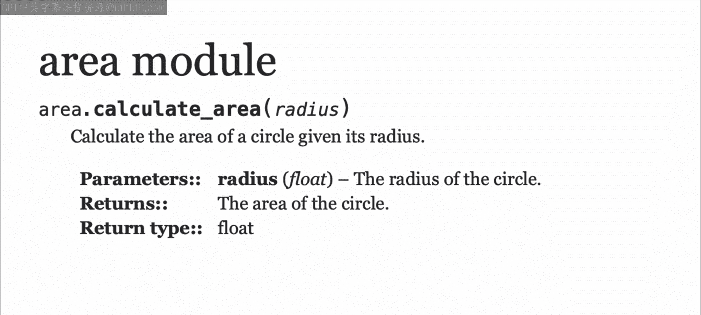

# 吴恩达《软件开发的生成式AI技能（简介、结对编程、数据库设计-3课全）Generative AI for Software Development Skill》 - P39：14_自动化文档工具.zh_en - GPT中英字幕课程资源 - BV1ucxLeUEHD

Soub documentationcument comments are an important tool to help others understand your code and use it successfully。

But it can be a pain to read these dock strings and IDEs are on GitHub。Luckily。

 tools exist to help you turn the documentation comments in your code into beautiful doc pages that make it easier for your colleagues and users to learn about your code。

 and if you aren't familiar with these tools and which options are available or how to install and work with them。

 you can always tap your LLM companion's knowledge of these tools。😊。

And the LLM will suggest some options for you and even how to set them up。For Python。

 Sphinx is the most comprehensive and widely used tool， so let's take a closer look at that。😊。

Sphinx is used in the Python community for generating documentation。

 it can convert restructured text docstrs into HTML， PDF and many other formats。

 making it an essential tool for any developer looking to create professional documentation。😊。

Sphinx was created to generate documentation for the Python programming language itself。

 but is versatile enough to be used with any project。

 It takes your restructured text files and dock strings。

And turns them into a cohesive documentation site， is' capable of outputting in a variety of formats。

 including HTML， Windows helpp， lateeek， EPub， and a whole lot more。😊。

To get started with using Sinx， you'll need to set it up and this is another task that an LLM can assist with。

If you ask the model for advice on how to install and set sphinx。

 it will walk you through the installation process step by step。

 You can provide context such as what system you're running on to get the best instructions for your particular setup。

The first step is nice and easy。 You can install it with Pp。 Note that if you want to follow along。

 you should probably do this in your own development environment。 Once Sphinx is installed。

 the LLM states that you should run the Sphinx Quick start command to set up a new Sphinx project。😊。

The script will give you some questions to answer， usually you can just accept the defaults or at least give sensible answers。

One thing I would note， though， is that the default to keep the source and docks in the same directory is one that I override。

 and I like to keep them separate。 I'll show my work in the screencast later on。

This gives you a very basic sphinx installation and you saw how the Quick Start compiled a site for you。

😊，Next， you'll make some real code， work with ChatyP to generate Doc strings。

 and then see how to make sure it works with sphinx to generate new documentation。

So let's start with basic code like this， the circle area function from the previous videos。😊。

Start by working with an LLM to write a do string for the function in the restructured test format and again try giving it different roles or instructions until you get something that looks like the dock string here。

And as you can see， the text in the comment is clear。

 and the structure follows the restructured text format。

 making it perfect for integration with Sphinx。😊。

Now at this point， you'll need a little bit of expertise and strengthphins to be able to get the most out of it。

 but if you don't have that， working with your favorite LLM will still get you up and running quickly。

😊，All of the following configuration code and instructions were provided to me by GPT by specifying that it's an expert in generating automatic documentation。

I then provided it my code and asked it to help me set upphinx。

Sphinx uses a configuration file called Kf dot P and Python for setting everything up。

 You should add code to this file to tell it where your source code is。

 And here's what I use for a directory I created in collab called Sphinx test。

 I'll show this in the screencast shortly。😊，Depending on where you've put your source directory。

 you'll probably have a different URL there。Still in confpy。

 you'll probably see extensions being set up as an empty list。 If that's the case， use this line。

 If there's something in there already， don't overwrite it。

 but do add a string containing sphinx EXt。 auto doc。For the Python earlier。

 I just created a Python file called area dot pi and the source directory， but in addition to that。

 you'll need another file with the dot or S extension， and it looks like this。

 Sphinx uses this to figure out how deep in the dock string it goes to generate documentation。

And then the master RsT file called index。orsT will need to be updated to know about the area one that you just created。

Once that's done， you could just call a command like make HTML and Sphinx will compile all of your code into Docs。

 and the documentation for the area module that we wrote should look a bit like this。😊。

I know that I went through that quickly， so join me in the next video where I'll walk you through the process step by step。

