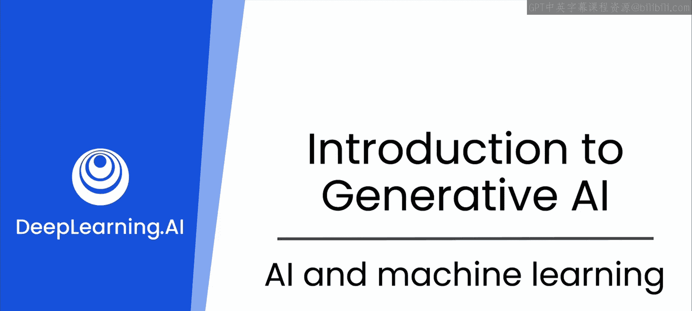
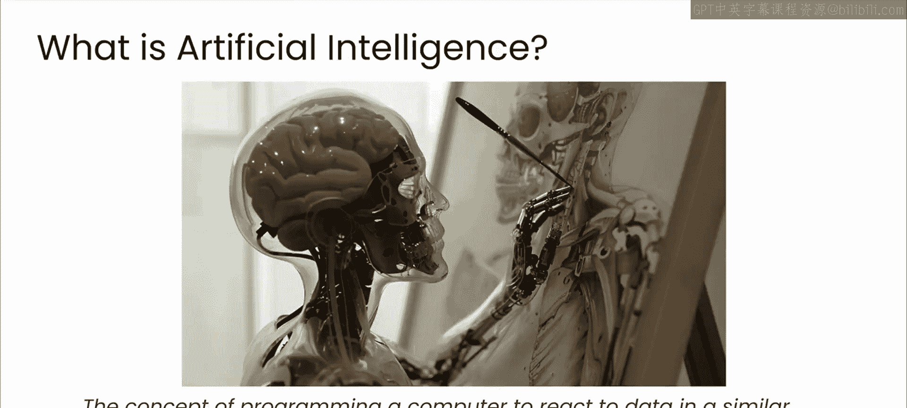
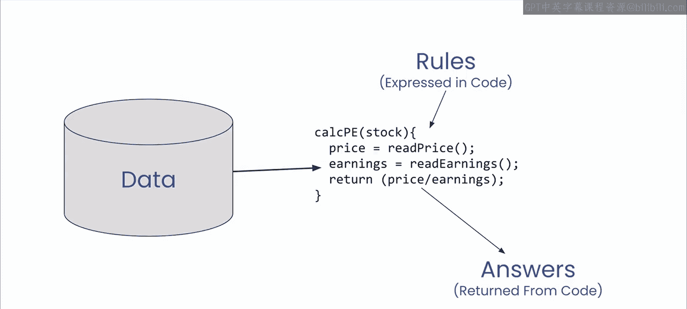
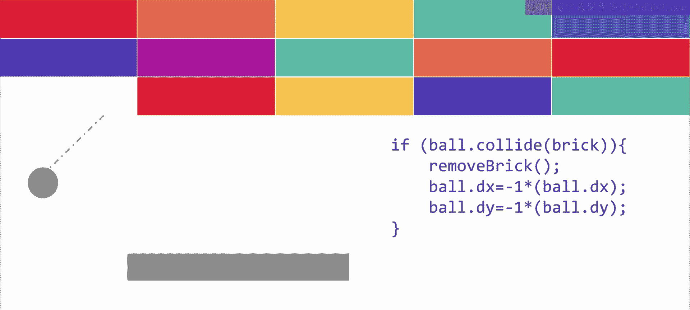
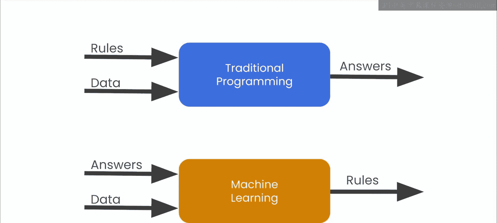

# 吴恩达《软件开发的生成式AI技能（简介、结对编程、数据库设计-3课全）Generative AI for Software Development Skill》 - P3：2_人工智能和机器学习.zh_en - GPT中英字幕课程资源 - BV1ucxLeUEHD

So let's start your journey by going back to basics and looking at the AI landscape。

 I'm assuming if you're taking this course you're an experienced developer。

 but you may not know as much about machine learning or generative AI。😊。

The next few videos will provide a high level overview of the way machine learning models are trained using data。

 and I'll also explain how one architect you'll called a transformer is particularly well suited for powering large language models。

If you already are comfortable with these topics， feel free to scam or even skip the next few videos in this module。

 If not， stick with me for a quick introduction to the key concepts， powering generative AI tools。

 There are many definitions of AI， But the one that I prefer is to think of AI as programming a computer to reacted data in the way an intelligent being does。

 And let's explore what that means。😊。

Here's an image of a cat。 You know it's a cat。 I know it's a cat。 But how would a computer see this。

A computer doesn't really see。 And instead， it would recognize this picture as just a bunch of colored pixels that have no associated meaning。

 whereasas you and I would see a cat and a different thinking being like a dog would also see it as a cat and probably react by chasing it or barking at it。

 But how do living creatures see the cat。 We don't see pixels。 But instead。

 we see something like eyes and ears and paws and the like。 And over time。

 we have learned that when a creature has ears like this and eyes like this。 It's a cat。

 Does this give us the basis to program a computer to be artificially intelligent in the way that living creatures are really intelligent。

 And the answer is， yes。😊。

So remember the definition from a few moments ago， it's that the concept of AI is programming a computer to react to data。

So if you can have the computer recognize features in the same way that people or animals do and learn to put these features together to make an interpretation that what it's looking at is a cat。

 then you can say that the computer program is artificially intelligent。

But then the question remains， well， how do you do that？Well， that's where machine learning comes in。

 Now， this term may evoke an image like this， but it's not really about robots in a classroom。

 It's just a fancy new way of programming a computer。In order to understand it。

 let's examine what computer programming really is。

So consider the components that make up traditional software developments。 For example。

 you've likely seen code like this where you read in some data。

 perform some manipulation on that data and return the result。

 It's what the entire software industry has been built on。

Or maybe code like this that specifies the rules behind how a game will behave， for example。

 how to move the ball and what happens when it collides with a brick， etc， etc。😊。

Traditional programming can be summarized in a graph like this one。 You express rules using code。

 These rules act on data， and you get back answers。

Think about almost every computer programming problem and how it can be summarized like this。

 it's what you've been doing for your whole career and probably the bulk of what you learned when you started coding。

😊，The machine learning revolution is just a new way of looking at this graph because it's a new and different methodology for coding。

😊，Instead of trying to figure out the rules yourself and express them in code。

 what if you give the answers and the data and then have a computer figure out what the rules are？

That's the core of the entire machine learning revolution。Now。

 I know this might not make a lot of sense right now if you haven't encountered machine learning before。

 so let's move on to the next video to explore an example in a bit more detail。

