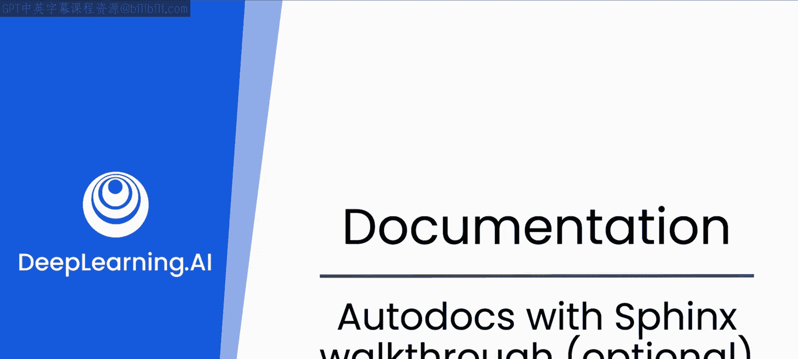
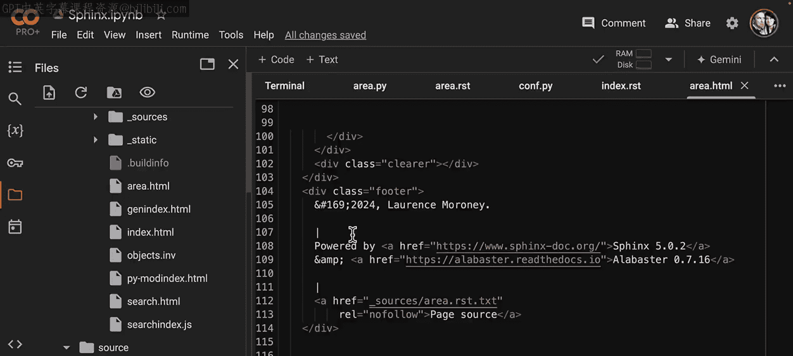
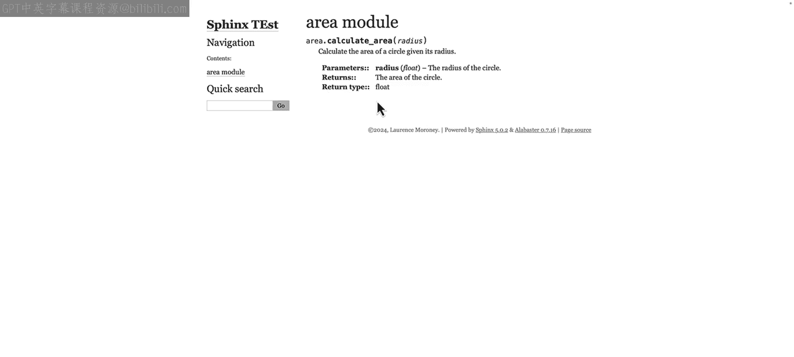

# 吴恩达《软件开发的生成式AI技能（简介、结对编程、数据库设计-3课全）Generative AI for Software Development Skill》 - P40：15_使用Sphinx进行自动文档生成演练（可选）.zh_en - GPT中英字幕课程资源 - BV1ucxLeUEHD

So I'm going to start in collab and I'm going to be using collab in a way that you may not have seen previously。

 but if you look at the tabs along the left on Collab。

 this one here gives you a terminal so I'm looking at this terminal and Sphinx is already pre-installed on it so the first thing I'm going to do is just I'm going to make a new directory。

In here， then I'm just going to call Stinkxs test。And then within that directory， well。

 let me change to it first。 I'm going to change to sphinx test。And if you use this view over here。

 the files view， you can actually see the directory has been created。So within that directory。

 I'm going to run the sphinx， quick start。And it's going to ask me a lot of questions。

So let's start with this first question and it's going to ask if I want to separate the source and build directories like yes or no。

 you see the default is no， but in this case I'm going to say yes。

Because I just want to make sure that these things are separate and it's a little bit cleaner for me to use。

The second thing it asks is going to be the project name。

 and that's where I could just give a name anything that I want really。

 so I'm just going to call this sphinx。Test。Author name， it's just going to be me。

Project release so this is as you can see it's like it' his way you can give some notes about project release you could ask track GT for some details about it。

 I'm just going to leave it blank。And then it's going to ask like about the project language。

 I'm just using English which is the default， and now I'm ready to go， everything is set up for me。

 everything has been initialized。So the next thing we can do is take a look at this directory and I need to refresh it。

And then we can see that this whole bunch of good stuff has been made for me in here， build source。

 make that all of that kind of thing。Al right， so the next thing I need， of course。

 is a file that I'm going to have a。Now that I'm going to build some documentation for。

 so let's start on doing that one next now that of course is going to be in my source。😊。

And in my source， you can see I have a budget files in here already。

 but I just want to create a new one， and I'm going to do the area Pi that we were showing in the slides。

 I'm going to call that area Pi。And now I can double click on area up high to open it up in here so I can start editing it。

So here I've just pasted in the code and with this little star is on here that means it needs to be saved so control S or command S on a Mac will save it and the star has gone away so we can see it's just the area that we were using previously that source code to calculate the area and we have the documentation in there。

So the next thing that we're going to need within our Sphinx test is another new file。

 which would be the area du or ST that contains some of the details that we need to defy the documentation。

 so I'm just going to say area or ST。And I'm going to open that up。Wopsupp it in the wrong directory。

 Let make sure it's in the source directory。And then I'm going to open that up again。

 it's just a blank file。And its contents will look like this and this is what we've seen in the slides and I'll provide all of these files in the download as well so you know how that they should look。

😊，Okay， so now we have the area our Pidon and the area the RST done， we're looking good。

 we're heading in the right direction。Next， we should take a look at Contoppi。Now。

 if we notice in here， import cis and import O pain。Commented out。

 so I'm going to comment them back in。And then the next thing is the cis path we can see that's commented in first。

 and this is giving us the absolute path to our content。

 but in the case of now we're currently running it in Colllab。

 this is incorrect right so in Colllab we're in slash content and then as you can see here a slash sphinx test。

And slash source。 So I'm going to change this to B。Slash content， slash sphinx。😔，Tests。😔。

Slash source。And where did I get the slash content from if you move upper a directory we see it's the content。

 this is the route directory in Colllab， we were in the content directory， so we slash content。

 slash sx test， slash source is where we're working。

And then one other change that we need to make and there should have been in the instructions that you got from chat EptT are in the extensions。

 so we want to do auto documentation here， so we're going to use the Sphinx extension for that。

 which should be just Sinx do。The auto dock。Don't like the bracket being on a separate lines。

 I'm just going to go there and only'm going to save this。

Now my next change will be the index at RST。If we could annually open this one up and all of this code is in the sidess。

 what we need to add is our area module。 It hasn't been added。 So I'm just going to add in here。

 area like so。 and the indentation， it really should be underneath the colon caption。

So I put the indentation there， hope that that works， but let's see。

So now all of our configuration is set up correctly， I'm going to go back to terminal。

I's going to clear the windows so that we can see and then up here I'm going to say make HTML。

And Sphinx is going to run and it succeeded and my HTML pages are in slash build s HTML。

So if I open this up and I got HTML， I should see that there's an area that HTML there is。

 so it has compiled this one for me this documentation off of that area page。

Kind of hard to read now because it's just straight HTML， but I've provided a download for you。

 and I'll show you what this would look like in the download。

And it looks like this。I guess I call my page Sphinx T oh sorry this is the one that's available in the download that you see I recorded in the video where I just had a little bit of a typo there。

 but we can see that the area module has now been documented fully for us area calculate area was the method and it gives us those parameters so if you imagine if you had a lot of modules and a lot of code here now the sphinx would be able to go through that compile them and give you documentation like this。

And that's it。 This is just scratching the surface of what you can do with automatic documentation。

 but hopefully it helped you understand the possibilities of working with an LLM。

 not just to prepare your code for auto documentation。

 but also to help you navigate an environment like Sphinx if you weren't already familiar with it。

 Having clean， easy to read documentation in hand will definitely make it easier for your colleagues。

 not just developers， but also testers， security experts， developer advocates and others。

 to understand and use your code。 This video has been very focused on Python code and tooling。

 but the same principles will apply if you're working in different languages。

 We'll take a look at a couple of examples in the next video。😊。

