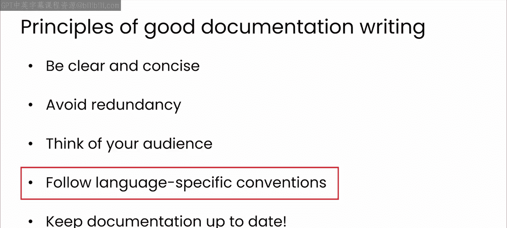
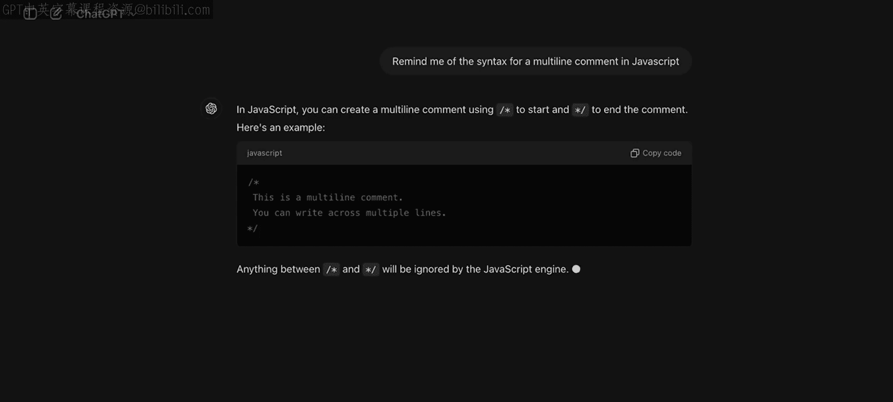
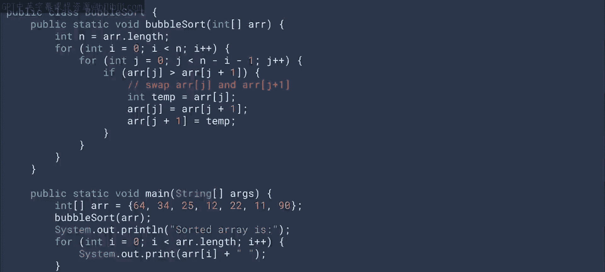
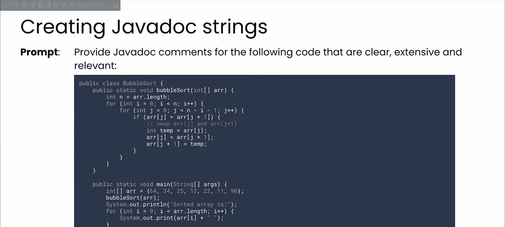
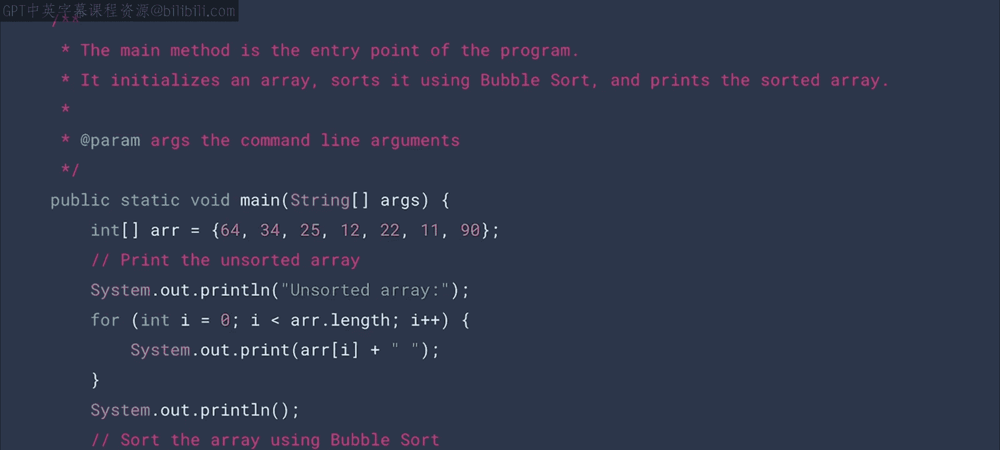
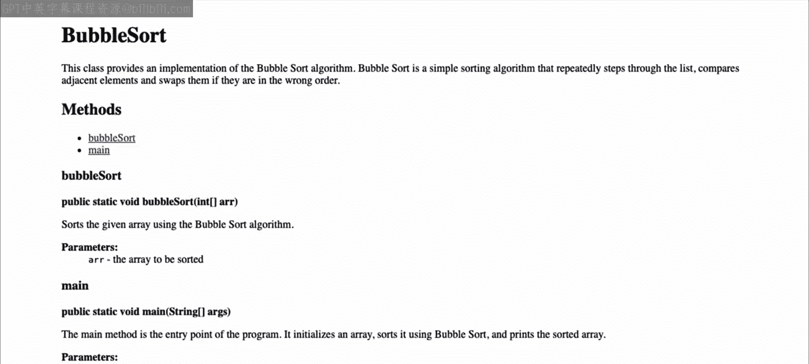
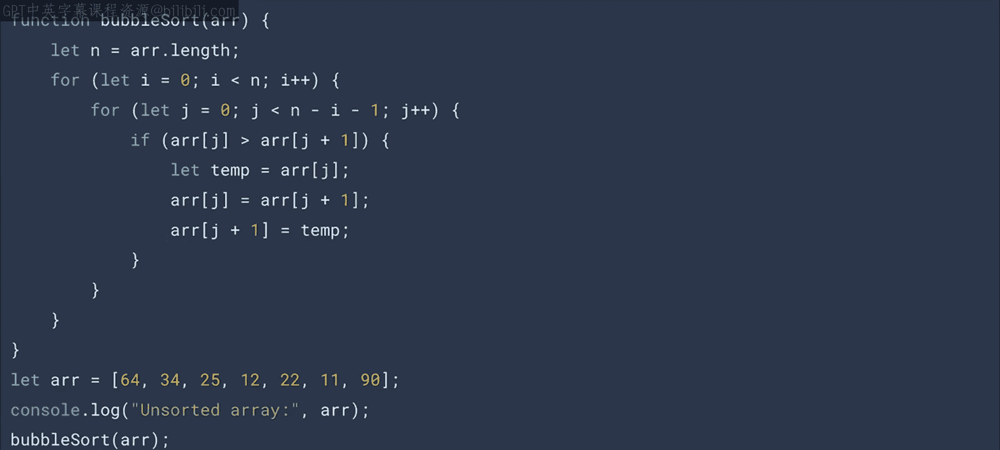
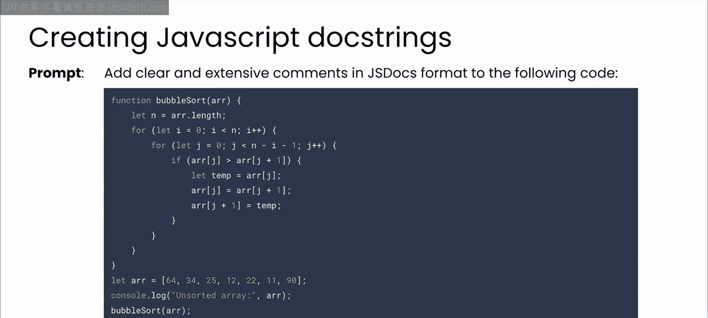
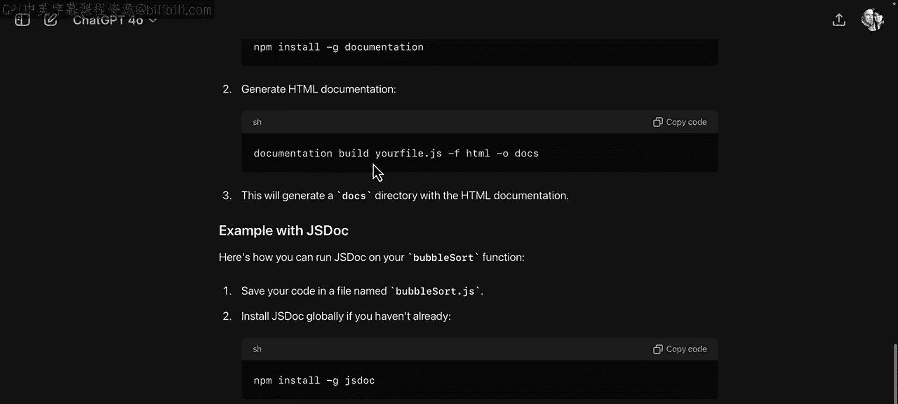
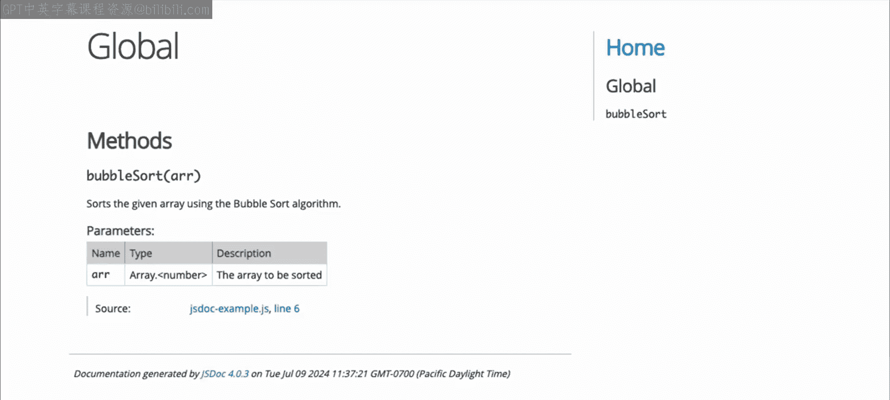

# 吴恩达《软件开发的生成式AI技能（简介、结对编程、数据库设计-3课全）Generative AI for Software Development Skill》 - P41：16_其他编程语言中的文档.zh_en - GPT中英字幕课程资源 - BV1ucxLeUEHD

In this module， you've explored how an LLM can help you write useful， well constructed documentation。

😊，From short inline comments to more extensive documentation of a software library or SDK。

 you've seen how an LLM can format your comment strings to ensure readability， clarity。

 and easy processing by automated tools。Although Python is the working language of this course。

 the principles of good documentation you've been working on largely apply in other languages as long as you think through any language specific conventions。

😊，Best practices do vary between languages and as always an LLM can help you learn about these。

One obvious difference is in common syntax， and LLM can always help you make sure you're getting this right for whatever language you're working in。

😊。

The amount of commenting also varies。 For example， some languages are intrinsically more didactic in their coding styles。

 Python is actually a really good example of this along with Ruby Go。

 So comments can be more minimal because the code itself when written well。

 explains what's happening。😊，Other languages like Java。

 C sharpa PhP tend to be more formal and verbose in their documentation and commenting with clearly defined structures to follow。

 And when it comes to automated documentation， some languages of great support for this built in where others can rely on third parties。

 Old languages like C and Fortran don't have much support for this at all。 Again。

 and LLM can help you navigate these differences and offer advice on tools to use。

So let's work through a couple of examples of working with an LLM to refine documentation in other languages。

😊，Let's start with Java， and if you're familiar with Java。

 it has a format called Java Doc for the automatic generation of documentation。😊。

So here's some Java code for the same bubble sort algorithm that you saw in Python in the last few videos。

 you can immediately see that this code is less easy to read than the Python version。

With a prompt to provide Java do comments that are clear， extensive and relevant。

I got this code， You can immediately see how verbose the commenting is here。First。

 for the function itself， it is a bit too long to fit it all on one slide。

 but you can see how the Java doc was done。And it was smart enough to infer that this is a bubble sort algorithm from its contents。

And similarly， it created Java doc for the main function describing what it does。

If you're familiar with the Java SDK， it comes with a Java Doc tool。

 which can then read your source code， take those comments， and turn them into HTML。

Here's an example page that was created from these comments。

So using an LLM can really reduce a lot of the friction in generating these。

 they often require very specific formats and a lot of trial and error to get them just right。

 and I think an LLM really speeds that up。😊。

Javascript is another language with a well formalized documentation string format。

 and it's called the JS Doc syntax。 So let's take a look at an example。

And here is the JavaScript code to bubble saw an array is very similar to the others firing all those syntactical differences。

Now let's ask an LLM to add clear extensive comments and JS docs to the code with a prompt like this。

And the model will give output that should look similar to this。😊。

The structure of the comments is very similar to that in Java Doc。Now， just like Python。

 there are several tools available to take the comments in your code and use them to generate document pages。

😊，You may already know about these， but if you don't， just ask an LLL for ideas。😊。

I got several suggestions for tools， and I decided to try out the JS DoP tool and you can install this in your development environment with the Note package manager NPM。

😊。

We'll discuss NPM in a bit more detail in the next module。

 but for now I'll leave it as an exercise for you to work out how to install the JS Doc tool。

 asking in LLM is it good place to start So if you use the JSDoc tool that's available to node users。

 you can quickly convert your JavaScript code to documentation and here's the page that was generated for the bubble sort that we just looked at。

😊，In fact， it gave a lot more than just a page。 Indeed。

 it gave a whole site with deep links into the source code so you can see where the various functions are。

 That's pretty cool。😊。

As you've seen， LLMs are helpful partners for writing clear。

 well structured comments and documentation。And they can also help you identify and use tools that can generate beautiful documentation in many different languages。

All of this will help others hit the ground running with your code。In the next video。

 we're going to wrap up by discussing one last benefit of good up to date documentation。

 and that is it helps make your code easier to maintain once it's in production。😊，I'll see you there。

