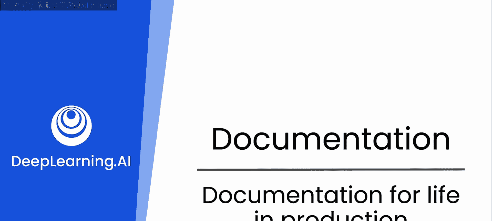
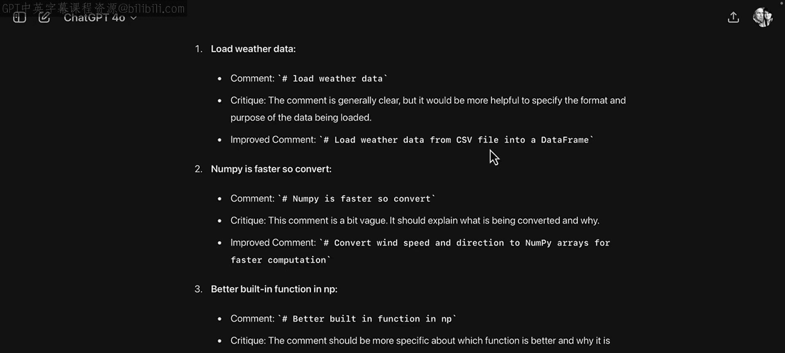
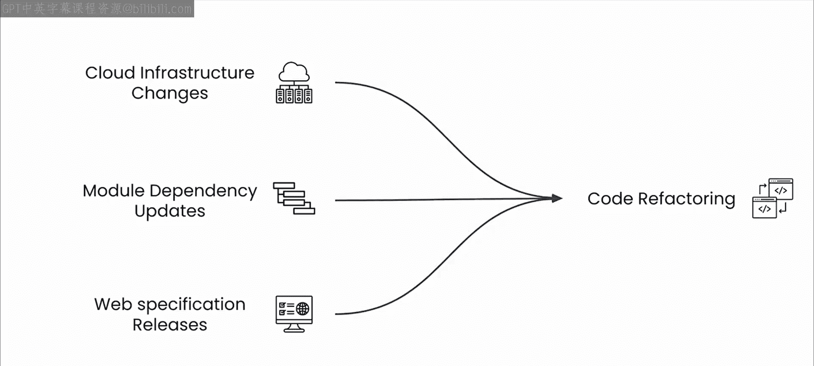

# 吴恩达《软件开发的生成式AI技能（简介、结对编程、数据库设计-3课全）Generative AI for Software Development Skill》 - P42：17_生产环境中的文档.zh_en - GPT中英字幕课程资源 - BV1ucxLeUEHD

So you've been taking a deep dive on documentation in this module and maybe deeper than you have in a long time。

 and I hope you'll agree that good documentation can really transform your code。😊。

From short inline comments to well crafted documentation comments that help you build extensive doc pages。

 comments make your code easier to read and understand。

 and hopefully you've come away feeling confident that LLMs can help you do this critical work quickly and effectively with an LLM as your documentation partner it's no reason to write bad documentation ever again。

😊。

There's one last benefit of good documentation that I do think is worth emphasizing。

 it really helps your code function well in production settings。

If your code is readable and well explained with good do strings and comments。

 it will be easier to maintain and your engineering team will be able to quickly understand what your code does。

 leading to faster bug fixes and faster updates。😊，And for your colleagues in tech support our education roles like developer advocates。

 your well written documentation will make it much easier for them to learn how to use your code and also get users excited about it。

Lastly， as we all know， code is like a living thing because the ecosystem it lives in。

 cloud infrastructure， module dependencies， web specifications， and so on are constantly changing。

Your code will probably require frequent refactoring once in production to keep up with these changing dependencies。

Good documentation will make that process so much smoother for you and for anybody else working with your code。

😊，In fact， when it comes to dependencies， LLMs are really useful for working through issues related to package version control。

 library dependencies and so on， and that's exactly what you're going to focus on in the final module of this course。

 so let's move on to the next video to start exploring dependency management with large language models。

😊。