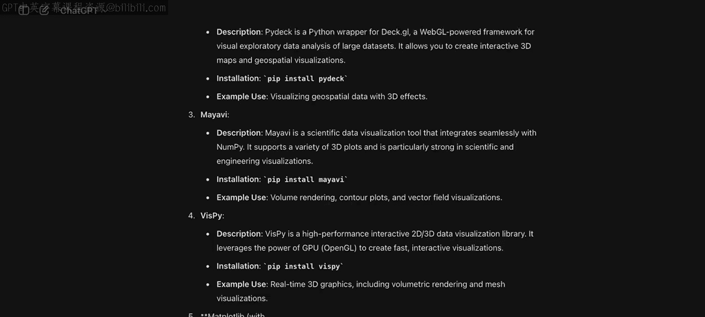
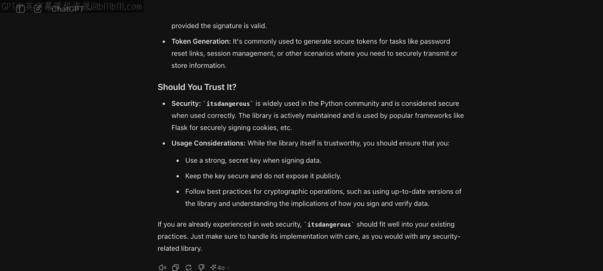
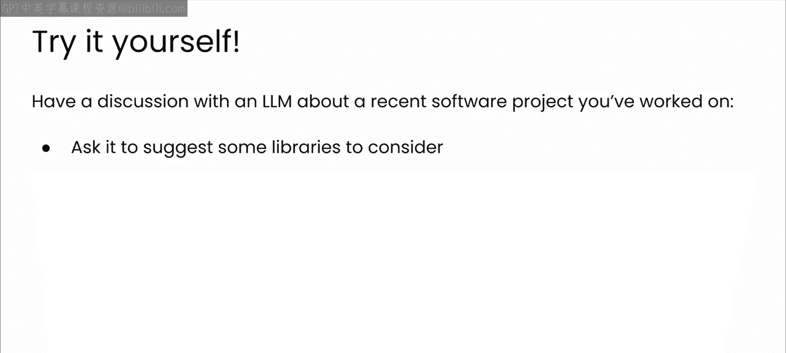
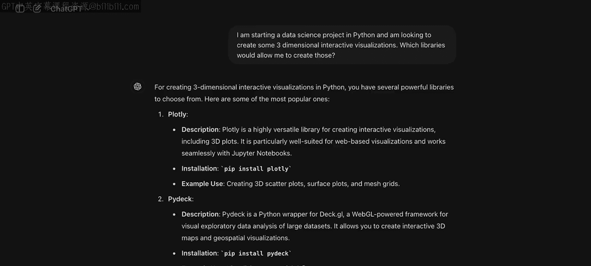
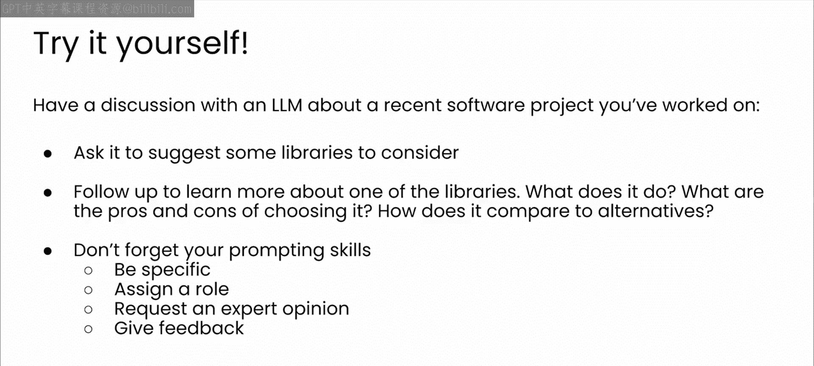

# 吴恩达《软件开发的生成式AI技能（简介、结对编程、数据库设计-3课全）Generative AI for Software Development Skill》 - P43：18_模块介绍.zh_en - GPT中英字幕课程资源 - BV1ucxLeUEHD

Modern software development relies on a dizzying array of dependencies from web development to machine learning to networking and infrastructure。

 odds are， if there's a task you're working on， there's a library or framework available to help you complete the job。

It's enormously helpful to have access to these off the shelf solutions。😊，In many cases。

 these libraries are built by experts in a particular area and you can count on their code to be efficient。

 tested， and secure。At the same time， they're called dependencies for a reason。

 you are literally depending on that code to work as expected。

 and if those libraries are found to have flaws or if they inevitably need updates。

 it could have downstream effects on your project。If you want to be an effective developer as well as knowing what's going on in your own code。

 you'll also need to understand the complex web of dependencies that your code is built on。

And this is an area that LLMs can be a huge help。In the third and final module of this course。

 you'll learn how LLMs can help in many areas of dependency management from selecting which dependencies to build upon in the first place to getting familiar with the functionality of a new library to manage in common challenges with dependencies like version conflicts and security vulnerabilities。

 LLMs can help you and your team make better choices as you navigate the dependencies that your software projects are built upon。

😊，To get started， let's remind ourselves what a dependency is In simple terms。

 a dependency is a library or module that your project relies on to function correctly。

 Dependencies are crucial because they allow us to leverage existing code。

 frameworks and tools to build our own applications faster and more efficiently。 For instance。

 if you're a Python developer working on a web application。

 you might use flask or django as you went framework。 If you're doing data analysis。

 you might rely on libraries like Numpy or pandas。😊。

Dependencies can be internal or external internal dependencies are modules or packages that you've written yourself and live within your own project。

External dependencies are third party libraries that you include in your project。 Now。

 as you probably know， dependencies can be incredibly powerful tools。

 but they can also introduce their fair share of headaches。

 A very common challenge with dependencies is version conflicts。

 These occur when different dependencies require different versions of the same library。For example。

 here， one part of the application could have been written to use version 2。0 of a popular library。

But the offth code in that same project is still using version 1。0。

And this can lead to compatibility issues and errors in your application。

Security vulnerabilities are another critical issue using outdated or unpatched libraries can expose your project to security risks。

 So here if the Library version 1。0 has a vulnerability， it now puts the whole app at risk。And。

 of course， there is also the challenge that dependencies you take can have dependencies of their own。

 The results， a complex web of transitive dependencies whose behavior。

 vulnerabilities and updates you'll need to manage。

So let's think a little bit about how LLMs might help us navigate these challenges。

First is their strengths LLMs can be a great tool to help you brainstorm libraries and packages to use in your project。

😊。

For example， say you want to do some data visualization。

 an LLM can let you know your options and help you pick the best tool for your project。

 and as always， the more context you're able to provide the model。

 the more tuned the recommendations will be to your needs。😊。

Second， LLMs can help you learn more about the dependencies you come across as you work。

For example， if you learn your project is using an unfamiliar package。

 you can ask the LLM to tell you a bit more about it。 A little later on。

 you'll see code that I used that has a dependency on a library called Its dangerous Now that sounds scary and I want to know more about it。

😊。

While documentation or online forums are also helpful。

 an interactive conversation with an LLM can often lead to a more tailored understanding of whether a dependency is the best choice for you。

Third， LLMs often can help spot dependency conflicts with newer models doing an excellent job of processing large bodies of text。

 you might even get away with just sharing the dependencies of your project directly with the model and asking it to identify any potential conflicts。

 You'll take a closer look at dependency conflicts in a later video。 Finally。

 once you've identified the conflicts， LLMs can help you work to resolve them。😊。

They may be able to suggest different approaches or alternative libraries for you to use to fix that roadblock that you're encountering。

😊，All of this can help you and your team keep your projects moving forward。That said。

 you can probably already anticipate some weaknesses of LLMs in this context。 First。

 LLMs don't know anything about changes to libraries or packages past their training data cutoff date。

 Some models can augment their training data by searching the web view。

 but if you're working with a fast-chan library or in an area of very rapid development。

 it's possible that the LLM just won't know about the most relevant changes to your project。Second。

 LLMs may not be as helpful or accurate when providing support with more obscure libraries。

 the amount of knowledge in LLM encode codes about a topic depends on how frequently it encountered text about that topic during its training if you need support using a more obscure library。

 the possibility for inaccurate or hallucininated answers and code snippets can increase。

In this case， the model may just not have enough data on which to base its responses。

Before we dig into each of these modes of working in turn。

 I think it would be helpful to try this out for yourself。

 have a discussion with an LLM about a recent software project you've been working on。😊。

Ask it to suggest some libraries to consider and then follow up to learn more about one of the libraries it suggests。

Feel free to choose a library you already know a lot about and see if you agree with the results。

 or use this as an opportunity to learn more about a new library As always。

 don't forget the prompting skills that you have been practicing， provide context， give feedback。

 assign a role， and ask for an expert opinion。😊，Pause the video now and give it a try for yourself。

Depenencies are useful， but they are risky。 you're deciding to tie the success of your project to the work of other people。

 and these are often people you don't work with directly and who you'll likely never even meet。

LLMs can be an effective tool to help you make this decision carefully and then navigate the complexities that arise from taking on these dependencies。

Let's start with a powerful tool， virtual environments。

 they help you to explore different dependencies without risking damage to your development setup。

