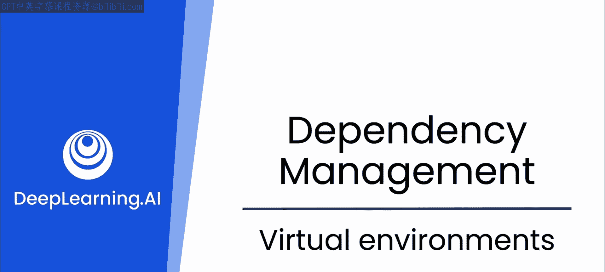
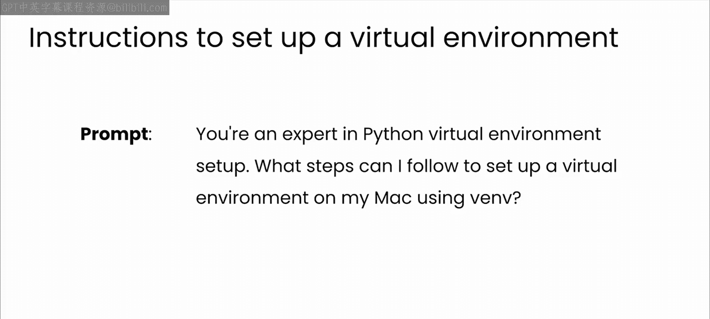
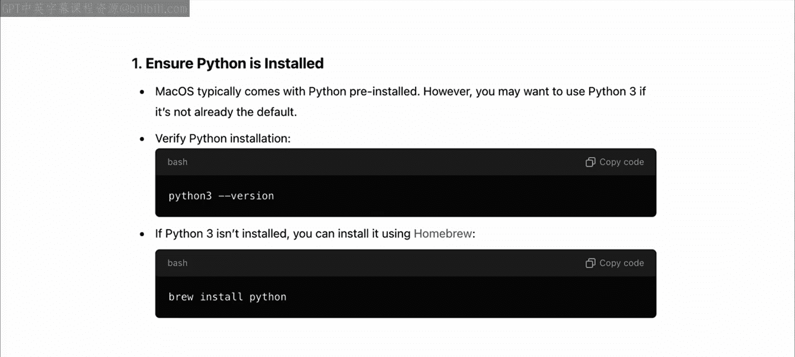
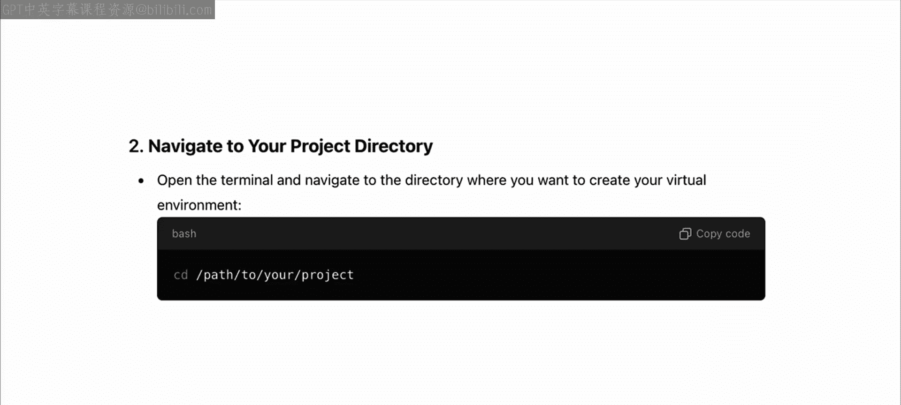
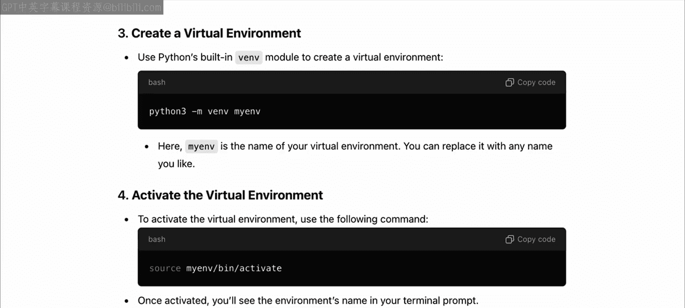
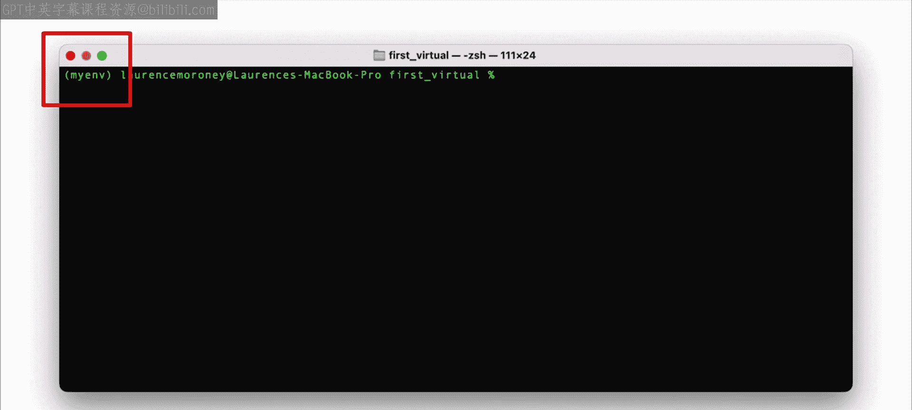
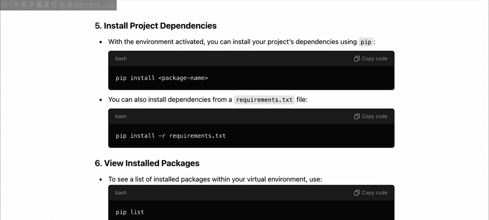
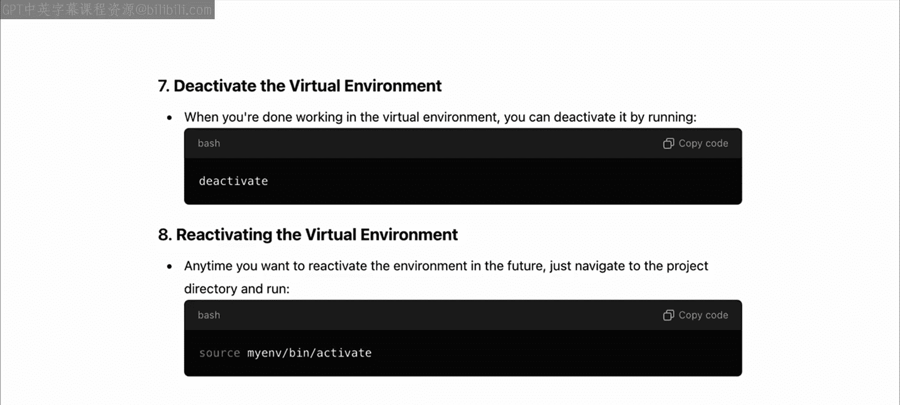
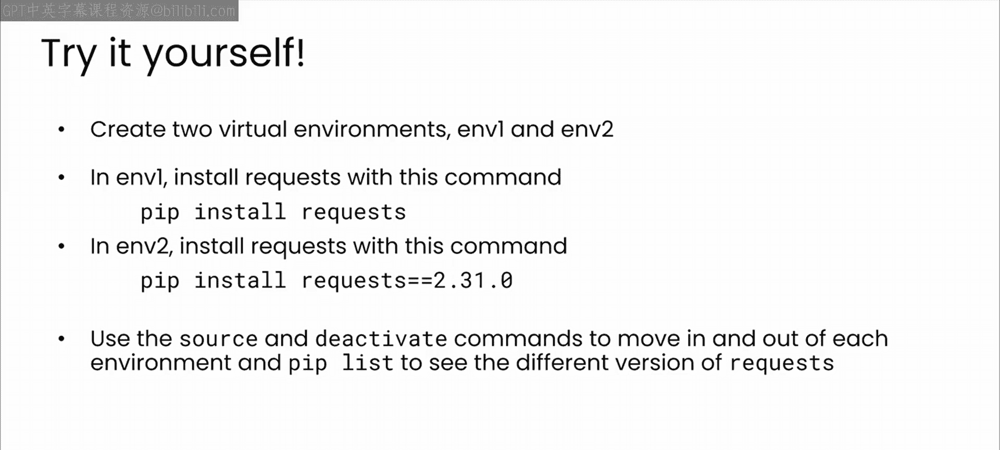

# 吴恩达《软件开发的生成式AI技能（简介、结对编程、数据库设计-3课全）Generative AI for Software Development Skill》 - P44：19_虚拟环境.zh_en - GPT中英字幕课程资源 - BV1ucxLeUEHD

A great first step for successful dependency management is to have a space where you feel safe to try different libraries for a specific project。

Virtual environments are designed with exactly that in mind。

 A virtual environment is an isolated workspace that allows you to manage dependencies for a specific project without affecting others。

 This isolation is crucial to avoid conflicts between different projects and their own sets of dependencies。

😊，So for example， think of the slide as representing a single development machine。

 the yellow box on the left is one virtual environment designed to run app 1。😊，To do so。

 library version 1 and Fwork version 2 are necessary。Meanwhile。

 the green box on the right is a second virtual environment designed to run app 2。

 perhaps this is a newer app so it's built upon library version 2 and F version 5。😊。

You'll notice that it's the same framework and library in each。

 but different versions app 1 might require library version 1。

 which is incompatible with library version 2。 So if app 2 needs library version 2。

 installing that would break app 1。 if you are trying to run these apps within the same development machine。

 this could create a conflict by instead partitioning each app within separate virtual environments。

 you can isolate them from one another and only give each app access to the appropriate dependencies。

There are many benefits to using virtual environments in your development projects。

A virtual environment is isolated from all other environments。

 so each project can have access to its own set of dependencies。

 which won't be impacted by unintended updates by other projects。

 This is a great way to avoid cross project conflicts。😊，Virtual environments are also reproducible。

 For example， you can send your project to a teammate and by loading the same virtual environment configuration。

 they can expect the application to run in the same way as it did for you。 Lastly。

 virtual environments are more manageable by keeping the setups isolated and only working with exactly what you need for a given project。

 It's easier for you to manage， maintain and update dependencies over time。

 especially if you have many projects in the works。😊。

Now that you've seen an overview of virtual environments。

 let's actually set some up throughout this module。

 I want you to have an opportunity to try out the concepts that you'll be exploring to help you do that。

 you'll see how you can set up a virtual environment in Python and explore tools that you can use to install packages and manage dependencies like PIipP。

😊，Here you'll be using a tool called Venv V E N V。 If you're familiar with this， great。

 feel free to skip ahead， or you might find this material useful as a refresher For the rest of us。

 let's take a brief look at how to get up and running with Venve and we'll have an LLM by our site to help us To start。

 I'm going to prompt the LLM to tell me how to set up a virtual environment in Python using Venv。😊。

Note that I asked it for instructions on setting it up on my match。

So it gave me max specific instructions， such as using homebrew to install Python。

 If I didn't have it installed already。 First， it tells me just to make sure I have Python installed and check its version number。

 And if I don't have Python installed， I can then install it using home brewrew。

This ended up being surprisingly good advice because I've gone so used to using development environments in the cloud that my local environment has gotten really rusty。

 This is one of the things I love about working alongside an LLM like this。

 It doesn't have assumptions and it forces you to challenge yours。😊，Next。

 it tells me to navigate to the directory where I want to create my virtual environment。

Once you're in the correct directory， you can call Python 3， M， Ven V NV。

 and then the name of your environment here the environment is called Myen。

 but you can name it whatever you like。Now you called source the name of your environment slash bin/lashactate to activate your environment。

 so for example it's source my end/lash bin/lash activateate。

Should everything work， your terminal would show the name of your environment at the beginning of your prompt like this。

Now that your virtual environment is active， you can install libraries or other dependencies within it。

 as you normally would， without impacting your main environment or any of the other environments。

 to see those packages listed out， you can call PIip list。😊。

And when you're done， you can simply call deactivate to deactivate the virtual environment。😊。

If you want to reactivate an environment， you can use the same source commands that you use to activate it the first time。

😊。

In the next few videos， I want you to be able to create virtual environments of your own。

 Feel free to rewatch this video for instructions or prompt your LLM to provide them for your specific machine。

😊，Then I'd love you to try the following activity， create two virtual environments with NV Call them EN V1 and E V2。

 that's end1 and endv2 Use PIip to install requests in each of these。

 but do it slightly differently in EN V1， use Pip install requests in EN V2 use Pip install requests equal equals 2 do31。

0。😊，In N1， you'll get the most recent version of the request library In end 2。

 you'll get a specific version from May 2023。 Use the source and deactivate commands to move in and out of each environment and use Pip list to get details on the versions of your dependencies。

😊，Take your time and explore to get a feel for it。

Once you're done， join me in the next video where you'll see how LLAs can help you make good choices about how to pick the libraries to use in the environment that you just created。

😊。