# 吴恩达《软件开发的生成式AI技能（简介、结对编程、数据库设计-3课全）Generative AI for Software Development Skill》 - P45：20_研究依赖项.zh_en - GPT中英字幕课程资源 - BV1ucxLeUEHD

Welcome back at this point， you've seen at a high level how LLMs can help you manage dependencies。

 and you've even set up a virtual environment or two。

 and now it's time to get hands on and actually try it all out。😊，As I discussed earlier。

 not only do most modern software projects have a long list of direct dependencies。

 but these libraries will themselves have dependencies that your app now transitively is dependent on。

 And in many projects， a lot of your work as a developer will involve effectively understanding and managing。

 all of these libraries that someone else has built and likely is continuing to actively develop。

You may already be familiar with some advanced tools that help with some of these package management tasks。

 for example in Python tools like poetry or PIP can help streamline this process。

 and if you're a JavaScript developer you may be familiar with NPM and in the world of CSharp you'll likely use Newget。

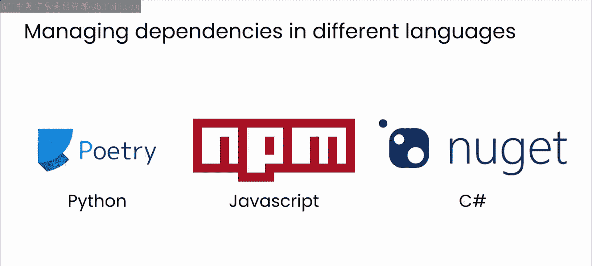

While package managers will remain your primary tool for managing dependencies。

 LLMs can help you better understand the project's dependencies and make good decisions about how best to meet the needs of your project。

In the last video， you use PIip list to list the packages installed in your environment。

 Now try a very similar command Pip freeze。😊，You'll get a list of your dependencies with our versions that looks like this。

The version numbering such as 2323 for requests following the equals equals is generally called pinning。

 and that's where you specified the exact version of the request library that your project was built on。

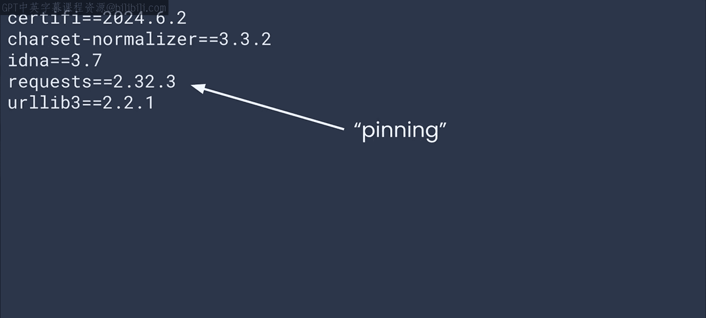

There's a separate and powerful command line tool called PP To that can help you keep your PP based packages fresh。

 even when you've pinned them， it consists of two main commands， PP compile and PP sync。😊，Typically。

 while using PP toolsol， you start by listing the direct dependencies of your project in a file called requirements。

inN。You then callP compileile on this file and it will generate a requirements。txt file for you。

 and this is something that you can use to specify the dependencies if you want to load them in future。

And as you'll see later， Pip syncnc can then be used to install or update all of these dependencies。

 Let's take a look at an example。

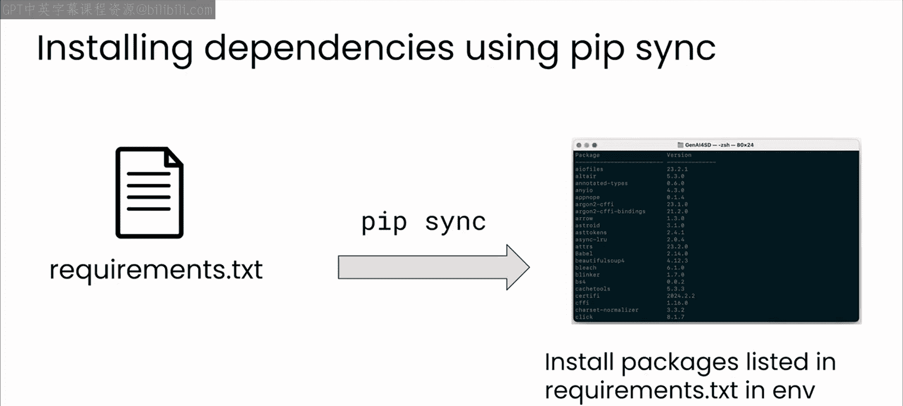

For the next few steps， make sure you have a virtual environment active and if you don't know how to do this please go back to the previous video Now I'm just going to ask the LLM for tips on installing PIP tools and compiling my first set of requirements。

😊。

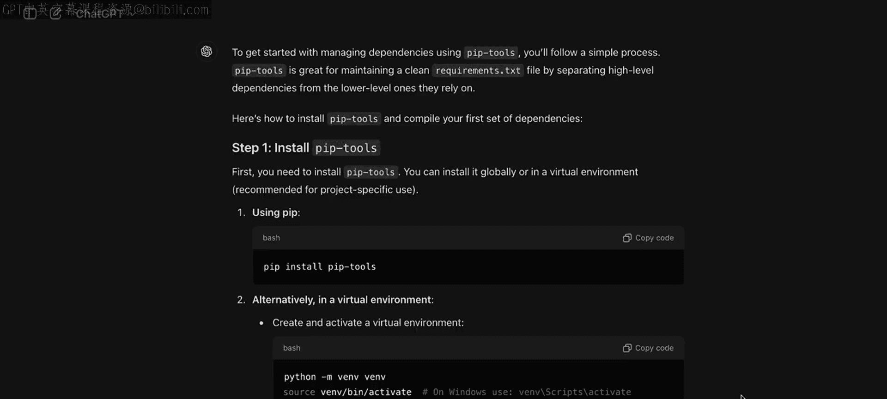

Here's what that process looked like on my machine。 First。

 I used Pip to install P tools from the command line。 Once that was installed。

 it told me to create a file called requirementsments do in that lists my project's direct dependencies。

 and you'll recall these were requests and flask。Finally。

 it told me to call P compileile with my requirements。 In file。

And here's the output I got。 What's really cool is that it figured out your dependencies dependencies and ensured that theyre included in the requirements start tax too。

😊。

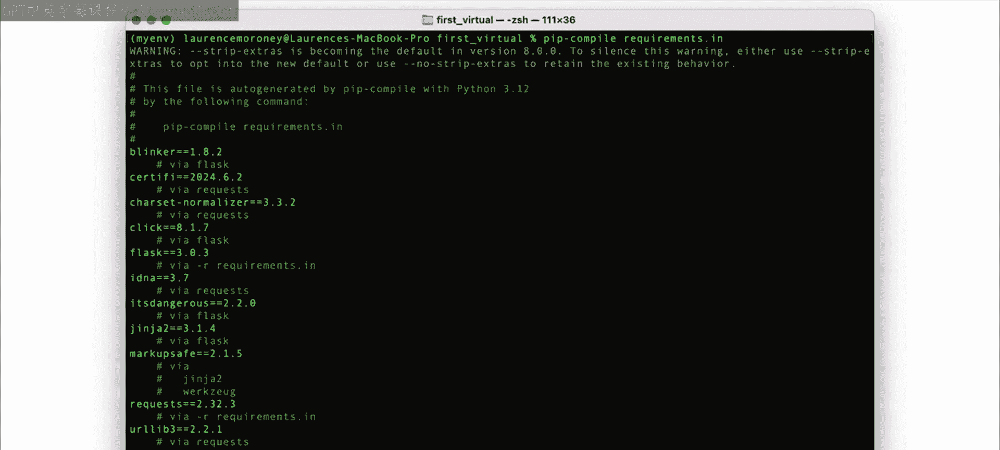

You can see my output here。And the generated requirements。 TxT look like this。😡，Now。

 there's lots of stuff in there that I didn't ask for because they are the dependencies of my dependencies。

 including things like it's dangerous and Verkeuug。

I'm now taking a dependency on them without realizing it because I ask for requests and flask。

 So I'm taking a bit of a risk， particularly with something called It's dangerous。

 Here's where an L L M can be a helpful tool to help you understand these dependencies。

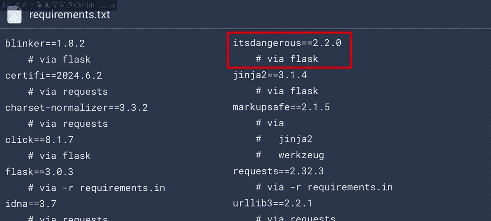

I'd probably write a prompt like this。I have a dependency on a Python library called It's dangerous。

 What does it do and shall I trust it？

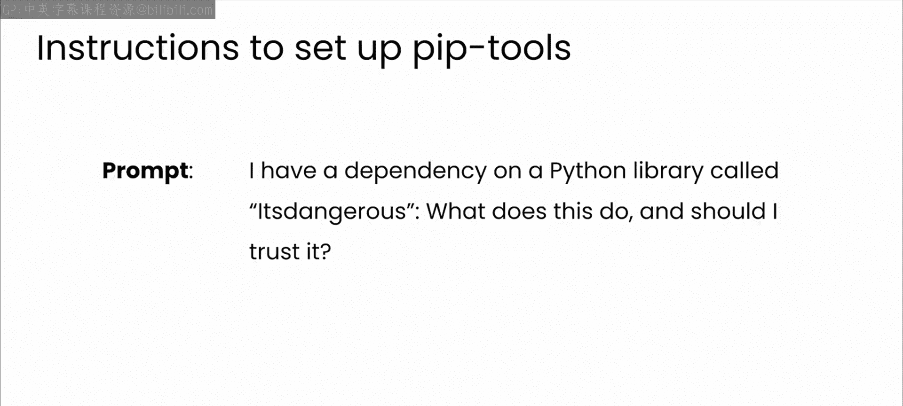

And then you'll get an answer a little bit like this。😊。

Giving you a lot of detail about the library and maybe helping you to trust it a little bit more despite its name。

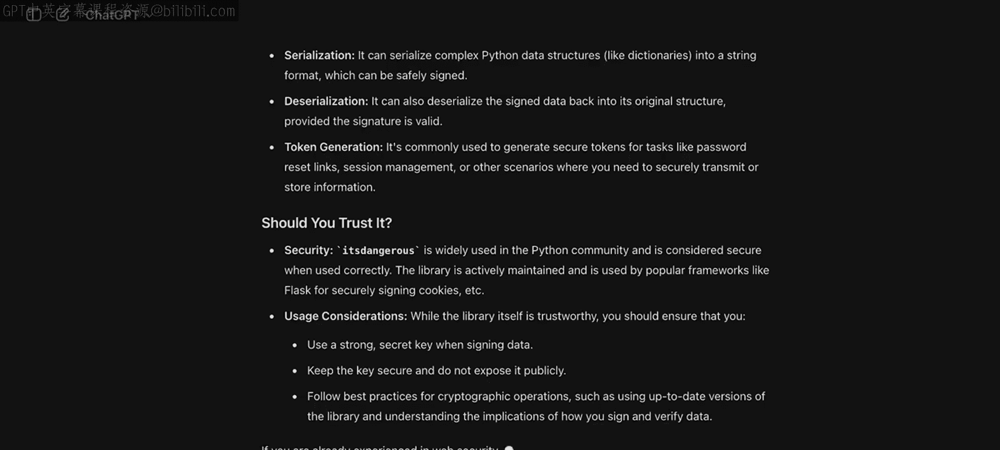

And it could even give you the URLs that you could go to to learn more。

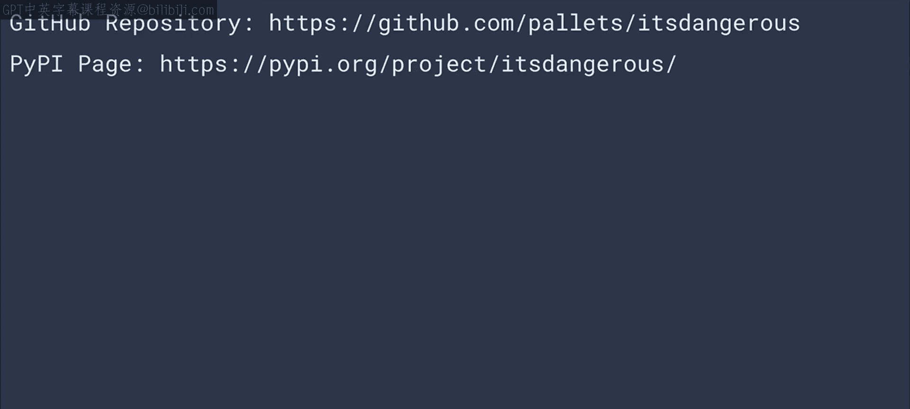

Of course， because you're working with an LLM， you could always go one step further and ask it to provide a quick summary of every dependency at once like this。

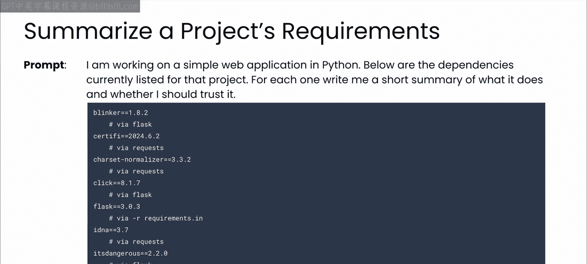

LLMs are excellent at responding to these kinds of complex queries。

 and they can help you quickly get familiar with all of the dependencies in your project。

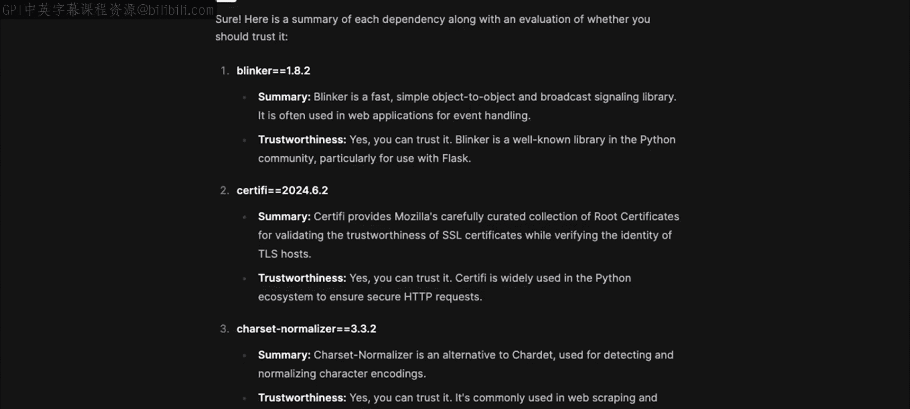

A huge benefit of compiling packages like this is the ability to allow you or your colleagues to replicate the virtual environment that you're using。

This can allow two developers to work in sync with one another while being certain that the behavior of the software can remain consistent。

To do that you'll use the PPSync command I mentioned earlier。

 this command will read from the requirements。 Tx file that you generated， and then install。

 upgrade or uninstall all packages currently in that environment to exactly match with those listed in requirements。

 Txt。😊，Do note that doing a PipSync will remove any libraries that are not specified in the requirements。

 TxT fileile This means if you share a requirements。txt file with a colleague。

 they can also run PipPSync and be sure that they're working off the same set of packages。

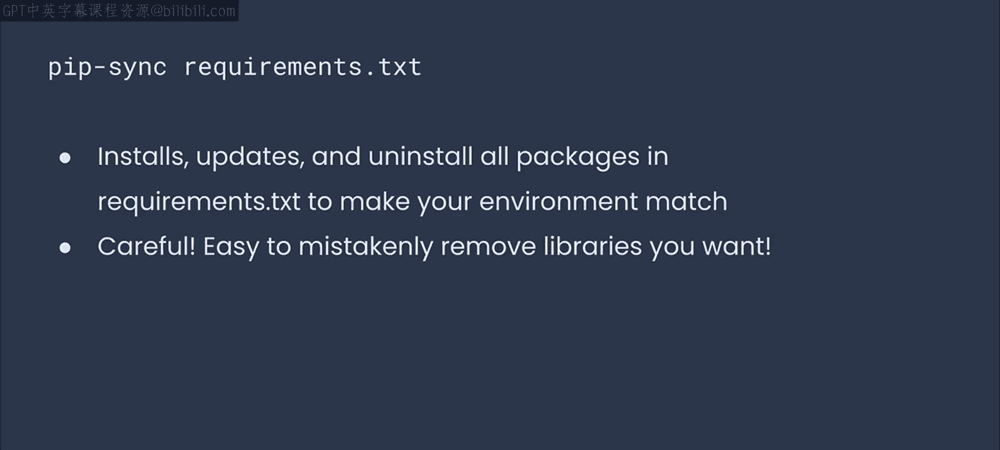

So now it's time to try some of this for yourself self， create an environment called the NV1。

 create a requirementsin file in this environment and add a couple of packages like I just showed you。

😊，Compile that into a requirements TxT file， Use an LLM to learn more about all of the packages that are listed there。

 Are there any surprising ones。Then imagine you want to clone your environment。

 perhaps so a colleague can work on the same project。

Create a second environment called ENV2 and figure out how to sync the dependencies in ENV2 with those in ENV1。

If you get stuck， just ask yourLM for help。Paullluse the video here and work on this task for a little while and then move on once you're done。

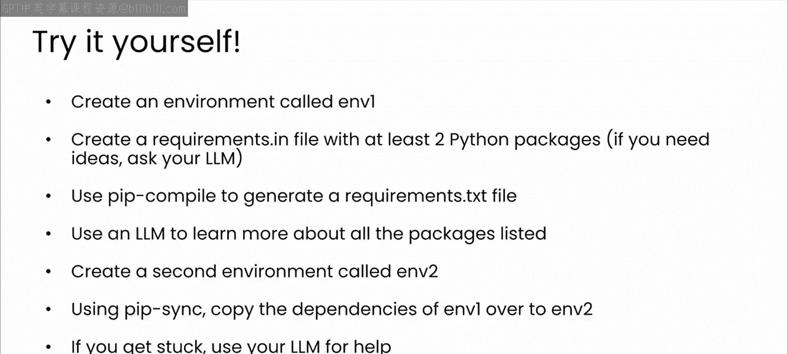

As you hopefully saw in that activity， LLMs can be a very helpful tool in quickly getting your head wrapped around the web of dependencies underlying a project you'll better understand the development stack your project is built on and have the ability to ask personalized follow ups if you need more help and of course。

 if you need help navigating the tools that allow you to package up and share your environment with your teammates LLMs are still a helpful guide and despite all of your best efforts you're still going to encounter dependency conflicts so let's move on to the next video to learn how you can debug those with the help of your favorite LLM。

😊。