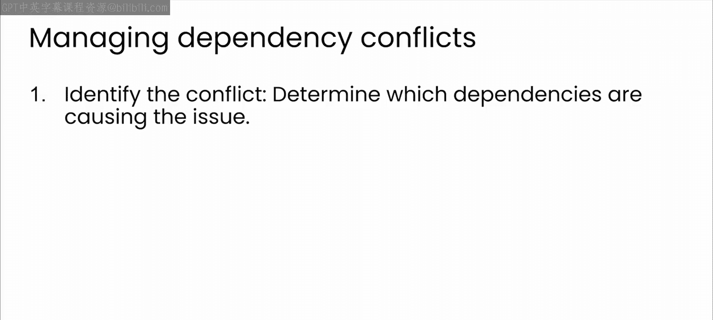
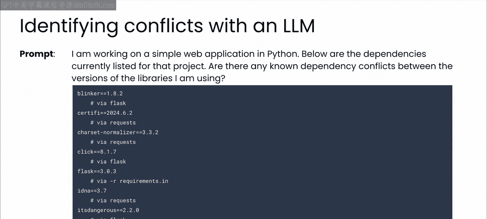
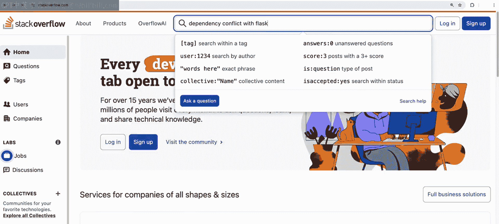
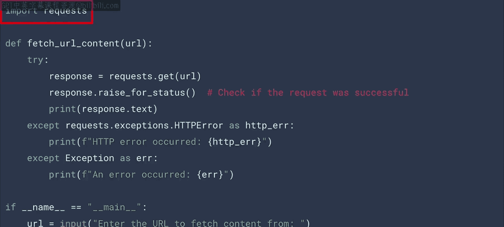
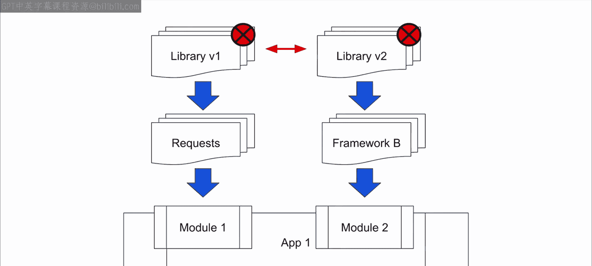
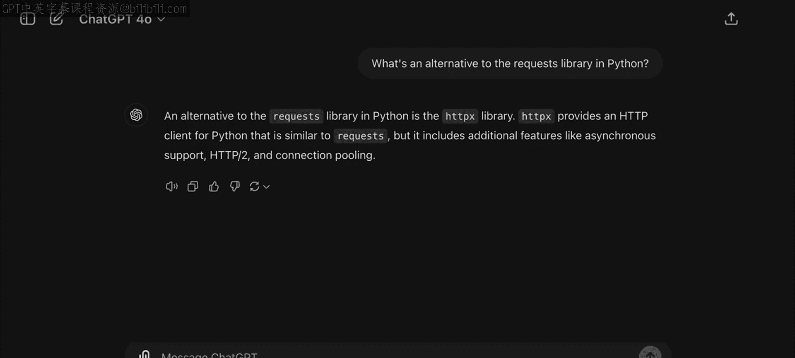
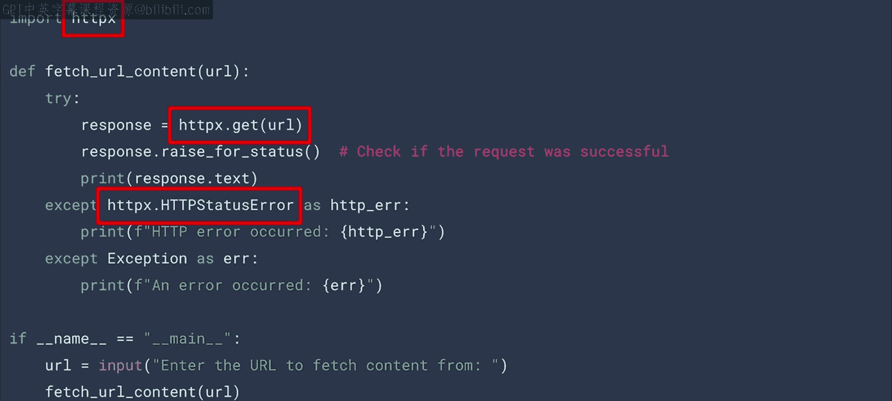

# 吴恩达《软件开发的生成式AI技能（简介、结对编程、数据库设计-3课全）Generative AI for Software Development Skill》 - P46：21_依赖冲突.zh_en - GPT中英字幕课程资源 - BV1ucxLeUEHD

A common challenge when working with dependencies are dependency conflicts。

Let's remind ourselves why these happen and see how LLMs can help us resolve them。

Dependency conflicts can occur when different packages require different versions of the same dependency。

This can lead to compatibility issues and errors in your project。 Think of it like this。

 Your app might use two frameworks A and B Frame A has a dependency on version 1 of a library。

 but F B has dependency on version 2 of the same library。

You can't fix this with a virtual environment because there's only one app， so what can you do？😊。

Well， of course， there's no one size fits all answer to this。

 But here is where an LLM as your assistant can be really helpful。

 and it's good to follow a framework when trying to figure it out。😊。

I like to follow these steps first is to identify the conflict and figure out which dependencies are causing the issue。

One great way to do this is to upload your requirements TxT file to your LLM and ask it to identify if there are conflicts between the libraries。

 Your mileage may vary， but it is a really useful shortcut。

 and it might give you the solution right away。😊。

Next， look for compatibility is the reversion of the library that works for all libraries in the dependency chain。

 your LLM may be able to make suggestions if that information does exist in its training data。

And then of course， the final step is to update your dependencies based on any recommendations and keep iterating until it works。

😊，It's very rare that by using an approach like this that you may not fix the issue。 but if you do。

 you'll have two ways forward。 The first， you'll typically have a well known issue。

 which means there'll be well documented workarounds。 If the LLM doesn't know about them。

 a traditional web or stack overflow search could likely help。

The second， and here's where an LLM would be really useful is to find alternative libraries that have a different dependency chain。

 and LLM can help you find a different library that fits your needs and then refactor your code to use that library。

😊，For example， here's some code， and this uses the common requestquests library in Python to retrieve data from a given URL。

Now imagine you're in a scenario where this module uses requests which has a dependency on Sa version one of a library。

And another module uses a different framework， which depends on version 2 of that library。

Situations like this， as we discussed earlier， can easily lead to a dependency conflict in your app。

One way forward would be to ask the LLM for an alternative。

 and now it tells me about a library called HTTPX。

And it becomes a trivial task for me to refactor my code to use HtTP X instead of requests。 In fact。

 this is probably something I could ask the LLM to help me do。

 And here you can see that I just needed to make a couple of adjustments in a few places in my code。

😊。

At which point I can now try to see if everything works dependency wise again and iterate myself towards the desired solution。

As with everything there isn't a one- size fits all solution for dependency management and resolving dependency conflicts。

 but hopefully these quick examples are helpful for you to see how you can get assistance from an LLM when faced with these difficult problems I hope you'll join me in the next video where we'll talk about using LLMs to address vulnerabilities that arise as a result of taking dependencies in your projects。

😊。