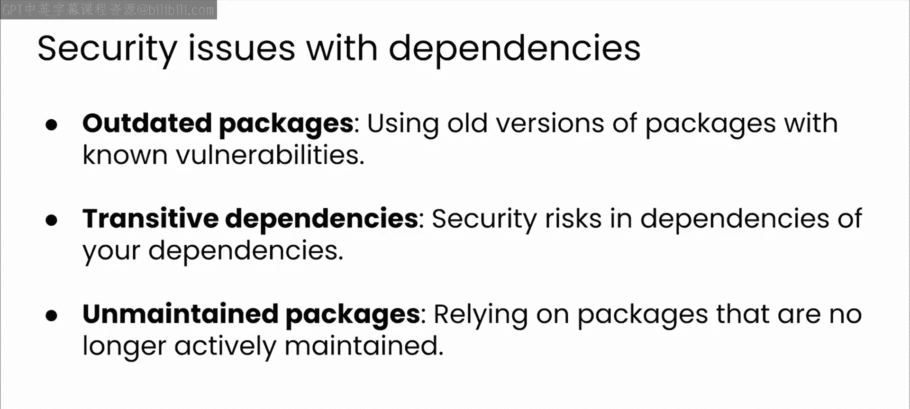
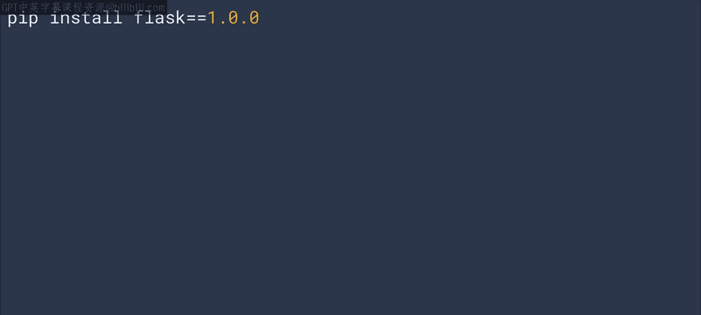
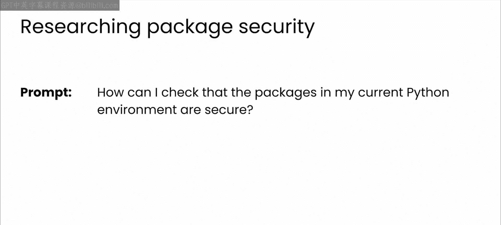
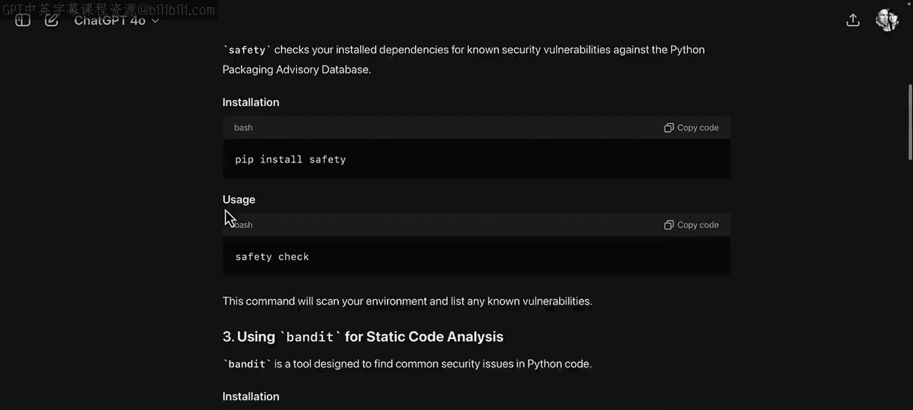
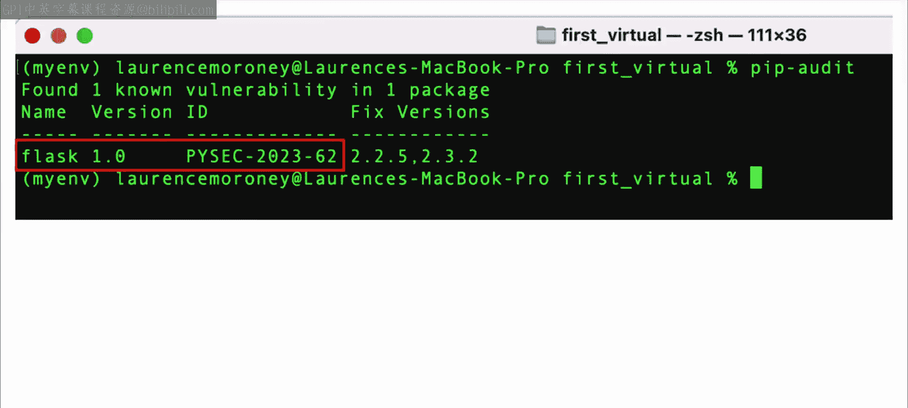
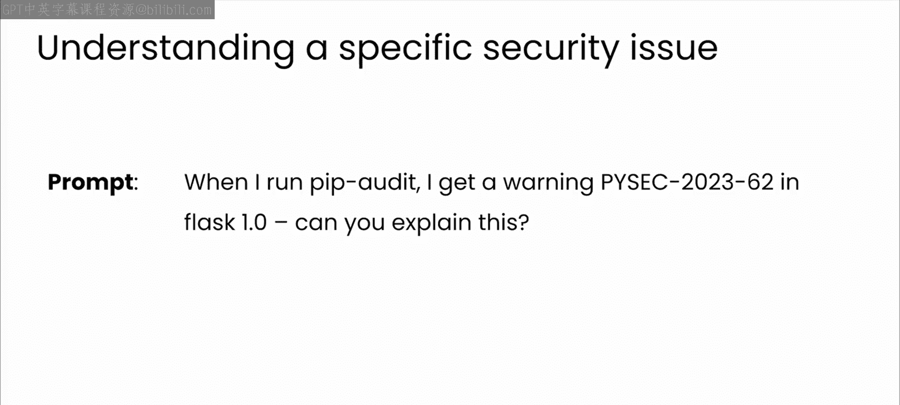
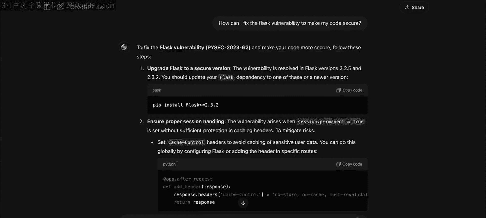
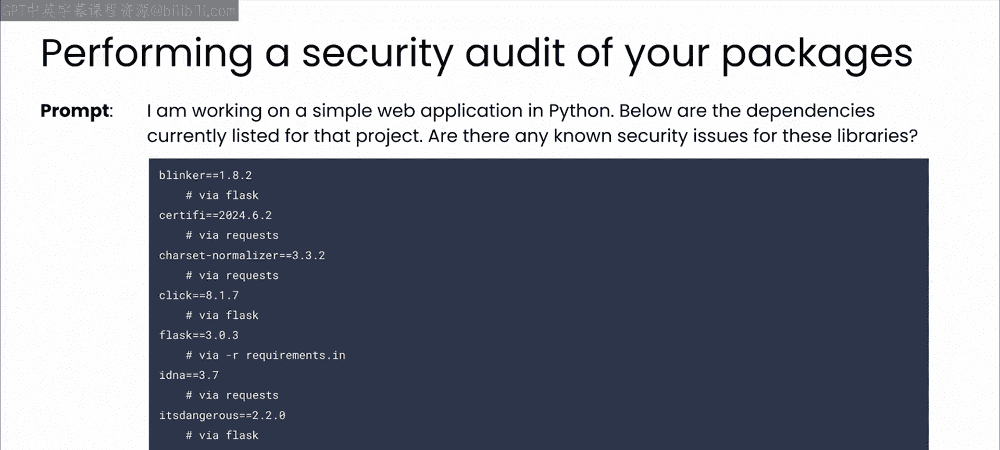
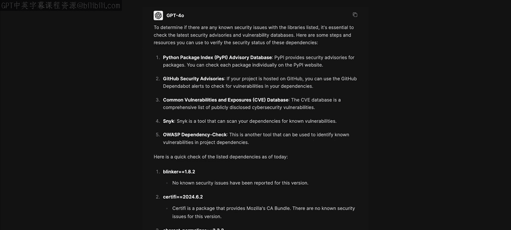
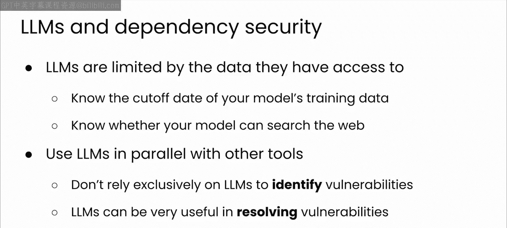

# 吴恩达《软件开发的生成式AI技能（简介、结对编程、数据库设计-3课全）Generative AI for Software Development Skill》 - P47：22_依赖项与安全.zh_en - GPT中英字幕课程资源 - BV1ucxLeUEHD

Dependencies allow you to build on the work of other developers。

 but they can also introduce security vulnerabilities。

Understanding and mitigating these risks is crucial for maintaining a secure project。

 There are a number of ways that security issues arise from dependencies。 First。

 and the most common is from outdated packages， like all code。

 packages and dependencies are constantly under attack from hackers or security tested by their owners。

 as new vulnerabilities or threats are detected， the packages are usually updated with notifications posted。

 but it's easy to miss these， particularly if the package is deep in your dependency chain。Second。

 and very similar， of course， is when your transitive packages may have updates and flaws。

 It's a difficult game to keep up to date on every version of every package。

 particularly when they're not direct dependencies。 And as such。

 having an LLM work as a pair programmer to help you through any difficulties here is a no braininer。

 Third is taking a dependency on unmaintained packages。

 And this is where issues may have been found yet you don't know about them。

 and active exploits might be out in the wild。 Work with unmaintained packages is a serious risk here。

 And I found this to be a particularly useful way of using an LLM。 by asking about packages。

 it will often give you that information， up to its training date cut off， Of course。

 Le that look at an example of how you might introduce a security vulnerability into your software。

 If you've been following along， you'll have a virtual environment in which you've installed flask and requests。

 The nest thing you'll need to do is downgrade。😊。

Whatever version of flask you have to version 1， you'll do this by pinning version 1 like this。

By going back to this really old version， it's guaranteed to at least have some vulnerabilities。

Now， if you're not a Python developer， you might be wondering what tools exist to help you check for vulnerabilities in your packages well。

 you can always just ask yourLL。Here's the prompt， How can I check that the packages in my current Python environment are secure？

Now let's take a look at what happened when I did this。Following the theme of this course。

 one of the things you can do if you're unsure about something is you can always ask ask Cha ET or whatever your LLM is as your favorite pair programmer。

 so in this case I could say how can I check that the packages in my current Python environment are secure。

And GPT came back with a list of suggestions including PP audits and showing me how I can install and use it and other things such as safety。

 This one actually has a Python Pack advisory database and can check for vulnerabilities against that。

m usingsing bandit for static code analysis， using PIip check that will check for out of day or vulnerable packages。

You can manually check them if you wanted as well using PEp commands such as L and install。

And then of course， there's automated security with CICD pipeline if you're using something like GitHub actions。

So there's lots of recommendations here， and the first one that it gave was PIP audit and we're going to explore that one in the course。

The top recommendation was PP audit， which I happen to know is a commonly used tool。

 so I'm going to follow the instructions to install PP audit， run it， and here's the output。

It's flagged an issue， PysC 202362。

Now that you have this specific issue， you can ask your LLM about it， and here's the prompt。😊。

When I run Pip audit， I get a warning Psec 202362 in Flask 1。0， Can you explain this？

Newer models like GPT40 will do internet searches beyond whatever information is in its training data。

 so it's much more likely to provide you with up to date information。

Older models may not yet have this functionality， so it's important to understand the training cutoff date of your model and whether it has the ability to incorporate up to date information。

In response， you should get a detailed explanation of the error so you can understand the implications of it。

And of course， you can ask your LLM for a fix， it won't just give you the code that helps you update to a version with the fix。

 but maybe also ways that you can update any code that you have in your app to ensure that this vulnerability doesn't impact you。

😊，And you can see an example of my output here。

At this point， if you're using the same environment that you created earlier in this module。

 you can update your flask and then run Pip audit again。

 Hopefully you'll see no more vulnerabilities。In this last example。

 you used an LLM to check for vulnerabilities， but you could just as easily ask it to audit all of your dependencies with a prompt like this。

I'm working on a simple web application in Python below are the dependencies currently listed for that project。

 are there any known security issues for these libraries？

Here you can see I'm just asking it for any known vulnerabilities with every package pinned in that requirements。

Txt。

I do want to talk about this example because I personally have mixed feelings about using an LLM in this way。

 and funnily enough， so do many modern LLMs。Take a look。😊，When I use this prompt with the GPT4 model。

 it actually recommends that I use tools like PIP audit which we've just reviewed or safety to check for vulnerabilities and packages Honestly I would agree that this is a better approach for gathering more reliable data about package vulnerabilities。

 use the tools， not the LLMs。GPT 40 is a newer model that has the ability to search the web。

 augmenting its training data with more up to date information。

And so while it begins by proposing other ways I could confirm the security of these dependencies。

 it also reports any known security issues for each dependency。

 This brings me to some of my thoughts about Allams as a tool for maintaining security in your dependencies。

As you know， LLMs are limited by the data that they were trained on and the data that they have access to。

 It's important to know the cutoff date of the training data in the model that you're using and whether that model can search the web to augment itself beyond its training data。

Even so， I still think LLMs are best used in parallel with other tools。 and in particular。

 I'd advise against relying exclusively on LLMs to identify vulnerabilities。

That said， once you found one， they can be very useful as you look to resolve them。

 This was a pretty quick tour of a single tool in Python Pip audit and how using it in parallel with an LLM like G can help you maintain the security of your dependencies。

 There are many other tools in Python and of course， if you use other languages。

 they'll have their own ecosystem too。 Let's go on to the final video of this module to see how an LLM can help you with dependency management when working in some other languages。

😊。