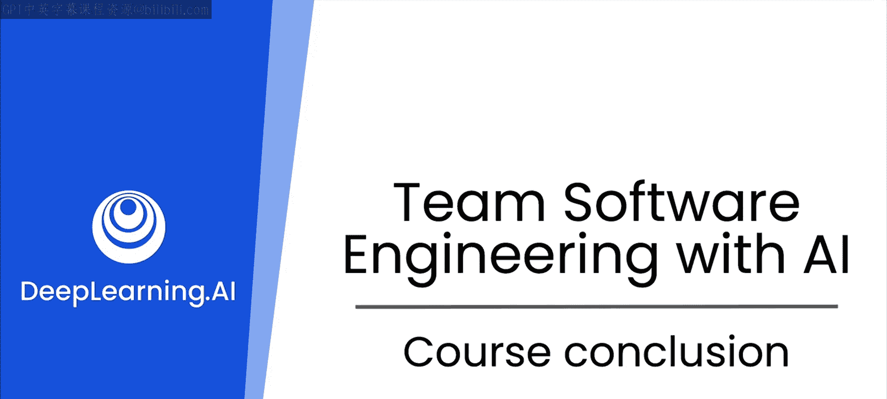

# 吴恩达《软件开发的生成式AI技能（简介、结对编程、数据库设计-3课全）Generative AI for Software Development Skill》 - P49：24_课程总结.zh_en - GPT中英字幕课程资源 - BV1ucxLeUEHD

Congratulations， you've made it to the end of this course on using AI to help you and your extended team with software development Let's take a look back at what you've seen in this course。

😊，You started by exploring the ways that LLMs can be used to aid in software testing。

 and that was whether you were performing exploratory， functional performance or security testing。

 LLMs were able to help you brainstorm scenarios that you would want to test for and then write those tests alongside you Next we explore documentation from inline comments all the way up to full API documentation and beyond LLMs were able to help you develop clear。

 comprehensive and useful documentation and with better documentation。

 your team is better able to use one another's code onboard new teammates and maintain your code over the long term Finally。

 you saw how LLMs can address many of the challenges of dependency management Now whether you're exploring which libraries are available for you to use。

 learning more about a particular library or even addressing dependency related challenges like version conflicts or vulnerabilities。

 LLMs can offer targeted advice based on your team's needs。😊。

I hope this course has demonstrated that as well as helping you be a better coder。

 LLMs can help you grow beyond yourself and have the tools to be a better part of a professional software engineering team。

Happy coding。

