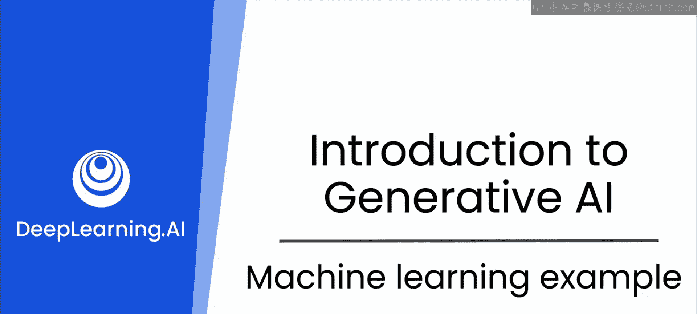
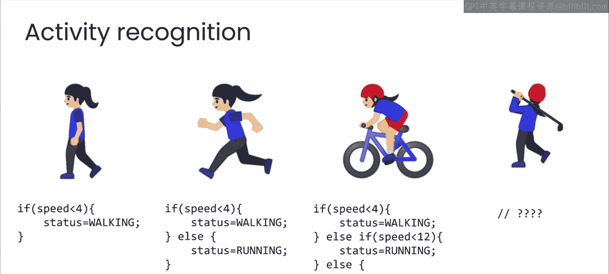
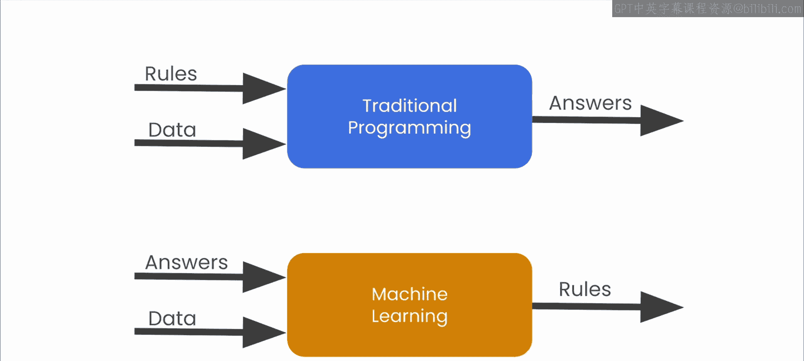
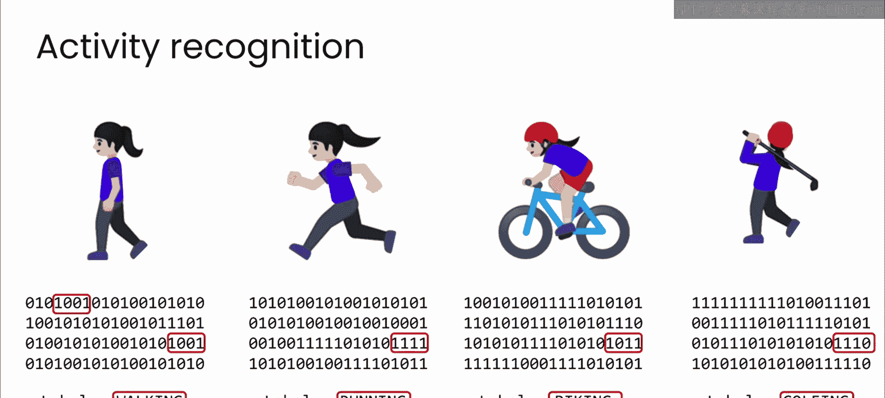
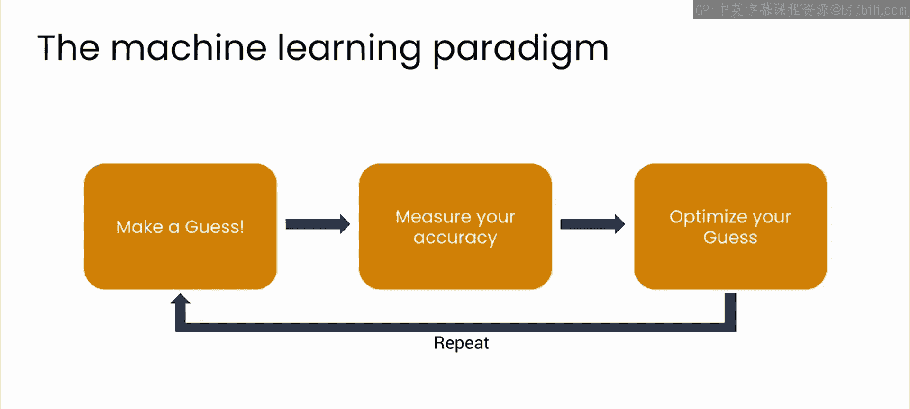
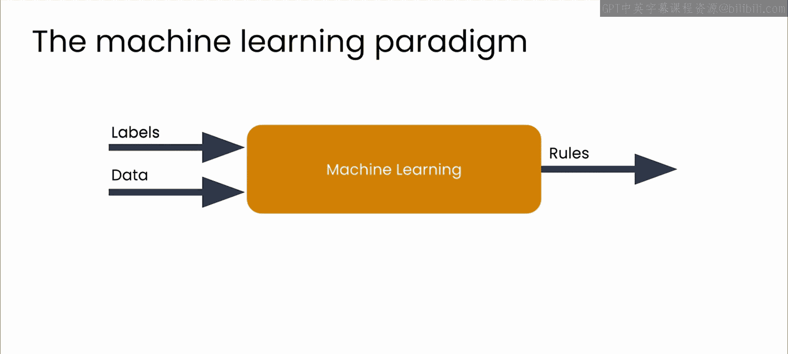
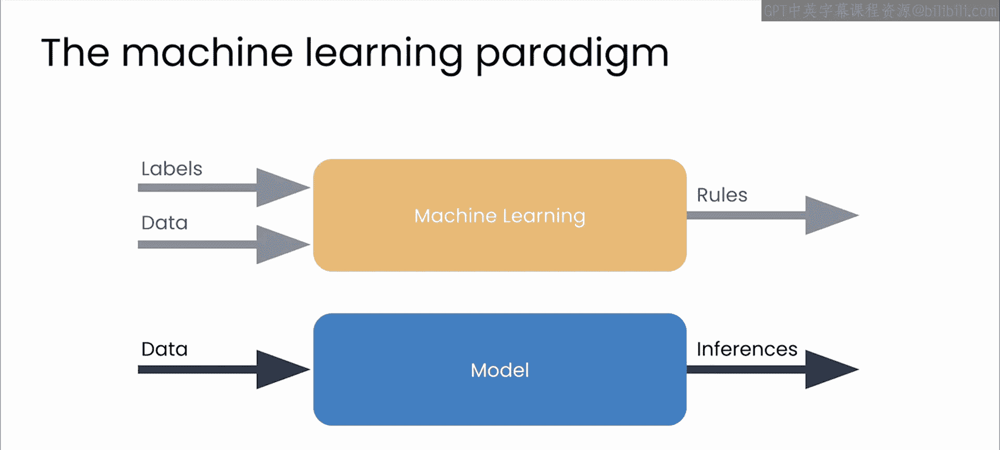

# 吴恩达《软件开发的生成式AI技能（简介、结对编程、数据库设计-3课全）Generative AI for Software Development Skill》 - P4：3_机器学习示例.zh_en - GPT中英字幕课程资源 - BV1ucxLeUEHD

So you just saw how machine learning is a paradigm shift that lets a computer figure out the rules required to complete a task itself based on the data and answers that you provide。

 Let's take a closer look at how this works by considering the problem of activity recognition。

Your goal is to write an app that uses sensors on a phone or a watch or some other device to determine a person's activity。

Are they walking， are they running， are they biking or doing something else？😡，You could， for example。

 use the device sensor speed data and write a rule that decides that if the speed is below a certain value。

 say，4 miles perph， then the device wearer is probably walking。 You have the data。 You have a rule。

 You get an answer。And then you can extend this to determine if they're running by extending the rule。

 if it's below four， they're walking， otherwise they're running。 Great， it still works sort of。

And you can extend it even further to see if they're biking if the speed is below 4， they're walking。

 Otherwise if it's below 12， they're running。 Otherwise you can say that the user is biking。

But what about other activities， For example， how could you determine that the user is golfing。

 What rule could you write that would differentiate golfing from walking。Also， by now。

 you've probably realized that the other rules are also that little bit naive。

 You can't just go by speed alone。 You might run downhill faster than your bike uphill， for example。

So let's go back to this diagram and think about how machine learning could help you solve that problem What if you give a computer the answers and the data and you have it figure out what the rules are for you。

So， for example， it could look like this。 You could have someone wear the device and then carry out a number of activities During each activity。

 you could capture the data from the device's sensors。

 You can then label the data with something like walking， running， biking， and golfing。😊。

Now the problem becomes， can you match this data to this activity label like here？For example。

 maybe these parts of the data are always present like this when the person is walking。😊。

And these values are always different when the person is running， biking or golfing， etc。

 you can have a machine spot these patterns， and when it does spot them。

 you can then use whatever rules it figured out to determine which patterns match which labels and have that look at future data to determine what an activity a device wearer is actually performing。

Now that's probably more reliable than writing the rules ourselves。

So how do we write a program that does that pattern matching well。

 the process is actually quite simple。😊，You start by making a guess as to the relationship between the data and the labels。

Next， you'll look over all of your data and compare your guesses with the correct answers。

 We have the answers already when we label the data so we can do this。

 Then based on the parameters of our guests and the accuracy that we got by measuring against the real answers。

 we now have some data that will let us optimize our guests。😊，And we can then repeat the process。

Logically， if we keep doing this， our guesses will get better and better and better。

When using the tools of machine learning like TensorFlow。

 the APIs to do this are actually available to you。😊。

So now， if we go back to this diagram， the idea behind machine learning is to feed in the answers also called labels and the data and have the machine figure out the rules that match those labels to that data。

And when you do this， you'll get a model。😊，The model can then take data and apply the patterns that it learned to match that data to answers。

 to give out a prediction or an inference about that data。So in our case of activity detection。

 now someone else could take a device and based on the pattern matching rules that the machine learned and put into the model。

 it could then detect if that person was walking， biking， running or golfing。

This is one form of machine learning and it's called superupervised learning。

 let's move on to the next video to take a closer look at supervised learning。😊。

