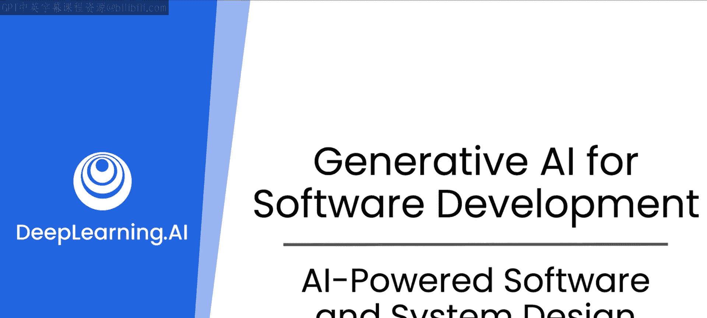

# 吴恩达《软件开发的生成式AI技能（简介、结对编程、数据库设计-3课全）Generative AI for Software Development Skill》 - P50：0_Laurence Moroney与Andrew Ng的对话.zh_en - GPT中英字幕课程资源 - BV1ucxLeUEHD

Welcome to this third and final course on Genrative AI for software development I here again with Lawrence Veroni in the first two courses you learn how to paner with an OM to write an analyze code to improve its performance and robustness in production。

Then you sawhanna can help you create test cases， write documentation， and manage dependencies。

 all of which help your teams work better。In this course you explore how you can tap a deeper knowledge of arms beyond just writing code to building better applications and designing better software Yeah and this course it's really about thinking beyond just your code how it interfaces with other things and the final product So for example a lot of times your code might need to read configuration files maybe very complex configuration files write out log files or deal with like serialization and desialization of data and then the second one of course would be databases and structured databases so to be able to use an LLM to help you structure and design most efficient schema and we even populate it with sample data and then think about like crossha queries and those kind of things and how to build them very very efficiently and I think these are very important things as you go to production but then as we go into production then we think about how there are developers out there with many。

😊，Millions of person years of experience in building systems and then the design patterns that have grown out of that experience。

 particularly the gang of four design patterns， and you know I'll be frank that they're often quite opaque if you don't know what they are already and here's where an LLM can be very。

 very powerful to help suggest maybe the right design pattern for you as well as starting you with code for that pattern Yeah I find spotting the right design pattern and when to use it to be really difficult。

😊，Several weeks ago， I was implementing an interface interface with multiple pieces of software。

 and I had cled it together with a big switch statement。😊，Fornately， thanks to an LM。

 it prompted me to use a design pattern called a factory method design pattern。

 which long storyory short is an objectoriented programming concept than you write code to instantiate objects without me to specify in advance what class they will be so pretty complicated in design pattern they canly I kind of understand but not really but the fact that the OM looked at what I did。

 prompted me for a better way to architect the code and it gave me sample code to tell me how to implement this in Python that got me going and resulted in helping me go from a pretty ugly switch statement kind of thing to much cleaner design that also much more extensible so I showed the code to some of the people and I think they were impressed but really know the helping me get the job done and that's what they're great at right you know it's like in that case it sparked inspiration in you to think about using the factory method but then just didn't leave you hanging there right？

You said it also gave you the sample code but then you as an engineer were able to take that sample code。

 solve a problem with it and solve it in a way that was hopefully more efficient and more maintainable going forward Yeah much more ex I think I asked the to help me design something more ex and it came of this and I thought this is great so hopefully I thinks will make you look good。

😊，I'm sure they will。So with that， let's go on to the next video and dive in to start learning about seization and desization databases and design patches。

