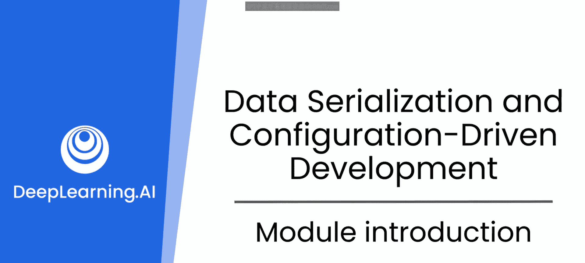
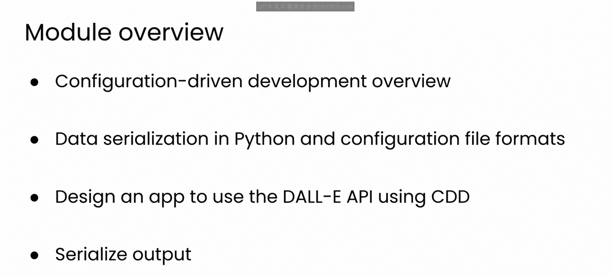

# 吴恩达《软件开发的生成式AI技能（简介、结对编程、数据库设计-3课全）Generative AI for Software Development Skill》 - P51：1_模块介绍.zh_en - GPT中英字幕课程资源 - BV1ucxLeUEHD

In this module， I'll walk you through how you can use an LLM to help design the architecture of an application。

Starting from an initial concept and working up to building a simple functioning prototype。

The methodology that you'll explore is configuration driven development or CD。

This is an approach to building software where the behavior features and settings of an application are controlled through external configuration files。

 rather than hard coded within the application's core logic。

 This approach enhances software flexibility in response to changing requirements and can allow non technical team members to modify certain aspects of the application's behaviour without code changes。

We're going to be looking at file serialization as part of this。

 So one I've been a part of successful engineering projects using C。

 The goal of this module is not to convince you to use C in your work。 Instead。

 I want you to see an example of how an LLM can help you select and implement a design paradigm that broadly impacts a software project。

 This module and this course is aimed to help you consider the ways that LL Ms can help you with major design choices like this one。

 And I think CD is a great first example to explore。😊。

You'll start with an overview of CDD so that you can understand the overall approach and its strengths and weaknesses。

Next， you'll get a quick refresher about how to read， write and serialize data in Python。

 CD depends on reading and writing from configuration files。

 and this will also be an opportunity to practice using a library that you may not have touched for a while with the help of an LLM。

😊，Next， you'll partner with the LLM to structure a sample project using CDD approach。

 This project uses the image generation model Dolly to well， generate images。

We've been very focused on L L Ms in this specialization。

 So I think you'll enjoy seeing a different type of generative AI and action with the help of an LLM。

 you'll also design the code in a C style。 externalizing parameters in configuration files that add flexibility to the design of the projects。

 You'll also be able to serialize the outputs of your app。

 making it easy for you to manage and share the images that you generate。

 I think this is a fun project。 And it's a good opportunity to reflect on how an LLM can help you approach and consider those bigger design questions in your projects。

😊。

So with that， join me in the next video to get started。

