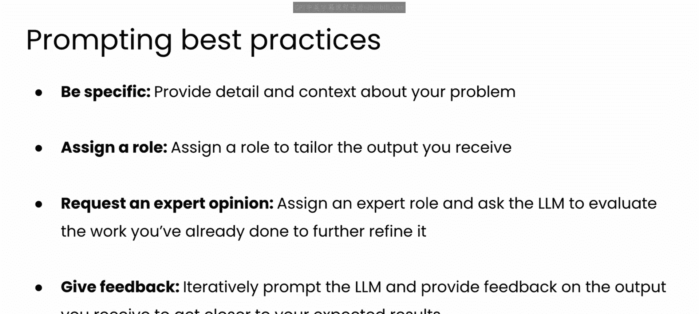
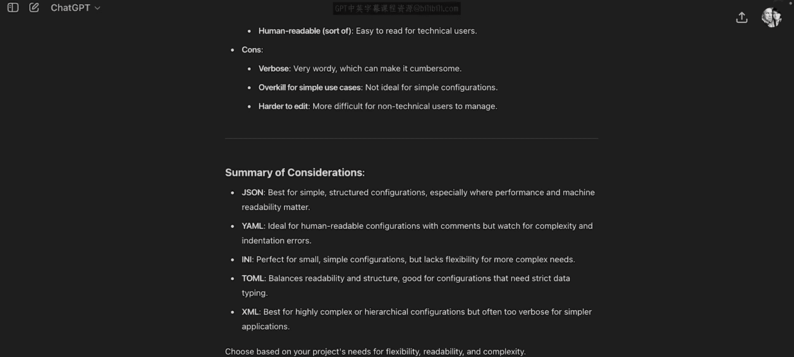
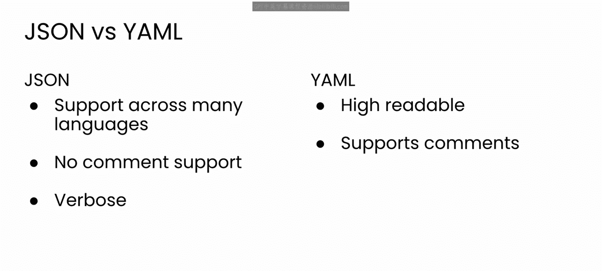
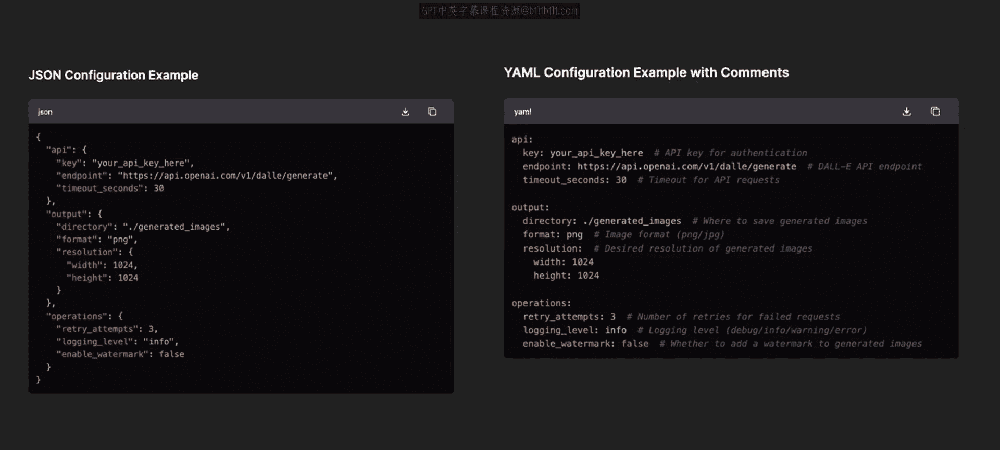
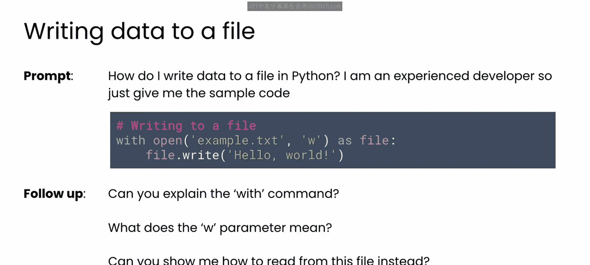
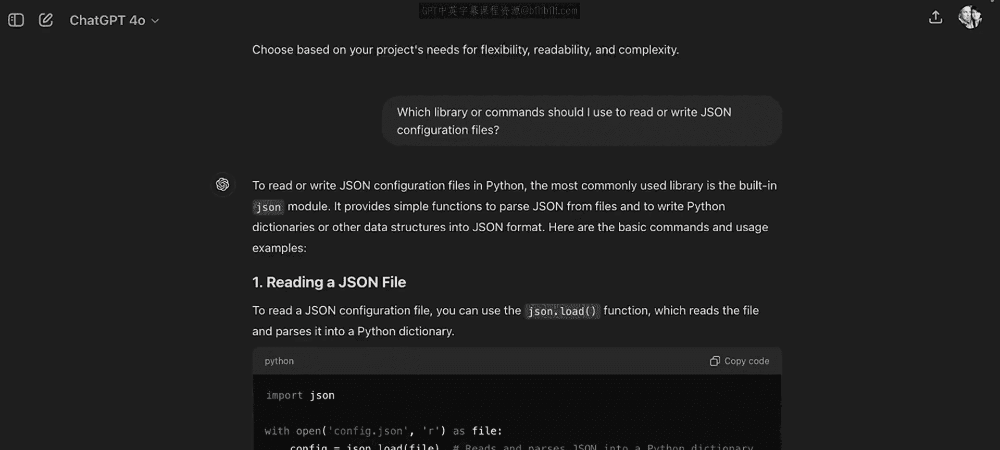

# 吴恩达《软件开发的生成式AI技能（简介、结对编程、数据库设计-3课全）Generative AI for Software Development Skill》 - P53：3_选择配置文件格式.zh_en - GPT中英字幕课程资源 - BV1ucxLeUEHD

As you just saw， CD depends on moving configuration details to external configuration files。

 Your source code then reads in these files in order to customize the way that your software runs。

So let's do a quick review of some of the file formats that you might use to structure these configuration files。

 as well as some of the common operations that you're going to carry out on these files。😊。

This is also a great opportunity to revisit the L L M prompting best practices that you've been using in the previous two courses。

 If you completed the other courses in the specialization。

 then you'll know that these best practices are Be specific。 assign or role， Re an expert opinion。

 and give feedback to the LL M on the text or code that it generates。😊。

Let's see what it looks like to use these skills as you learn about Python file operations。

One decision you'll need to make is which format to use for your configuration files。

 You can prompt G and ask for some recommendations here I'm just sharing the context of the project and asking for a few recommended formats for structuring my configuration files。

 as well as any benefits or drawbacks。😊，The model responds with a few different suggestions。

 some of which might be familiar to you。 Let's look at the top two responses that I got。

 which are Jason and Yamel。

You've almost certainly encountered JSON in your professional career as it's a near ubiquitous format for structuring data and has become the de facto standard for API requests and responses across the web。

As the model mentions， it's technically a subset of JavaScript。

 but it is language independent and has support across a wide variety of languages， including Python。

The model does mention that JO has some drawbacks， including the lack of common support and a tendency towards verossity。

I agree that JO can be a little hard to read sometimes。

 but I do appreciate how well structured and universally compatible that it is。

The second format the model recommended is Yaml， Yaml's benefits include that it's highly readable and it supports comments which could be useful for a configuration file。

However， since it relies on indentation a little bit like Python code。

 it can more easily lead to errors。

And if you want to see some examples of what configuration files in each format would look like。

 you can just ask GPT to generate them。And here's the sample configuration files that G generated for me。

 This is really helpful as I decide which format I want to use。The Yaml is definitely very readable。

 and I do like the ability to include comments。😊，While JO is a bit more of abose。

 I'm used to reading JO files at this point。 And I think the vast ecosystem of JO tools。

They probably make it a more practical choice。

Now that you've selected the format to work with， you're going to need to write some code to read and write those configuration files。

Now， let's just say youre probably a little rusty on file operations in Python。

 So instead of immediately jumping into experimenting in code or reading documentation。

 maybe you could start with a simple prompt like this。How do I write data to a file and Python。

 I'm an experienced developer， such as give me the sample code。

And here's the output that I got from that prompt。If you're an experienced Python programmer。

 this probably would be all you need to quickly remind yourself of the syntax。 However。

 if you are less familiar with some of these commands， you might follow up with questions like。

 can you explain the width command， What does the W parameter mean。

 or can you show me how to read from this file instead。

And the LLM will respond and hopefully help you fill in any of those gaps in your knowledge。

If you're going to be reading and writing configuration files， however。

 it's possible that these techniques are not appropriate。

 so let's follow up one more time and ask if there's a different approach recommended when specifically reading and writing JSON configuration files。

And now GPT is recommending that I consider the JON Library。

 which is used to reader or write JO files， and it handles the file serialization used to store the data。

This will be an important step in architecting your app。

 so let's take a look at it in a little bit more detail in the next video。😊。

