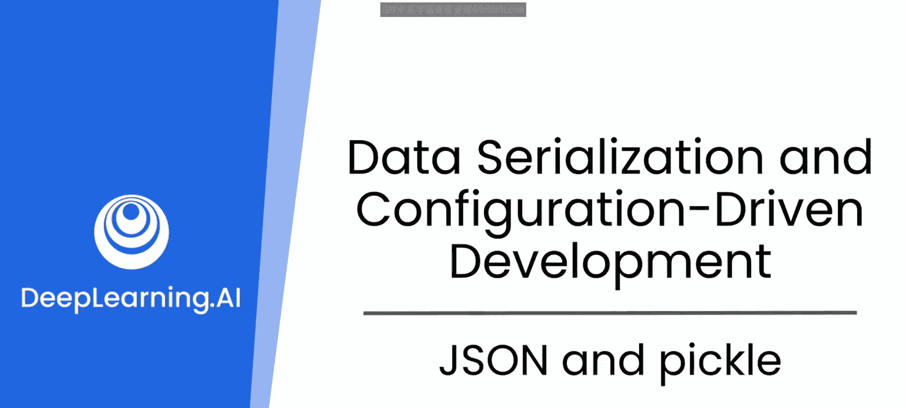
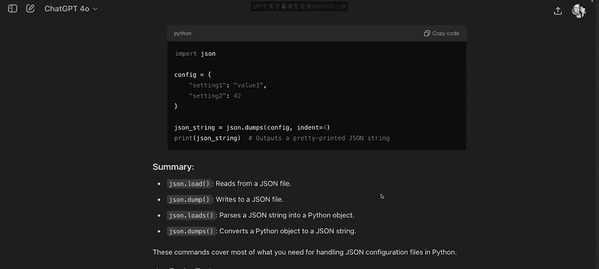
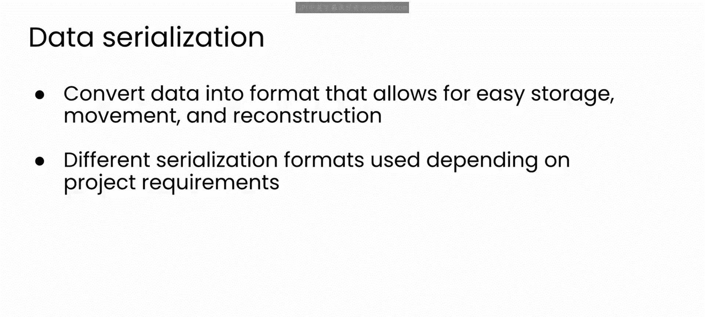
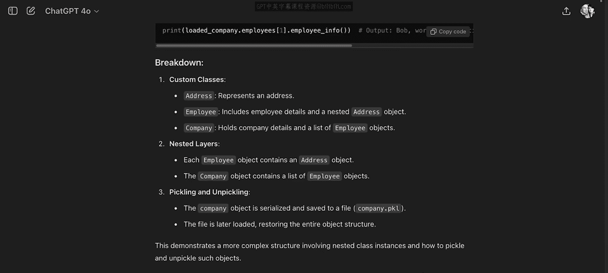

# 吴恩达《软件开发的生成式AI技能（简介、结对编程、数据库设计-3课全）Generative AI for Software Development Skill》 - P54：4_JSON和Pickle.zh_en - GPT中英字幕课程资源 - BV1ucxLeUEHD

At the end of the last video， the LL M suggested that you'll need to use the JSO Library in Python to read or write configuration files for your app。

 and it mentioned that the library could handle serializing the data for you。

I know once my app is able to generate images， I'm going to want to be able to save and share them。

 so those will also need to be serialized， so let's spend a moment looking more closely at the JSUM Library and file serialization。

😊，Let's continue working with the same ongoing conversation with GPT。

 and we'll send it this new prompt。If I'm going to be reading and writing configuration files in JSON。

 which command should I be familiar with and can you show me some examples？😊。

The model responded by suggesting the four commands you're most likely to use are Json do load and Json dot Dump to read and write files。

 and Json do load S and Json do Dump S do the same thing， but with strings。

The example code looks very similar to the code that we saw earlier for reading and writing files。

So this will be a good start as far as reading and writing your configuration files is concerned。

 and we can always come back to the LLM if we want to explore some other use cases。😊。

An important step that the Json Do command is taken care of for you is serializing a Python dictionary so it can be written easily to disk。

I know you are likely very familiar with this， but just as a reminder。

 data serialization is the process of converting data objects and structures into formats that can be easily stored。

 moved around and reconstructed later。You take the inmeory representation of your object。

 say something like a Python dictionary， and convert it to your chosen format。 in this case， JO。

Choosing the right serialization format and library depends on specific requirements of your application。

How big is that data that you need to serialize， Do you need it to be human readable。

 Does it need to be compatible with different programming languages or operating systems。

 Quess like these will drive the serialization strategy that you choose。

So going back to the configuration files for the Dli app。

 JsonN is a good choice for these because it's human readable。 It's compatible with many platforms。

 and tools exist in many libraries for working with it。

 like the Json Library that we just saw in Python。😊。

But what about serializing the images or other objects that you might include with your app as you build it out。

 The J Library alone won't be able to handle all of those。 So what other tools exist。

If you're experienced in Python development， then you'll probably know that the library best suited for general purpose situations where you need to serialize lots of data is pickle。

So let's ask the LLM for a little background about pickle as well。 which I did here with G 40。

 And you can see the answers that it gave me。 It's a Python module for serializing and desializing Python objects。

 It converts an object into a bite stream， and unpickling converts the by stream back into an object。

😊，Now， why might that be useful？Well， first of all。

 is persistence Pickling allows you to save the state of an object to a file。

 letting you store data across different program runs。

You can spend hours training a machine learning model， for example。

 and pickle would be one method to keep its data before you run it again。

It also helps you transfer data where instead of trying to pull the data out of an object into something like JSON。

 only to read it back and reinitialize the object later， you could just save the entire object。

If your image generator app， for example， wants to store complex objects like users or images。

 this could be a better general purpose way to store that type of information for later。

Pickling also helps with caching。 If there's an initialized object that you want to share and reuse instead of constantly needing to re initialitialize it。

 you can just save it out and then reload it。 For example。

 if many users are tried to generate the same images。

 you could decide to cache some results for later and then save time on generating those images。

And of course， another useful aspect of this is compatibility。

 but you should check if your custom object will work across different versions。

 and this is a great use for your LLM pair programmer to see if what you're working on could even be pickled。

😊，And one other thing that the L L M pointed out， given that pickling deals with serializing objects。

 what you get back when desializing can contain executable code。

 So be very careful when unpling objects。 as you might end up runninging something that you don't want to。

 For example， where an attacker could replace your pickle with something malicious。

 That's a useful tip。 Thanks T V T。😊，Okay， so let's follow up on the conversation to explore how to use pickle Alas GPT。

What are the most useful commands for me to know in pickle。

 And the response looks quite similar to what you saw earlier for the JO Library。

 Pickle load and pickle dump handle of writing and reading serialized data to files and pickle load S and pickle dump S will handle serializing data to and from a straightit。

The model also returns sample code for each command to show how it can be used。

Pickle is an important library because of its power to serialize complex Python objects。

 So let's ask for some sample code that shows this in action。Here I'm just going to ask GPT。

Show me an example of pickling a more complex object。In the response。

 the model has now generated a much more complex object to pickle。

 and this includes instances of a custom defined class and nested layers of data。Picking this object。

 however， it's just as simple as it was before。

And when I tested this code， I was happy to see I could take the complex object through the round trip of serializing and decializing it。

 and it was returned perfectly intact。😊，Okay， so that's the end of our quick tour of J Southern Pickle。

 I think you now have all the skills that you need to build your app， so let's start coding it。

