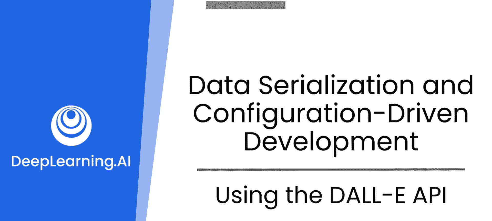
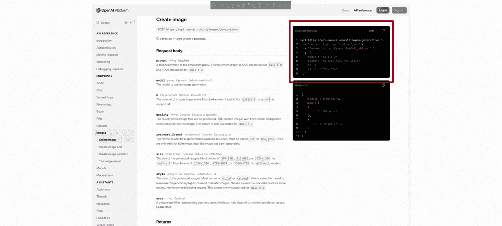
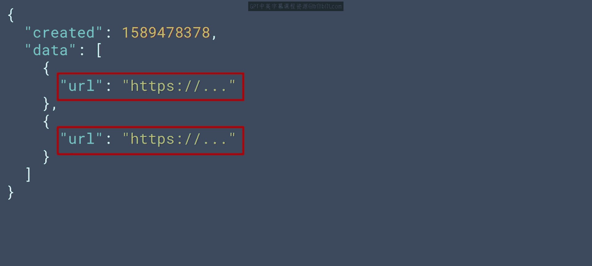
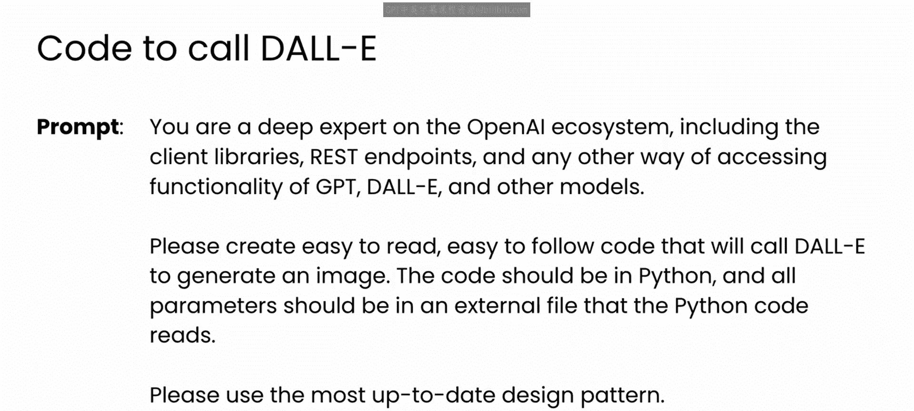
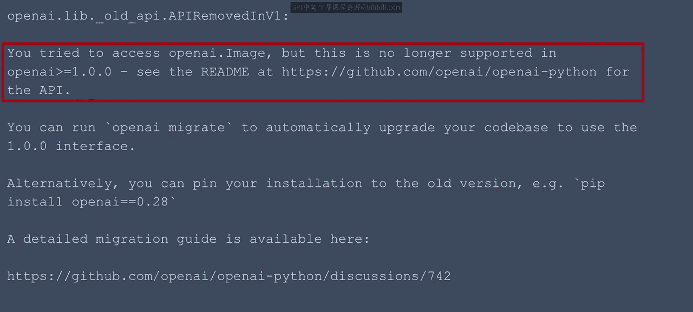
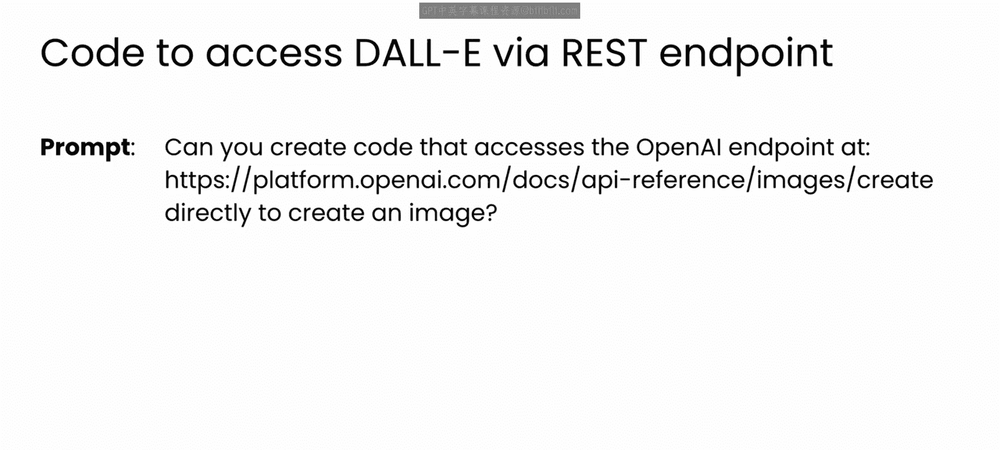
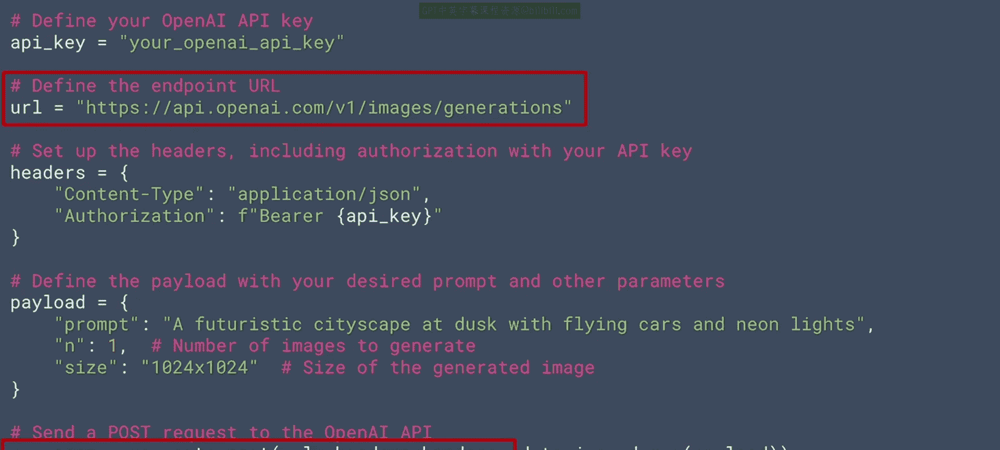

# 吴恩达《软件开发的生成式AI技能（简介、结对编程、数据库设计-3课全）Generative AI for Software Development Skill》 - P55：5_使用DALL-E API.zh_en - GPT中英字幕课程资源 - BV1ucxLeUEHD

At this point， you've used an LLM to remind you of the skills needed to read and write configuration files using JSO。

 So now we're going to switch gears and we're going to build our app using an API for the Dli model from Open AI。

😊。

Throughout the specialization， you've been using large language model to help you generate code。

 but generative AI isn't just limited to code or language。

 Models like Open AIs Dolly can take text prompts and then use them to generate images。

 and this is the model that we're going to be using to build this app。😊。

Calling these from an API can require a lot of parameters， as you can see here。Indeed。

 on the documentation page， you can see a sample curl request to create an image。

 and it looks like this。

And as you can see， there are lots of parameters that need to be set in order to make a successful call。

But I'm going to split those into two parts。The first are the parameters for the model itself。

 and these are what guided to create the image on your behalf。And you can see those here。

 The API does separate them out for you。 Note that this is not an exhaustive list of parameters。

 but it is a useful list that can help you get an image。

The second set are the parameters that ensure that the application will work the way that we want it to。

 In this case， it's the API key。 But as you'll see in a moment， there are many others。

 such as the location where we want to save the file from our application and whether we want to pickle it up or not。

After calling Dolly， if the call is successful， you'll get back a set of URLls where it temporarily stores the generated image for you。

 The payload will look a little bit like this。 It's adjacent object with a data element that contains a number of Us。

 each pointing to an image。 You can ask Dolly to generate multiple images based on your hyperparameters。

 And this output is the result of asking for two images。😊，And as noted earlier。

 if you are creating an app to do all of this calling on your behalf。

 you'll likely want to download and save the produced images。

 so you're going to have to specify file names for them。

Okay， so now let's take a look at how you can start creating an app that makes use of the Doli model。

I want to make a quick note here that from experience when creating this。

 it's a great example of how not to blindly trust the output from an LLM。😊，At the time of recording。

 the API was in flux and even though I was using GPT。

 which is an LLM from the same company that produces Dolly。

 the code that GPT generated was deprecated， it didn't work。So as a software engineer。

 I did have to make some decisions up front and guide the LLM according to those decisions。

 Let me demonstrate。First， as you've seen throughout these courses when prompting an LLM for the code。

 you have to be explicit。So for a problem like the one we're trying to solve here that you want both code and an external file for the parameters。

 then you should be very clear about what you want。Here's the prompt that I used， and as you can see。

 I first assigned the LLM， the role of an expert in the open AI ecosystem with deep knowledge of the libraries and tools available to use their models。

😊，I gave explicit instructions on what I want and then asked it to use the most up to date design pattern。

And in response， the model generated this code。The generaterate image function here uses the OpenaiI dot image library to create an image。

 and it then takes in the prompt and other image configuration parameters in order to set up the API call。

Now， this code may look really good at face value， but there was a big problem。

 This library is deprecated， and it was deprecated a long time ago。 So if you try to run the code。

 you'll likely get a message like this one， calling out that the open AI dot image library is unfortunately no longer supported。

And when I tried following the instructions in the response。

 I found a detailed walk through that focused on using the LLM endpoint。

 but hasn't been updated for the Dli image generation endpoint。

So I tried using GT to refactor the code to fix this issue。

 but it ended up sending me around in circles with the only realistic solution being to downgrade my client libraries to all aversions。

 Still， by the time you're watching this， that issue might be fixed， and it might work。

 but I did want to include my experience to reiterate the fact that you should not blindly trust the LL M。

 You should continuously test the code you generate and use your expertise to navigate around roadblock like this one。

😊，And here's where if you treat it as a pair programmer and not a blind code generation machine。

 you can begin to solve the problem together。Earlier， you saw the rest endpoint。

 which you can call to generate an image。 So if you guide the LLM with that specific information。

 you can work your way out of the bug without downgrading libraries。So with a prompt like this one。

 that includes the endpoint that you want to work with。

You can now get code that does not use the deprecated client libraries and instead post directly to the endpoint using the request library in Python。

With a payload of parameters that's hard coatd in。And if you run this code。

 you'll now find that it works。 Now， the code you've written here is a great start。

 but it doesn't follow the design approach of CD quite yet for that。

 you're going to have to identify your configurable parameters in your code and then refactor your code to externalize those parameters into a file。

 again， with clear， detailed prompting and LLM can help you with this step。

 So join me in the next video to see all of this in action。😊。

