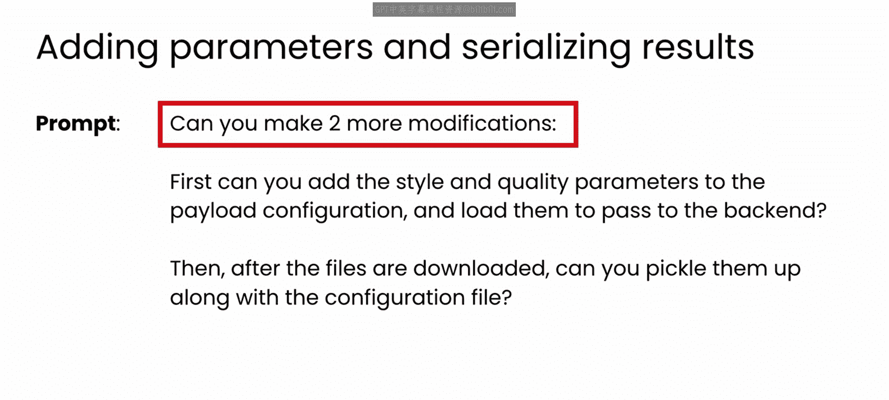
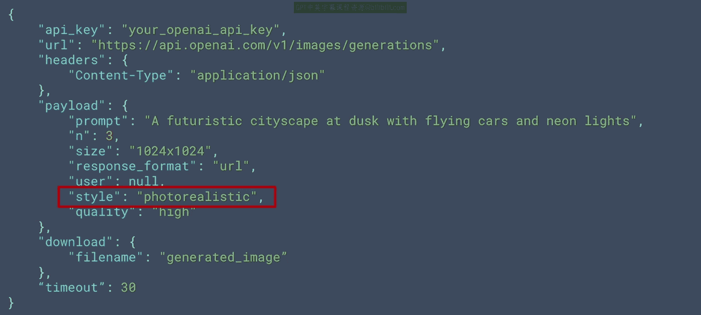
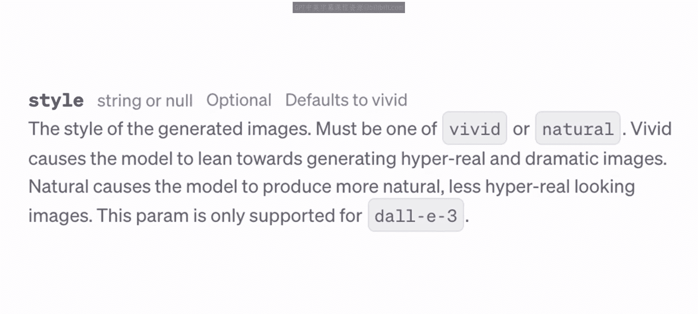
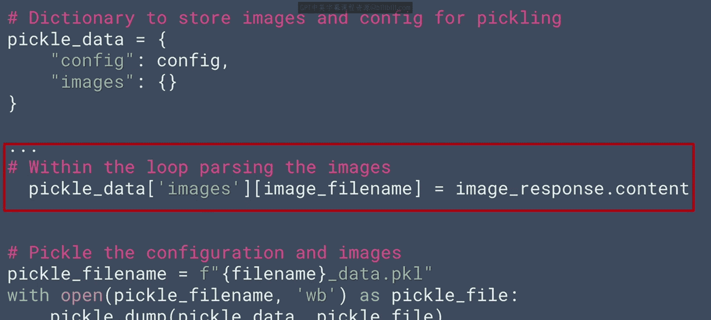
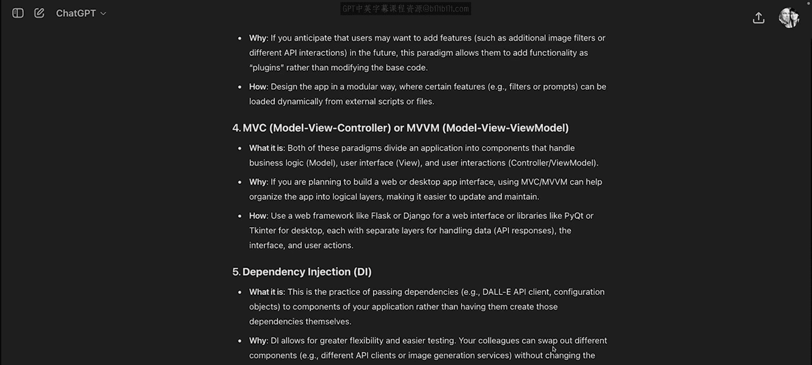

# 吴恩达《软件开发的生成式AI技能（简介、结对编程、数据库设计-3课全）Generative AI for Software Development Skill》 - P57：7_序列化结果.zh_en - GPT中英字幕课程资源 - BV1ucxLeUEHD

So now you've seen how to externalize the configuration parameters for an app that calls Dolly to generate images。

And this is the foundation of configuration driven development。 Now。

 someone can modify the behavior of your app without rewriting the underlying code。

 They simply change the configuration file with the details of the images that they want to create。

 and then then pass that to your app。And beyond the image generation details。

 you can also configure how the app interacts with the API， for example。

 by setting the API key or by changing the endpoint that you want to call。

And you were able to build all of this with the help and guidance of an LLM。

 which suggested the design paradigm of configuration driven development and then followed that approach to help you code up the app。

😊，As a final step， let's think about how you can use pickle to share both the images that you generated。

 along with the configuration settings that got them into a single file that others can then use。

The goal here is to enable others to look at the images， decide whether they like them or not。

 and if they do， use the configuration on hand so that they can prompt and create similar images of their own。

At the end of the previous video， I asked you to refactor your app to incorporate some Daally API parameters that the LLM had not included in the original app configuration such as quality and style。

Here's the prompt that I use to include them in the app。

 I'm also including a request here that the LLM pickles both all of those image files after they're downloaded and the configuration file into a single file。

😊，This prompt is part of that ongoing conversation that you've been exploring throughout this module。

 So the LLF does have the context of the source code that you've been working on in memory。

 So when you ask for further modifications， the model understands that it's going to work on your previously generated code。

😊，One thing to be careful of here when it does this is that it may hallucinate default values for some of the parameters that are not actually supported by the API。

 In my case， for example， it set the style to photo realistic。

 But if you check the API documentation linked in the notes for this video。

 this value isn't actually supported。

So it should be vivid or natural。

The model also generated the code for pickling both the data and the configuration after downloading the images。

And it looks like this。 First， you'll create a dictionary containing the config file with a subdictionary of images。

 Then in the loop， where you parse the images and download them。

 you add each image to the pickle data dictionary。

And then at the end， you create the pickle file and you'll write all the data to it。

You now have a pickle file that's easy to share with other users。

 and it contains the configuration file and the images。

 I'll leave it as a challenge for you to see how you would unpickle this。

 how you would extract the configuration and allow your end users to have those parameters to be able to draw similar images。

😊，Either try this byad yourself or ask the LLM to help you。

So that brings us to the end of this module， and I hope you've seen a number of useful techniques that can help you think through options for software design in your own development work。

😊，You saw how you can use an LLM to brainstorm software design paradigms that meet the requirements of your project。

 and you then work through an example of using configuration driven development to design and implement an image generation app that makes calls to Doli。

😊。

Along the way， you saw how an LLM can help you make those important design decisions。

 like the format for your configuration files， And it helped you quickly get up to speed with how to do things in code that you may not be familiar with。

 For example， like reading or writing files in Python and how to handle all of the data serialization。

😊，Lastly， you saw how an LLM can take some prototype code like the code that calls the Doli API using the Python SDK and identified the configurable elements。

 You could then work with the model to write code for both the configuration file and the core logic of your app。

I think this was a really powerful use of an L LM， and it can help you build high quality。

 flexible software products using tried and true design paradigms。 Now。

 the data handling in this prototype that you built in this module it was fairly simple。

 and it wasn't really optimized for large real world applications。

 It was pretty cool to be able to share the results of the application using pickle。

 But then as your applications grow bigger， and you have much more complex data within them。

 particularly if you want to be able to query， sort and search that data。

 You're going to have to use a database。😊，So in the next module。

 you'll look deeper at how LLMs can help you design and implement databases for your projects。

 and will go all the way from schema design to query optimization。

 This will allow you to build robust applications with good data handling quickly and will help you avoid common problems related to poor database design。

😊，So join me in the next module to start looking at database design with large language models。

