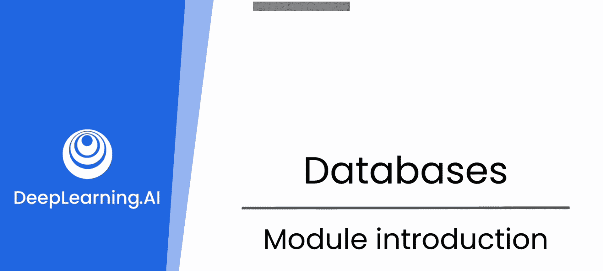

# 吴恩达《软件开发的生成式AI技能（简介、结对编程、数据库设计-3课全）Generative AI for Software Development Skill》 - P58：8_模块介绍.zh_en - GPT中英字幕课程资源 - BV1ucxLeUEHD

When your application needs to use a lot of data， you probably need more than just an external configuration file or text file。

 particularly if that data needs to be organized and searched。

 And that's what backend databases come in。 They built to be efficient ways to store and retrieve information。

 but in order to get the best out of them， The means by which the data is stored。

 It needs to be carefully designed。 It doesn't matter how fast or how powerful your database engineers。

 If your underlying data design or schema is poorly executed。 you won't have the benefits it offers。

 I can recall one story where I worked in a system that was used for security and surveillance。

 It was very expensive to design embedded systems that went down to the bits and bytes level for managing their configuration。

 For example， you had to control who could use what camera。

 how they would use it and stuff like that。In an embedded system。

 it was literally a bitmap that the processor read in order to assign or understand permissions。

To save costs， we looked at using a PC for this and to embed one of those within the surveillance system。

 putting the information into a structured database was much easier to do and to debug than working with raw bit maps。

But in the first version， the database schema was so poorly designed that it took 20 minutes to initialize when you powered on the system。

 you had to wait that long before you could use it as a comparison。

 the embedded system took a fraction of a second。 It was quite embarrassing。 But fortunately。

 we fixed it。 And even more fortunately for you。 Lage language models are excellent pair programmers that will help you not just write the code to manage your database。

 but also to design schema that are efficient， reliable and robust。

 And we're going to look at that in this course。😊。