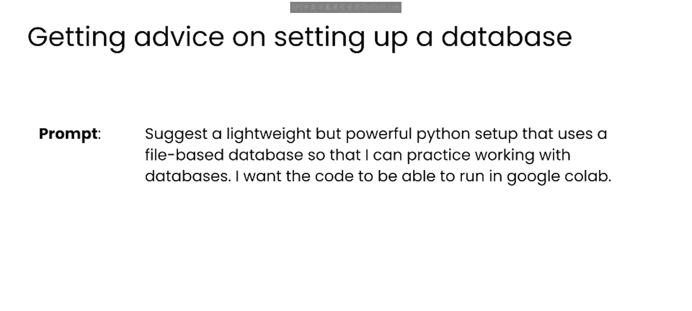
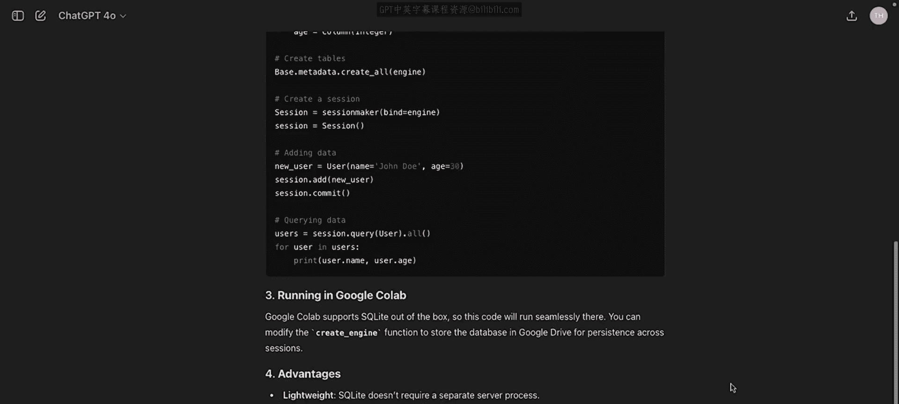
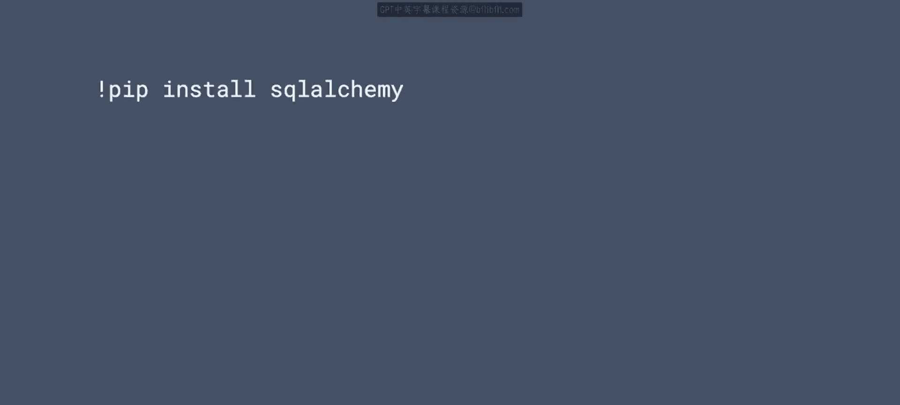
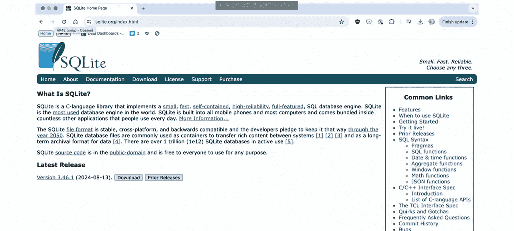
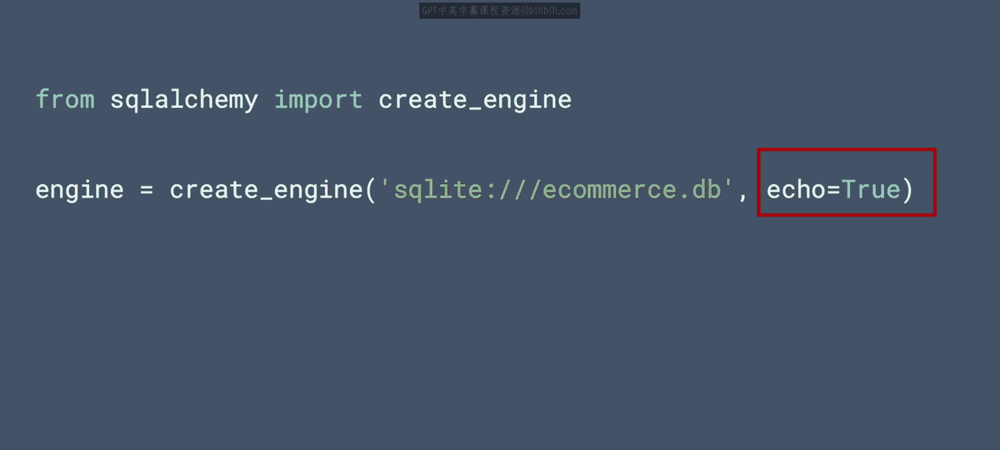
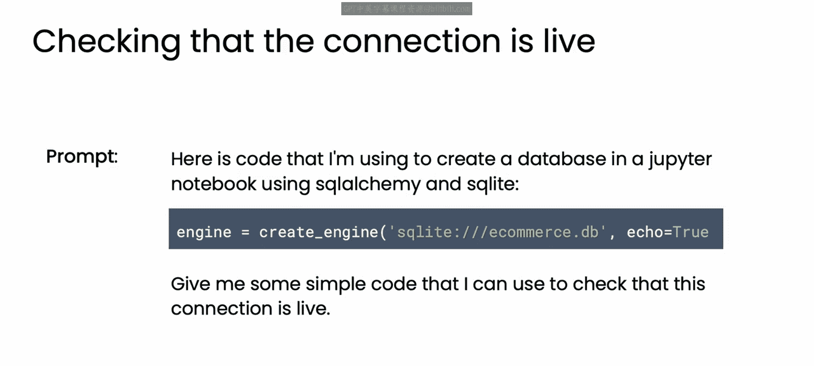
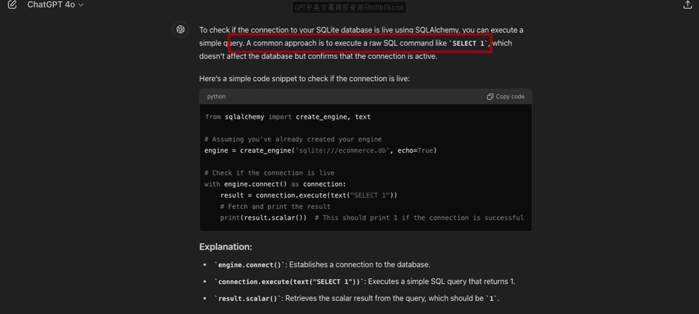
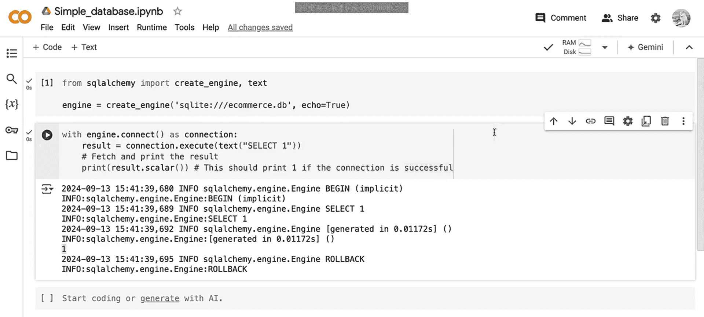

# 吴恩达《软件开发的生成式AI技能（简介、结对编程、数据库设计-3课全）Generative AI for Software Development Skill》 - P59：9_设置简单数据库.zh_en - GPT中英字幕课程资源 - BV1ucxLeUEHD

One of the challenges of learning how to work with databases has always been having a database to access in the first place。

 So in this lesson， you're going to start by setting up a simple development environment that will allow you to try out any code that an LLM suggests as you think through issues related to database design and access。

😊，For this module you're going to be using SQL light and SQL alchemy in Python this combination of packages is ideal for the course because they're lightweight。

 file based and they will run in collab or your local environment。😊，Now。

 if you're an experienced Python developer， you would likely know how to select this combination of packages。

But if you're less familiar and need a suggestion， you can always ask an LLM to suggest a lightweight database setup up for you。

 and here's a prompt you could use。Suggest a lightweight but powerful Python setup that uses a file based database so I can practice working with databases。

 I want the code to be able to run in Google Coab。

And when you run this， you'll get a suggestion from the LLM。 In this case。

 it's also the combination of SQL alchemy and SQL light。

 along with instructions on how to install and set up the packages。😊。

You'll follow a similar setup process in this video to get up and running。

So let's start with SQL Alchemy， which is a powerful Python library that provides a set of tools for working with databases。

First， you need to install the package with this command。

And once SQL alchemy is installed， you can set up a sample SQLite database。 SQLite is a lightweight。

 serverless， relational database management system。

 making it a great choice for this course and very easy for you to use。

 It's included in most Python setups。 So you usually don't have to install it separately。😊。

For this setup， you're going to use SQL alchemy to create and manage the database as a DB file。

Here's the code to import the necessary libraries and create an engine to connect to the SQLite database。

This code creates a SQLite database named ecommercecommerce。db。

The E=s true parameter allows us to see the generated SQL statements。

 which is really helpful for debugging and understanding what SQL alchemy is actually doing under the hood。

Okay， great， you now have a database connection set the first thing you should do， of course。

 is to check that it's working。😊，Before LLMs figuring out how to test this connection would likely have involved searching the SQL alchemy docs or stack overflow pages。

 and you may not have easily found what you were looking for and what you needed。 Now。

 you can just give the LLM some context about how you've set up your database and ask it to provide the code that you need to check if the connection is live。

😊。

And the LLM will respond with some code， but more importantly。

 it also offers some guidance on common practices to check the connection。 In this case。

 by executing a sample SQL query， select1。This kind of insight is a really great way to learn how a package or library or any kind of code works。

And if you do try out this code， you'll see that it's actually working。😊，First。

 you see the SQL commands that was executed will appear on screen。

 and this is because of that echo equals true that you said earlier in the code。

And then you'll see the intejo 1 being returned as expected， indicating that our connection is live。

 So before moving on to use this database， I encourage you to carry out the steps in this video either with your own setup or in coabab and then use the code above or whatever your LLM provides you to check that connection。

😊。

And once you've got a working database instance， join me in the next lesson where you'll explore how you can use an LLM to define the schema for your database。

😡。