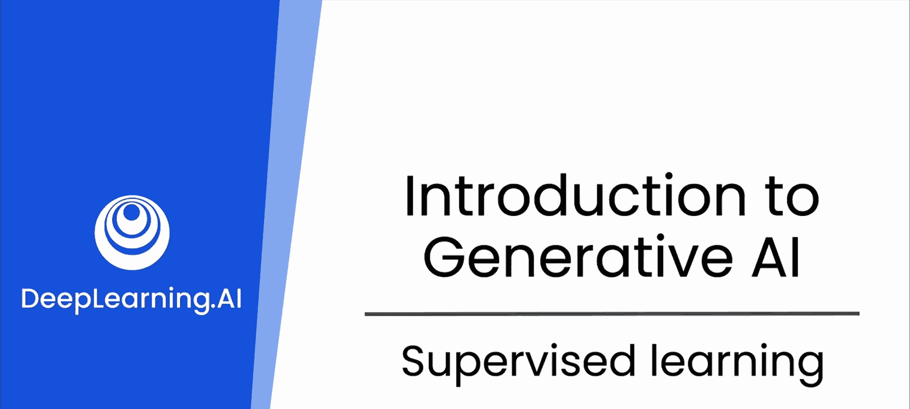
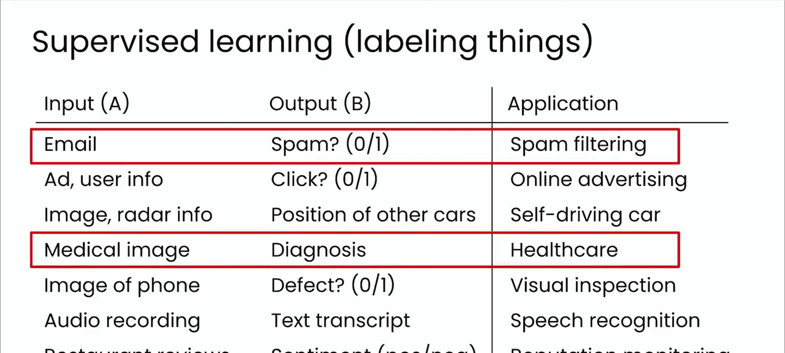
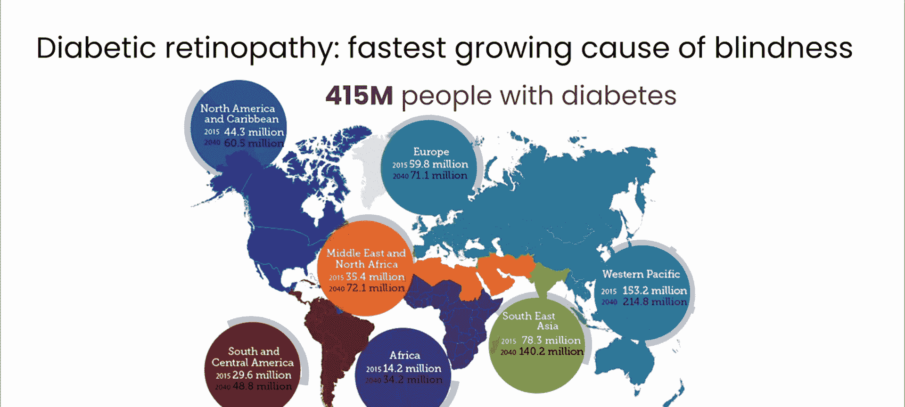
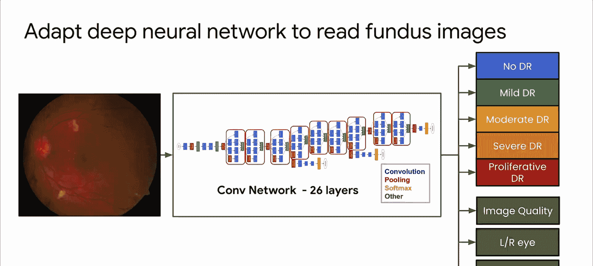
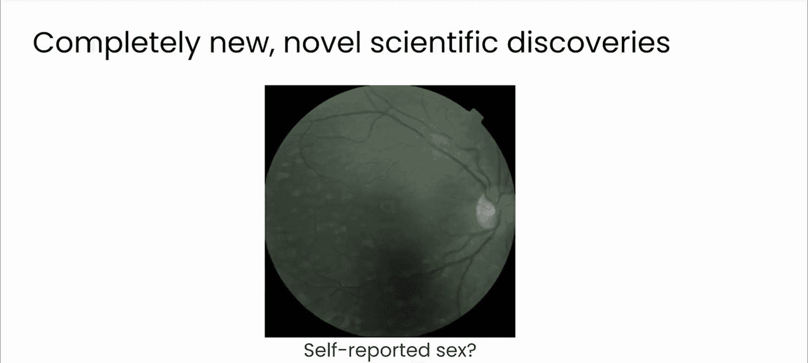
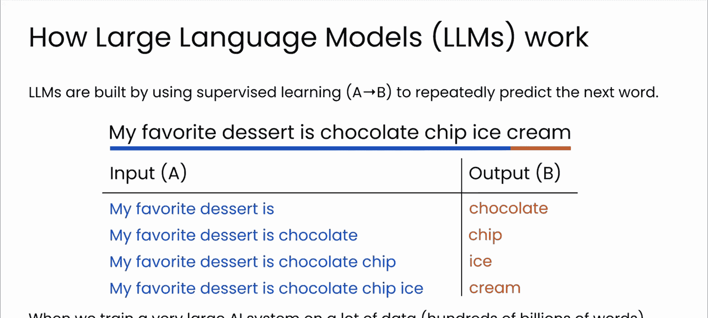

# 吴恩达《软件开发的生成式AI技能（简介、结对编程、数据库设计-3课全）Generative AI for Software Development Skill》 - P5：4_监督学习.zh_en - GPT中英字幕课程资源 - BV1ucxLeUEHD

In industry， supervised learning is a giant， It's more prevalent than all other AI domains like unsupervised learning or reinforcement learning。

 because it has direct applications in our day to day technology。

 from email filtering to personal assistance， supervised learning forms the backbone of systems that require reliable and accurate predictions based on past data。

So what exactly is supervised learning。 Well， it involves training a model on a data set that includes inputs paired with correct outputs。

 As we saw earlier with the activity detection example。

This method is akin to teaching a child with flashcards。

 Each question comes with an answer and the task is to learn those pairs in order to make predictions。

Think about some everyday examples， email systems that are trained to identify spam based on features within good emails as well as spam ones。

 or medical imaging systems that learn from thousands of retina images tagged with diagnoses。

 these systems rely on high quality label data to learn how to respond accurately to new information。

And the core underlying principle of machine learning is that it can learn to match the data to the labels。

 One really interesting real world example comes from medicine and the diabetic retinopathy example。

 diabetic retinopathy is the world's fastest growing cause of preventable blindness。

 and it is relatively easily mitigated with regular screening。

 and every diabetic person should be screened yearly with a special camera that takes a picture of the back of the eye。

 The retina。😊。

But in many parts of the world， there simply aren't enough specialists to do this。 In India。

 for example， there's a shortage of many thousands of eye doctors to do that scanning。

 and as a result， almost half of patients will suffer vision loss before any diagnosis。

 and this is a tragedy because a disease is completely preventable。

In order to address this doctor shortage， researchers turned to machine learning。

 they created a data set of tens of thousands of retinal scans that were graded by doctors on a five point scale from no issues all the way up to advanced disease。

Doctors would spot patterns like hemorrhages as you can see here。

The researchers then use the resulting data and human assigned labels to train a machine learning algorithm to match one to the other and carry out the same feature spotting as the doctors。

So this model enables a computer to learn how to diagnose images as well as and sometimes even better than a human。

But machine learning can sometimes find other interesting relationships in the data set。In this case。

 the retina images weren't just labeled with disease features。

 but also other data like the patient's age， their birth assigned gender， blood pressure readings。

 and so on。And because supervised learning matches data to labels。

 the algorithm here has learned to match the images through all of the labels and in the process reveals something new。

The model was able to correctly predict a person's birth assigned gender from the retina image 97% of the time。

Somehow， it could see this label in the images in a way that humans can nabs。

 A human will get this right about 50% at the time。 the same odds is flipping a coin。

So supervised learning is a very powerful technique that can be applied to different kinds of label data。

 from images to sounds and text。In fact， it supervised learning using text data that has led to the development of the powerful large language models。

 the power chat bots and other applications， LLMs like Chat Ept or Gemini are trained on vast amounts of text data where the model learns the relationships between sequences of words。

 and what naturally follows， enabling it to predict the next word repeatedly。

 and thus to continue to generate coherent and contextually relevant text on its own。😊。

We'll look at those next， starting with the transformformer architecture。

 which makes the generation of text and the artificial simulation of reasoning possible。

