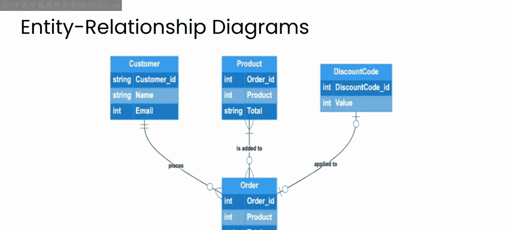
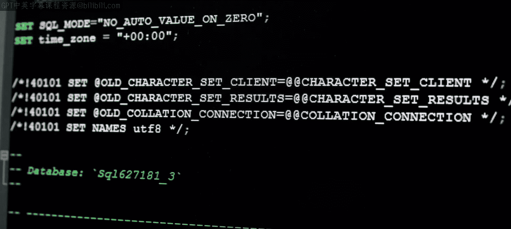
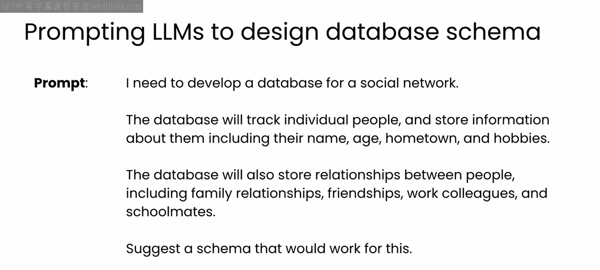
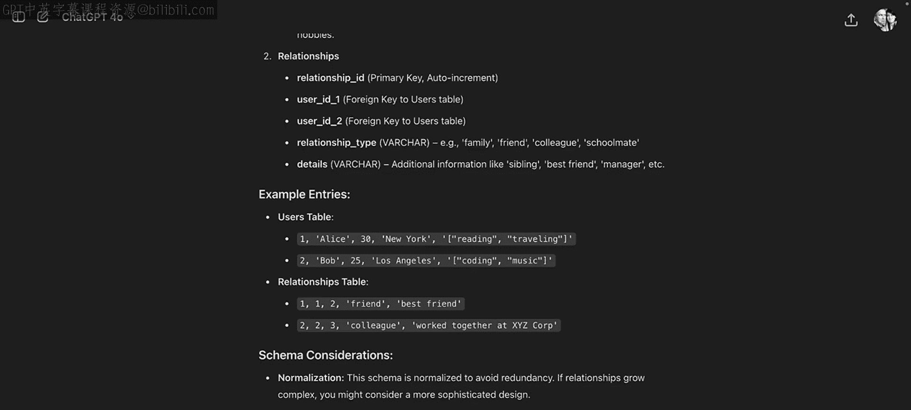
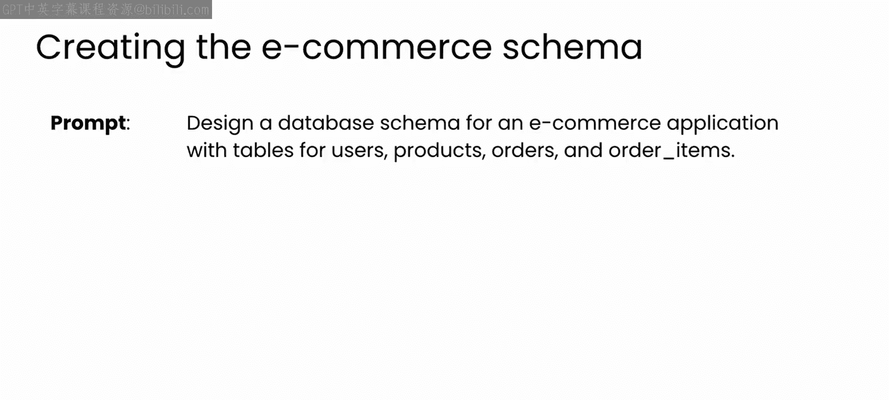
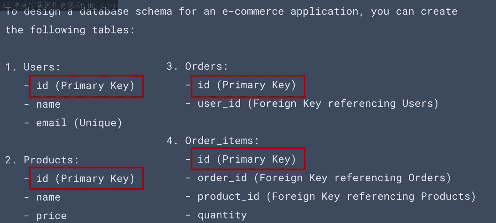
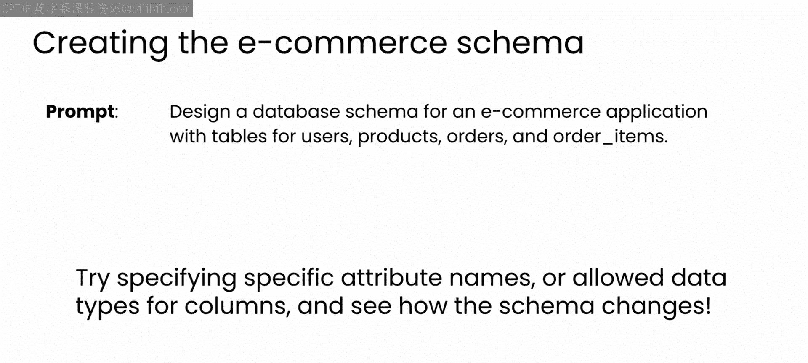
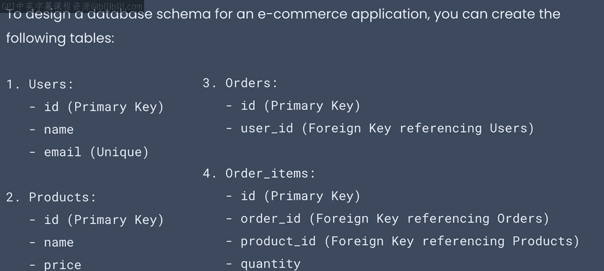
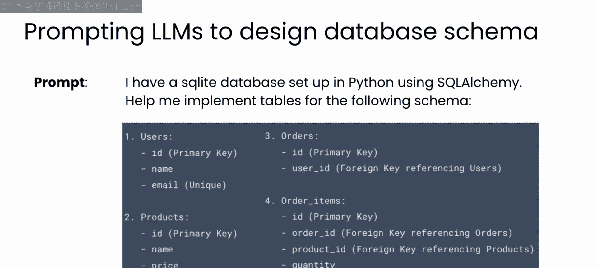
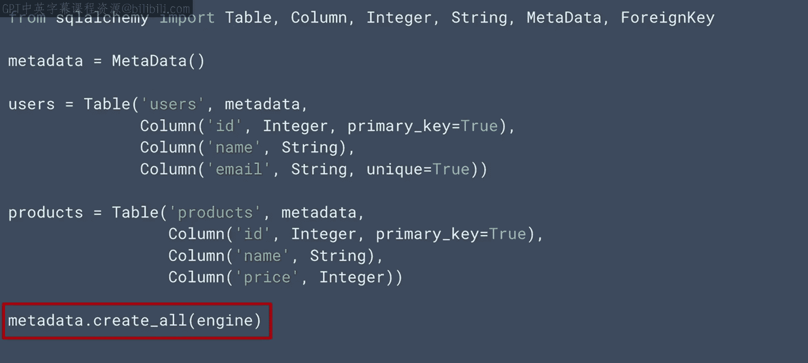

# 吴恩达《软件开发的生成式AI技能（简介、结对编程、数据库设计-3课全）Generative AI for Software Development Skill》 - P60：10_设计和实现数据库模式.zh_en - GPT中英字幕课程资源 - BV1ucxLeUEHD

Now that you have your environment set up， you can move on to one of the most important steps in database development。

 and thus designing and implementing the database schema。

The example you'll explore in this module is a database for an e-commerce company that will store information about users and their orders。

 As I'm sure you'll know， schema design has always been a structured and collaborative process involving a variety of stakeholders and team members。

😊，A project will usually start with a period of requirements gathering where the team identifies what data needs to be stored and how it will be used。

 Next， you might create a visualization known as an entity relationship diagram to map out the record types。

 attributes and relationships of entities in the database。

This diagram can then be used to decide which tables and columns and what your indexing strategy is going to be for the database。

Then with the development team， you would work to implement this into a specific database management system。

 for example， MySQL， and create the documentation required for developers to be able to work with the database。

Scheme and design can take a lot of time and expense and it can involve a lot of people and meetings。

 we all love meetings。😊，In the age of LLMs， you can now leverage AI to help you with much of the work of schema design。

 and this reduces the time to get a working prototype in place。

 which makes those later conversations about implementation in production more efficient and more productive。

😊，LLMs can take high level business requirements or descriptions in natural language and translate those into a preliminary database schema。

For instance， if you provide an LLM with a description of a social network。

 including attributes of the people in the network and the relationships to be captured and ask it to create a schema。

 the LLM will then suggest a detailed schema， including tables， columns。

 data formats for attributes and so on。😊。

It can even create some example entries for you and offer some considerations on the choices that it made。

 like the indexing keys that it recommends。😊。

LLMs have learned from lots of examples of database code on the internet。

 how to map requirements to a schema and even what schema strategies work best for different scenarios。

 so this can save you a ton of time and get you up and running much faster。😊。

Let's return to the example that you'll focus on in this module。

 a simple e-commerce app that will track users， products， orders。

 and individual items within an order。Now you could spend a lot of time thinking through all of the options here。

 what are the attributes to define， what are the relationships between them， all that kind of stuff。

Depending on the stage of your project， this may not be very well defined yet。😡。

Or you could take advantage of the LLM's understanding of both e-commerce and database schemas and have it generate the schema for you with a prompt like this。

😊，Design a database schemechema for an ecommerce-commerce application with tables for users。

 products， orders， and order items。

And the schema it generated in return will probably look a little bit like this。

The LLM has used its knowledge of database design to propose attributes and keys for each table。

 and all of these look useful。 It's also identified which key will be used to match records across tables。

 and in this case， it's the I D。😊。

The prompt I used here was fairly simple， but of course， the more context you provide。

 the better job the LLM will do at creating the schema。

Try modifying the problem to specify attribute names or data types and then see and explore how the schema changes。

While using an LLM to design a schema for you is very useful。

 using it to implement the design it came up with in code is the real game changer。😊。

It could help you build that working prototype very quickly。Okay， at this point。

 I'd like you to pause the video and see if you can turn this schema for the Ecommerce database into code to implement the requisite tables for you。

😊，Work with an LLM to create code for the SQL alchemy setup that you're using in this module and think about how to refine your prompt with the required context to steer the LLM to create what you want。

Okay， how did you get out， We you able to get the tables in the form that you wanted， Well。

 let me show you how I approached this and what I wrote alongside the L L M。

 Here's the prompt that I used。 I'm letting the L L M know about my database setup and that I'm using SQL light and SQL alchemy。

 And then I provide the database schema that I wanted to implement。😊。

Remember the code DCC will probably be a little bit different due to the randomization within the LLM。

 or you may even be using a different LLM， but the overall structure should likely be similar。

Here's a closer look at the code that G 40 generated for the users at product tables and actually looked pretty good。

The LLM has used the table objects。Created columns for each of the attributes specified in the schema and has chosen a suitable data type for each column。

The LLM also identified whether the column functions as the primary key， and if it did。

 it added the appropriate parameter。And the metadata doc create all command will generate the SQL statements to create these tables on the SQLite database for you。

The full code of all of the tables is available in the download for this course。

 So go take a look and compare it with what the LLM wrote for you。

 And if you don't understand any of the differences， go ahead and ask it to explain in more detail。😊。

With the tables in place， your database is ready for use To be able to do that。

 you're going to need to think through the operations used to add。

 update and remove data from the tables， and these are collectively known as CRd。

 So join me in the next video to see how you can work with an LLM on this stage of database development。

😊。