# 吴恩达《软件开发的生成式AI技能（简介、结对编程、数据库设计-3课全）Generative AI for Software Development Skill》 - P61：11_实现CRUD操作.zh_en - GPT中英字幕课程资源 - BV1ucxLeUEHD

Welcome back In this segment， we're going to focus on pair programming with an LLM to implement crud operations in our e-commerce database。

 You may be deeply familiar with this term， but in case you need a refresher， Crd stands for create。

 read， update and delete the four basic operations that you can perform in a database。

 you'll use your previously created database to build on during this session。

 If you haven't built it yet。 It may want to pause the video here and go back to do so。

 It'll be a lot easier to follow along when you can try out the code for yourself。😊，First。

 we're going to look at the create operation。 This is the action of adding new records or data items to a database。

 There's actually a fair amount to consider as you think through the create operation for database and an LLM is both aware of the issues and can advise you on things to think about。

😊，If you ask the LLM about these issues with a prompt like this。

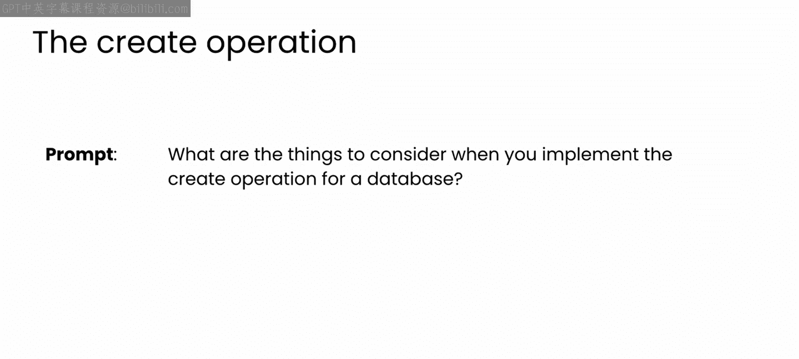

It will respond with a lot of great information。 Some issues are likely top of mind。

 How will you validate the data， What security protocols do you need to implement to protect against sQL injection or other vulnerabilities。

 and how will you handle errors。 Others may be less obvious or familiar to you like transaction management。

 concurrency control， audit logging and so on。

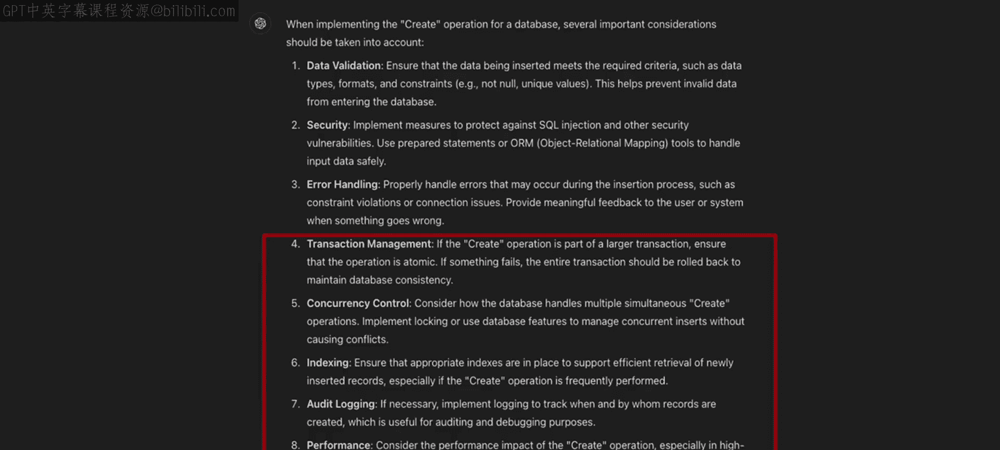

You may not need to worry about these at the early stages。

 but keep in mind that you can always come back and ask an LLM for advice as your project progresses。

😊，Let's start by asking ChatyPT to help generate a function to add a new user to the users' table of your Ecommerce database。

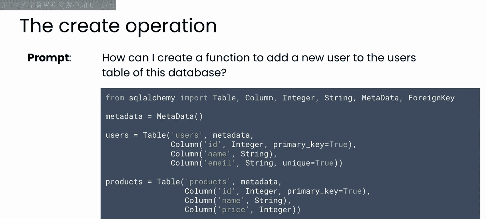

And for me personally， this was another great example of where using an Allab as a pair programmer was really useful。

 As someone who doesn't do this daily， I was suddenly stuck。😊，What's the best way to do that。

 By default， I was going to start writing a function that would execute SQL。

 and I was going to roll up my sleeves to do that。 But when I asked GT about it。

 it suggested some SQL alchemy APIpis。 given that I was already using SQL alchemy。

 This should have been a no brainer， but I missed it。

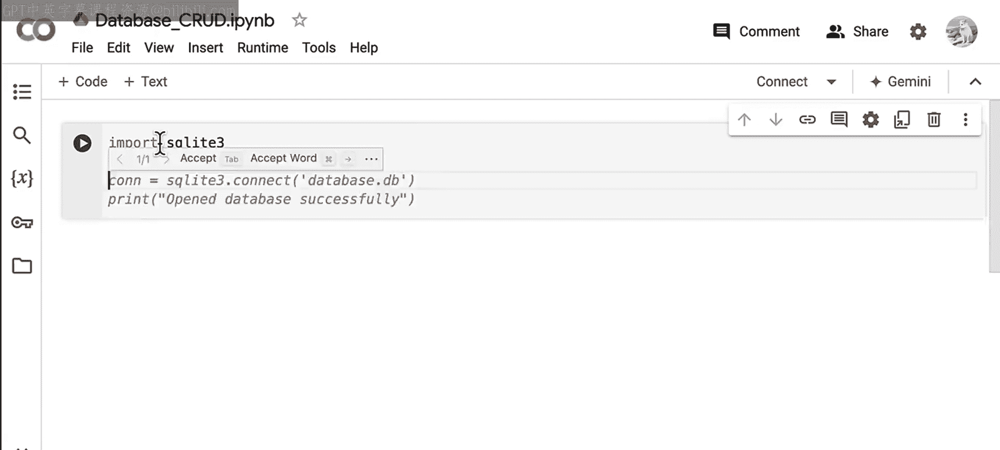

It's a good reminder that no matter how experienced you are。

 there are always new methods that you may not be familiar with， Bouncing off a pair programmer。

 machine or human is a great way to learn about new things。😊，And while for this course。

 amusing Python and SQL alchemy， do remember that the same principles apply no matter your language or environment。

So here's the code the LLM created。 and here you can create a new session and define the add user function。

 which inserts a new user into the user's table and then commits the transaction。

 We then test the function by adding a user named John Doe。😊。

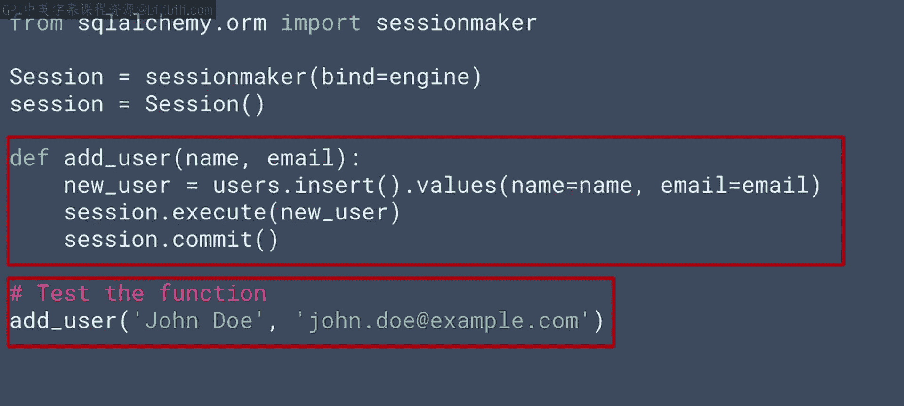

Running this appeared to work very nicely and you can see the output from SQL alchemy here。

The security minded among you might be wondering， wait a second。

 I can see that it called SQL with parameters。 Is it O to trust SQL alchemy like this or should I be doing some kind of sanitization of those parameters first。

Hold on to that thought for now， you'll come back to take a closer look at that issue a little later。

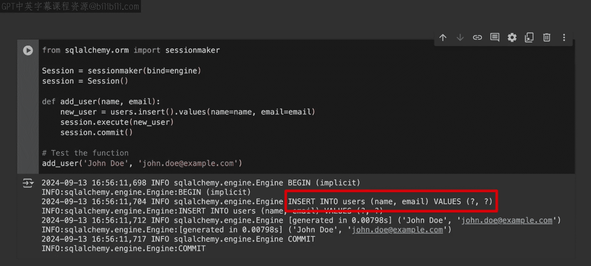

Next， it would be good to test if the user that you just added was added correctly。

 and for that you need to implement read functionality and again， with a simple pro to GPT。

 you can ask it to create a function to do that。😊。

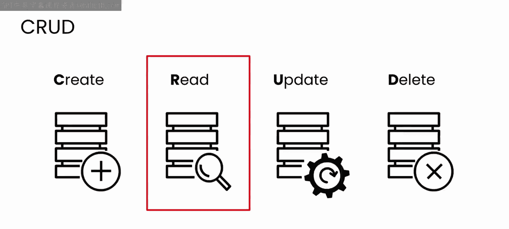

Pause the video and think about how you would prompt GPT for that code。

 think about what you would want the read action to do and then give the LLM specific instructions。

Here's the prompt that I used。And here is the code that the model generated。

 You should have something similar。 It runs a query to select old users and returns the results of that。

 which is a Python list and then print it out。

And here's the result of executing that code。Again。

 you're seeing the SQL queries because of the Echo equals true flag in the database set up from earlier。

 and we can see that our John Doc Doux was retrieved as expected。 If you aren't seeing that。

 go back and check your code Now， it's important to be able to write and read the data properly before you go on to update and delete。

 if you're having trouble， try regenerating new code that works。 or if you're really stuck。

 I've provided my code in the download for this course。

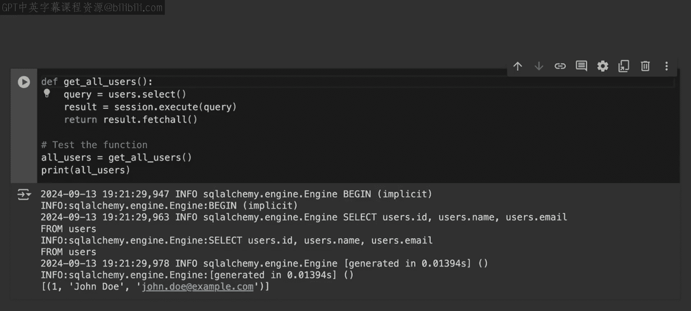

Okay， so you can now create entries in the database and you can read them back and at this point you have a single record in the user table of your database with the name and email address of the user。

😊，Now suppose you want to update that to add new information， say for example， the email address。😊。

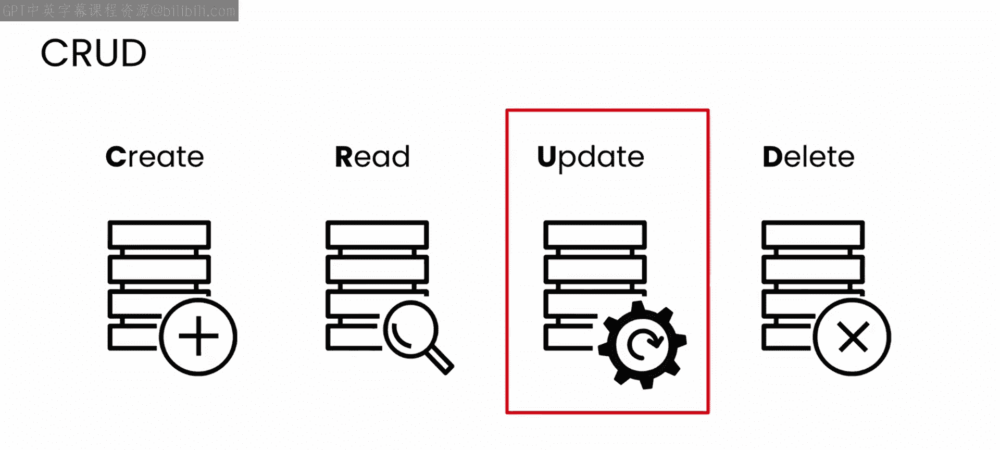

Again， with a prompt， you can have the LLM generate the code to do that for you。

 Here's one prompt that you could use。

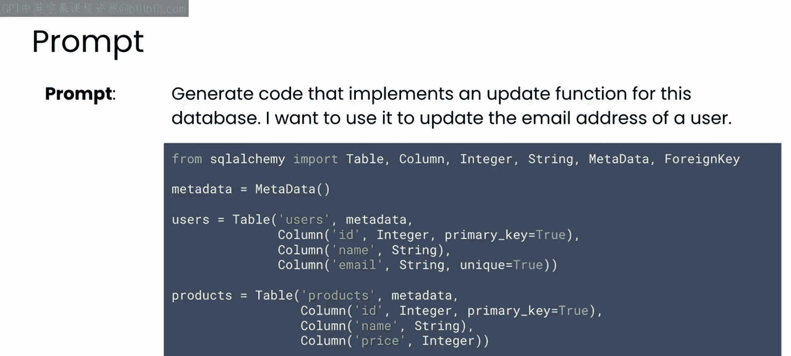

And here's what I got back from the LLM， it was code to help me update the user's email address。

It generated a function that takes it an ID and matches an existing record against that I。

 and it then updates the email of that record to the new email that was passed in as a parameter。😊。

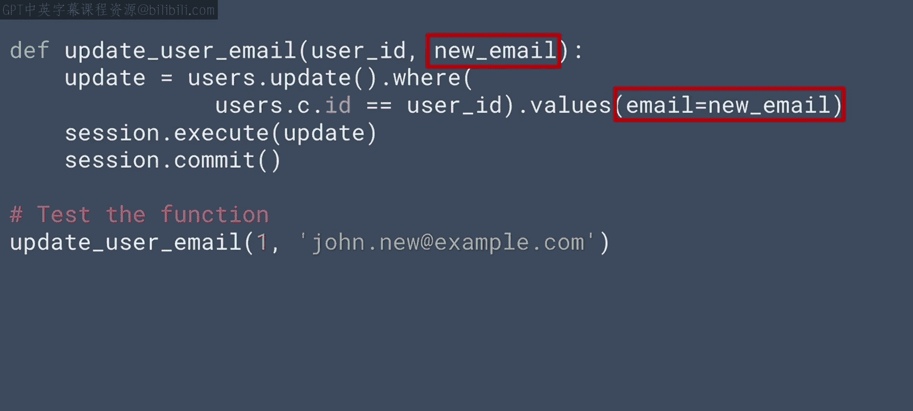

So again， here you're seeing the LLM's ability to understand the structure of the database and how different tables and records are related。

 it's all in action here。The model is able to write code for you very quickly。

 and let's see how that works。Here's the result of executing that code and again you can see the status update from SQL Alchemy。

And if you go back and run the read query from earlier。

 it will show you both the user's name and their new email address。

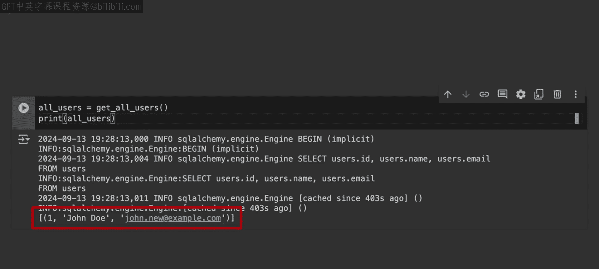

Finally， let's handle the delete operation， which， of course。

 involves removing records from your database。 You're going to work with an LLM to write a function to remove a user based on their ID。

😊。

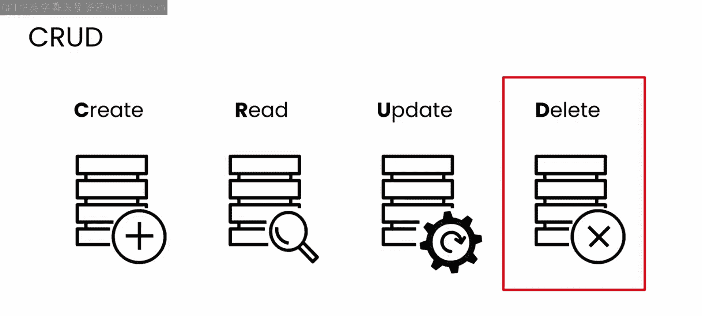

As always， pause the video for a moment and try thinking through this。

 What information do you need to provide to the Alllaan and then try out your prompt。

Okay， how did you get on？Here's the code that GPT generated for me。😡。

You should get something pretty similar。 It's quite a straightforward function that takes a user ID parameter as input。

 It then searches for that parameter。 And if it matches one of the database。

 it will delete the record。

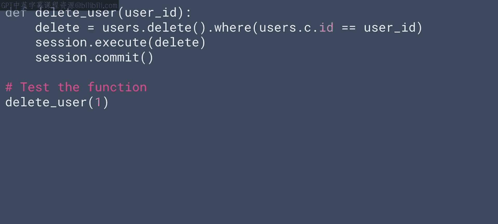

The results of running it are here。And we can see that it ran a SQL query to delete from the user's table where the user matches a particular parameter。

😊，And to see if it works， you can run the get All Use function to list all of your users。

 and that should now give you an empty result。😊，Great。

 so you now have code to do crud operations on the user's table， adding a user， reading them back。

 updating their details， and then deleting them。😊，But if you remember earlier。

 there was a point of concern about security， that even though you aren't interacting with the database using SQL。

 the application uses APIs that do use SQL under the hood。

Here's the output from the C operation that you saw earlier showing the SQL insert statement happening in the background。

 Is there a chance here that this SQL is not sanitized and that your code could accept parameters that enable SQL injection attacks。

😊。

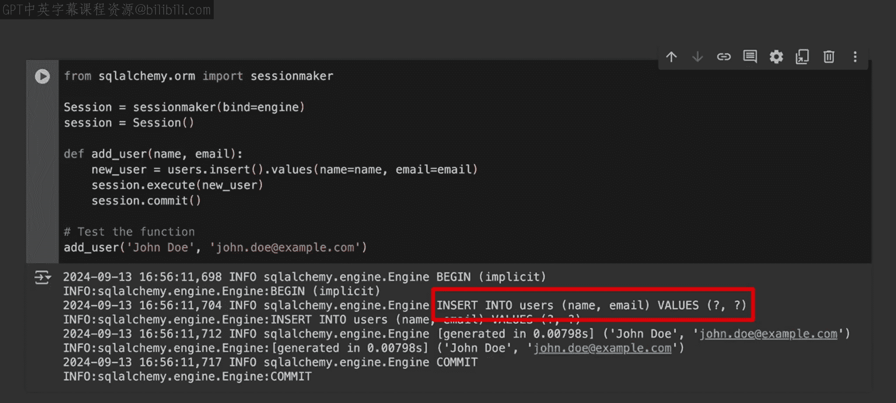

Well， one way to find out would be to go back to my trusty pair programmer in Chat EptT and just ask。

Which I did like this。

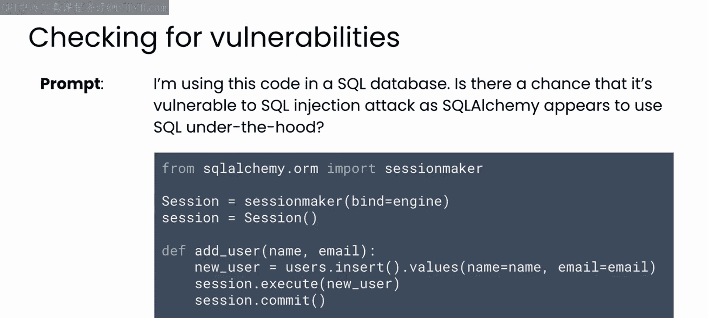

And the answer I got was that， yes， my code was vulnerable。 When I initially generated that code。

 I hadn't specified any kind of security role or anything that you've learned in the earlier modules。

 And as a result， if my code was going to be in production， it was at risk of attack。😊。

So GT suggested that I use the ORM feature and store my data in a class and then offered me alternative code that implemented the user as a class representing the user's table。

 and when I did my ad operation it used the ORM methods which are safe from SQL injection。😊。

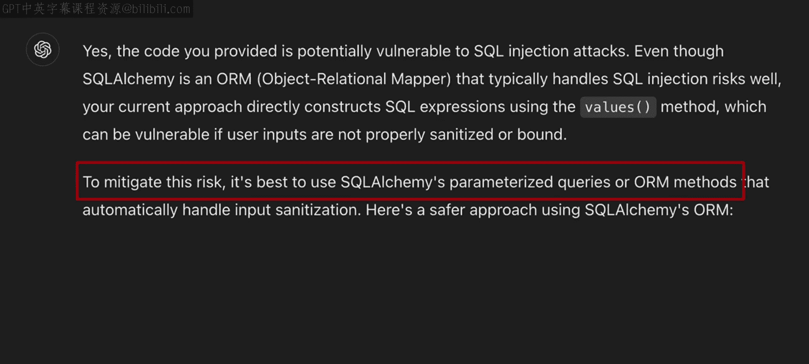

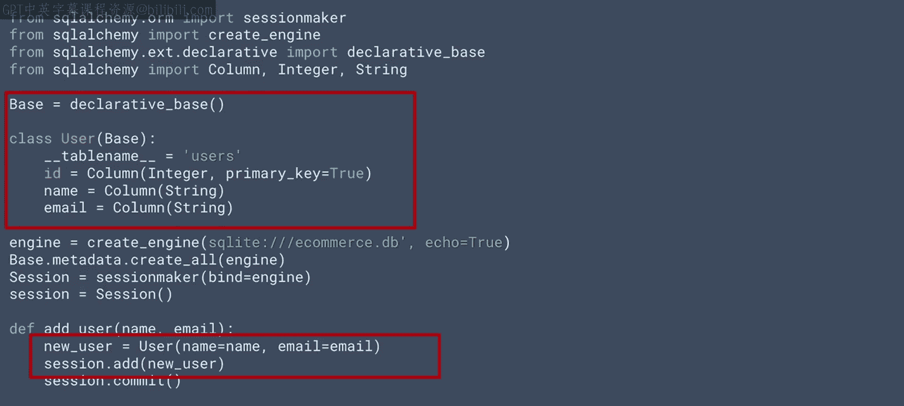

When I ran this code， it successfully added the user。

 which I was able to see with the getall users function as successfully being there。

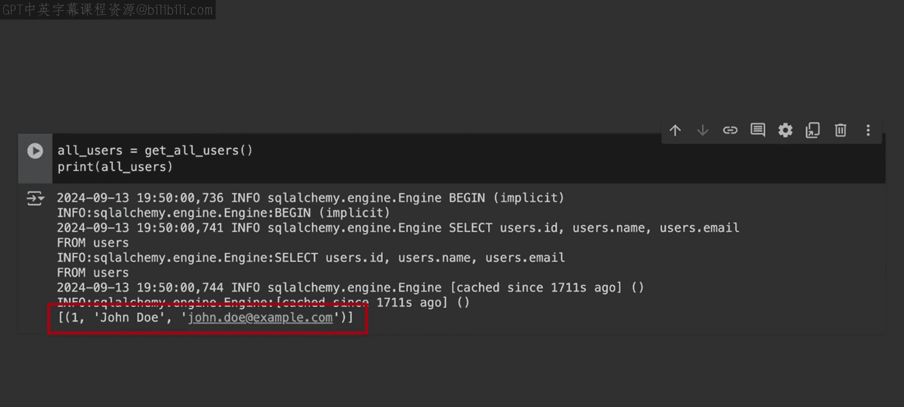

You're now ready to do a hands on exercise。 Your task is to build out the crud operations for the remaining three tables in the database。

 products， orders and order items。Once you have those operations in place。

 you're going to add some test data and query against that data to check if everything works。😡。

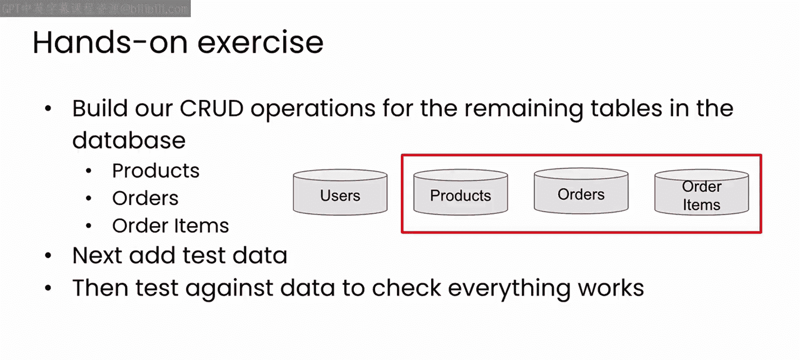

Join me in the next video where I'm going to go through some details of how you can get started。

