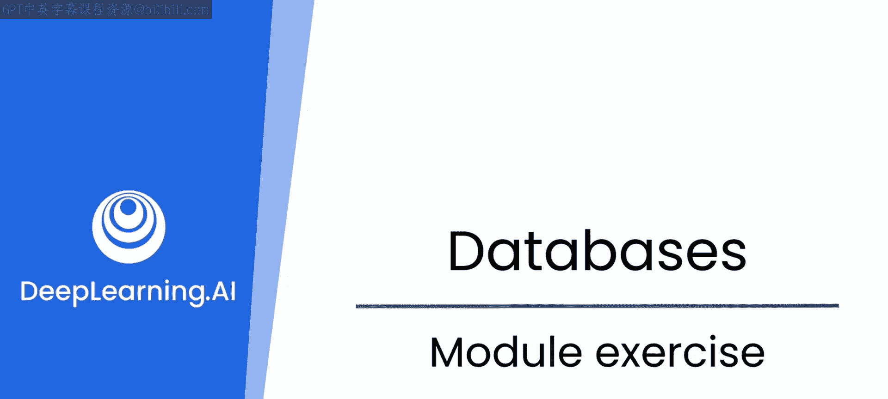
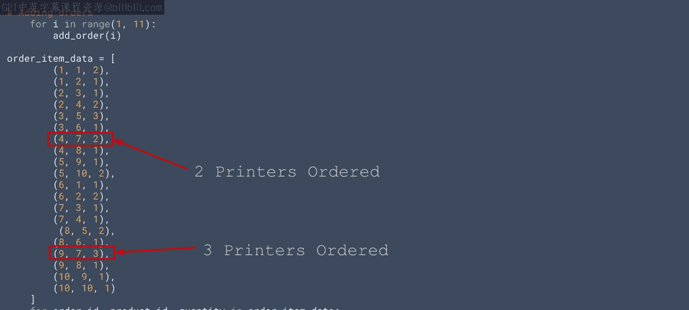

# 吴恩达《软件开发的生成式AI技能（简介、结对编程、数据库设计-3课全）Generative AI for Software Development Skill》 - P62：12_模块练习.zh_en - GPT中英字幕课程资源 - BV1ucxLeUEHD

In the last video， the first iterations of the Cd functions used basic code that did not take advantage of all of the safety features built into SL alchemy。

 towardsward the end of the video， you saw the LLM suggest using OM classes to build up the crud operation functions。

 and these offered better protections against SQL injections and other security vulnerabilities。😊。

So in this hands on activity， you're going to start by implementing crud functionality for the remaining tables in the database。

 products， orders and order items， and you should do so using the OM features in SQL alchemy。

 Once you've done that， you'll use this code to add data to your database。

 be sure to use it exactly as I've provided。 and I've also put this code in a download for the course。

 If you don't want to type it all out。😊，Here's the code for adding the users and the products。

 and here's the code for the orders。Then once your database is initialized and coded correctly。

 and you've added the data correctly， you're going to go on to create code to query the data and carry out some common tasks。

For example， I'd like you to create code to query the database for all orders by a particular user and to list what and how many of that item a user ordered。

With the data that I've provided， user ID1 has a single order with two laptops and one smartphone。

How would you write or generate code that will give you this result， that's actually pretty easy。

So for a little bit more of a challenge， you should also create some code that figures out which item was ordered the most and how many units of that item were ordered。

 The answer is printers and five of them were ordered。 See if you can get it。

This inin't a challenging exercise。 and it's the kind of thing that could take a long time if you are doing it solo。

 But with an L L by your side and good expressive prompting， it shouldn't take you too long。

 Give it a try。