# 吴恩达《软件开发的生成式AI技能（简介、结对编程、数据库设计-3课全）Generative AI for Software Development Skill》 - P64：14_数据库优化.zh_en - GPT中英字幕课程资源 - BV1ucxLeUEHD

There's a lot to consider when optimizing both your underlying database structure and the queries they write to work with it。

Whether you have expertise in database creation and maintenance or not。

 I think it's still good practice to work with an LLM as a pair programmer and a database expert to double check your knowledge and maybe even spark inspiration on things you should consider。

😊，As always， you can start with a high level general prompt like this one。

 What are some of the best practices to improve the performance of this database。

 and you can then dig deeper into specific issues as you consider the suggestions from the LLM。😊。

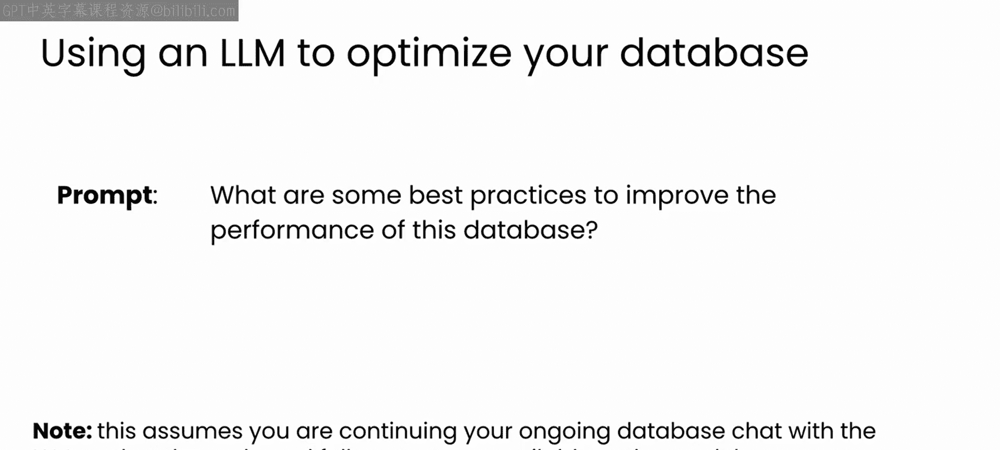

GPT 40 responds to this prompt with a very detailed answer。

 highlighting a number of things that you should consider。You've already designed your schema。

 so let's skip on to the next suggestion and that's indexing。

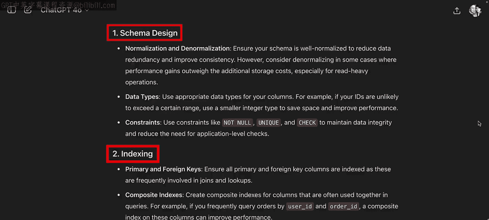

Smart use of indexes can significantly speed up the retrieval of data。

 but it can be hard to know where to begin。 So let's dig a little bit deeper and ask the LL M for some indexing advice。

 If you're relatively new to database design， you can start with a simple prompt like this one。

 What are the best practices for indexing a SQL database。😊。

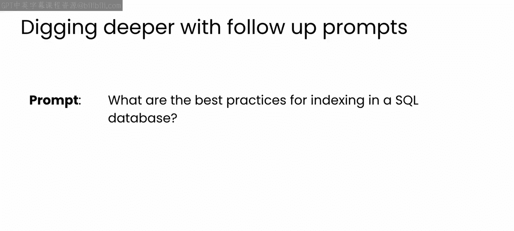

And you'll likely get a detailed answer like this that highlights a lot of the best practices for indices。

First is to choose which columns you're going to index。

 and the best to start with are those where you'll likely use wear or join operations。

And then is also some advice that's more useful if you have larger and more diverse databases。

 such as considering the size of the index， and to avoid indexing columns that have large complex data types within them。

 such as globally unique IDs or GuIs。😊，The model then also demonstrates how to create an index。

 in this case， on the products table and on the name column。

 here's the code to create an index called IX productss name on that field。

Simply by creating the index， any search for products by name will automatically run faster。

 It is a powerful tool， but also when you should use carefully。😊。

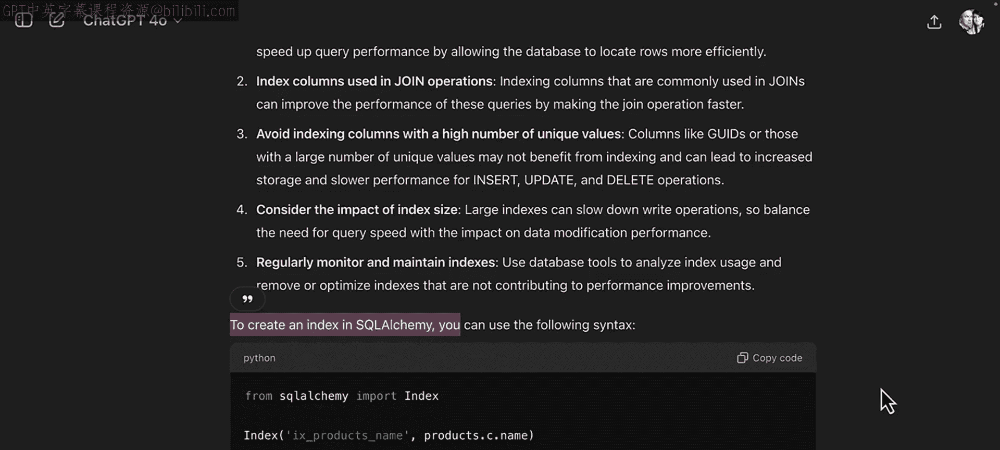

When writing code that uses indices， you can't just index every column and expect a performance upgrade。

 Use it carefully， Use it sparingly and always test your code thoroughly。

 It's easy to fall into bad habits， particularly with generated code。😊。

So let's go back to the list and another tip that the AllLam gave was caching and specifically query caching。

 This can help reduce the load on your database by storing the results of your more expensive queries。

 If you have relatively common queries that are expensive to run。

 Why not just run them once and then cache the results。

 Subent queries would then just read the cache much faster。😊。

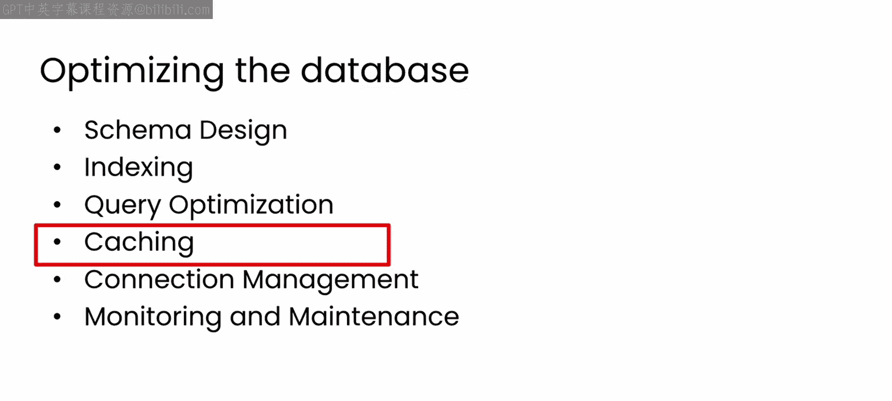

And this is all very well。 But what if you've no idea where to begin In these examples。

 I'm using sequL alchemy， and I understand that you might be using something else。

 but the same basic principles will apply。 And you can just ask for help with a prompt like this。

And here's the response I got， and I hope you get something similar。

 the LLM suggests installing the Dogpile。cash library。And after giving installation instructions。

 it writes this sample code that can then be used to perform caching。 And with anything else。

 if you don't understand what's happening， you can always dig deeper with your LM by asking follow up questions。

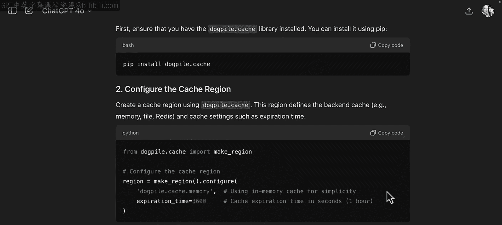

In this case， dogpile cash first creates the cache file with an expiration time of one hour of 3600 seconds。

Then by attributing the Get All products query with Wijat dot cash on arguments。

 you're signaling that you want to cache the results of this function in memory。

 where they'll be fast to retrieve。It's nice that you don't need to change the contents of the function。

 you just attribute it。😡，And then to test the function， you just call it as always。

 the first time you call it or one hour after the last time you called it， the function will execute。

 and it will return the results。 Otherwise， the results will be returned from the cache。😊。

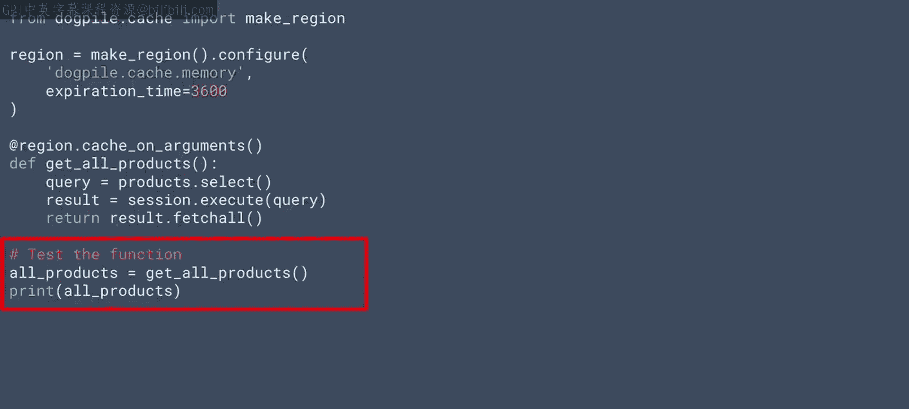

This would be a good place to pause the video， try out the code。

 and see if he can get the cached query up and running。And once you do。

 you can use one of the timing tools available at Python or whatever language you're working in to verify that the cached query is running much faster。

😊。

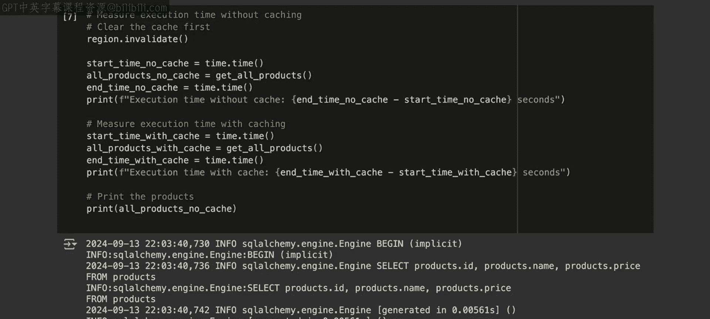

One quick note， the query cashier was implemented after designing the database。

 So I skipped over schema design as an optimization。

 But one part of the overall design that you should consider。

 particularly for indexing is noted earlier， is to be very smart with the data types that you choose your higher level schema tables and joins and all that may not change。

 but the data in particular columns is something you should always consider carefully。

 And to that end， you can prompt your LLM for details about this。 For example。

 with a simple prop like this that asks for best practices in choosing data types。😊。

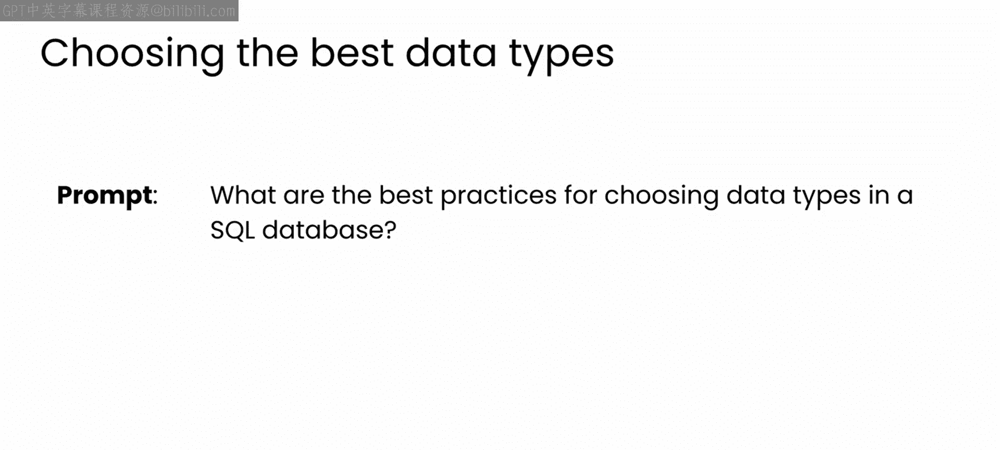

In my case， the prompt yielded great results like this。

 And if you have even a basic knowledge of database design， that largely common sense。However。

 they are a terrific reminder to pay attention and double check L L M generated code to make sure that it always follows best practices。

 For example， the third point to use text for strings is obvious， but the advice to limit the length。

 if possible， is a great point， which you can see here that the model did not follow when it created our original schema。

 So be sure to pause a video now and go back and update your code。😊。

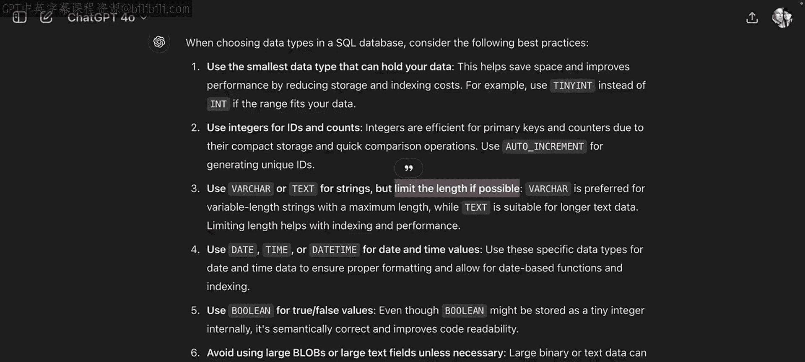

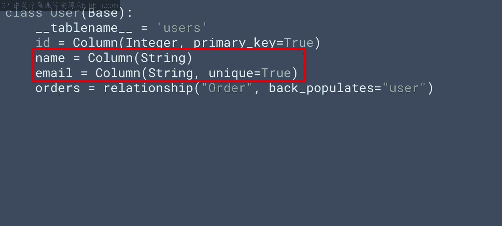

Be sure to think of the other best practices as you grow your own databases from scratch and to make sure that you're optimizing for both the schema design and the queries that you'll use to work with your data in the next video。

 you're going to think through some of the processes of debugging databases。

 after which you're going to be ready for the second part of this week's exercise。😊。

I'll see you there。