# 吴恩达《软件开发的生成式AI技能（简介、结对编程、数据库设计-3课全）Generative AI for Software Development Skill》 - P65：15_调试.zh_en - GPT中英字幕课程资源 - BV1ucxLeUEHD

See you've come a long way since the start of this module。

 And if you've been following along in code， you should now have a fairly large code base in hand。

 You've designed and created tables。 You've implemented cr functionality， you've designed queries。

 and you've maybe even refactored some of the code to optimize it for performance。 for example。

 by implementing a query cache。 And along the way， you've probably encountered a bunch of errors。

Errors are inevitable when working with databases or indeed any code。

 But knowing how to handle and debug them effectively can save you a lot of time and a lot of headaches。

 First， let's talk about handling database connection errors。

 A common issue you might encounter is an inability to connect to your database。

 Could you work with an LLM to help you write code to handle any connection errors you might encounter。

😊，Well， we've been using SQL alchemy and Python as the example in this module。

 but if you're using something else， the same principles of specific prompting will apply。😊。

So let's start by asking the LLM a fairly general question about how to handle database connection errors in SQL alchemy。

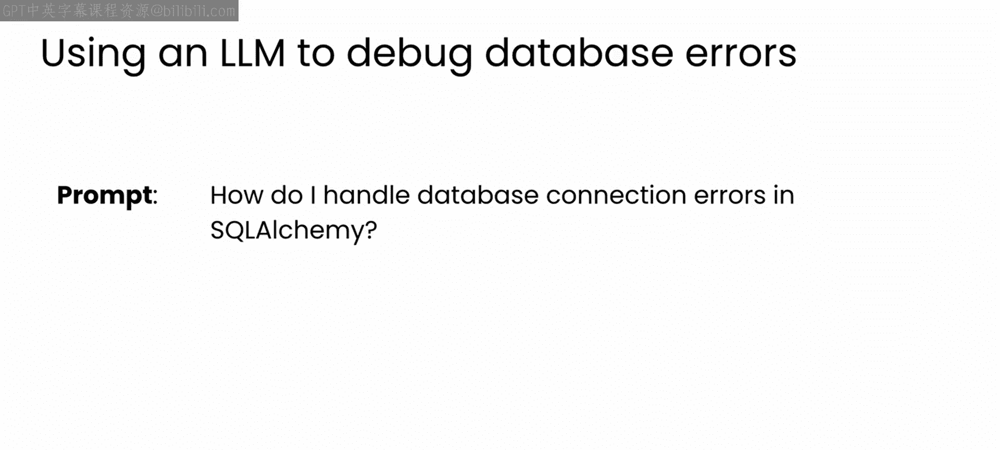

And the solution is pretty simple。 A basic tricach clause to get an operational error exception and to print out the details。

 You first attempt to connect to a database using engine dot connect。

 And if a connection error occurs， it's caught by the exception block。

 and then you can then print out the error message and misses simple。

 but is a very effective way to handle connection issues。😊。

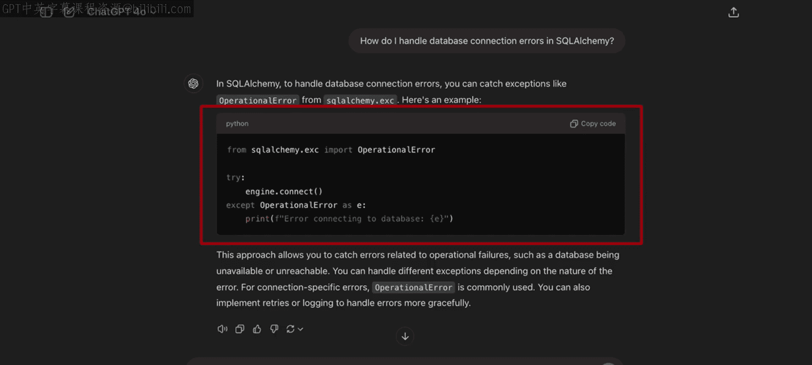

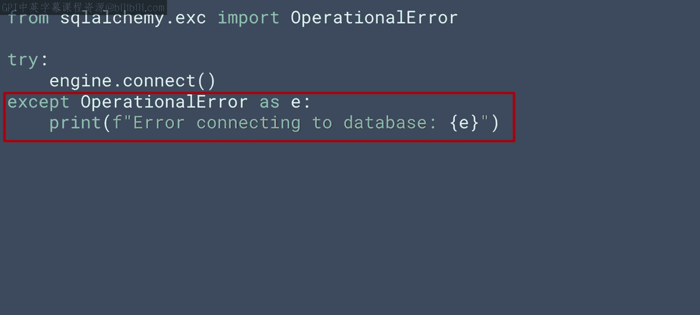

In earlier videos， you implemented a series of cru operations and as you expand the functionality of your database。

 you might find yourself running into edge cases that create errors with these operations。

For example， what if you tried to insert a duplicate entry into a table that has a unique constraint。

 How should your database handle this error， You can ask the LLM for advice with a prop like this。

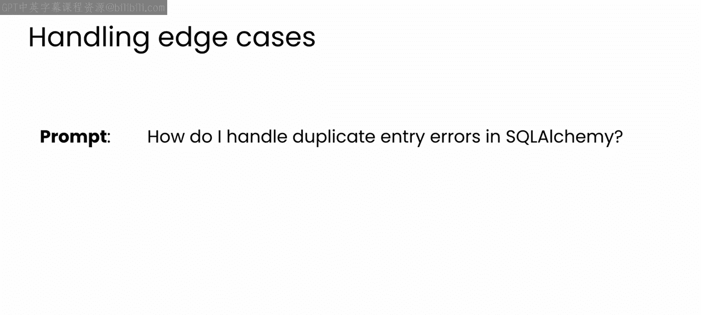

And it will give you some advice along the lines of this here。

 it suggests that you use an integrity error type， which is built into SQL alchemy and has a super simple interface。

😊。

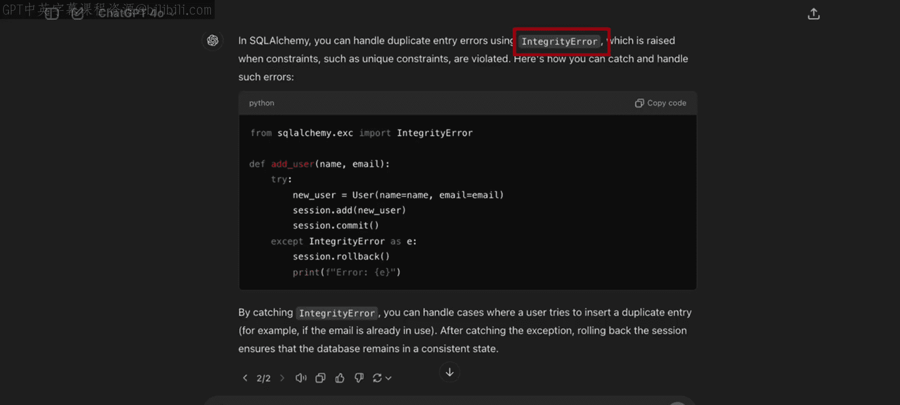

If you're working in some other language or database infrastructure。

 the model should give you specific advice for your implementation。 So in the example here。

 the code deals with the case of trying to add a duplicate user to the user's table。 Use should。

 of course， be unique so this action should be disallowed。

If a duplicate entry error occurs due to the unique constraint on the email column。

 it triggers an integrity error that is caught by the accept block， which then prints out the error。

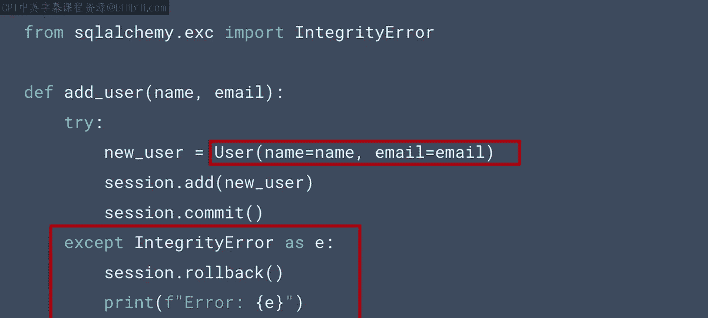

Again， the point here is not the implementation， but the fact that the LLM understands that the user's table has a unique constraint。

 and it makes use of the correct error type in the database software you're working with and helps you handle the error。

Now let's move on to debugging issues， one powerful tool for debugging anything is logging。

 and SQL queries are no exception to this。😊，So let's ask the LLM how to enable SQL query logging with a very simple prompt like this one。

😊。

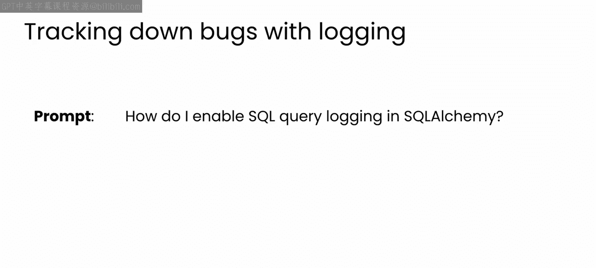

And here is the code that was generated。 It turns on logging and tests it with a query to get all users。

 The sequel will just be printed to the console。

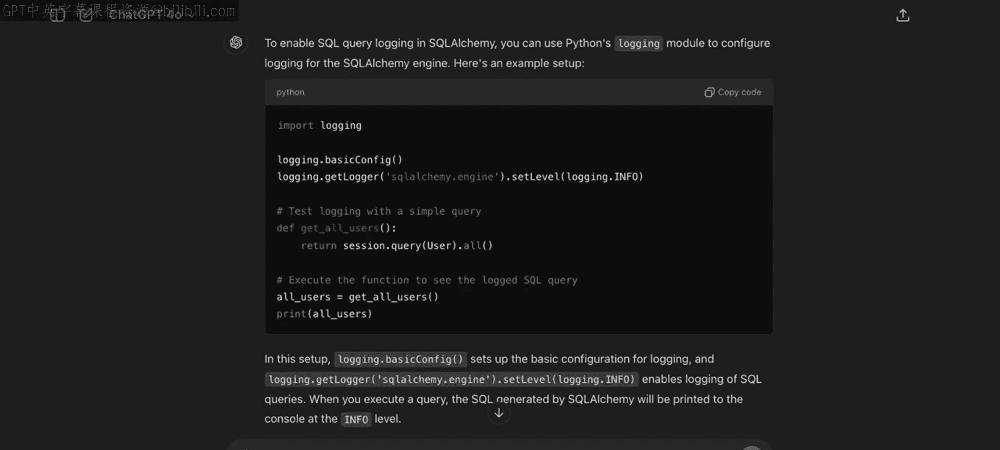

In production， you'll likely want your logs to be saved to a file so you can ask a follow up to the LLM to modify the code to do that for you。

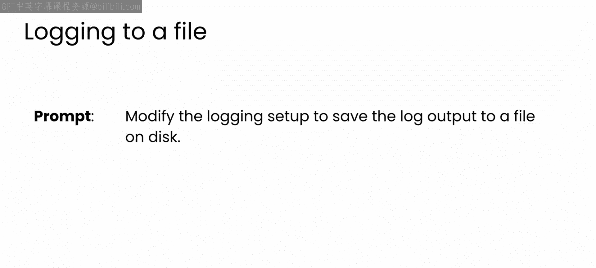

And it will return the modified code where you output the logs to a file by specifying the file name and other setup parameters inside the basic config call。

Take a second to pause the video and implement something like this in your own database setup and see if you can get it to work。

Okay， hopefully you are able to successfully enable logging to a file in your database setup。😡。

Another type of error to consider are transaction errors。

 and these can typically happen when you're doing a complex update to the database。

 which will fail before it completes， and that leaves the database in an inconsistent state。

These can be really damaging， so how do we mitigate them？Well， we could start by asking。

 and in the response， you'll see code like this。It tries the query。 And when it commits。

 it then checks if there's an exception。 And if so。

 it uses the same session rollback that we saw for a previous integrity error。 That's handy。

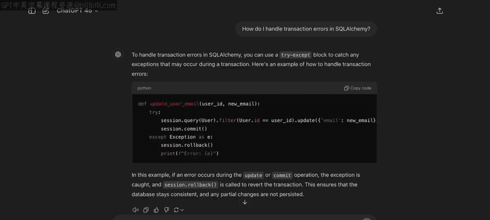

Finally， if you work with databases a lot， you'll probably know that another useful debugging tool is to understand the execution plan of queries。

 This is primarily for complex queries that interact with many tables and can track and reveal the order in which tables are accessed。

 which parts of the get updated first and stuff like that。😊，In SQL alchemy。

 there's functionality calledEx。 Let's see how you would use that。😊，First。

 I'll query the LL lab for some advice。

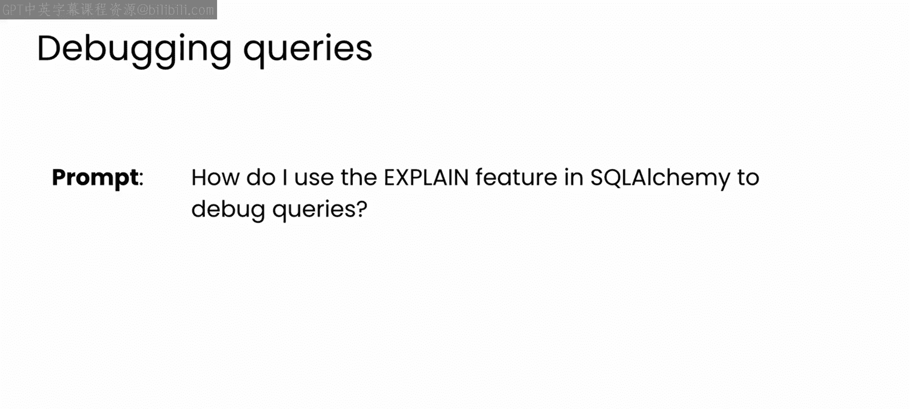

And it will generate code me that looks like this。😊。

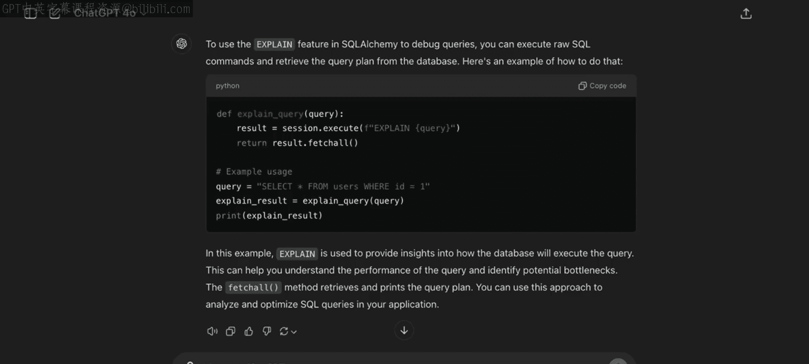

Again， be sure to check here that the code is matching your database setup If you've been working in the same chats。

 the LLL will probably be keeping track， but it can make mistakes so check that all of the suggested code is good and check it carefully。

So you can see a query here。 Select all users that match ID equals1 and pass this to the explain query function。

 which in turn will execute， Ex what that query and then return the full process of running that query。

 And if you print that out， you can explore just what happened， which will look like this。 Now。

 if you don't understand what everything in the output means。 you can， of course。

 go straight to the LLM for answers with a query that looks like this。😊。

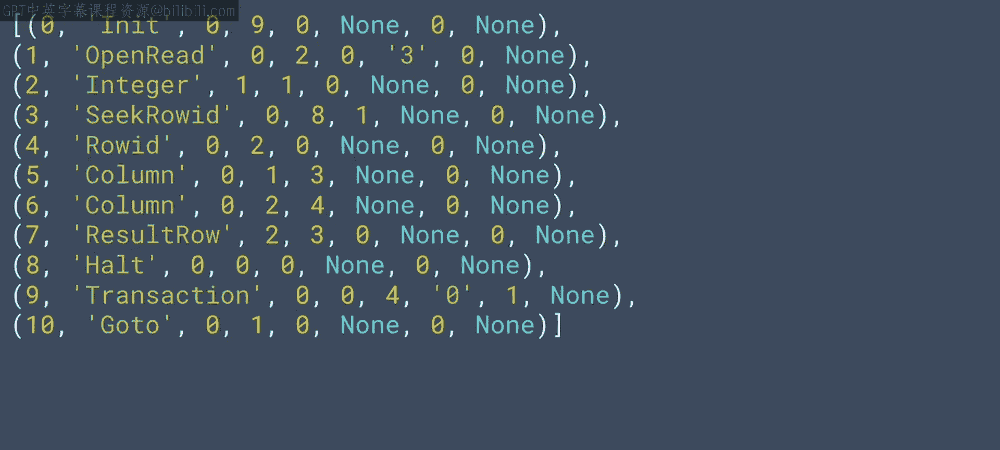

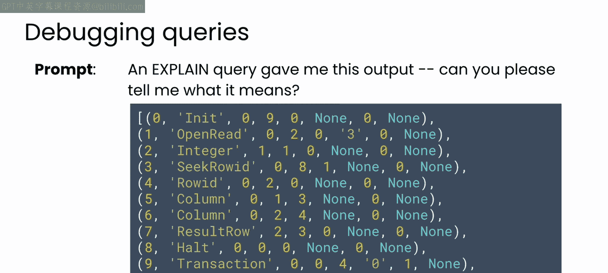

And you'll get a very detailed answer。 I've shown a snippet of the output here。

 and it really shows in detail how that query executes step by step。

I usually learn something new from output like this。

 so I would encourage you to take the time to read through it thoroughly。 So hopefully。

 you've now got a flavor of how an LLM can help you debug errors in your database and offer up code fixes for whatever database platform you're using。

😊。

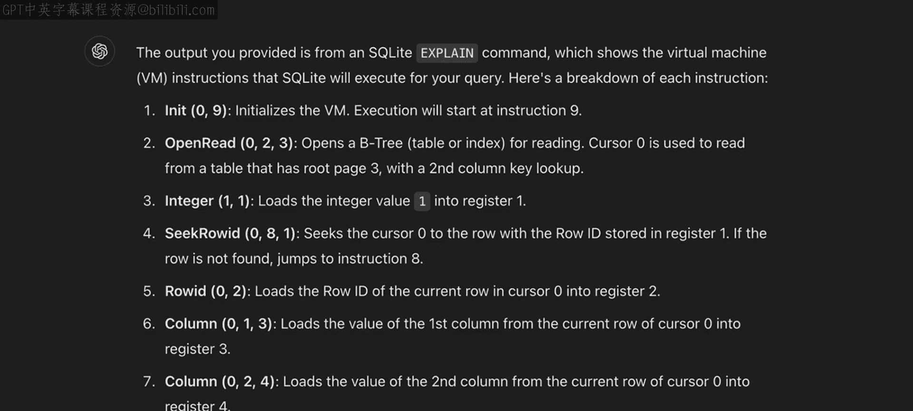

You're now ready to do the final exercise for this module and actually try debugging some database errors yourself。

😊，In the next video， I'll walk you through some of the important details of the exercise。

 And when you're done with that， you'll be ready to move on to the final module of this course and specialization。

 where you'll work with an LLM to develop deeper understanding of common software design patterns that can really elevate your workflow and the products that you build。

 I'll see you there after the exercise。😊。