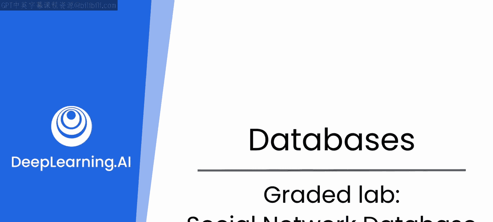
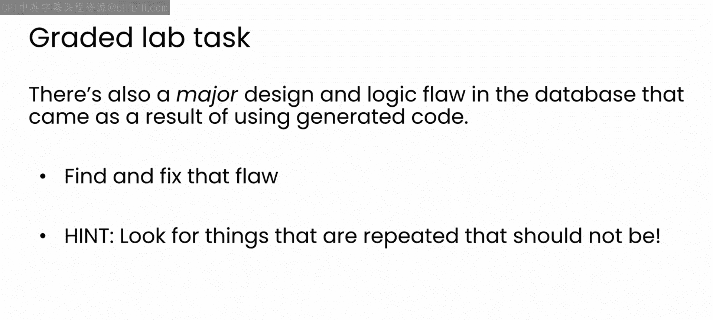

# 吴恩达《软件开发的生成式AI技能（简介、结对编程、数据库设计-3课全）Generative AI for Software Development Skill》 - P66：16_社交网络数据库分级实验.zh_en - GPT中英字幕课程资源 - BV1ucxLeUEHD

I want to share some details about the graded exercise for this module to help set you up for success。

I provided code in a notebook to create and populate a database for a simple social network and the notebook is called social networkworkdb。

Ipi notebook。The social network includes people and clubs and captures both friendship and membership relationships between these entities。

Here's the task that you have to complete。First， you're going to create code that given a particular club will find all of the members of that club。

Then you're going to create code that finds everybody that a particular person considers to be their friend。

And then lastly， you're got to create code that given the name of a person finds all of the people that considers them their friend。

There is a major design and logic flaw in the database that came as a result of using generated code。

 Take a little bit of time to see if you can find and fix that。 And here's a little bit of a hint。

 Look for things that are repeated， that should not be。

Hope you enjoyed this activity and when you're done I'll see you in the next module when we're going to talk about design patterns。

😊。