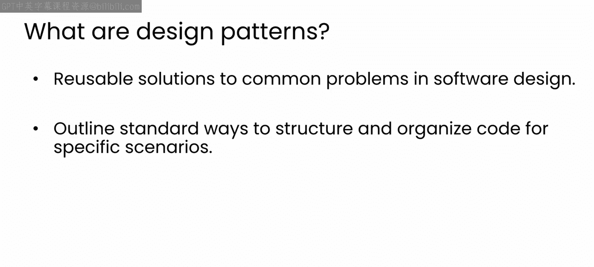
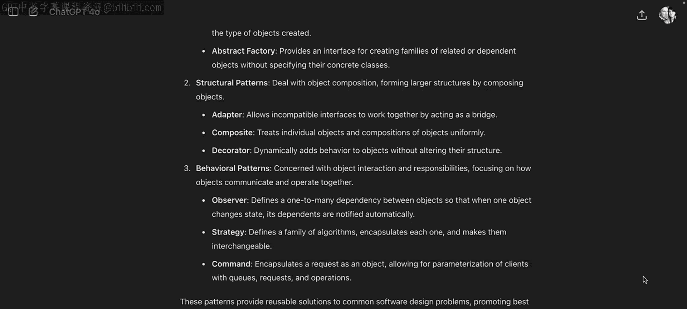
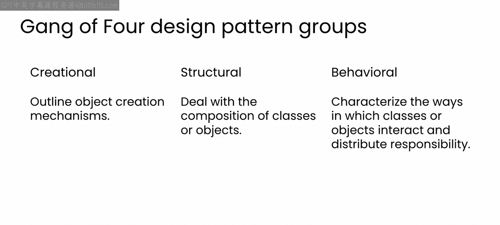

# 吴恩达《软件开发的生成式AI技能（简介、结对编程、数据库设计-3课全）Generative AI for Software Development Skill》 - P67：17_模块介绍.zh_en - GPT中英字幕课程资源 - BV1ucxLeUEHD

Welcome to the final module of this course on AI powered software and system design。😊。

In the following videos， you'll explore how an LLM can help you learn about important software design patterns and you'll implement them in code。

You've likely learned about and used design patterns at some point in your career。

 but just to refresh your memory， design patterns are reusable solutions to common problems in software design that outline standard ways to structure and organize code for specific scenarios。

Design patterns provide a standard terminology that developers can use to communicate their ideas clearly and efficiently to others。

They not only enhance code readability and reusability。

 but they also help in debugging and preventing issues early in the design phase。In this module。

 you'll explore some of these patterns and you'll work with an LLM to help you implement them effectively。

 enhancing both your coding skills and your architectural insights。 Frankly。

 I found that a lot of the code and ideas of some of the more advanced design patterns are really hard to understand。

 Try to figure out if I should use them in building my code has always been a challenge。

 without prior expertise in using them， there's a dilemma。😊。

You know， they're proven and people who use them love them。 but without knowing them already。

 it's really hard to know if they're useful for you。 You record in a loop。

 So you're going to see how an LLM can help you better understand design patterns assess whether they're appropriate for your use case and then implement them in code by exploring the ideas of the famous gang of four design patterns。

 The term Gang of4 refers to four authors。 Eric Gamma， Richard Helm， Ralph Johnson and John Viiddesa。

 who published a seminal book in 1994， titled Design patternss。

 El of reusable object oriented software。😊，This book is a cornerstone in the field of software engineering。

 and it has influenced so many developers and the design of many programming languages。

The gang of four patterns are foundational to understanding modern software architecture。

 The authors categorize the patterns into three groups， creational， structural and behavioral。

 each serving a different aspect of software design。

Creational patterns deal with object creation mechanisms。

Structural patterns deal with the composition of classes or objects。

 and behavioral patterns characterize the ways in which classes or objects interact and distribute responsibility。

If you aren't familiar with using these patterns， you may be confused as to how。

 when or why you would use them， or you may already have a problem that could be solved by them。

 but you aren't sure how to implement that pattern in your code。

And that's what this module is all about using an LLM as a pair programmer to help you understand them a little more and how to make the most of them。

 So let's get started by taking a closer look at the Gang of4 patterns that I've just mentioned。

 I'll see you in the next video。😊。