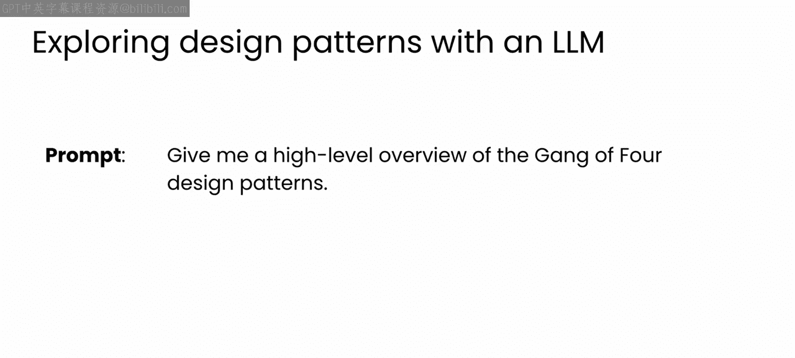
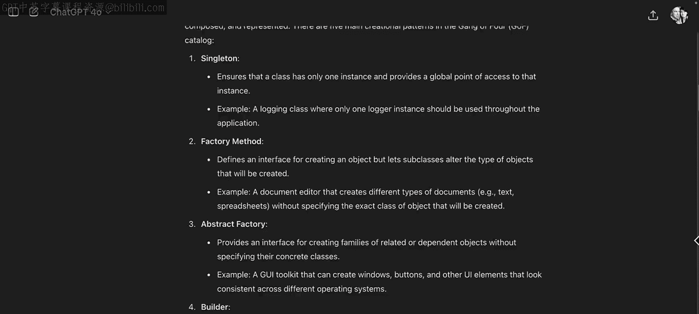
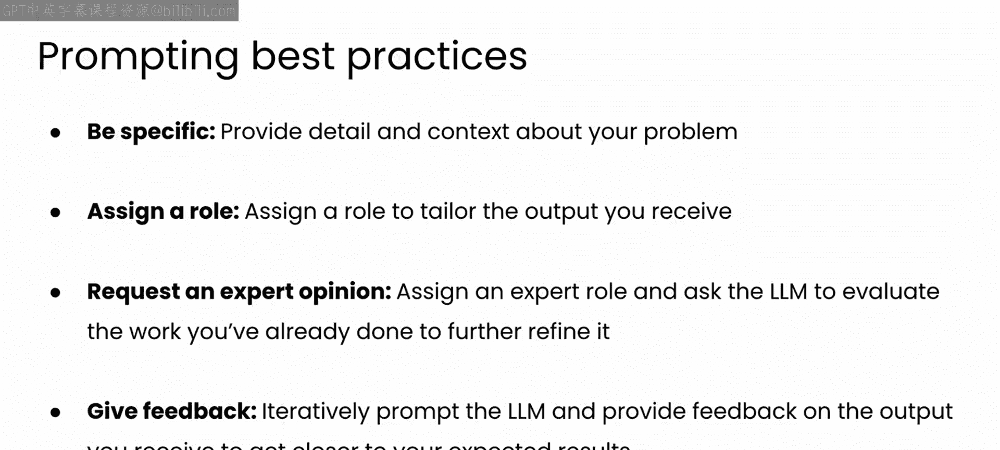

# 吴恩达《软件开发的生成式AI技能（简介、结对编程、数据库设计-3课全）Generative AI for Software Development Skill》 - P68：18_四人帮设计模式概述.zh_en - GPT中英字幕课程资源 - BV1ucxLeUEHD

The Gang of4 design patterns have been hugely influential in the field of software development。

 and while developers like to debate the merits of all of the patterns。

 many of them have been implemented as key features of modern languages like Python and JavaScript。😊。

If you need a high level introduction or refresher to the design patterns。

 LLMs like Chaty PTT are a great starting point。If you ask the model to give you a high level overview of the Gang of4 design patterns。

 it will write a nice summary like this， letting you know about the original book and the G of four authors。

 and then going on to discuss the three main pattern groups that I mentioned in the last video。

 creational， structural and behavioral。 The summary here discusses the three most important patterns in each group。

 But there are actually 23 in total。 And if you brought the model for follow up。

 it will dive into the details。😊。

So let's take a closer look at these three categories。

 they each serve a unique purpose in software architecture。

 and they address specific design challenges and solutions。First we have the creational patterns。

 these are all about instantiation of classes and the way that objects are created from them。

Singletons ensure that classes have only one instance。

 and they enable global access to that instance。The builder pattern separates the construction of an object from its representation。

 allowing the same construction process to produce different representations。

Prototypes specify the kinds of objects to create by using a prototypical instance which can then be copied to create new objects。

Factory methods define interfaces for creating objects。

 but they let subclasses decide which class to instantiate。And lastly。

 abstract factories provide an interface for creating families of related or dependent objects without specifying a concrete class。

Of these， the Singleton and the factory method are probably the most important。

 so you'll take a look at these in more detail in later videos。😊。

The next group are the structural patterns。 These are all about how classes and objects can be composed to form larger structures。

 Strucural patterns facilitate an ease design by identifying a simple way to implement the relationships between different entities。

There are seven of these overall， the adapter， which allows classes with incompatible interfaces to work together by wrapping an interface around an already existing class。

😊，Bridges which decouple an abstraction from implementation so that they can evolve independently。

Composites which compose objects into a tree structure to represent hierarchies and let clients treat individual objects and compositions uniformly。

Decorators add new functionality to objects dynamically by placing them inside special wrapper objects。

Facades provide a simple interface to a large body of code like a class library。

Flyweights minimize memory usage by sharing data as much as possible with other similar objects。

And proxies， which provide a placeholder for another object to control access， reduce cost。

 and therefore reduce complexity。You may recognize some of these patterns， for example。

 the decorator is commonly used in Python， and you may have also seen one such as the adapter and the facade and other code。

Finally， the behavioral patterns focus on algorithms and the assignment of responsibilities between objects。

 these patterns emphasize not only the relationships between objects or their classes。

 but also how communication between objects is handled to achieve complex tasks。😊。

There's actually 11 behavioral patterns， so I'm not going to go over them all。

 be sure to follow up with an LLM if you want a detailed explanation of all of these options。

 but I'll just call out a few of them here。😊，The iterator provides a way to access the elements of an aggregate object sequentially without exposing its underlying representation。

 This pattern informs many of the data types in Python， including lists and dictionaries。😊。

The strategy pattern defines a family of algorithms and it encapsulates each one of them。

 It makes them interchangeable and lets the algorithm vary independently from clients that use it。😊。

And the template method pattern defines the skeleton of an algorithm in an operation。

 but leaves some of the steps to client sub classes。

 You're going to take a closer look at the template method and strategy patterns later in this module。

As you can see， there's a lot here， and not all of it is immediately understandable。

 The key takeaway is that these patterns have evolved over decades of software engineering to address common challenges in object oriented design。

When faced with a problem， it's valuable to consider these patterns as potential solutions。 However。

 their technical nature can be difficult to understand。

 and it makes it challenging to determine when and how to apply them effectively。

 But with an LLM as your partner， you can use many of the techniques that we've discussed in this course。

 such as assigning expert roles and having that ongoing back and forth with the model to help you identify when a pattern may be a good solution to your problem and then to figure out how to implement it in code。

😊。

Before you start pair coding with an LLM， I think it's helpful to start by looking at an implementation of one of these patterns to see how to map from the concept towards functioning code。

 So in the next video， we'll move on to explore the singleingleton pattern。

 which I think is one of the more straightforward of the Gang of 4 patterns to understand。

 I'll see you there。😊。