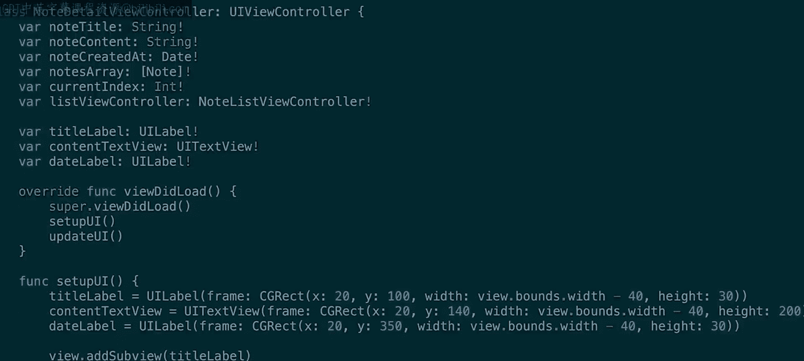
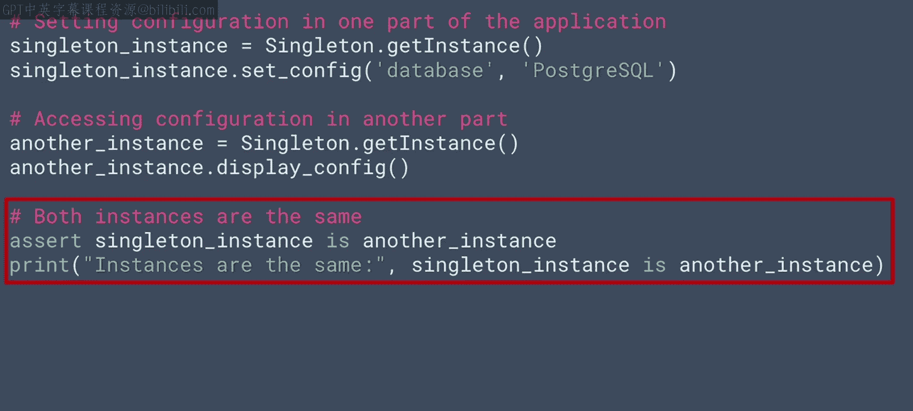
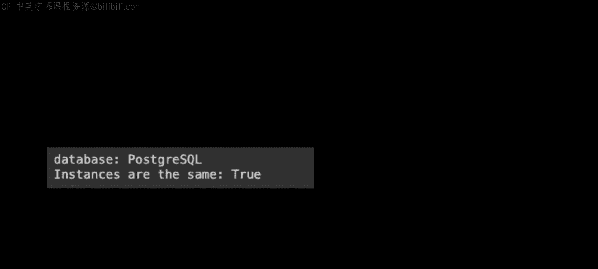

# 吴恩达《软件开发的生成式AI技能（简介、结对编程、数据库设计-3课全）Generative AI for Software Development Skill》 - P69：19_单例模式.zh_en - GPT中英字幕课程资源 - BV1ucxLeUEHD

My first encounter with using the Gang of four design patterns came many years ago when I was working on a mobile application。

Mobile operating systems like iOS or Android are very strict about managing memory and resources。

 If an app consumes too much of them， the system can respond by slowing it down。

 limiting its background activities or even closing it unexpectedly in order to keep the device running smoothly。

 So when designing apps for these operating systems。

 you generally have to be very careful about memory usage。😊。

And if you need to store a large amount of data that must be accessed across different parts of the application。

 things can get tricky。 In my case， I was passing a lot of data between functions in order to maintain the state between different views。

 And my work became spaghetti code really quickly。 What I really needed was some sort of global variable。

 But there was no such functionality when using multiple source files that separate each view and separated the design from the implementation。

 leaving me to do the trick that I just mentioned passing data that maintain state from function to function or view to view。

 Its not efficient。😊。

And then I stumbled across this singleton design pattern。 It's very simple。

 It's a class that can only be instantiated once it then allows you to have data and methods that are accessible to every other class。

 And because there's only one instance of the class。

 the contents of its variables are effectively global and they're not repeated。😊。

It was a perfect solution to my problem。 But back in the day。

 it took me a long time to figure that out。😊，So let's start by implementing a singleton in Python。

 It's actually really straightforward， especially when you've worked with the pattern before。

Here's the code。The key to the singleleton pattern is the underscore instance class variable。

 Initially， it's set to none。😊，Then when the class is iniated。

 the get instance method checks if an instance already exists。 If it doesn't。

 it creates a new one and assigns the new instance to underscore instance。😊。

And if an instance does already exist， then it will return the existing one。😊。

So you can see here that the underscore instance variable serves as a gatekeeper。

 ensuring that only one instance of the Singleton class can ever be created。

Another thing to notice here is that get In is a static method， which is crucial。

 Sta methods can be called directly on the class without needing an instance。

 This allows you to call singleleton do get instance from anywhere in your app。

 ensuring that you will always access the single instance of the singleleton class。😊。

Now the Seelton example here isn't really that useful， it doesn't do anything or hold any data。

 but if you were to add some data to the class instance， well。

 then you'll have a really useful object that can be accessed from anywhere in your application。😊。

A great example of the kind of data a singleleton might hold is configuration variables that may need to be accessed from anywhere in your app。

 so let's take a look at how we can add data to a singleton next。😊，And it's pretty straightforward。

 here's the previous class where a configuration dictionary added to it。😊。

The dictionary is created when the class is initialized。

 and then functions are defined for both writing to and reading from the dictionary。

You can then add one more function that allows us to pass through and read the entire dictionary like this。

Note that this is just a continuation of the same class as we had on the previous slide。Okay。

 so now you have a singleton class where only one instance is allowed。

 So it's great for global functionality。 and it includes some data and some variables。

 as well as some functions。 Now， let's take a look at how we can implement some code that consumes the singleton。

😊，And here's the code。It first creates an instance of the Singleton。

 that you'll call Singleton instance。😊，And then on that instance， you'll call set config。

 passing a key and a value， where the key is database and the value is Postgres SQL。

 and it stores it in the configuration dictionary that you added to the Singleton class。😊。

So now you can check if your singleingleton is working as intended by creating another instance of the Singleton。

 and let's call this one another instance。😊，And if the single tip does work as intended。

 then the return from the display config will be the key value pair of database and Postgres SQL from the first instance。

 because these are actually the same instance， there is only one。

But if you really want to test if they are the same instance and not that one is just a copy of the other。

 you can do an assertion like this and test if they're the same instance。😊。

When running this code in Google Colab， I got this results。

 and we could see that the Singleton is working as intended。

So hopefully， this has helped you get a feel for how a singleton works and how one of those gang of four patterns can be implemented in code。

Okay， the thing with this scenario is that I already knew that the Sleton was a good solution to my problem and that it worked pretty well。

 but what about those 22 other design patterns， some of that might be equally suitable for similar scenarios。

But it can be hard to know if a particular pattern is a good choice for your scenario。

 even if you're an experienced developer， so typically you would have to experiment with different patterns or work alongside someone else who already has expertise or experience in your problem domain and can understand how to apply patterns to it。

😊，But what if you could quickly explore and validate different patterns with the help of an LLL？Well。

 that's the spirit of what you're exploring in this module In the remaining videos in this module。

 you're going to partner with an LLM like Chat GPT to see if you can improve on a coding scenario using some of the other gangang of 4 design patterns and see how using an LLM to implement tested and proven solutions can help you avoid writing bad code。

😊，So let's move on to the next video to look at our first scenario where we're going to build an app for a financial services company。

😊。