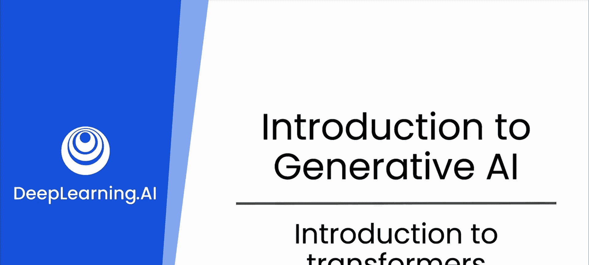
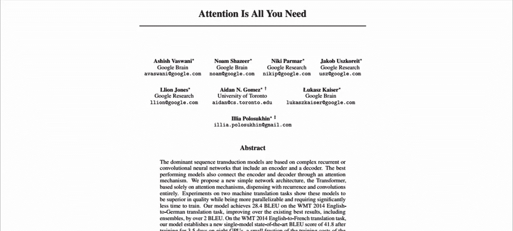
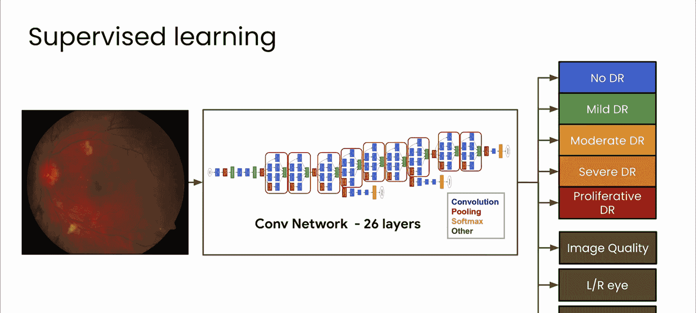
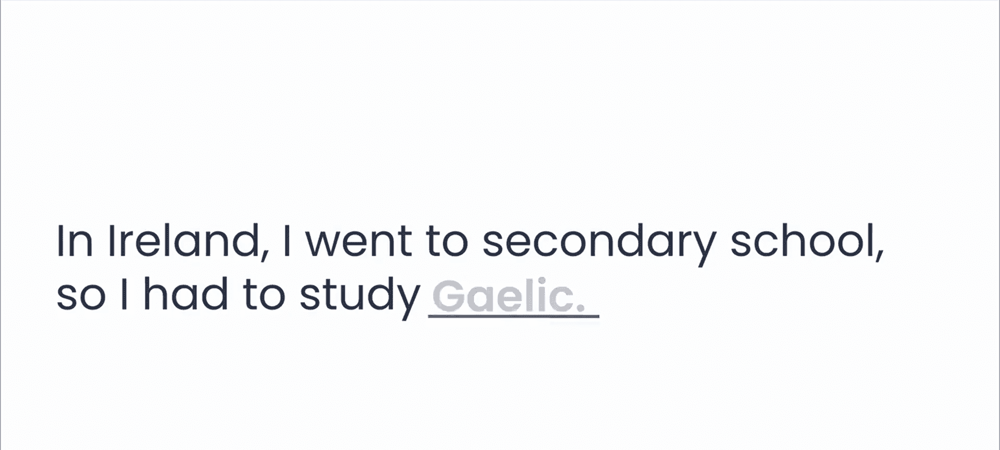

# 吴恩达《软件开发的生成式AI技能（简介、结对编程、数据库设计-3课全）Generative AI for Software Development Skill》 - P6：5_Transformer简介.zh_en - GPT中英字幕课程资源 - BV1ucxLeUEHD

Okay， so now let's dive into the engine room of modern AI， specifically the transformer architecture。

 this revolutionary design has become a game changer for natural language processing。😊。

You'll unpack the basics of how transformers work。 See how they've paved the way for the advanced large language models like G or Gemini that have so quickly captured public attention and started to revolutionize what it looks like to be a software developer。

 First introduced in the paper。 attention is all you need by Vaswani and Al in 2017。

 The Transer model brought a new approach to machine learning models for handling sequences of information like text。

😊。

Earlier you saw how supervised learning worked， a computer learns to predict data that was labeled。

 and a machine learned to match the data to the label。

 like a retina to a doctor's opinion of the state of disease within that retina。

More complex algorithms， such as recurrent neural networks started to learn about the sequences of data。

 Now， this was really useful for models that could predict what would happen next in a system as opposed to predicting what they see。

For text， these could be pretty good， but they were limited in understanding their deep meaning in text。

 The big idea behind transformers is that they process all parts of the data simultaneously。

 This parallel processing capability， not only speeds of training。

 but also improves the ability to handle long range dependencies in text。 Now。

 let's take a look and see what this means。Consider this sentence in Ireland。

 I went to secondary school， so I had to study blank。How would you finish this sentence。

 Let's explore that a little bit。First， secondary school is the equivalent sort of to high school elsewhere。

 So it's for older children studying more advanced things。 And， of course， Ireland is a country。

 so there may be topics that someone would study in Ireland that people in other countries may not。

 which is why I put the emphasis on that country in the sentence instead of just saying。

 I had to study。As a human， you paid attention to those words and the full context of the sentence may lead you to predict that the blank。

 the next token is Irish or Gaelic indicating the language， and you'll be right。

That's what gives the title to the paper that presented Transers。 attention is all you need。 Now。

 the details of transformers are highly technical， and I'm not going to go into all of the specifics here。

 Thatll be a full course in its own right。But there are two key concepts that I think are important for you to know。

 and let's go on to the next video to explore those concepts。

