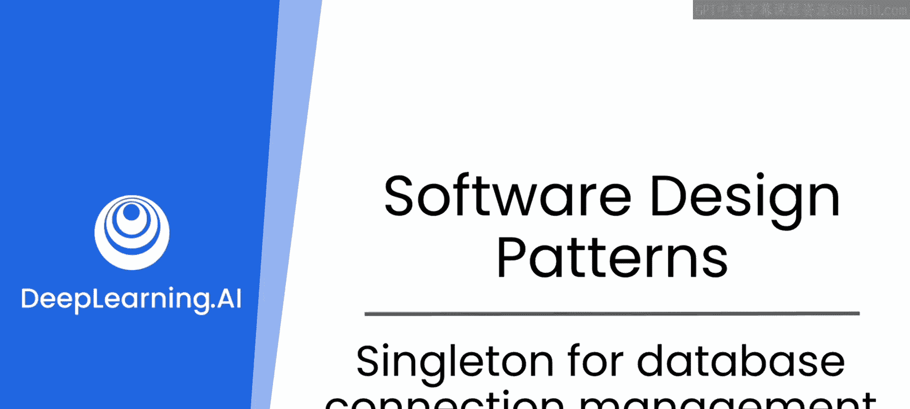
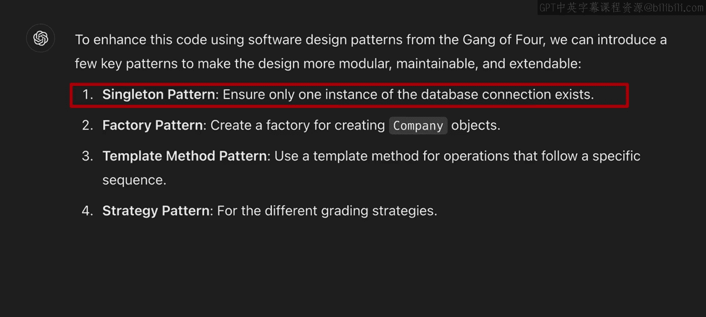
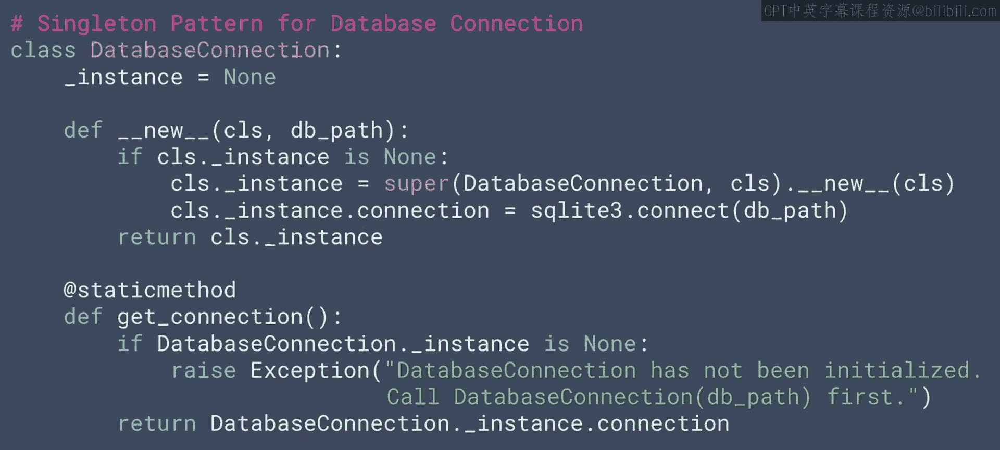
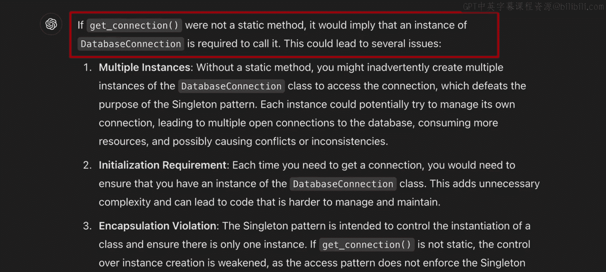
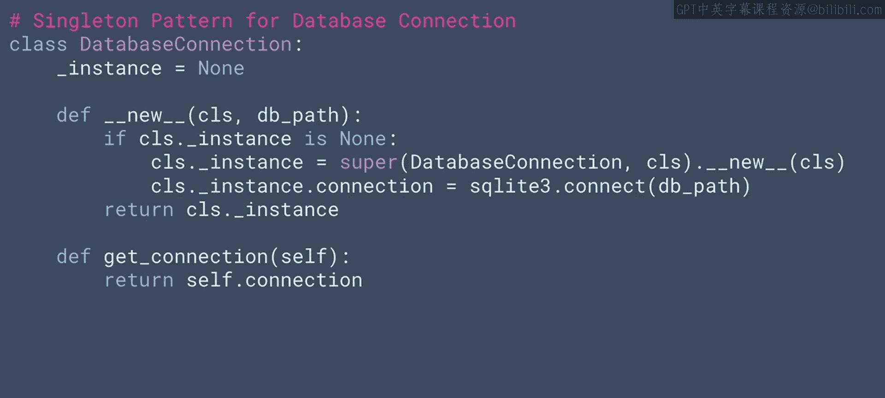
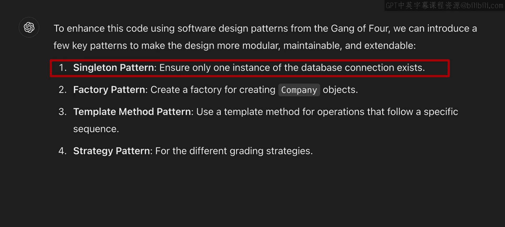
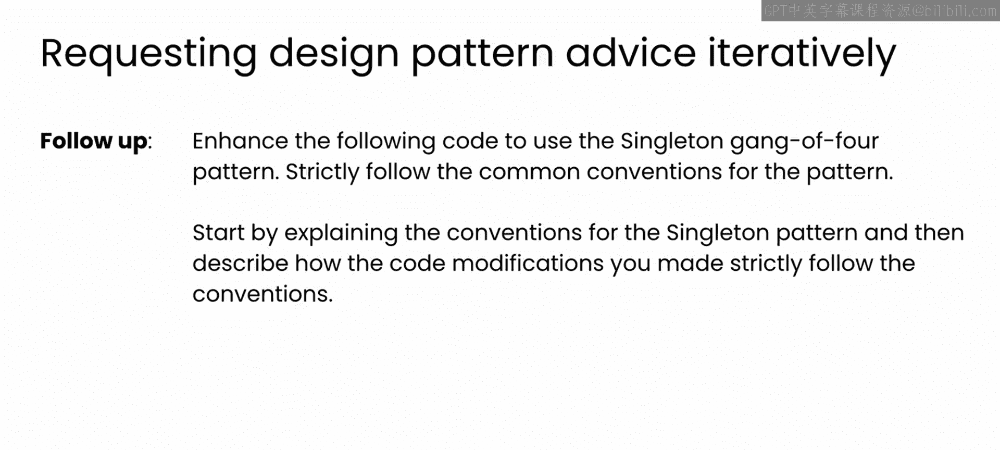
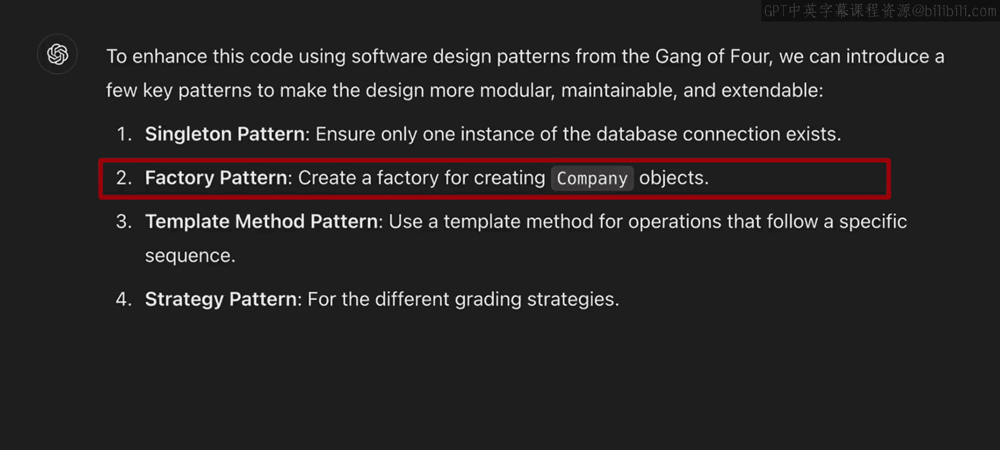

# 吴恩达《软件开发的生成式AI技能（简介、结对编程、数据库设计-3课全）Generative AI for Software Development Skill》 - P71：21_数据库连接管理器的单例模式.zh_en - GPT中英字幕课程资源 - BV1ucxLeUEHD

In the last video， you created a database application to store and interact with company stock price data。

You then asked an LLM to analyze the code and suggest how to improve it using patterns from the famous gang of 4。

The first suggestion was to use a singleton pattern for the database connection。 That way。

 we're always ensuring that we have just a single database connection。 Without it。

 we could end up in scenarios as the code grows that gives us many database connections。😊。

This will obviously save us some resources， but it also reduces our attack surface in case of potential hackers。

 as well as making our code much easier to debug， knowing that everything is channeled through a single connection。

😊，After additional prompting， the LL M then went on to create this code that implements the singleingleton pattern for the database connection。

 And as you can see， this code sets up a new class， a database connection class。

 And this handles the connection to our Sel light database。

 Did you notice anything missing from this code compared to the singleingleton class。

 You explored a few videos ago。 pause a video and check out the code and see if you can identify the missing piece。

😊，There's actually a hallucination in here。 And it's the kind of thing that can give you issues if you' are not careful in exploring the code that's generated for you。

 Did you see it。If not， don't worry， but do be careful in future when generating code。

 Always explore， always interrogate。 The issue was that the get connection method was not set up as a static method。

So the code should be like this。 At this point， you might be wondering， hang on a second。

 We still checked when instantiating the class。 if the instance existed， and if it did。

 we just returned that。 So why does it need to be static。 Well， that's a great question。

 And the answer is very detailed。 But as always， youll always have a trust the L L N by your side。

 So why not just ask it。 And here's a prompt that you could use。😊。

And the answer from GPT will probably be very detailed， and here's the one that I received。

There's some very detailed information in there， so take some time to read it。

 but also take some time to try prompting yourself。But ultimately。

 the lack of a static method will change the API that you use to call the singleleton and that can lead to some confusing code。

It's prompt easier for you to understand this in code， so if you don't use the static method。

 you could easily and inadverttedly write code like this。In this case。

 database connection is a singleton， So Db1 and Db2 are the same instance of the class despite having different names。

 And similarly， con1 and Con2 are the same connection。 There is only one connection。

 but your code would not obviously show that， which could be very confusing。😊，However。

 if you make the class static， your instantiation code would look like this。

 and because there's no name for the database connection， we don't need to say DB1 or DB2。

 it's much more intuitive when we do make a connection to call it con or something like that。

 and it reads less likely to have multiple connections than earlier。😊，Now。

 there's nothing to stop you from doing something like this and having multiple connections。

 But the fact that there's a single abstract class for the connection should make it more obvious that you don't need to do that。

And this is an interesting example， one that shows you the importance of your own expertise as a developer。

 And LL M has knowledge of design patterns， and it does know how to implement them in code。😊。

But like human developers， it does not always stick to the conventional path。

 It can generate code that doesn't strictly follow the pattern that it just told you about。

And if you've worked with Singleton's before or even just from watching this course。

 you may have caught this。

But there is， of course， a little bit of that chicken and egg problem here。

 If you didn't know about the use of static method in the first place。

 how would you know that the L&M actually skipped it。

Getting really specific with your prompts can help you here。 For example。

 you could modify your original prompt asking the LLM to enhance your code by saying。

 enhance the following code to use the gang of four patterns。

Strictly follow the common conventions for any patterns that you might choose。

 Being explicit like that will help guide it to really dig deep into the patterns。When I tried this。

 I did have some mixed results。 In some cases， the coat that was generated followed the conventions。

 but sometimes it didn't。So one thing that can help is to have the LLM first list what those conventions are。

 and then ask it to explain why the code that it wrote follows the conventions。

Here's a modified prompt to implement the Sleton with additional instructions。

 asking it to explain itself。

The code it generated was better， although it still chose a different approach to including aesthetic static method。

 even though it had already mentioned that that's the convention it would follow。In the end。

 it only used the static method when I asked why it hadn't actually done that and used the static method。

 It tried to justify its alternative code， which was very interesting to me。

 but it then went on to use the static method and create a get instance method for me。

So I would encourage you to try instructions like this。

 experiment and continue the conversation with the LM to advance the code。

And wherever you can bring your own knowledge to the table。

 it will always help you steer the LLM to create the right code that you want。

Once you have done exploring the Singleton database connection。

 you'll move on to the second pattern suggestion from the LLM。

 And that was to use the factory pattern for creating company objects。 I don't about you。

 but I think this suggestion is a bit cryptic。 It doesn't explain why it chose this pattern or clearly describe what it does。

 So let's move on to the next video to explore the factory method pattern in more detail。

 Under why the LLM suggested it and then work with the model to implement it in code。😊。

