# 吴恩达《软件开发的生成式AI技能（简介、结对编程、数据库设计-3课全）Generative AI for Software Development Skill》 - P72：22_工厂模式.zh_en - GPT中英字幕课程资源 - BV1ucxLeUEHD

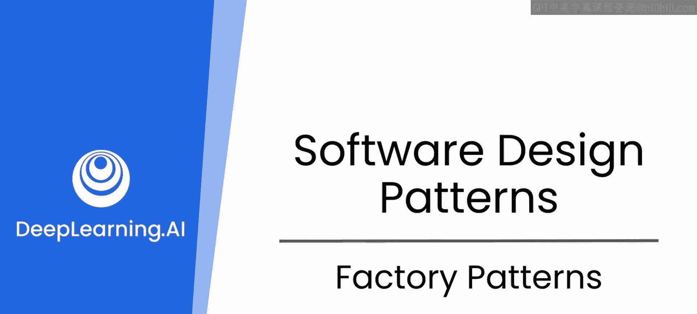

You've been working on a pseudo real world database application to store and interact with data about various companies and their stock prices。

By passing the code to an LLM， you learned that the singleingleton pattern was useful for marshalling the database and ensuring that we only have one connection to it。

The LLM also suggested some other patterns， one of which was the factory pattern。

 and we're going to take a look at that in this video。To get more details about the factory pattern。

 I asked the LLM to explain the factory pattern in detail。

 especially because it wasn't already clear to me that there would be a benefit in using it in this app。

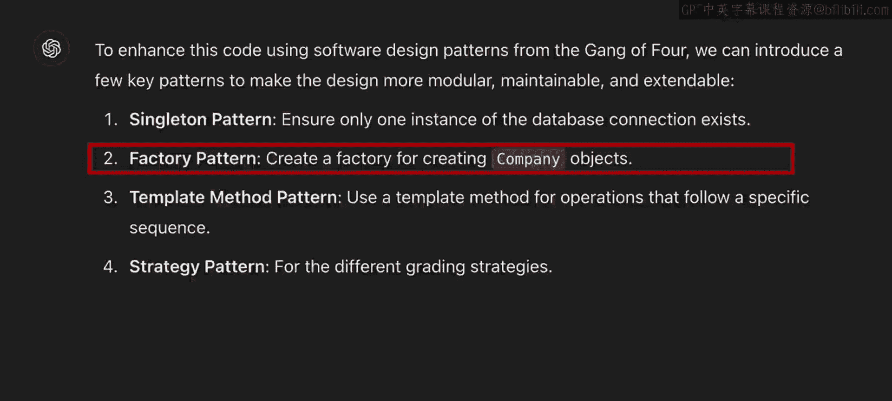

Note that here I was continuing a previous conversation with the LLM。

 so it already had the code and context of what I wanted to learn about。

 which was the gang of four factory patterns for this application。But you could， of course。

 start a new chat if you wanted and then give the code and ask the LL M directly why a factory pattern would improve the company object。

 And then you could ask for some code to help implement those suggestions。 In either case。

 the L L M will give you a detailed reply。 It'll describe the factory pattern as a creational design pattern that provides an interface for creating objects in a superclass。

 but allows subclass to alter the type of objects that will then be created。😊。

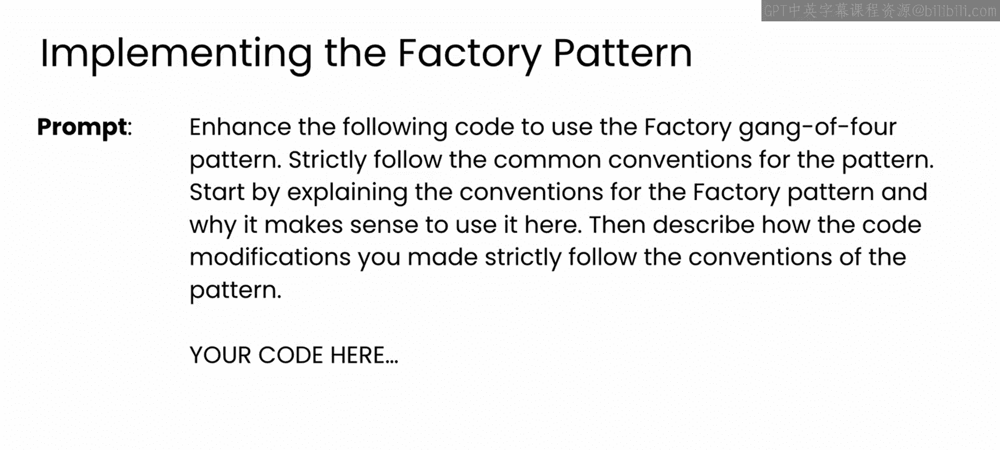

Yeah， that's a pretty jar description。It does go on to state that the main goal of the factory pattern is to decouple the creation of objects from their use。

 That's a bit less jargony， but it's also still quite abstract。 So lastly。

 the LLM will identify that the company object is the part of the code that can be improved with a factory pattern by refactoring it with a factory pattern。

 It will give you some flexibility to create different types of companies。

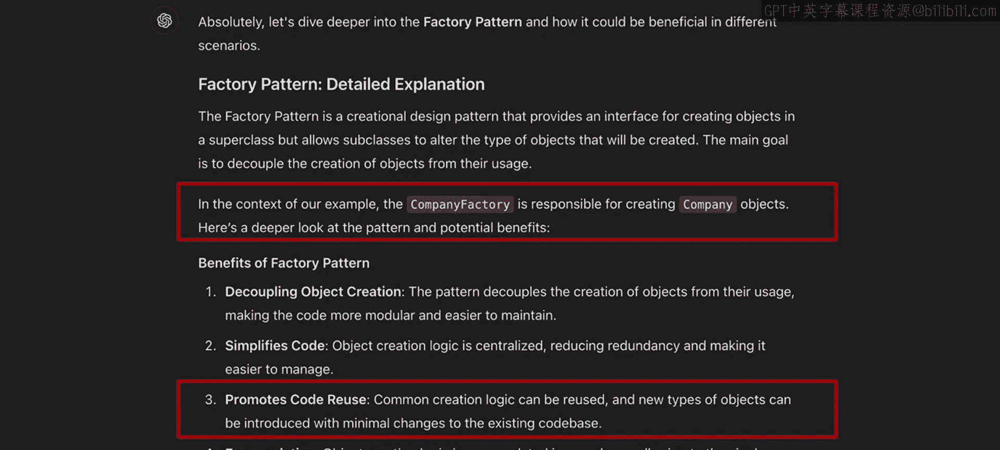

Now， to think through the different types of companies you might want to be able to handle。

 let's start by looking more closely at the current construction of the company object。

The company object in your application has both an ID and a stock ticker to represent it。

 The ID was just the primary key that was used to link the time series database so we could query by I。

And the identifier for the company was the ticker。 And here's the code that's used to synthesize the different companies into the database。

But this structure introduces a constraints that you might not want。

 and that is that companies must have a ticker symbol。

 but what if you wanted to explore other types of company， for example。

 overseas ones that don't actually have a ticker symbol。

The original company object design has some flexibility because has both the I and the ticker properties。

 So a foreign company could have a unique I to identify them。 But because they don't have a ticker。

 the parts of your code base that query companies by ticker won't work for the foreign company。

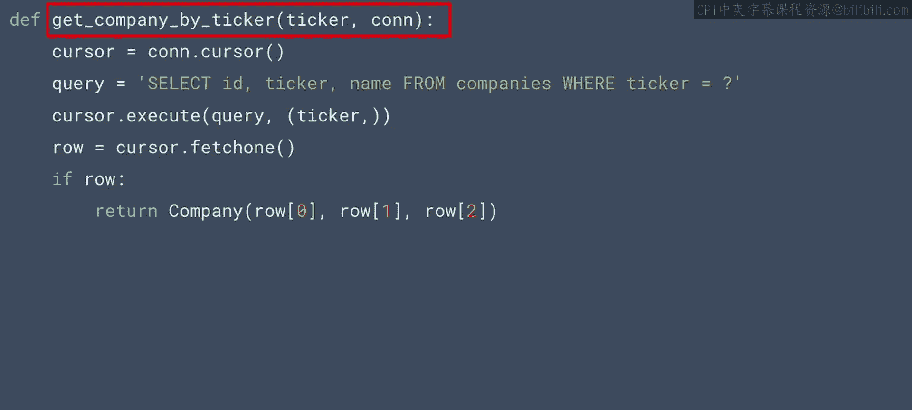

And if you already have a lot of legacy code that identifies domestic companies by their ticker。

 it may not be feasible or desirable to go back and change it all。 So what can you do。

 How do you add this capacity to handle foreign companies without an extensive we architecting of the system。

 In particular， Can you do it without migding the database to an entirely new format。

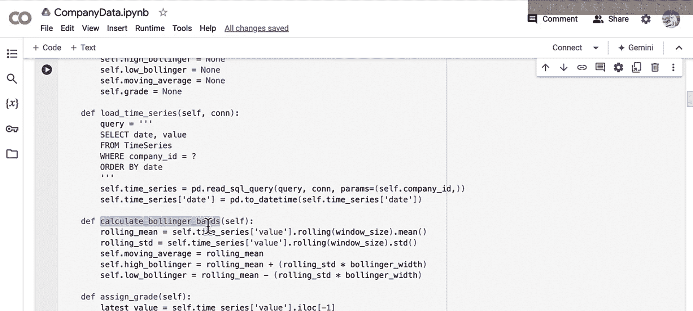

That's what a factory pattern could be。 your friend。

 A factory pattern allows you to build a functionality to handle creation of different types of objects that can share features in common。

 A factory class handles the overall production of the objects。

 much like a real factory and concrete classes pass over specific instructions to make different variations of those objects。

😊。

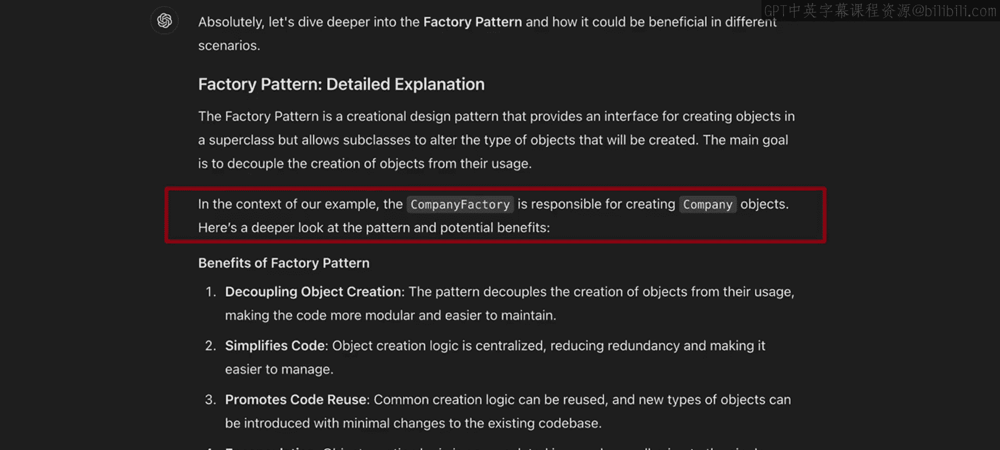

Imagine a car factory that makes three variations of a certain model of vehicle that can differ in upholstery finished stereo options and so on。

The underlying car is the same， it's only the details that are changing。

In the factory design pattern， the concrete classes contain the specific variation details for each version of the car。

 The abstract factory class then implements those specifications on top of the base car object at the moment a request to build a new car is made。

 I think it's much easier to understand what's going on here by looking at some code。

So I asked the LLM to help me write some code that would implement the factory class to help me handle creating two types of company objects。

 foreign and domestic。And here's the more detailed prompt that I use for this。Again。

 note that I was continuing an earlier conversation where I had assigned the LLM the role of an expert in software design patterns。

 particularly those from the Gang of four。If you're starting this in a new chat。

 you'd probably want to assign the role again here and then provide any relevant context from previous chat sessions to your initial prompt。

First， the prompt will ask the LLM to update the database with some foreign companies and then add some data to them。

 I gave some specific instructions about how to handle the ticker field。

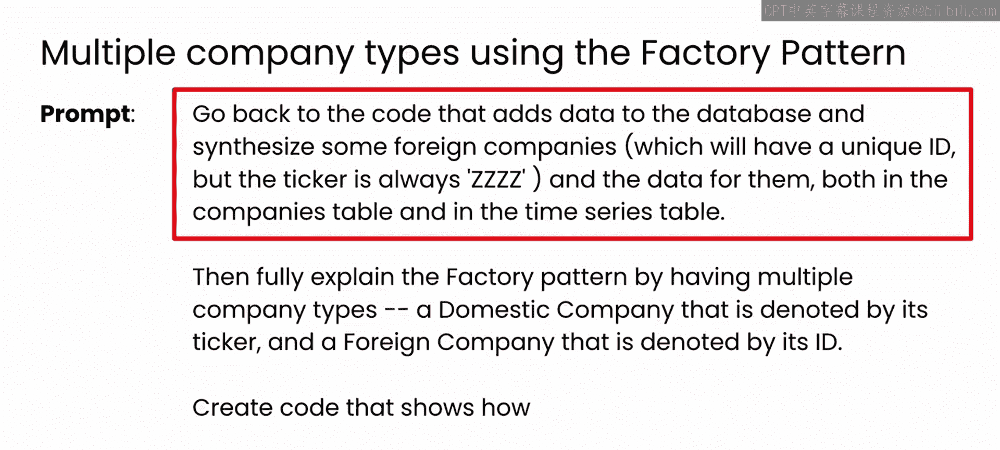

And then the LL M wrote code to create two companies with the identifiers 1001 and 1002。

 And as you can see here， the ticker is the same here for both。

 So finding a company in the database by ticker alone would not work for your existing functionality。

 And this is exactly what the factory pattern can help you deal with。

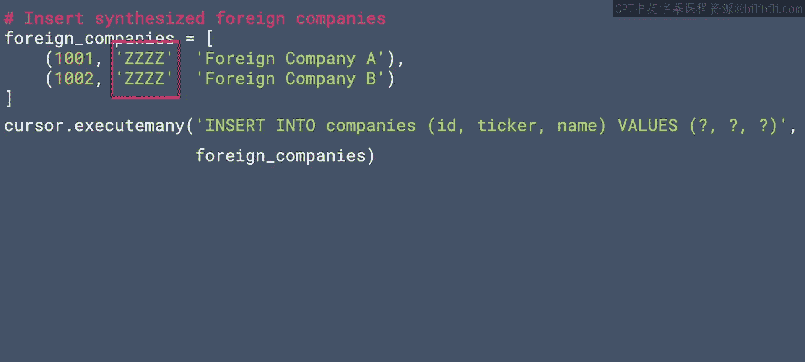

The second half of the prompt was to explain how the factory pattern works to handle multiple company types。

 In this case， a domestic company denoted by its ticker and a foreign one denoted by its I D。

 I also asked the LLM to create the code to implement this pattern at the same time。

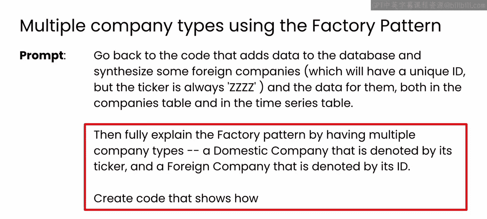

So here's the code for the abstract company factory that includes the interface for creating concrete classes。

 Note that it has a static method， All like the singleingleton。

 and it has a single method get company。 The static method allows you to access the class and work with that method。

 even if the class hasn't been instantiated yet。The L L M also wrote concrete factory classes for creating specific company subclass。

 In this case， domestic companies and foreign companies。

 These are pretty simple subclass that just add a single property company type to the base company object。

 But you can imagine circumstances where you might want to override methods or data in the original company class。

 I'm just keeping it simple for the purpose of this video。

So now when the Gt company method of the company factory is used。

 it gets the instance of the identifier in the database， which will be called with either a ticker。

 which is a string or an ID which is an integer。So if the identifier is a string。

 the query will then be able to pass that parameter with the wear clauses being the ticker。

 which of course will give us a domestic company， so we return a domestic company object。Otherwise。

 the assumption is that you passed in an ID， which in this case it could be either。

 but we can get it to return an instance of the appropriate class。

And now your code gets much simpler because based on the parameter type that you pass in。

 get Company will return a company regardless of the parameter being a ticker or an ID。

 and it should return the appropriate class type。

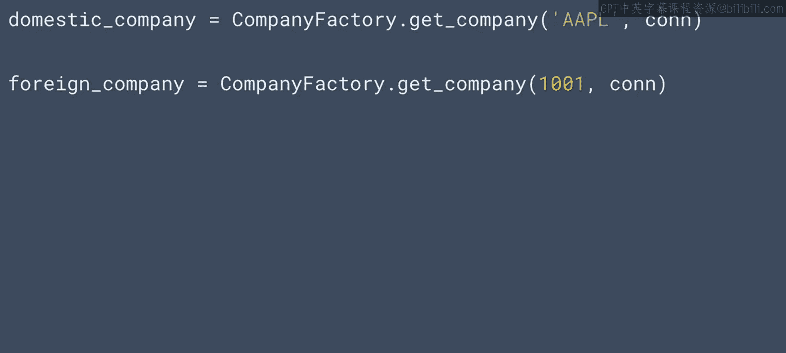

As I noted earlier， there's no great difference in these classes other than the ID or ticker as identifier。

 but for a real world application， there may be different methods that might be used for different company locales。

 and sensible object design， along with the factory can help you abstract that。

So there's a lot of code and detail here。 Take a moment to try it out for yourself using the code that I've provided in the company data notebook。

 and then you can see the factory pattern at work。The notebook actually has both the initial version of the database code for handling this scenario。

 as well as the updated version with the code that implements the singleleton and the factory patterns to improve this application。

 This will let you see the changes that these patterns will give you much more easily。😊。

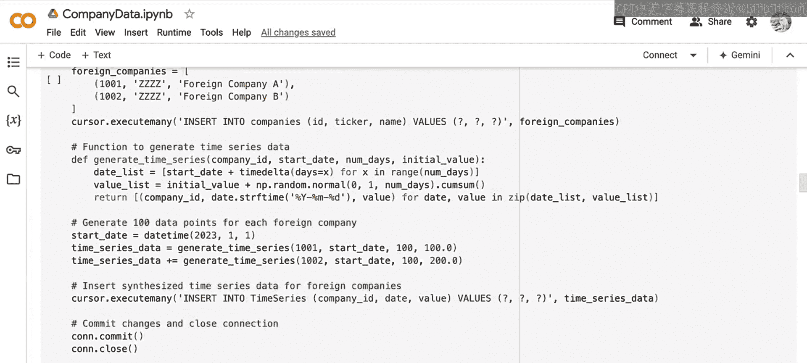

One interesting note， and another example of where using L L Ms can trip you up in coding。

 if you aren't careful， This application uses the word grade to indicate what we think of the current market position of a company。

 and it gives it an ABC grade based on its current price。 As such。

 the company object has a grade property to store this。😊。

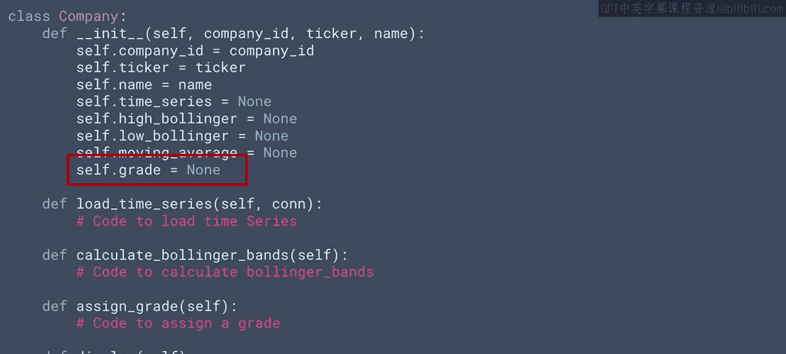

But grade is also a verb。 And when chat GT saw that， it created a method called grade。

 which it then tried to call。 and as such it was failing a lot。

 I had to manually rewrite the code to change this to assign grade to prevent confusion between grade as an action and grade as a result。

 Something to watch out for when you're generating code。

 and you can mitigate this a bit by ensuring any properties that contain data。

 Don't have a name that could either be a noun or a verb like grade。😊。

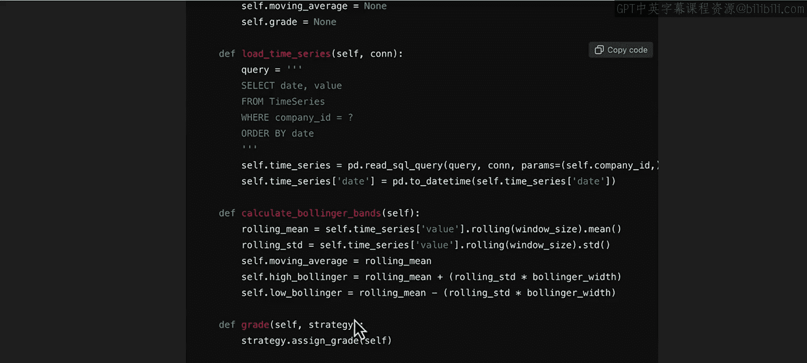

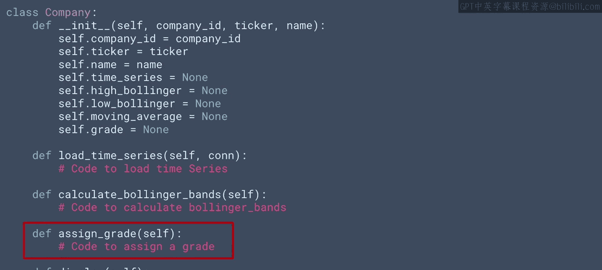

Okay， after looking at and playing with the code， I'm going to encourage you to do a self paced exercise。

 consider a third company type， and it's not really a company， but you can treat it as one。

 A common investment vehicle is a cryptocurrency or other token。

 These don't have closing prices as they're trade at 24 hours a day， So how would you implement that？

 Is there a way to use the current time series database。 So would you need a new one。

 And how would you calculate the boager bands when you don't have daily data， nor that kind of thing。

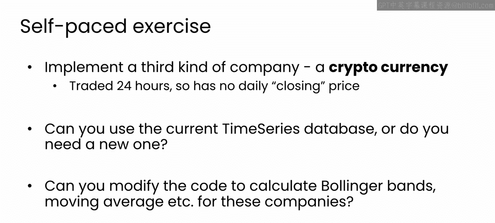

I'm not going to provide the solution for you， but using this code as a starting point。

 it might be fun to extend it to see if you could handle the differences with a cryptocurrency and its company type that might require you to override some methods。

😊，Don't worry if you can't do it yet， but try thinking about it a bit。 In the next video。

 we're going to look at the template design pattern， and that might have some hints。

