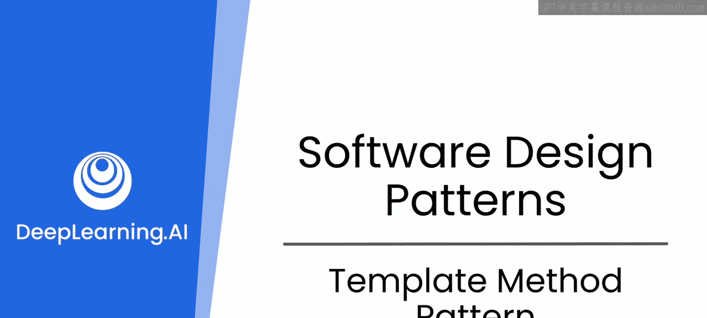
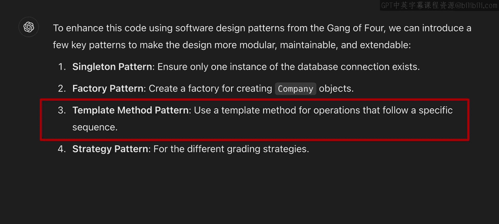
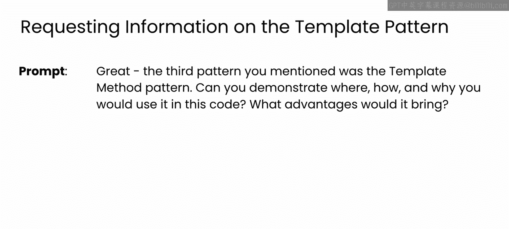
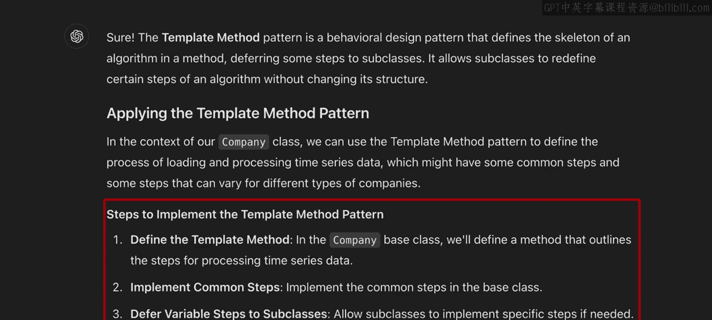
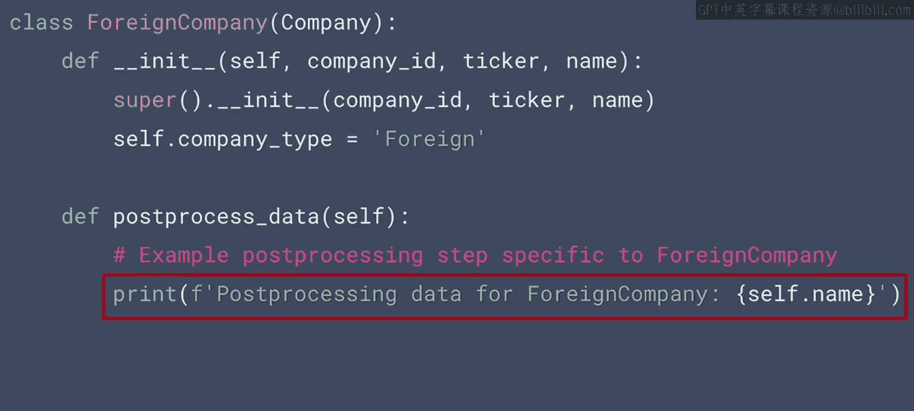
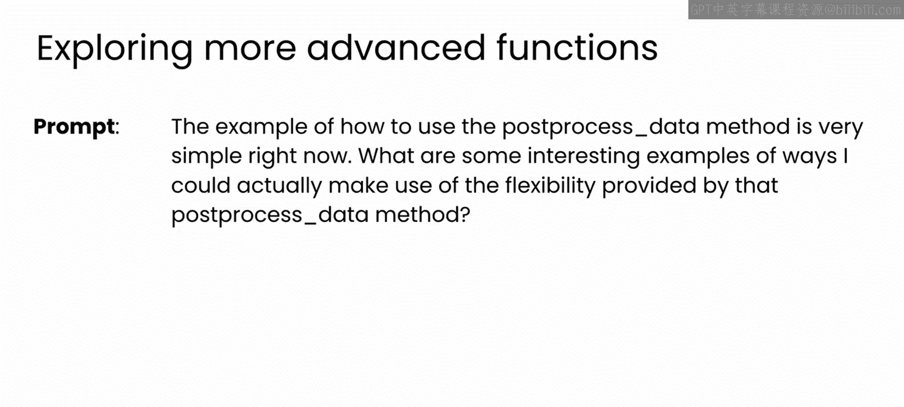
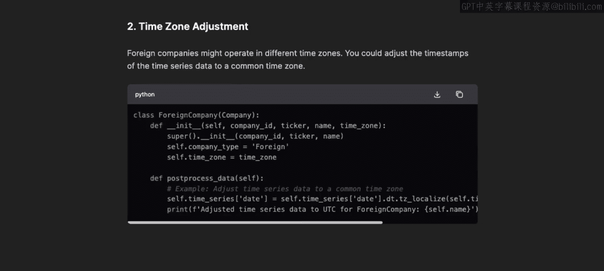

# 吴恩达《软件开发的生成式AI技能（简介、结对编程、数据库设计-3课全）Generative AI for Software Development Skill》 - P73：23_模板方法模式.zh_en - GPT中英字幕课程资源 - BV1ucxLeUEHD

As you've been exploring how to use an LLM as a pair programmer and an expert in design patterns。

 you've built a simulation of a real world application for financial services。😊。

You first improved it with the singleingleton pattern to make sure that our database's connections are more efficient and secure。

And you then improve the design further to give you flexibility around the company types that your application can handle。

Specifically， you implemented a factory pattern that lets you create subclass of the company for foreign or domestic companies。

And this helped you retrieve foreign companies from the database that don't use the ticker ID that domestic companies do。

But another pattern that GP suggested that could give you better flexibility was the template method pattern。

So let's explore how that pattern will work。

All of the code I'm going to show was created by using an LLM。 and you can do the same。

 I simply continued the conversation from earlier， where I put in my original code。

 and I then asked about design patterns that it could use。😊。

So I prompted it like this to ask it to demonstrate the template method and what advantages I may get from using it。

The LL M first responded by explaining the benefits of the pattern。

 It outlines that it's a good pattern to follow when you want to define find a skeleton of an algorithm while allowing sub classes to modify parts of that algorithm without changing the structure。

Next， the LLM explains where to actually apply the approach。

 and here it wants to apply the pattern to the analysis of a company's time series data。

 There's a few general steps that the time series analysis process follows and by using the template method pattern。

 you can allow the subclass， which here would be the domestic and foreign companies to modify those steps。

Finally， it gives a high level description of how to actually implement the pattern。

 So based on that description， you're looking to define a high level process for analyzing a company's time series data and then implement some changes to the subclasses that tweak individual steps in that process。

 So let's take a look at the code that the LLM generated。😊。

First， here is the template method。 It's a pretty straightforward method called process time series。

 and it looks like it has four steps。 Two of these steps look very familiar。

 load time series and calculate bolog bands。 These two methods already exist in your class。

 and they're used to analyze a company's data。For example。

 if you wanted to analyze a domestic company's data。

 you could have written the code like this here you instantiate a domestic company object。

 and in order to get its grade， you would load its time series data， calculate the Boinger bands。

 choose the appropriate grading strategy， grade the data， and then display the results。Remember。

 however， that the template method already would load the time series data and calculate the bologger bands。

 So one immediate simplification from the template method is that it could take these two lines of code and combines them into a single action called process time series。

 And remember that this updated method is available to all subclasses of company。

 be they domestic or foreign。 And if you've tried the self paced exercise from last time。

 it could also be something like a cryptotoken。😊，In order to see where you can get more flexibility from this approach。

 let's have another look at that template method。 Here it is again。

 And as well as having steps to load the time series data and calculate the bologger bands。

 it also has these。 Pre process and post process data。 These are new to the class。

 So let's see how the Aan has actually implemented them。😊，And in the company class。

 the implementation of these methods looks like this。Pretty much nothing in them。That makes sense。

 because the whole idea here is that there are steps in the process that can be overridden by some classes。

A quick note that this pass functionality is Python specific。

 but similar features for letting the subclass implement the method should exist in most languages。

 For example， in Java， you would do it like this by declaring a protected abstract function with no implementation。

Anyway， back to this example at Python， here are the changes the LLM suggested to the foreign company class。

 and you can see that it's overriding that post process data function。😊，In theory。

 there could be some special behavior in here。 but right now。

 it seems that all it does is print a message specifying that a foreign company's data is going through post processing。

Now， it may feel like you did a lot of work to implement this pattern just to enable the printing of a basic message。

 Since the app you're working on here is small and has limited functionality。

 There's only so much for the LLM to work with and adds to the template method pattern。

But let's see if the LLM can walk you through some examples of situations where this pattern would actually be more useful。

So you can ask for some more interesting examples using a prompt like this。

And now， the Ala La is outlining a number of interesting ideas for data post processing that are specific to the foreign company。

 perhaps the companies in the eurozone and the closing prices in euros。

 Or maybe it's in China and the prices in Yuan。If you want to compare with an American company。

 then you might want to post process the data to convert them so that they have equivalent currencies。

The model is also suggesting time zone adjustments。

 which makes total sense for alignning data from one country to another。

 It's even sharing some sample code for how these adjustments could be implemented。 Now。

 these are much more compelling examples of why you would want to use this template method pattern。

 and they could help you determine whether it's worth rearchitecting your app to make use of it。

I think it's important to call out that throughout this example， you as the developer。

 are still driving the process。The L L M suggested a useful pattern。 It described its benefits。

 It showed an example implementation， and it helped brainstorm scenarios where it might prove useful。

As a developer with the full context as to the long term direction of this project， however。

 it will be up to you to decide whether to actually implement it。

So you've now seen three patterns apply to our project， The Singleton。

 the factory and the template method。 There's one more pattern the LLM suggested to you。

 and that's the strategy pattern。 So join me in the next video to explore this final software pattern。

😊。